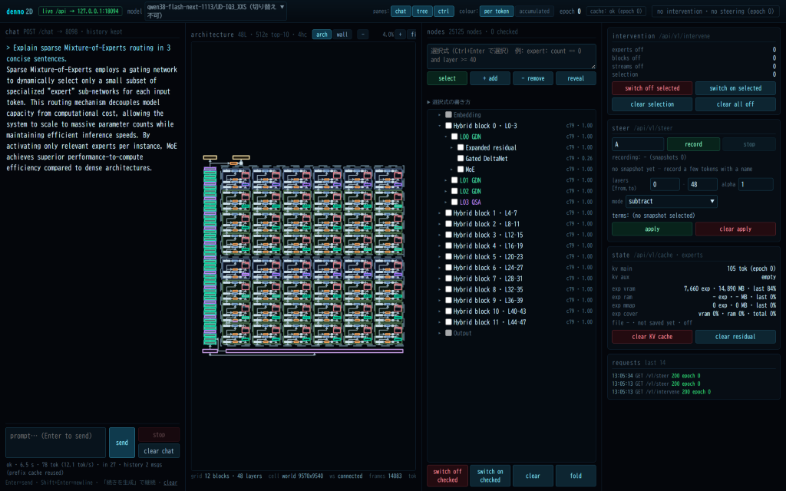

# denno-beta

[](https://github.com/ahinore/denno-beta/actions/workflows/ci.yml)

[English](README.md) | 日本語

Rust で書いた Anthropic Messages API 互換の LLM サーバー。推論カーネルは CPU 版も CUDA 版もすべて自前で書いていて、candle などの既存ライブラリは使っていない。いまの主な対象は **Qwen3.8-Flash-Next**(512 expert のスパース MoE)で、重み 84〜111 GB のモデルを VRAM 32 GB・RAM 64 GB の PC で動かす。

- expert を VRAM → RAM → SSD の順にキャッシュし、router が選んだものだけを引き上げる
- temperature 0 なら同じ入力に対して毎回同じ出力になる(CI で確認している)
- 推論の様子をブラウザで見られるビューア [denno-view](docs/VIEWER.ja.md) がある
- Intel Arc Pro B60 向けの版をブランチ `arc-port` で移植中

## 現時点の性能

`llama-bench` 形式の標準ベンチマーク（プロンプト処理 `pp512` / `pp2048` / `pp8192` と、文脈長 `d0` / `d2048` / `d8192` での 128 トークン生成 `tg128`）を、Qwen3.8-Flash-Next（リビジョン `f5d175de`）に対して `/v1/messages`（`"stream": true`、`temperature: 0`、1 リクエストずつ）で計測した値。全機材で同一の自然言語プロンプトを使い、各回の前に KV プレフィックスキャッシュをフラッシュして `reuse=0` の温まった状態の中央値を取った。`pp` の tok/s は SSE 計測の **TTFT**（`input_tokens / TTFT`）、`tg128` は SSE トークン間隔（**TPOT**）から算出している。

### プロンプト処理 (`pp`) と TTFT

| 機材 | 重み | `pp512` (tok/s / TTFT) | `pp2048` (tok/s / TTFT) | `pp8192` (tok/s / TTFT) | 2 ターン目 KV 再利用 TTFT (2k / 8k) |
|---|---|---|---|---|---|
| RTX 5090 32 GB (`main`) | Q3 (`UD-IQ3_XXS`) | **578 tok/s** (0.89 s) | **1,551 tok/s** (1.32 s) | **2,058 tok/s** (3.98 s) | **0.80 s** / **0.86 s** |
| RTX 5090 32 GB (`main`) | Q4 (`UD-Q4_K_XL`) | 116 tok/s (4.40 s) | 253 tok/s (8.09 s) | 606 tok/s (13.53 s) | 1.07 s / 0.98 s |
| Intel Arc Pro B60 24 GB (`arc-port`) | Q3 (`UD-IQ3_XXS`) | 187 tok/s (2.75 s) | 433 tok/s (4.74 s) | 486 tok/s (16.86 s) | 1.26 s / 1.31 s |

### トークン生成 (`tg128`) と TPOT

| 機材 | 重み | `tg128` @ `d0` (tok/s / TPOT) | `tg128` @ `d2048` (tok/s / TPOT) | `tg128` @ `d8192` (tok/s / TPOT) |
|---|---|---|---|---|
| RTX 5090 32 GB (`main`) | Q3 (`UD-IQ3_XXS`) | **107.5 tok/s** (9.30 ms/tok) | **105.2 tok/s** (9.51 ms/tok) | **98.5 tok/s** (10.16 ms/tok) |
| RTX 5090 32 GB (`main`) | Q4 (`UD-Q4_K_XL`) | 50.0 tok/s (20.0 ms/tok) | 44.9 tok/s (22.3 ms/tok) | 37.6 tok/s (26.6 ms/tok) |
| Intel Arc Pro B60 24 GB (`arc-port`) | Q3 (`UD-IQ3_XXS`) | 17.1 tok/s (58.6 ms/tok) | 17.2 tok/s (58.2 ms/tok) | 13.3 tok/s (75.4 ms/tok) |

- **RTX 5090（`main` `20132ae`）:** Ryzen 7 9800X3D、RAM 64 GB、2026-11-24 計測。
  - Q3 は全条件・全ラウンドで出力 md5 が完全一致し、さらに長い 14k トークン級の prefill では約 2,870 tok/s（4.88 s）に達する。
  - Q4 は 111.3 GB あって 64 GB RAM に収まらないため、冷えた回は SSD 読込が入る一方、キャッシュが温まった回では生成 62〜73 tok/s・`pp8192` 約 816 tok/s まで伸びる。
- **Intel Arc Pro B60（`arc-port` `451c7f3c1`）:** Ryzen 7 8700G、RAM 64 GB、2026-11-24 計測（`DEVICE_LOST = 0`）。
  - VRAM 24 GB のうち expert キャッシュに使える枠は約 12.5 GB（約 6,464 本）のため、128 トークン連続生成では VRAM ヒット率が約 91%（58.6 ms/tok）となる。40 トークン前後の短い応答ではキャッシュ内に収まり約 33.6 ms/tok（約 30 tok/s）が出る。
  - `tg128 @ d0` の 128 トークン出力 md5（`03d236ba9edc`）は RTX 5090 Q3 と 1 ビットの違いもなく完全一致する。
- **RTX 3080 10 GB（旧条件の参考値、2026-11-18）:** Core i9-13900K、RAM 64 GB、Windows 11 WSL2 上の Docker、Q3（`UD-IQ3_XXS`）の別々設定での最速値：短い生成 8.6 tok/s（116 ms/tok）、prefill 3,826 tok 9.4 s、14,018 tok 27.3 s（下の「VRAM が少ない GPU」を参照）。
- 段ごとの内訳と以前の計測は [docs/DETAILS.ja.md](docs/DETAILS.ja.md) にある。

## 使い方

### 1. 重みを取る

[`unsloth/Qwen3.8-Flash-Next-GGUF`](https://huggingface.co/unsloth/Qwen3.8-Flash-Next-GGUF) の 2026-11-13 版(リビジョン `f5d175de`)を使う。ログインは要らない。

| 重み | 大きさ | 必要な RAM の目安 |
|---|---|---|
| Q3: `UD-IQ3_XXS`(既定) | 83.6 GB | 64 GB |
| Q4: `UD-Q4_K_XL` | 111.3 GB | 64 GB でも動くが、RAM が多いほど速い |

```bash
pip install -U huggingface_hub
hf download unsloth/Qwen3.8-Flash-Next-GGUF \
  --revision f5d175de2cf7f720d45d6064019a81fcf056e986 \
  --include "UD-IQ3_XXS/*" --local-dir ~/models/qwen38-flash-next-1113
```

Q4 を取るときは `--include "UD-Q4_K_XL/*"` に替える。`--dir` はフォルダ内の `*.gguf` を全部読むので、重みは 1 フォルダに 1 種類だけ置く。

### 2. ビルドして起動する

```bash
cargo build --release --features cuda -p denno-cli -p denno-engine

DENNO_CUDA=1 DENNO_PREFILL_BATCH=1 DENNO_PREFILL_BATCH_CHUNK=512 DENNO_STRIP_TOOLS=1 \
DENNO_START_PREFETCH=1 DENNO_GPU_WEIGHT_MB=12000 \
DENNO_EXPERT_GPU=0 DENNO_EXPERT_BATCH=1 DENNO_EXPERT_IQ_GPU=1 \
DENNO_EXPERT_VRAM_MB=22000 DENNO_EXPERT_GPU_MIN_HIT=0 \
DENNO_GEMV_V3=1 DENNO_MIX_GPU=1 DENNO_ROUTER_GPU=1 \
DENNO_MOE_BATCH_PTX=crates/denno-engine/kernels/kernels_moe_batch.ptx \
./target/release/denno serve-flash \
  --dir ~/models/qwen38-flash-next-1113/UD-IQ3_XXS \
  --port 8098 --max-ctx 65536 --max-tokens 4096
```

- 上の性能表の RTX 5090(VRAM 32 GB)の設定。
- Q4 では `--dir` を `UD-Q4_K_XL` に替え、`DENNO_START_PREFETCH=0` にする。

### 3. 呼び出す

```bash
curl http://127.0.0.1:8098/v1/messages \
  -H "content-type: application/json" \
  -d '{"model":"qwen3.8-flash-next","max_tokens":256,
       "messages":[{"role":"user","content":"1+1は?"}]}'
```

```python
import anthropic
c = anthropic.Anthropic(base_url="http://127.0.0.1:8098", api_key="sk-test")
print(c.messages.create(model="qwen3.8-flash-next", max_tokens=256,
      messages=[{"role":"user","content":"こんにちは"}]).content[0].text)
```

- `"stream": true` にすると SSE で返る。ほかに `GET /v1/models`、`GET /health` がある。
- `/v1/chat/completions` はまだ無い。
- リクエストは 1 本ずつ処理する。続きの会話は前回の KV キャッシュを使い回すので、RTX 5090 Q3 では 2k〜8k 文脈でも応答開始まで約 0.8 s しかかからない。

### 4. 2D ビューア（`denno-view`）で推論を見る・介入する



`serve-flash` はテレメトリ既定 ON（活性値と構成図をすべて流す場合は起動時に `DENNO_TELEMETRY_ACT=1 DENNO_TELEMETRY_ARCH=1` を付ける）。別ターミナルで `denno-view` を起動し、ブラウザで `/2d` を開く。

```bash
VIEW_UPSTREAM=ws://127.0.0.1:8098/v1/telemetry/ws \
  cargo run --release -p denno-view
# ブラウザで http://localhost:8093/2d を開く（3D は /3d、ダッシュボードは /）
```

- **チャット（左）:** `/chat` 経由でサーバーへ中継する内蔵チャット（CORS 設定不要）。会話を流しながら右側の構成図がリアルタイムに光る。
- **構成図（中央）:** Qwen3.8-Flash-Next の 48 層・12 Hybrid block・4 残差ストリーム・GDN/QSA・router・512 expert を実構造どおりに配置。ホイールで拡大縮小、ドラッグで移動、ダブルクリックで寄る、`0` で全体表示、クリック / Shift+ドラッグで選択（`wall` で従来の層タイル表示）。
- **ノードツリーと選択式（中右）:** `Hybrid block → 層 → residual / mixer / MoE → expert` のツリーや選択式で対象を絞り込める。
  ```text
  expert: count == 0 and layer >= 40
  expert: rate > 0.05 | top 5 by count per layer
  ```
- **介入・ステアリング・状態（右）:** 選んだ expert やブロックを推論中に `switch off / on` で切り替える介入（`/v1/intervene`）、活性スナップショットの記録・適用によるステアリング（`/v1/steer`）、KV キャッシュと VRAM 上の expert 常駐状況の確認ができる。選択式の全仕様や 3D ビュー（`/3d`）は [docs/VIEWER.ja.md](docs/VIEWER.ja.md) を参照。

### VRAM が少ない GPU(RTX 3080 10 GB の例)

- `crates/denno-engine/kernels/build_ptx.sh` の `compute_90` を自分の GPU の値(3080 なら `compute_86`)に替えて PTX を作り直す。
- `DENNO_GPU_WEIGHT_MB=5000`、`DENNO_EXPERT_GPU_MIN_HIT=0`、`RAYON_NUM_THREADS=8` にする。13900K では 24 スレッドにすると遅くなった。
- 生成を優先するなら expert は CPU に置いたまま(`DENNO_EXPERT_IQ_GPU` を付けない)にする。
- prefill を優先するなら `DENNO_EXPERT_IQ_GPU=1`、`DENNO_EXPERT_VRAM_MB=800`〜`1500` にする。

環境変数の一覧と、ほかのモデル(GPT-2、Qwen2.5、Qwen3.5-27B)を動かす `serve` の使い方は [docs/DETAILS.ja.md](docs/DETAILS.ja.md) にある。

## ドキュメント

- [詳細](docs/DETAILS.ja.md) — モデル構成、段ごとの内訳、環境変数、ほかのモデル
- [denno-view](docs/VIEWER.ja.md) — 可視化の起動、3D と 2D のビュー、テレメトリのフレーム
- [アーキテクチャ解説](docs/ARCHITECTURE.ja.md)、[数値方針](docs/NUMERIC_POLICY.ja.md)
- [開発史](docs/history/README.md)、[タスクと計測の手順](docs/TASKS.md)、[API 仕様](docs/api.md)

## ライセンス

コードは MIT または Apache License 2.0([LICENSE-MIT](LICENSE-MIT) / [LICENSE-APACHE](LICENSE-APACHE))。

重みはこのリポジトリに含めず、それぞれのライセンスに従う。Qwen3.8-Flash-Next は [Qwen Community License 1.0](https://huggingface.co/Qwen/Qwen3.8-Flash-Next/blob/main/LICENSE) で、複製を渡すときは重みに同梱の `LICENSE` も一緒に渡す。参照した実装の出典は [docs/history/80_licenses.md](docs/history/80_licenses.md) にある(k-quant の形式と GDN の数式は llama.cpp、構成は Qwen のモデル実装と [TensorFold](https://github.com/ashhart/TensorFold))。
