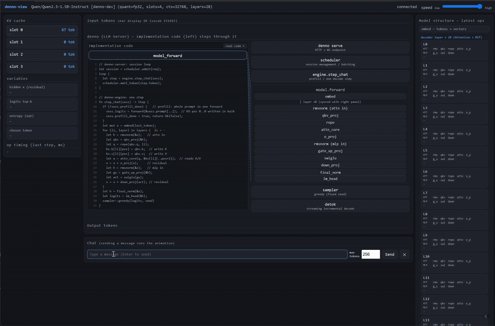

# denno-beta

[](https://github.com/ahinore/denno-beta/actions/workflows/ci.yml)

English | [日本語](README.ja.md)

An Anthropic Messages API–compatible LLM server written in Rust.
The goal is to understand how LLMs work (tokenization → forward pass → sampling → decode loop) through code, so the **inference kernel is implemented entirely from scratch** — no existing LLM libraries such as candle. Structural reference: [ashhart/TensorFold](https://github.com/ashhart/TensorFold).

- **Single binary** `denno` — CLI (`pull` / `models` / `info` / `generate` / `serve` / `serve-flash`), axum HTTP server, inference engine. CPU only by default; a `--features cuda` build adds hand-written CUDA kernels.
- **Models**
  - GPT-2 124M
  - Llama family (RMSNorm + RoPE + SwiGLU + GQA): Qwen2.5-0.5B–7B-Instruct, Qwen3-0.6B (QK-Norm, thinking mode)
  - Qwen3.5-27B (Gated DeltaNet hybrid, loaded from GGUF, Q4_0)
  - **Qwen3.8-Flash-Next** (arch `qwen4exp`) — sparse MoE; its own serving path, `serve-flash`
- **Exact decoding**: fixed seed + temperature 0 → bit-identical output for the same input, kept intact across every optimization (continuous batching, SIMD, CUDA), enforced by exactness tests in CI.
- **CUDA offload**: decode and prefill both run on hand-written kernels with weights / KV / hidden states resident in VRAM. Numerical contract: linear layers, rope, rmsnorm and swiglu are bit-identical to CPU; only attention has an approved relaxation window ([Architecture §8](docs/ARCHITECTURE.en.md), [numeric policy](docs/NUMERIC_POLICY.en.md)).
- Continuous batching (multiple sessions in one forward, KV slot pool), prefix cache (largest-LCP selection, with GDN state snapshots), int8 quantisation for the 27B path, repetition / frequency / presence penalties, no-repeat n-gram.
- **Expert tiering** (Flash-Next): each of the 512 experts is cached in VRAM, then RAM, then read from the GGUF on SSD; the router's top-10 per layer pulls the ones it needs back up. Every tier has a budget, so the model runs inside a VRAM limit far smaller than its 104 GB of weights.
- **Inference telemetry + viewer**: telemetry that never makes inference wait (`DENNO_TELEMETRY=1`, off by default, read-only) and a separate `denno-view` server with a 2D dashboard (`/`) and a 3D view (`/3d`) of the real layer structure.

## Qwen3.8-Flash-Next at a glance

Values read from the GGUF header, not from the model card:

| Item | Value |
|---|---|
| Layers | 48 — **12 full attention (QSA, `(il+1) % 4 == 0`) + 36 GDN**, `full_attention_interval = 4` |
| Experts | 512 per layer, **top-10** selected per token, plus a shared expert |
| Widths | hidden 2560, expert FFN 640, context 262144 |
| Attention | 24 query heads / 2 KV heads, head dim 256; indexer 4 heads x 128 |
| PLE | n-gram embedding layer at **layer index 1 only** (one injection per token): 16 heads = (ngram 3 − 1) × 8, 16 tables, about 28.8 GB kept on SSD |
| Weights | UD-Q4_K_XL split GGUF, about 104 GB — gate/up experts Q4_K, down experts Q5_1, attention / ssm / shared Q8_0 |

`serve-flash` keeps the dense weights resident and treats the experts as a cache. The serving path is deliberately minimal: `/v1/messages` only (`/v1/chat/completions` is not implemented), one request at a time, with a prefix cache that reuses the longest shared prefix — continuing an 805-token conversation drops from 204.7 s to 5.7 s.

## Measured

Wall clock on a single consumer GPU, one request at a time. The first run of any process pays the weight upload and is discarded; figures are medians of alternating A/B runs and are always quoted together with the output-hash anchors.

| Model | Prefill | Decode |
|---|---|---|
| Qwen3.5-27B, Q4_0 | 9.24 s @ 16k ctx / 38.03 s @ 65k ctx | 17.3 ms/token |
| Qwen3.8-Flash-Next, UD-Q4_K_XL | 29 ms/token @ 706 tok | 191 ms/token @ 706 tok (150 ms/token on a 38-token run) |
| Qwen3.5-9B, int8 | 13.18 s / 431 tok/s (5,686 tok) | 16.4 ms/token |

Where Flash-Next decode time goes (49 input + 128 output tokens, 193.9 ms/token): selected experts 71.9 ms (37 %) / attention 62.2 ms (32 %) / mix 31.8 / router 17.0 / shared expert 10.9. Per layer, decode costs 4.04 ms against 0.61 ms of prefill — a 6.6× amplification, which is where the fixed cost of a GEMV-shaped batch lives.

Older numbers, rejected experiments and the protocol that defines "official" live in [docs/TASKS.md](docs/TASKS.md) and the [development history](docs/history/en/README.md).

## Usage (Qwen example)

```bash
# 1. download the model (into the HF hub cache ~/.cache/denno/hub)
cargo run --release -- pull Qwen/Qwen2.5-0.5B-Instruct

# 2. start the server (fixed seed for exact decoding)
cargo run --release -- serve Qwen/Qwen2.5-0.5B-Instruct --name denno --port 8080 --seed 42

# 3. call the API (Anthropic Messages format)
curl http://127.0.0.1:8080/v1/messages \
  -H "content-type: application/json" \
  -d '{"model":"denno","max_tokens":128,
       "messages":[{"role":"user","content":"1+1=?"}]}'
```

Generate directly from the CLI:

```bash
cargo run --release -- generate Qwen/Qwen2.5-0.5B-Instruct --prompt "1+1=?" --temperature 0 --seed 42
cargo run --release -- generate openai-community/gpt2 --prompt "The capital of France is" --raw --seed 42
```

It also works as-is with the official Anthropic Python SDK:

```python
import anthropic
c = anthropic.Anthropic(base_url="http://127.0.0.1:8080", api_key="sk-test")
print(c.messages.create(model="denno", max_tokens=128,
      messages=[{"role":"user","content":"Hello"}]).content[0].text)
```

### Flash-Next

```bash
# --dir points at the directory holding the split GGUF shards
DENNO_CUDA=1 cargo run --release --features cuda -- \
  serve-flash --dir /models/Qwen3.8-Flash-Next/UD-Q4_K_XL \
              --port 8098 --max-ctx 65536 --max-tokens 1024
```

The request format is the same `/v1/messages`; only the model id differs. Environment knobs that matter in practice:

| Variable | Effect |
|---|---|
| `DENNO_CUDA=1` | enable the GPU path |
| `DENNO_PREFILL_BATCH=1`, `DENNO_PREFILL_BATCH_CHUNK=512` | batched GPU GEMM for prefill (chunk default 8; 512 measured best, above 1024 regresses) |
| `DENNO_GPU_WEIGHT_MB`, `DENNO_EXPERT_VRAM_MB` | VRAM budget for dense weights and for the expert cache |
| `DENNO_EXPERT_GPU=1`, `DENNO_EXPERT_BATCH=1` | place / batch the selected experts on the GPU |
| `DENNO_STRIP_TOOLS=1` | drop the `tools` definitions from the prompt (a 40-tool request costs 6,979 prompt tokens, or 842 without them) |
| `DENNO_TELEMETRY`, `DENNO_TELEMETRY_ACT=1`, `DENNO_TELEMETRY_ARCH=1` | telemetry (on by default here; `0` disables) / per-layer activation / structure frames |

## Starting the visualization (denno-view)

```bash
# 1. start the server with telemetry on (same command plus DENNO_TELEMETRY=1)
DENNO_TELEMETRY=1 cargo run --release -- serve Qwen/Qwen2.5-0.5B-Instruct --name denno --port 8080 --seed 42

# 2. in another terminal, start denno-view
#    (defaults to the telemetry WS at ws://127.0.0.1:8080, listens on :8093)
VIEW_TOKENIZER=~/.cache/denno/hub/models--Qwen--Qwen2.5-0.5B-Instruct/tokenizer.json \
  cargo run --release -p denno-view

# 3. open http://localhost:8093/ for the dashboard, or /3d for the 3D view
```

**Demo** — while the built-in chat generates, the model-driven program steps through the implementation code and the layer / KV / variable panels animate in sync:



The 3D view (`/3d`) is built from the model's real topology rather than an illustration: 48 layers along Z, each with its mixer (12 QSA / 36 GDN), router, 512 experts laid out 32x16, shared expert and GR read/write, with a hybrid-block frame every 4 layers. Experts sit at the height of the tier that currently holds them (VRAM / RAM / SSD) and move between tiers as the router selects them; the KV band shows prefix-cache reuse, the prompt tokens, and the decode read position; the prediction head shows the real top-8 candidates from the sampler, and the chosen token flies back to the chat box. Keys: `f` toggles a quaternion-based free-flight mode (WASD + mouse, Shift to accelerate, Q/E up/down, Esc back to orbit).

`denno-view` environment variables: `VIEW_UPSTREAM` (default `ws://127.0.0.1:8080/v1/telemetry/ws`), `VIEW_PORT` (default 8093), `VIEW_RECORD` (append frames to a file), `VIEW_REPLAY` (serve a recording at `/replay`), `VIEW_CAPTURE` (serve a captured frame stream at `/capture.bin`), `VIEW_TOKENIZER` (tokenizer.json for token text). Its `/chat` endpoint proxies to the upstream server, so the built-in chat box needs no CORS setup.

## Telemetry frames

`DNTL` magic, 1-byte version, 1-byte kind, then a varint-packed payload. Kind numbers are stable across branches; retired numbers are not reused.

| Kind | Frame | Meaning |
|---|---|---|
| 1 | `ServerInfo` | model id, quant, slots, context, layers |
| 2 / 3 | `SessionAdmit` / `SessionDone` | KV slot install / release |
| 4 | `Prefill` | one prefill forward: token count, ns, **the prompt token ids** |
| 5 | `Token` | one decoded token (id + position) |
| 6 | `Step` | one batched decode forward (width, ns) |
| 7 | `OpSummary` | accumulated ns per op |
| 8 | `KvUsage` | per-slot KV usage |
| 9 | `Gap` | frames dropped because a subscriber fell behind |
| 10 | `TopK` | sampler top-8 (probability as f16 bits), chosen token, entropy |
| 11 | `LayerRun` | ops executed inside one layer, in order |
| 12 | `LayerAct` | residual-stream activation: the abs-value top-K neuron indices per layer |
| 13 | `RoleAct` | per-role RMS (attn / gdn / router / shared expert / PLE) |
| 14 | `ExpertResidency` | which experts of a layer are in VRAM |
| 15 | `TierStats` | VRAM / RAM / SSD occupancy, 1 Hz |
| 16 | `RouterTopK` | the experts the router actually picked, with gate weights |

Everything is sent on a channel that drops rather than blocks, so a slow viewer can never slow inference down.

## Documentation

- [Architecture (English)](docs/ARCHITECTURE.en.md) / [アーキテクチャ解説(日本語)](docs/ARCHITECTURE.ja.md) — design principles, inference flow, KV cache, compute kernels, model differences, visualization architecture
- [Development history](docs/history/en/README.md) (English) / [日本語](docs/history/README.md) — eight volumes plus an index: bootstrap, API features, models, decode performance, prefill performance, GDN, output quality, measurement & verification, with measured numbers and the approaches that were rejected
- [Tasks and measurement protocol](docs/TASKS.md), [KPI definitions](docs/KPI.md)
- [API spec](docs/api.md)

## License

Code: dual licensed under MIT or Apache License 2.0 — see [LICENSE-MIT](LICENSE-MIT) / [LICENSE-APACHE](LICENSE-APACHE).

Weights are not distributed with this repository and keep their own licenses. Reference implementations are attributed in [docs/history/80_licenses.md](docs/history/80_licenses.md): llama.cpp (MIT) for the k-quant block formats and the GDN formulas, and the Qwen model sources for their architecture.
