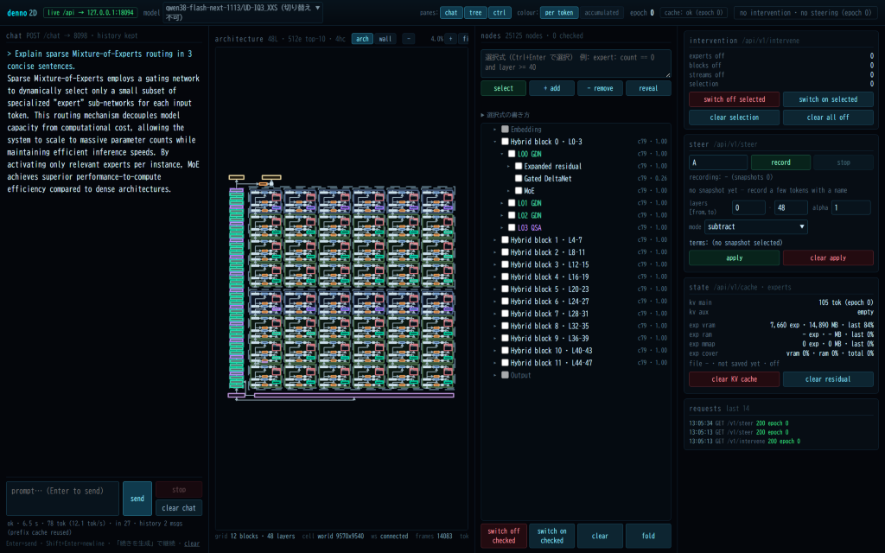

# denno-beta

[](https://github.com/ahinore/denno-beta/actions/workflows/ci.yml)

English | [日本語](README.ja.md)

An Anthropic Messages API–compatible LLM server written in Rust. Every inference kernel, CPU and CUDA, is written from scratch; no existing library such as candle is used. The main target today is **Qwen3.8-Flash-Next** (a sparse MoE with 512 experts): its 84–111 GB of weights run on a PC with 32 GB of VRAM and 64 GB of RAM.

- Experts are cached in VRAM, then RAM, then SSD, and only the ones the router picks are pulled up
- At temperature 0 the same input always gives the same output (checked in CI)
- A browser viewer, [denno-view](docs/VIEWER.en.md), shows inference as it runs
- An Intel Arc Pro B60 port is in progress on branch `arc-port`

## Current performance

Standard `llama-bench`-style prompt processing (`pp512`, `pp2048`, `pp8192`) and 128-token generation (`tg128` at context depths `d0`, `d2048`, `d8192`), measured one request at a time over `/v1/messages` with `"stream": true` and `temperature: 0` on Qwen3.8-Flash-Next (revision `f5d175de`). All values are warm medians using identical natural-language prompts across machines, with the KV prefix cache flushed (`reuse=0`) before each cold-KV run; `pp` throughput is computed from end-to-end SSE **TTFT** (`input_tokens / TTFT`) and `tg128` from SSE inter-token latency (**TPOT**).

### Prompt processing (`pp`) and TTFT

| Machine | Weights | `pp512` (tok/s / TTFT) | `pp2048` (tok/s / TTFT) | `pp8192` (tok/s / TTFT) | Turn-2 KV-reuse TTFT (2k / 8k) |
|---|---|---|---|---|---|
| RTX 5090 32 GB (`main`) | Q3 (`UD-IQ3_XXS`) | **578 tok/s** (0.89 s) | **1,551 tok/s** (1.32 s) | **2,058 tok/s** (3.98 s) | **0.80 s** / **0.86 s** |
| RTX 5090 32 GB (`main`) | Q4 (`UD-Q4_K_XL`) | 116 tok/s (4.40 s) | 253 tok/s (8.09 s) | 606 tok/s (13.53 s) | 1.07 s / 0.98 s |
| Intel Arc Pro B60 24 GB (`arc-port`) | Q3 (`UD-IQ3_XXS`) | 187 tok/s (2.75 s) | 433 tok/s (4.74 s) | 486 tok/s (16.86 s) | 1.26 s / 1.31 s |

### Token generation (`tg128`) and TPOT

| Machine | Weights | `tg128` @ `d0` (tok/s / TPOT) | `tg128` @ `d2048` (tok/s / TPOT) | `tg128` @ `d8192` (tok/s / TPOT) |
|---|---|---|---|---|
| RTX 5090 32 GB (`main`) | Q3 (`UD-IQ3_XXS`) | **107.5 tok/s** (9.30 ms/tok) | **105.2 tok/s** (9.51 ms/tok) | **98.5 tok/s** (10.16 ms/tok) |
| RTX 5090 32 GB (`main`) | Q4 (`UD-Q4_K_XL`) | 50.0 tok/s (20.0 ms/tok) | 44.9 tok/s (22.3 ms/tok) | 37.6 tok/s (26.6 ms/tok) |
| Intel Arc Pro B60 24 GB (`arc-port`) | Q3 (`UD-IQ3_XXS`) | 17.1 tok/s (58.6 ms/tok) | 17.2 tok/s (58.2 ms/tok) | 13.3 tok/s (75.4 ms/tok) |

- **RTX 5090 (`main` `20132ae`):** Ryzen 7 9800X3D, 64 GB RAM, measured 2026-11-24.
  - On Q3, every run produced bit-identical output md5 across rounds, and longer 14k-token prefills reach ~2,870 tok/s (4.88 s).
  - Q4 is 111.3 GB and does not fit in 64 GB RAM, so cold expert reads hit the SSD while warm rounds hit RAM/VRAM cache (reaching 62–73 tok/s decode and ~816 tok/s on `pp8192`).
- **Intel Arc Pro B60 (`arc-port` `451c7f3c1`):** Ryzen 7 8700G, 64 GB RAM, measured 2026-11-24 with `DEVICE_LOST = 0`.
  - On 24 GB VRAM, ~12.5 GB remains for the expert cache (~6,464 experts). Sustained 128-token generation sees a ~91% VRAM hit rate (58.6 ms/tok), while shorter (~40-token) replies stay mostly resident and reach ~33.6 ms/tok (~30 tok/s).
  - The 128-token `tg128 @ d0` output md5 (`03d236ba9edc`) matches RTX 5090 Q3 bit-for-bit.
- **RTX 3080 10 GB (legacy reference, 2026-11-18):** Core i9-13900K, 64 GB RAM, Docker on WSL2 on Windows 11, Q3 (`UD-IQ3_XXS`) best warm runs across separate settings: 8.6 tok/s (116 ms/tok) short decode, 9.4 s for 3,826-token prefill, 27.3 s for 14,018-token prefill (see "GPUs with less VRAM" below).
- The per-stage breakdown and older measurements are in [docs/DETAILS.en.md](docs/DETAILS.en.md).

## Usage

### 1. Get the weights

Use the 2026-11-13 release (revision `f5d175de`) of [`unsloth/Qwen3.8-Flash-Next-GGUF`](https://huggingface.co/unsloth/Qwen3.8-Flash-Next-GGUF). No login is needed.

| Weights | Size | RAM, roughly |
|---|---|---|
| Q3: `UD-IQ3_XXS` (default) | 83.6 GB | 64 GB |
| Q4: `UD-Q4_K_XL` | 111.3 GB | runs on 64 GB; more RAM is faster |

```bash
pip install -U huggingface_hub
hf download unsloth/Qwen3.8-Flash-Next-GGUF \
  --revision f5d175de2cf7f720d45d6064019a81fcf056e986 \
  --include "UD-IQ3_XXS/*" --local-dir ~/models/qwen38-flash-next-1113
```

For Q4, use `--include "UD-Q4_K_XL/*"`. `--dir` reads every `*.gguf` in a folder, so keep one set of weights per folder.

### 2. Build and start

```bash
cargo build --release --features cuda -p denno-cli -p denno-engine

DENNO_CUDA=1 DENNO_PREFILL_BATCH=1 DENNO_PREFILL_BATCH_CHUNK=512 DENNO_STRIP_TOOLS=1 \
DENNO_START_PREFETCH=1 DENNO_GPU_WEIGHT_MB=12000 \
DENNO_EXPERT_GPU=0 DENNO_EXPERT_BATCH=1 DENNO_EXPERT_IQ_GPU=1 \
DENNO_EXPERT_VRAM_MB=22000 DENNO_EXPERT_GPU_MIN_HIT=0 \
DENNO_GEMV_V3=1 DENNO_MIX_GPU=1 DENNO_ROUTER_GPU=1 \
DENNO_MOE_BATCH_PTX=crates/denno-engine/kernels/kernels_moe_batch.ptx \
./target/release/denno serve-flash \
  --dir ~/models/qwen38-flash-next-1113/UD-IQ3_XXS \
  --port 8098 --max-ctx 65536 --max-tokens 4096
```

- These are the settings for the RTX 5090 (32 GB of VRAM) in the table above.
- For Q4, point `--dir` at `UD-Q4_K_XL` and set `DENNO_START_PREFETCH=0`.

### 3. Call it

```bash
curl http://127.0.0.1:8098/v1/messages \
  -H "content-type: application/json" \
  -d '{"model":"qwen3.8-flash-next","max_tokens":256,
       "messages":[{"role":"user","content":"1+1=?"}]}'
```

```python
import anthropic
c = anthropic.Anthropic(base_url="http://127.0.0.1:8098", api_key="sk-test")
print(c.messages.create(model="qwen3.8-flash-next", max_tokens=256,
      messages=[{"role":"user","content":"Hello"}]).content[0].text)
```

- `"stream": true` returns SSE. `GET /v1/models` and `GET /health` are also there.
- There is no `/v1/chat/completions` yet.
- Requests are handled one at a time. A continued conversation reuses the earlier KV cache, so the reply starts in about 0.8 s on RTX 5090 Q3 (even at 2k–8k context).

### 4. Inspect inference with the 2D viewer (`denno-view`)



`serve-flash` enables telemetry by default (add `DENNO_TELEMETRY_ACT=1 DENNO_TELEMETRY_ARCH=1` to stream per-layer activations and full architecture metadata). Start `denno-view` in another terminal and open `/2d`:

```bash
VIEW_UPSTREAM=ws://127.0.0.1:8098/v1/telemetry/ws \
  cargo run --release -p denno-view
# Open http://localhost:8093/2d (3D view: /3d, dashboard: /)
```

- **Chat (left):** built-in chat proxied through `/chat` directly to the server (no CORS setup needed).
- **Architecture diagram (center):** live 48-layer Qwen3.8-Flash-Next topology (48-layer column, 12 hybrid blocks, 4 residual streams, GDN/QSA mixers, router, shared expert, and 512 experts per layer). Scroll to zoom, drag to pan, double-click to focus a component, press `0` to fit all, click or Shift+drag to select (`wall` switches to the layer tile view).
- **Nodes tree & selector (right-center):** browse `Hybrid block → Layer → residual / mixer / MoE → expert` or select nodes with expressions such as:
  ```text
  expert: count == 0 and layer >= 40
  expert: rate > 0.05 | top 5 by count per layer
  ```
- **Intervention, steering & state (right):** toggle selected experts or blocks off/on live (`/v1/intervene`), record and apply activation steering (`/v1/steer`), and monitor KV cache and VRAM expert residency. See [docs/VIEWER.en.md](docs/VIEWER.en.md) for the full selector syntax and 3D view.

### GPUs with less VRAM (example: RTX 3080 10 GB)

- Replace `compute_90` in `crates/denno-engine/kernels/build_ptx.sh` with your GPU's value (`compute_86` for a 3080) and rebuild the PTX.
- Set `DENNO_GPU_WEIGHT_MB=5000`, `DENNO_EXPERT_GPU_MIN_HIT=0` and `RAYON_NUM_THREADS=8`. On a 13900K, 24 threads was slower.
- For the fastest decode, leave the experts on the CPU (no `DENNO_EXPERT_IQ_GPU`).
- For the fastest prefill, set `DENNO_EXPERT_IQ_GPU=1` and `DENNO_EXPERT_VRAM_MB=800` to `1500`.

The full list of environment variables, and `serve` for the other models (GPT-2, Qwen2.5, Qwen3.5-27B), are in [docs/DETAILS.en.md](docs/DETAILS.en.md).

## Documentation

- [Details](docs/DETAILS.en.md): model layout, per-stage breakdown, environment variables, other models
- [denno-view](docs/VIEWER.en.md): starting the viewer, the 3D and 2D views, telemetry frames
- [Architecture](docs/ARCHITECTURE.en.md), [numeric policy](docs/NUMERIC_POLICY.en.md)
- [Development history](docs/history/en/README.md), [tasks and measurement protocol](docs/TASKS.md), [API spec](docs/api.md)

## License

Code: MIT or Apache License 2.0 ([LICENSE-MIT](LICENSE-MIT) / [LICENSE-APACHE](LICENSE-APACHE)).

Weights are not in this repository and keep their own licenses. Qwen3.8-Flash-Next is under the [Qwen Community License 1.0](https://huggingface.co/Qwen/Qwen3.8-Flash-Next/blob/main/LICENSE); pass the bundled `LICENSE` along with any copy. Reference implementations are credited in [docs/history/80_licenses.md](docs/history/80_licenses.md) (llama.cpp for the k-quant formats and the GDN formulas; the Qwen model sources and [TensorFold](https://github.com/ashhart/TensorFold) for the structure).
