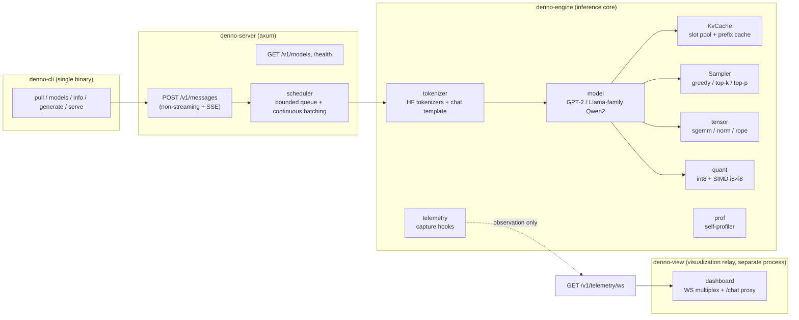
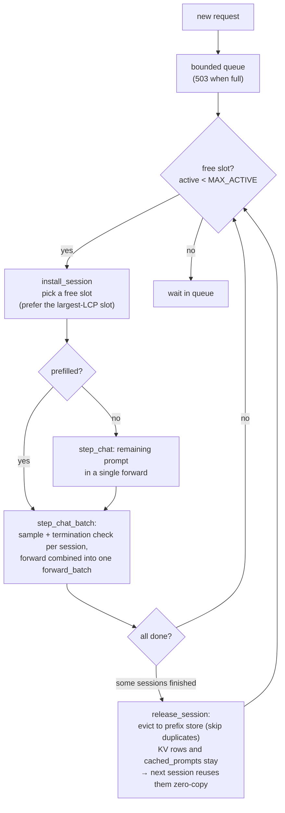
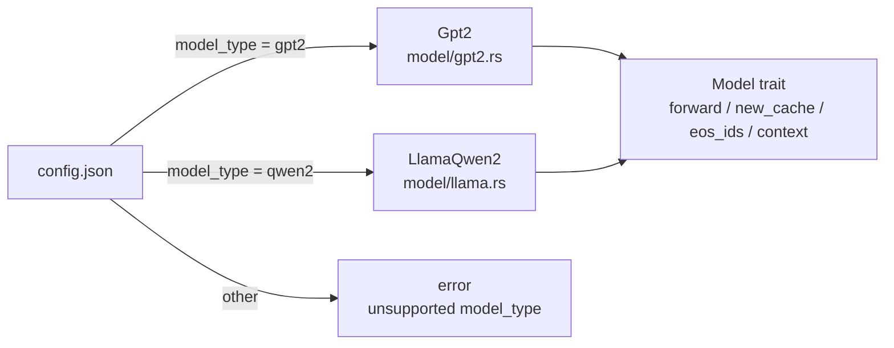
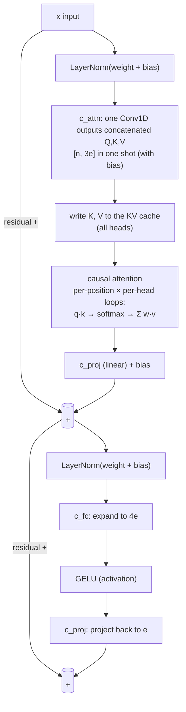
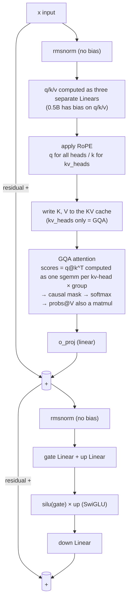
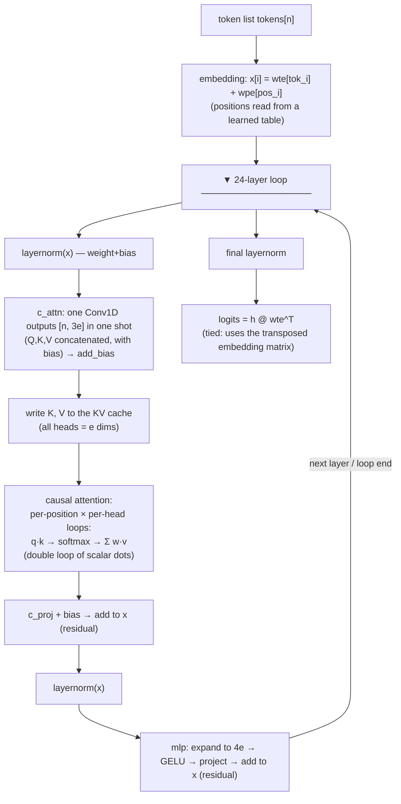
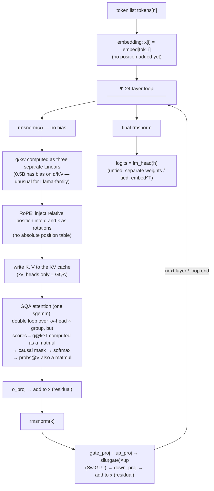
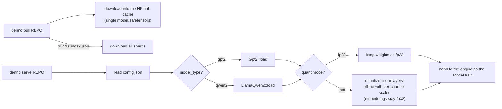
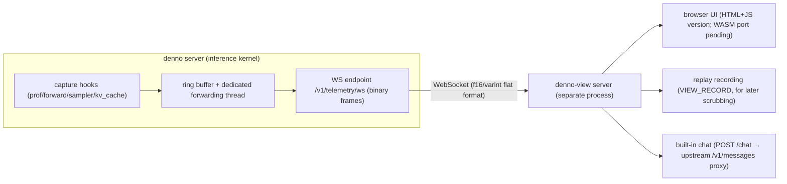

# denno-beta Architecture Guide

> An Anthropic Messages API–compatible LLM server written in Rust.
> The goal is to understand how LLMs work (tokenization → forward pass → sampling → decode loop) through code, so the **inference kernel is implemented entirely from scratch** (no existing LLM libraries such as candle).
> Repository: https://github.com/ahinore/denno-beta
> Structural reference: ashhart/TensorFold (a similar server written in Zig)
> Development history and measurement data: see the [Development History](HISTORY.en.md)

---

## 1. Purpose and Design Principles

- An LLM server written in Rust with a **fully hand-written inference kernel** (Anthropic Messages API compatible)
- The goal is understanding LLM internals through code → no existing inference libraries
- CPU only, single binary, exact decoding with a fixed seed (same seed + temperature 0 → **bit-identical output**)
- The topmost discipline: optimizations and parallelization must never break "same input → same output"
- Operations policy: **keep the host machine clean; everything runs inside Docker**

## 2. Overall Architecture



- A cargo workspace built around the **single binary** `denno` (cli/server/engine + telemetry), plus the visualization relay `denno-view` running as a separate process
- CPU only, no GPU. Runs Qwen2.5-0.5B–7B-Instruct and GPT-2 124M
- Inference is guarded by `std::sync::Mutex<Engine>`, and the **scheduler steps the engine one forward at a time**, letting new prefills interrupt decoding (P4; converted to continuous batching in P6)

```
denno-beta/
├── Cargo.toml                 # workspace (profile.dev opt-level=2)
├── .cargo/config.toml         # rustflags = ["-C", "target-cpu=native"]
├── crates/
│   ├── denno-engine/src/
│   │   ├── tensor.rs          # matmul, normalization, RoPE, activations
│   │   ├── quant.rs           # int8 quantization + SIMD i8×i8 dot products (NEON/AVX2)
│   │   ├── kv_cache.rs        # KV cache (truncate for prefix reuse)
│   │   ├── prefix_cache.rs    # multi-entry LRU prefix cache
│   │   ├── sampler.rs         # temperature/top-k/top-p sampling
│   │   ├── load.rs            # safetensors loading (single/sharded, F16/BF16→f32)
│   │   ├── tokenizer.rs       # tokenizer.json + minijinja chat template
│   │   ├── engine.rs          # begin/step_chat(): prefill→decode stepper
│   │   ├── prof.rs            # self-profiler (DENNO_PROFILE=1)
│   │   └── model/
│   │       ├── mod.rs         # Model trait + load_model dispatch
│   │       ├── gpt2.rs        # GPT-2 (LayerNorm + GELU)
│   │       └── llama.rs       # Llama/Qwen2 (RMSNorm + RoPE + SwiGLU + GQA)
│   ├── denno-server/src/
│   │   ├── lib.rs             # axum HTTP server + SSE + telemetry WS
│   │   └── scheduler.rs       # bounded queue + continuous batching worker
│   ├── denno-telemetry/src/   # telemetry frame format (zero deps, DNTL + f16/varint)
│   ├── denno-view/src/        # visualization relay server (dashboard + WS multiplex + /chat)
│   └── denno-cli/src/         # clap subcommands + HF download
└── docs/                      # API spec, architecture guide / dev history (JA & EN)
```

## 3. Inference Flow: Request to Response

```mermaid
flowchart TB
    REQ["POST /v1/messages"] --> AUTH{api key check\nmodel name check}
    AUTH -->|"queue full"| E503["503 overloaded_error"]
    AUTH --> TOK["tokenizer\napply_chat_template → encode"]
    TOK --> SUB[scheduler.submit_chat\nbounded queue (mpsc sync_channel)]
    SUB -->|"queue full"| E503
    SUB --> W[worker (single thread)]
    W --> ADMIT[admit: begin_chat\nchat template / max_tokens clamp]
    ADMIT --> PC{prefix cache\nlargest LCP entry?}
    PC -->|"hit"| TR[truncate and reuse KV\nrecompute only the difference]
    PC -->|"miss"| PF[prefill the whole prompt\n(weights × input GEMM)]
    TR --> LIVE[live session]
    PF --> LIVE
    LIVE --> LOOP["step_chat × N\n(engine mutex one forward at a time)"]
    LOOP --> PULL["pull newly arrived requests between steps\n(admit when a slot is free)"]
    PULL --> BATCH["decode: combine all resident sessions\ninto a single forward (P6)"]
    BATCH --> STOP{stop condition?\nEOS / max_tokens / stop_seq}
    STOP -->|"continue"| SAMP[sampler\ngreedy / temperature / top_p / top_k\nfixed seed for determinism]
    SAMP --> LOOP
    STOP -->|"stop"| OUT[ChatOutput\ntext / stop_reason / usage]
    OUT --> RESP["JSON or SSE\n(event: lines + 2-second keep-alive)"]
```

### Key points

- **Prefill** (forward the whole prompt at once) and **decode** (one token at a time) form the same two-stage structure as real products. Prefill is batched GEMM; decode is matvec
- **Queue and 503**: admission uses a bounded channel. Requests arriving while the running set + waiting queue are full immediately get `503 overloaded_error`. Concurrent sessions are capped at `MAX_ACTIVE_SESSIONS = 4`
- **Prefix cache**: from the prompt token lists and KV snapshots, pick the entry with the **largest LCP (longest common prefix)** and reuse the matching KV portion. Entries evicted by LRU when the token budget (default 32k) is exceeded. Choosing "largest LCP" rather than "most recent" is the key to hits in alternating-session workloads
- **step_chat granularity**: the engine mutex is held for one forward only. New admits/prefills can interrupt during decode, and decode of all resident sessions is combined into a single forward (§6.1)
- **Determinism guarantees**: the sampler is seed-fixed and the accumulation order of every dot product is fixed. Same input → bit-identical output. int8 mode differs from fp32 due to activation quantization, but is deterministic within int8
- **max_tokens clamping**: max_tokens exceeding the context would be a 400 in the Anthropic API, but for learning purposes it is clamped to fit the context and generation continues

## 4. KV Cache (kv_cache.rs)

Transformer attention needs "the K (keys) and V (values) of all past tokens". Instead of recomputing everything for each generated token, each layer's K/V are cached and **only the new token is appended**.

```rust
pub struct KvCache {
    n_layers: usize,   // 24 (Qwen2.5-0.5B)
    kv_dim: usize,     // kv_heads(2) × head_dim(64) = 128
    max_len: usize,    // 32768
    len: usize,        // number of tokens written
    k: Vec<Vec<f32>>,  // per-layer [max_len, kv_dim] contiguous buffers
    v: Vec<Vec<f32>>,
}
```

- `advance(n)`: after writing n tokens, advance `len`
- `truncate(len)`: roll back to `len` (for the prefix cache. The rolled-back region is stale, but attention only reads `0..len+n`, so it is never read and gets overwritten by the next forward)
- Allocated in bulk at startup and reused across requests (no re-allocation)
- **Slot pool**: the engine holds `caches: Vec<KvCache>` (env `DENNO_BATCH_SLOTS`, default 4); a session occupies its slot until completion (P6 continuous batching. The KV rows and cached_prompts in a slot are kept after completion so the next session with the same prefix can reuse them by truncation only)
- **Size**: per token = 24 layers × 128 dims × 2 (K+V) × 4 bytes ≈ **24.6 KB/token**. About 800 MB at full context. Thanks to Qwen2's **GQA**, K/V are stored for only 2 heads, shared by the 14 q-heads

## 5. Compute Kernels (tensor.rs / quant.rs)

Heavy GEMMs are delegated to `matrixmultiply::sgemm` (AVX2/AVX512 capable), parallelized with rayon.

| Function | Role |
|---|---|
| `matmul(a, b, m, k, n)` | c = a@b (b: [k,n] row-major) |
| `matmul_bt(a, b, m, k, n)` | c = a@b^T (b: [n,k] nn.Linear layout) |
| `matvec_bt(a, b, k, n)` | m=1 only. **Parallelized by output columns** (below) |
| `sgemm_acc(...)` | c += α·a@b^T (for attention scores) |
| `rmsnorm / layernorm` | normalization |
| `rope_rows` | RoPE (rotate_half style) |
| `silu / gelu / softmax / add_bias` | elementwise ops |

### Decode parallelization

Prefill matmuls have large m and can split along rows of A, but **decode is an m=1 matvec** with no room to split along A. Instead, split by output columns (= rows of B):

```rust
c.par_iter_mut().enumerate().with_min_len(64).for_each(|(j, cj)| {
    *cj = dot(a, &b[j*k..][..k]);   // output j is independent, so this parallelizes
});
```

### Batch decode kernels and "order-preserving SIMD" (P6/P9)

The batch kernels `matvec_rows_bt` (fp32) / `matvec_rows_bt_i8` (int8), which combine decode of multiple sessions into one forward, carry a contract: **the k-direction accumulation of every output element must be bit-identical to a standalone matvec**. How the SIMD lanes are laid out is critically important:

| Direction | fp32 | int8 |
|---|---|---|
| **k** (dot product length) | ❌ not allowed — partial sums reorder → not bit-identical | ⭕ allowed — i32 accumulation is associative (SDOT) |
| **i** (batch sessions) | ⭕ allowed (P9) — each element's k accumulation stays sequential while 4 lanes run in parallel | (SDOT suffices) |
| **j** (output channels) | ⭕ allowed — independent chains used for ILP | ⭕ allowed |

Structure of the P9 fp32 kernel:

```text
Transpose activation a[m,k] into [k][mp] (zero-padded)
→ process 4 output channels × 4 batch lanes simultaneously:
   acc[t] += vld1q(at + d*mp) * dup(row_t[d])   // separate vmul + vadd instructions
Each lane's d accumulation is strictly sequential, no FMA (multiplication and addition rounding kept separate)
→ every row is bit-identical to matvec_bt
```

The kernel alone achieves **3.9–5.9×** vs 4 standalone matvecs (0.5B shapes, m=4). Batch-decode linear layers are back to weight-bandwidth-bound (same as solo). The remaining bottleneck in batch mode is attention itself (per-session sequential processing).

### int8 quantization + SIMD kernel (quant.rs)

- Enabled with `--quant int8` (opt-in). fp32 default is completely unchanged
- Linear-layer weights are quantized offline at load time with per-channel scales (**embeddings always stay fp32**)
- At decode time **activations are dynamically quantized** and a true i8×i8 integer dot product runs on SIMD
  - aarch64: NEON `vdotq_s32` (FEAT_DotProd) / x86: AVX2 `_mm256_madd_epi16` (switched via `target_arch` cfg)
  - i32 accumulation is associative, so SIMD and the scalar reference are **bit-identical** (determinism preserved)
- Effect: 5.4–12.9× vs fp32 in kernel benchmarks; e2e decode roughly 14.4 → ~51 tok/s

### Profiler (prof.rs)

Enabled with `DENNO_PROFILE=1`. On request completion, logs accumulated time per phase (embed/rmsnorm/rope/qkv/attn/oproj/gate_up/swiglu/down/lm_head/sampler/detok). Zero overhead when disabled, never touches the numeric path. Measurement data: P7.5 section of the [Development History](HISTORY.en.md).

## 6. HTTP Server (denno-server)

axum + tokio. Anthropic Messages API compatible.

### Endpoints
- `POST /v1/messages` — non-streaming / SSE streaming (`"stream": true`)
- `GET /v1/models`, `GET /health`
- Auth: `x-api-key` header (optional)
- Errors in Anthropic format: `{"type":"error","error":{"type":"...","message":"..."}}`

### SSE event sequence (Anthropic-compatible)

```
event: message_start        → metadata + usage (input_tokens)
event: content_block_start  → empty text block
event: ping
event: content_block_delta  ×N → {"delta":{"type":"text_delta","text":"..."}}
event: content_block_stop
event: message_delta        → stop_reason (end_turn/max_tokens/stop_sequence)
event: message_stop
```

Implementation notes:
- **Every event needs an `event: <type>` line**. Without it, Anthropic-wire clients fail to parse immediately and retry forever
- **2-second keep-alive**: during prefill the event stream goes quiet, and clients would time out without it
- Generation runs in `tokio::task::spawn_blocking`, streamed to the SSE response via an mpsc channel

### 6.1 Continuous batching (scheduler.rs + engine.rs, P6)

A single worker thread advances a **set of resident sessions** together. The KV cache is a **slot pool** (`DENNO_BATCH_SLOTS`, default 4); a session occupies its slot until completion (the old suspend/restore rotation is gone).



Exactness rests on two legs:
1. **Kernel** — `matvec_rows_bt`/`matvec_rows_bt_i8` keep the k-direction accumulation order of every output element identical to a standalone matvec (`matvec_bt`; sgemm is not used). rayon splits by row blocks, so each element's addition sequence is unchanged
2. **Sampler** — each session owns an independent RNG, so output is bit-identical to a solo run no matter which sessions run concurrently (verified on real hardware for fp32/int8 with 4 concurrent sessions = solo)

Throughput at 0.5B: fp32 1.35× / int8 1.7× (b=4). At b=4, 0.5B transitions to compute-bound with the old fp32 kernel, but P9's order-preserving SIMD put batch linear layers back to weight-bandwidth-bound (solo-equivalent). Meanwhile 3B int8 (b=2) keeps step time almost unchanged (78ms→81ms) while aggregating 1.6× = still bandwidth-bound. **Larger models benefit from batching more directly**. The remaining bottleneck in batch mode is attention itself (per-session sequential processing).

## 7. Model Differences

### 7.1 Family detection

`load_model()` reads `model_type` from `config.json` to pick the family. The common interface is just the `Model` trait (`forward(tokens, cache) → logits`). The engine, scheduler, and server never know the family.



### 7.2 Architecture comparison

| Item | GPT-2 (`gpt2.rs`) | Qwen2 / Llama-family (`llama.rs`) |
|---|---|---|
| Positional encoding | learned absolute positions `wpe` [ctx, e] | **RoPE** (rope_theta, default 1M) |
| Normalization | LayerNorm (weight+bias) | **RMSNorm** (no bias, eps) |
| Activation | GELU | **SwiGLU** (gate/up split, silu×down) |
| Attention | MHA (3e output by one Conv1D `c_attn`, with bias) | **GQA** (q/k/v as separate Linears, no bias) |
| Q/K/V heads | Q=KV (all heads) | KV head count from config (`0.5B`: Q14/KV2, `7B`: Q28/KV4) |
| lm_head | tied (uses transposed `wte`) | switched by config `tie_word_embeddings` (3B/7B untied → separate `lm_head.weight`) |
| EOS tokens | one | **possibly multiple** (two read from generation_config) |
| Weight layout | `[out, in]` (Conv1D style) → `bt` kernels | `[in, out]` → regular matvec kernels |
| Embedding | `wte` always fp32 (for gather) | likewise always fp32 (not quantized even in int8 mode) |

### 7.3 Layer-internal differences

**One GPT-2 layer:**



**One Qwen2 (Llama-family) layer:**



**Code-level differences:**

| Processing | GPT-2 | Qwen2/Llama-family |
|---|---|---|
| Normalization | LayerNorm (weight+bias) | rmsnorm (no bias) |
| Q/K/V | **one matmul, concatenated output** | **three separate Linears** |
| Position injection | none (added at embedding) | **RoPE rotation right before attention** |
| Attention core | scalar loops (per position) | **sgemm matmul** (GQA) |
| MLP | 4e expand → GELU → project | gate/up → silu×up → down |

After the last layer: both families do a final normalization → lm_head (weights × hidden state) for logits.

### 7.4 GPT-2 forward flow (program order)

What `gpt2.rs`'s `forward(tokens, cache)` executes, in order. **The prompt (prefill) and each generated token run the same function**; only the token count n differs (prefill: whole prompt; decode: 1).



**Characteristics**: QKV comes out of one big matmul (a single GEMM = GPU-friendly). Positions are added at the embedding stage, so attention has no positional processing. The attention core is a straightforward "per-position, per-head" loop structure.

### 7.5 Qwen2/Llama-family forward flow (program order)

`llama.rs`'s `forward(tokens, cache)`. Same skeleton of "embedding → layers → logits", but very different inside.



**Characteristics**:
- **Position is injected in a different place** — GPT-2 adds it at embedding; Qwen2 rotates q/k via RoPE right before attention
- **QKV is three separate Linears** (standard Llama-family shape). But 0.5B has bias on q/k/v (normally absent in Llama-family; ignoring it destroys the output)
- **Attention is GQA + matmul** — kv-heads are shared by a group of q-heads, and scores are delegated to sgemm (`sgemm_acc`). Structurally and performance-wise different from GPT-2's scalar loops
- **MLP is SwiGLU** — two Linears + elementwise product + one Linear (vs GPT-2's one Linear + GELU + one Linear)

### 7.6 Decode step shared by both models (engine.rs)

Model differences live only inside `forward` above. The stepping loop and sampling are shared:

```
one step of step_chat():
  sampler.sample(logits)        ← greedy / temperature / top-k / top-p (fixed seed)
  → EOS / stop_sequences check
  → stream the diff of tok.decode(all generated)
  → model.forward(&[next], cache)   ← next token (prefill passes &prompt_ids[lcp..] in bulk)
```

The design only changes the n passed to `forward` between prefill and decode. Linear layers switch automatically: GEMM when n>1, output-split parallel matvec (`apply_bt`) when n=1.

From P6 on, `step_chat_batch` is used when multiple sessions run concurrently, and linear layers use the multi-column `apply_batch_bt` (→ `matvec_rows_bt`) to combine into one forward (§6.1). Each element's accumulation order matches the n=1 matvec, so solo-identical bit-exact output is preserved.

### 7.7 Qwen2.5 size differences

| Model | tied | shards | fp32 memory | Implementation notes |
|---|---|---|---|---|
| 0.5B | tied | single file | ~1GB (weights) | — |
| 1.5B | tied | single file | ~3GB | Just bigger dims. **Runs unchanged on the existing binary** |
| 3B | **untied** | **sharded** (index.json + 2 shards) | ~12GB | ✅ supported: sharded checkpoint + untied lm_head. fp32 ~2 tok/s, int8 ~4.7 tok/s |
| 7B | untied | sharded | ~28GB | ✅ verified with the same code: fp32 ~1.2 tok/s, int8 ~2.1 tok/s |

- Per-token KV cache size = `2 (K,V) × n_layer × n_kv_head × head_dim × 4 bytes`. At 32k tokens: 0.5B ≈ 805 MB (basis of the prefix cache token budget); 1.5B ≈ 1.9 GB; 7B ≈ the same as 0.5B thanks to GQA (4 KV heads)
- Large models are weight-bandwidth-bound at decode, so `--quant int8` + the SIMD kernel pays off most (3B: ~2.4× fp32; 7B: ~1.8×)

### 7.8 Model loading flow



`WeightStore` handles single and sharded checkpoints transparently, resolving shards via the `model.safetensors.index.json` mapping.

## 8. CUDA Optimization Notes

Connection points for future CUDA (NVIDIA GPU) optimization. **Architecturally, implementing a `GpuModel` that satisfies the `Model` trait (`forward(tokens, cache) → logits`) requires no changes to engine/scheduler/server.** The crux of porting is the GPU support of the `KvCache` abstraction.

### 8.1 Which parts are CUDA implementation points (backed by the P7.5 profile)

| Current implementation | Share (CPU) | CUDA implementation point |
|---|---|---|
| Linear layers `lin` / `Linear::apply_bt` (qkv/o/gate_up/down) | **~80%** | cuBLAS GEMM (prefill) / custom GEMV (decode). Decode is weight-bandwidth-bound, so simply **keeping weights resident in VRAM** helps a lot. int8 → dp4a / Tensor Cores (INT8) |
| Attention core `sgemm_acc` + softmax + matmul | 10–18% | **FlashAttention-style fused kernel** (scores never hit HBM; softmax completes in shared memory). PagedAttention for KV fragment management (vLLM style) |
| lm_head (`matvec_bt` / `lin`, vocab 152k) | 3.5–5.7% | Large GEMV. Split reduction. Computing only top-k candidates on GPU first is also possible |
| sampler (`sampler.sample`) | **fixed 3.5ms/step** | softmax + top-p sort → µs-class with a single-block radix-select/top-k kernel. **Small but a fixed cost every step** |
| Elementwise (rmsnorm/rope/silu/softmax) | ~1% | Not worth it alone, but **fused with surrounding kernels** (add+residual+rmsnorm, swiglu fusion) to cut HBM round trips — the CUDA standard playbook |

### 8.2 What stays on CPU

- tokenizer / detok (HF tokenizers, CPU-friendly)
- scheduler, HTTP (scheduler.rs, lib.rs) — outside CUDA porting
- the engine's step_chat loop body (though its content becomes a sequence of kernel launches)

### 8.3 CUDA-specific design challenges

1. **Decode becomes kernel-launch-latency-bound** — hundreds of small kernels per token. **CUDA Graphs** (record and replay one token) is mandatory (same as vLLM etc.)
2. **KV cache management** — currently contiguous `[max_len, kv_dim]` buffers + truncate. On GPU a **paged KV cache** (block-indirect references) fits the multi-session prefix cache better
3. **Prefix cache snapshots** — `suspend_session`'s `cache.snapshot()` is a CPU memory copy. On GPU a device-to-device copy (no PCIe) is cheap. Rather, **leaving KV in place for concurrent sessions is realistic on GPU** and merges naturally with P6 (batched matrix form)
4. **Impact of model differences** — GPT-2's `c_attn` single GEMM lands on cuBLAS as-is. Qwen2's GQA currently loops kv-head × group; **fusing q-heads into the dim for one GEMM** is the proper GPU approach (scores shape unchanged, compatible with determinism design)
5. **Bit-exactness is the biggest issue**:
   - **fp32 cannot be bit-identical to CPU** (GPU reduction order and tiling differ). A GPU version is either "a different exact decoding (deterministic within GPU)" or uses deterministic algorithms (deterministic cuBLAS mode + fixed tiling)
   - **int8 (i32 accumulation) is order-invariant, so CPU/GPU bit-identical output is maintainable** — P5's "associative integer accumulation" design pays off directly. If exactness must survive the GPU migration, int8 is the mainline

### 8.4 Recommended porting order (if implemented)

1. Linear layers only to cuBLAS (weight residency + GEMV/GEMM) → ~80% of the time, biggest win
2. Fuse attention into one kernel (FlashAttention style)
3. Sampler top-k kernel + CUDA Graphs
4. Paged KV cache → concurrent-session decode (merges with P6)

## 9. Usage

```bash
# download the model (into the HF hub cache ~/.cache/denno/hub)
cargo run --release -- pull Qwen/Qwen2.5-0.5B-Instruct

# start the server (fixed seed for exact decoding)
cargo run --release -- serve Qwen/Qwen2.5-0.5B-Instruct --name denno --port 8080 --seed 42

# generate directly via the CLI (with/without chat template)
cargo run --release -- generate Qwen/Qwen2.5-0.5B-Instruct --prompt "1+1は?" --temperature 0 --seed 42
cargo run --release -- generate openai-community/gpt2 --prompt "The capital of France is" --raw --seed 42
```

### Starting the visualization (denno-view)

```bash
# 1. start the server with telemetry on (same command plus DENNO_TELEMETRY=1)
DENNO_TELEMETRY=1 cargo run --release -- serve Qwen/Qwen2.5-0.5B-Instruct --name denno --port 8080 --seed 42

# 2. in another terminal, start denno-view
#    (defaults to the telemetry WS at ws://127.0.0.1:8080, listens on :8093)
VIEW_TOKENIZER=~/.cache/denno/hub/models--Qwen--Qwen2.5-0.5B-Instruct/tokenizer.json \
  cargo run --release -p denno-view

# 3. open http://localhost:8093/ in a browser and chat in the built-in chat box —
#    the model-driven program, layer panel, and KV/variable animations play along
```

`denno-view` environment variables: `VIEW_UPSTREAM` (default `ws://127.0.0.1:8080/v1/telemetry/ws`), `VIEW_PORT` (default 8093), `VIEW_RECORD` (record frames to a file for replay), `VIEW_TOKENIZER` (tokenizer.json path for token text display).

Being Anthropic Messages API compatible, it works as-is with the official SDKs and Anthropic-compatible clients (a Python SDK example is in the README).

## 10. Known Limitations

- No tool use (tool_use/tool_result content blocks) → no agent features, plain conversation only
- One model per process (multi-model serving is a future candidate). Concurrent decode of multiple sessions is already handled by continuous batching (P6)
- The viewer is the JS version (WASM port, replay scrubber, and L2 tensor display remain)
- Large-model download verification and performance are recorded in the [Development History](HISTORY.en.md)

## 11. Inference Visualization (denno-trace) — Implemented Architecture (P13/P14)

Since denno is a learning server, it can display the **program flow, hidden-layer states, and KV state** during inference in real time (P13 built the telemetry foundation, P14 the animation UI). Three design principles:

1. **Fully decoupled from inference** — visualization logic never enters the inference process. denno only streams observations
2. **Never make inference wait** — bounded channel + drop-allowed (when the consumer falls behind, frames are dropped and a gap marker is emitted). Waiting/blocking is forbidden
3. **Zero cost when OFF** — off by default (without `DENNO_TELEMETRY` the capture code never even runs). Observation is read-only copies only, **never touching the numeric path** (compatible with the bit-exact discipline)

### 11.1 Overall structure



- **denno (capture side)**: observation points in `prof.rs` op timing and forward/sampler/kv_cache/engine lifecycle (read-only, never touching the numeric path), streamed over WebSocket via a dedicated thread. One WS route on axum (`/v1/telemetry/ws`)
- **denno-view (relay server)**: WS client to the upstream denno (2-second retry on disconnect), multiplex relay to multiple browsers, frame recording to a file via `VIEW_RECORD` (replay material), built-in chat (sending a message drives the animation), `/tokenizer.json` (token text display), `/code/src` (implementation-code display, embedded at compile time via include_str!)
- **Viewer (UI)**: currently the HTML+JS version (the binary telemetry decoder is also implemented in JS and verified against Rust-generated frames). Porting to wasm-bindgen + canvas/WebGL2 remains

### 11.2 Capture levels (3 tiers, on demand)

| Level | Content | Traffic | Use |
|---|---|---|---|
| L0 flow (always on) | phase transitions (prefill/decode), op enter/exit (logical call stack rebuilt from event nesting), session lifecycle, output token stream | tens of B/step, **<0.5%** | program flow diagram, op timeline |
| L1 statistics | hidden-state norms, KV usage (layer×slot grid), logits top-k (8) + entropy, sampler choices | hundreds of B/step, **1–2%** | state overview, token distribution |
| L2 tensors (focus-limited, P15 candidate) | hidden-state vectors of a chosen session×layer (f16), attention probabilities (t_total vector), raw K/V | **one session + narrowing** ≤5% | heatmaps, tensor inspector |

- **P13 implemented L0/L1, and P14 the animation UI on top**. L2 focus is not implemented yet (the plan: the viewer sends "show me layer 14 attention of this session" and denno streams just that combination)
- L2 vectors are **rounded to f16 for transfer** (observation only, no effect on the numeric path, so outside the bit-exact discipline; halves bandwidth)

### 11.3 Wire format (denno-telemetry crate)

- New crate `denno-telemetry`: shared frame types + encode/decode (both the server and viewer use it)
- Frames: `magic(4B) + version(u8) + kind(u8) + session_id(u32) + seq(u32) + payload(len-prefixed)`
- Payload is a **flat structure + LEB128 varint + f16 tensors** (no JSON in the inference hot path — serialization leans zero-copy)
- A `Gap { lost: u32 }` frame explicitly marks loss (never silently skipped)
- Versioned (ready for future fields; the viewer skips unknown kinds)

### 11.4 denno-side implementation (P13)

- `denno-telemetry` crate (zero deps / std only): frame types + encode/decode. Server and viewer share the same format
- kinds: `ServerInfo / SessionAdmit / SessionDone / Prefill / Token / Step / OpSummary / KvUsage / Gap / TopK` (+ P14's `LayerRun` — one layer's op sequence bundled into one frame in execution order. `ServerInfo.layers` and `Prefill.tokens` were also added)
- Capture points: ① inside prof op timing (one emit line per existing hook) ② engine phase transitions and session admit/eos ③ after sampler (top-k) ④ kv_cache advance (usage; **not emitted for empty batches** — idle polling would flood frames) ⑤ after detok (output tokens)
- All capture is **read-only references after computation** (hidden states copied right after forward completes; never mid-flight)
- WS: axum `route("/v1/telemetry/ws", get(ws_handler))` — sends ServerInfo right after connect and relays via a hub→broadcast thread (503 when telemetry is disabled)

### 11.5 Viewer (denno-view) screen layout (implemented)

Three columns. The browser side also uses a playback queue + decimation so it **never makes inference wait** (the server side uses a bounded channel + drops).

| Area | What it shows |
|---|---|
| Center: implementation-code panel | Pseudo-code of the model-driven program. The running line advances like a debugger's PC, with the prefill branch and KV writes (right before attn_core) in true order. "real code ▸" switches to the actual scheduler.rs/engine.rs/llama.rs source (include_str! embedding + content-anchor mapping) |
| Center: model-driven program | denno serve→scheduler→engine.step_chat→model.forward{embed→layers→final_norm→lm_head}→sampler→detok. Active functions light up and "value" pulse dots travel between nodes. Input tokens drop from the top into embed, output tokens line up below. Fly-lines for KV/variable writes (green), reads (pink), and consumption (blue) |
| Left: KV slots + variables + op timing | KV slot cards (busy/token count/usage bar), hidden x/logits top-k/entropy/chosen token, measured ms per op |
| Right: model structure | embed→decoder×24 (ATT+MLP chips)→final_norm→lm_head. Chips light up individually per LayerRun, layer rows show measured op ms |
| Bottom: chat | Built-in chat (POST /chat proxy). Sending a message drives the animation |
| Header | speed slider (low = watchable slow motion / high ≈ real time, default high), model ID display |

- Not implemented: chrome-tracing-style op timeline, tensor inspector, attention view, replay scrubber (future candidates along with L2)
- 60fps strategy: decode into typed arrays → draw only the visible range → `requestAnimationFrame` decimation. When falling behind, decimate the display (data is buffered, never dropped; only rendering is reduced)

### 11.6 Performance budget and determinism

- L0 <0.5% / L1 1–2% / L2 ≤5% for the focused session (f16 + narrowing + bounded channel). Over budget → drop frames and report via Gap (inference is never slowed down)
- With telemetry OFF the code path effectively doesn't exist, and **exactness tests and the reference output are unchanged**. Even when ON it's read-only so numbers don't change (though A/B measurements are taken with telemetry OFF)

---
Development history, verification data, and future plans: [Development History](HISTORY.en.md)
