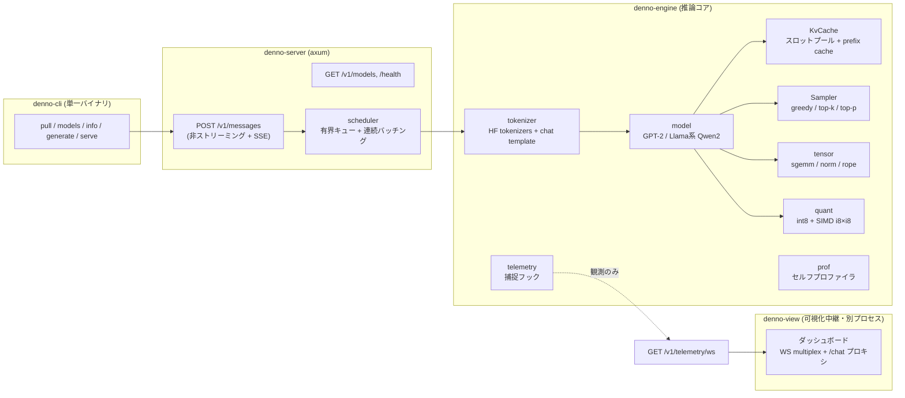
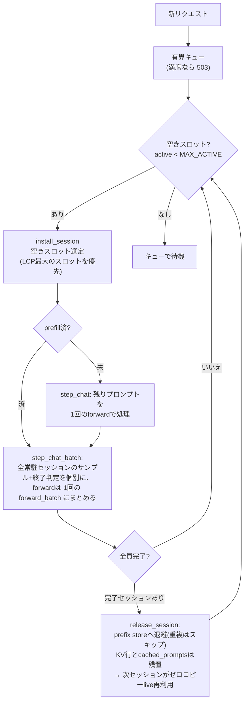
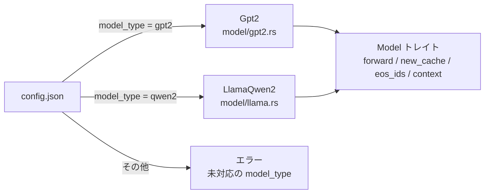
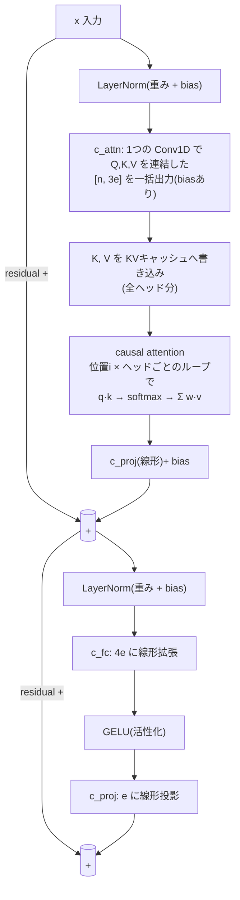
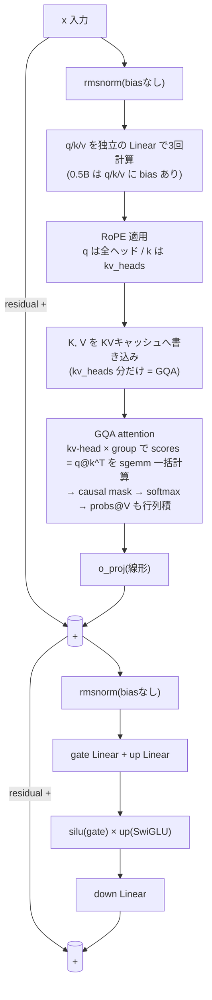
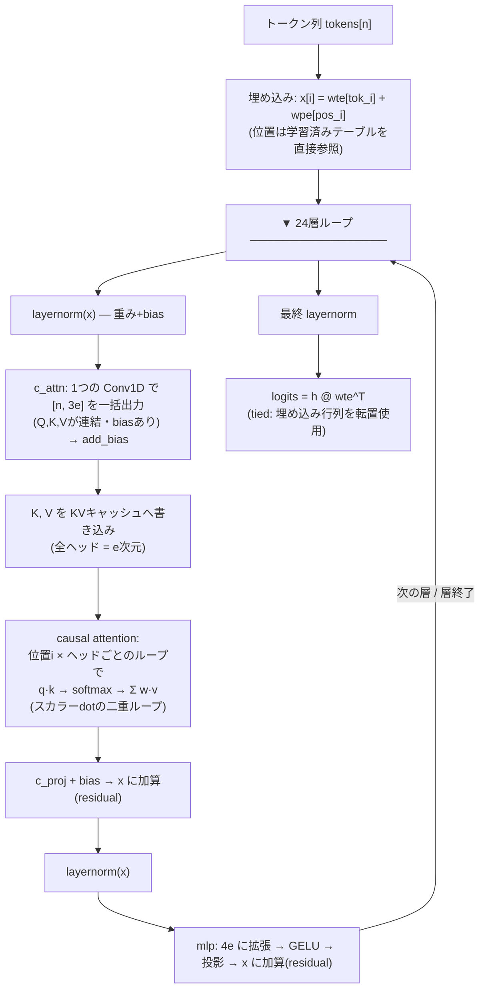
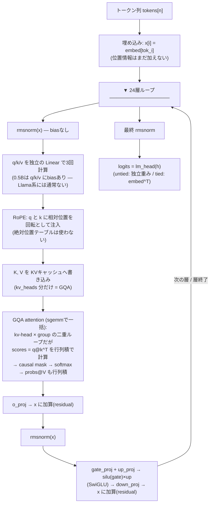
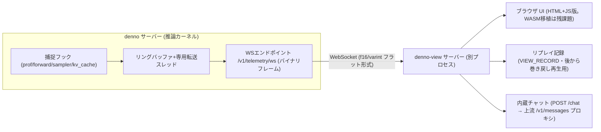

# 自作LLMサーバー denno-beta アーキテクチャ解説

> Rustで書いたAnthropic Messages API互換のLLMサーバー。
> LLMの動作原理(トークン化 → forward pass → サンプリング → デコードループ)をコードで理解することを目的に、**推論カーネルを完全自前実装**している(candle等の既存LLMライブラリは不使用)。
> リポジトリ: https://github.com/ahinore/denno-beta
> 構成の参考: ashhart/TensorFold (Zig製の同種サーバー)
> 開発の経緯・計測データは [開発履歴](HISTORY.ja.md) へ

---

## 1. 目的と設計方針

- 推論カーネルを**完全自前実装**したRust製LLMサーバー(Anthropic Messages API互換)
- 目的はLLMの動作原理のコードによる理解 → 既存推論ライブラリは不使用
- CPUのみ・単一バイナリ・seed固定のexact decoding(同seed+温度0なら**ビット完全同一出力**)
- 最適化・並列化をしても「同一入力→同一出力」を壊さないことを最優先の規律とする
- 運用方針: **ホストはクリーンに保ち、すべてDocker内で完結**

## 2. 全体アーキテクチャ



- **単一バイナリ** `denno`(cli/server/engine + telemetry)に加え、可視化中継の `denno-view` を別プロセスで動かすcargoワークスペース
- CPUのみ、GPU不要。Qwen2.5-0.5B〜7B-Instruct と GPT-2 124M が動く
- 推論は `std::sync::Mutex<Engine>` で保護しつつ、**スケジューラが1 forward単位でステップ実行**し、decode中にも新規prefillを割り込ませる(P4、P6で連続バッチング化)

```
denno-beta/
├── Cargo.toml                 # workspace (profile.dev opt-level=2)
├── .cargo/config.toml         # rustflags = ["-C", "target-cpu=native"]
├── crates/
│   ├── denno-engine/src/
│   │   ├── tensor.rs          # 行列積・正規化・RoPE・活性化
│   │   ├── quant.rs           # int8量子化 + SIMD i8×i8ドット積 (NEON/AVX2)
│   │   ├── kv_cache.rs        # KVキャッシュ (truncate で prefix cache)
│   │   ├── prefix_cache.rs    # マルチエントリ LRU prefix cache
│   │   ├── sampler.rs         # 温度/top-k/top-p サンプリング
│   │   ├── load.rs            # safetensors 読み込み (単一/分割shard、F16/BF16→f32)
│   │   ├── tokenizer.rs       # tokenizer.json + minijinja chat template
│   │   ├── engine.rs          # begin/step_chat(): prefill→decode ステッパ
│   │   ├── prof.rs            # セルフプロファイラ (DENNO_PROFILE=1)
│   │   └── model/
│   │       ├── mod.rs         # Model トレイト + load_model ディスパッチ
│   │       ├── gpt2.rs        # GPT-2 (LayerNorm + GELU)
│   │       └── llama.rs       # Llama/Qwen2 (RMSNorm + RoPE + SwiGLU + GQA)
│   ├── denno-server/src/
│   │   ├── lib.rs             # axum HTTPサーバー + SSE + テレメトリWS
│   │   └── scheduler.rs       # 有界キュー + 連続バッチング実行ワーカー
│   ├── denno-telemetry/src/   # テレメトリフレーム形式(依存ゼロ・DNTL+f16/varint)
│   ├── denno-view/src/        # 可視化中継サーバー(dashboard + WS multiplex + /chat)
│   └── denno-cli/src/         # clap サブコマンド + HF ダウンロード
└── docs/                      # API仕様・アーキテクチャ解説/開発履歴(日英)
```

## 3. リクエストから応答までの推論フロー

```mermaid
flowchart TB
    REQ["POST /v1/messages"] --> AUTH{api key 検証\nmodel 名検証}
    AUTH -->|"queue 満杯"| E503["503 overloaded_error"]
    AUTH --> TOK["tokenizer\napply_chat_template → encode"]
    TOK --> SUB[scheduler.submit_chat\n有界キュー(mpsc sync_channel)]
    SUB -->|"キュー満杯"| E503
    SUB --> W[ワーカー(単一スレッド)]
    W --> ADMIT[admit: begin_chat\nchat template / max_tokens クランプ]
    ADMIT --> PC{prefix cache\nLCP 最大エントリ?}
    PC -->|"ヒット"| TR[truncate して KV 再利用\nrecompute は差分のみ]
    PC -->|"ミス"| PF[全 prompt を prefill\n(重み × 入力の GEMM)]
    TR --> LIVE[live セッション]
    PF --> LIVE
    LIVE --> LOOP["step_chat × N\n(エンジン mutex を 1 forward ずつ)"]
    LOOP --> PULL["ステップ間に新規到着を pull\n(スロットに空きがあれば admit)"]
    PULL --> BATCH["decode は全常駐セッションを\n1 forward にまとめる(P6)"]
    BATCH --> STOP{停止条件?\nEOS / max_tokens / stop_seq}
    STOP -->|"継続"| SAMP[sampler\ngreedy / temperature / top_p / top_k\nseed 固定で決定論]
    SAMP --> LOOP
    STOP -->|"停止"| OUT[ChatOutput\ntext / stop_reason / usage]
    OUT --> RESP["JSON または SSE\n(event: 行 + keep-alive 2秒)"]
```

### ポイント

- **prefill**(プロンプト全部を一括forward)と**decode**(1トークンずつ)の2段構成は実製品と同じ。prefillはバッチ行列積、decodeはmatvec
- **キューと503**: 同時受け付けは有界チャネル。実行中+待ち行列が満杯の間に来たリクエストは即 `503 overloaded_error`。進行中セッションは `MAX_ACTIVE_SESSIONS = 4` に制限
- **prefix cache**: promptトークン列とKVスナップショット群から**LCP(共通接頭辞)最大のエントリ**を選び、一致分だけKVを再利用。トークン予算(既定32k)超過でLRU退避。「直近」ではなく「LCP最大」を選ぶのが交互セッションでヒットさせる要点
- **step_chat の細分化**: エンジンmutexは1 forward分だけ取得。decode中でも新規のadmit/prefillが割り込め、常駐セッションのdecodeは1 forwardにまとめられる(§6.1)
- **決定論の担保**: samplerはseed固定、各ドットの累積順序を固定。同一入力→ビット同一出力。int8モードはアクティベーション量子化によりfp32と出力が異なるが、int8内では決定論
- **max_tokens クランプ**: context超過のmax_tokensはAnthropic APIなら400だが、学習用としてcontextに収まる範囲へクランプして続行

## 4. KVキャッシュ (kv_cache.rs)

Transformerのattentionは「過去の全トークンのK(鍵)とV(値)」を必要とする。生成1トークンごとに過去全部を再計算する代わりに、各層のK/Vをキャッシュし**新しいトークンの分だけ追記**する。

```rust
pub struct KvCache {
    n_layers: usize,   // 24 (Qwen2.5-0.5B)
    kv_dim: usize,     // kv_heads(2) × head_dim(64) = 128
    max_len: usize,    // 32768
    len: usize,        // 書き込み済みトークン数
    k: Vec<Vec<f32>>,  // 層ごとに [max_len, kv_dim] の連続バッファ
    v: Vec<Vec<f32>>,
}
```

- `advance(n)`: nトークン書き終えたら `len` を進める
- `truncate(len)`: `len` まで戻す(prefix cache用。戻した領域はstaleだがattentionは `0..len+n` しか参照しないため読まれず、次のforwardで上書きされる)
- 起動時に一括確保し、リクエスト間で再利用(再アロケートしない)
- **スロットプール**: エンジンは `caches: Vec<KvCache>`(環境変数 `DENNO_BATCH_SLOTS`、既定4)を持ち、セッションは完了まで自スロットを占有する(P6の連続バッチング。スロット内のKV行とcached_promptsは完了後も残置し、同一接頭辞の次セッションがtruncateのみで再利用できる)
- **サイズ感**: トークンあたり = 24層 × 128次元 × 2(K+V) × 4バイト = **約24.6KB/トークン**。コンテキスト最大で約800MB。Qwen2の**GQA**で、K/Vは2ヘッド分だけ保存し14個のqヘッドから共有する

## 5. 演算カーネル (tensor.rs / quant.rs)

重いGEMMは `matrixmultiply::sgemm`(AVX2/AVX512対応)に委譲し、rayonで並列化。

| 関数 | 役割 |
|---|---|
| `matmul(a, b, m, k, n)` | c = a@b (b: [k,n] row-major) |
| `matmul_bt(a, b, m, k, n)` | c = a@b^T (b: [n,k] nn.Linear形式) |
| `matvec_bt(a, b, k, n)` | m=1専用。**出力列分割で並列化**(下記) |
| `sgemm_acc(...)` | c += α·a@b^T (attentionのscores用) |
| `rmsnorm / layernorm` | 正規化 |
| `rope_rows` | RoPE (rotate_half方式) |
| `silu / gelu / softmax / add_bias` | 要素ごと演算 |

### decodeの並列化ポイント

prefillの行列積はmが大きいのでAの行で分割できるが、**decodeはm=1のmatvec**でA側に分割余地がない。代わりに出力列(=Bの行)で分割する:

```rust
c.par_iter_mut().enumerate().with_min_len(64).for_each(|(j, cj)| {
    *cj = dot(a, &b[j*k..][..k]);   // 出力jは独立なので並列化できる
});
```

### バッチdecodeカーネルと「順序保存SIMD」(P6/P9)

複数セッションのdecodeを1 forwardにまとめるバッチカーネル `matvec_rows_bt`(fp32)/`matvec_rows_bt_i8`(int8)には、**各出力要素のk累積を単独matvecと完全一致させる**という契約がある。ここでのSIMDの張り方は決定的に重要:

| 方向 | fp32 | int8 |
|---|---|---|
| **k方向**(内積の長さ) | ❌ 不可 — 部分和の順序が変わりビット非同一 | ⭕ 可 — i32累積は結合則が成立(SDOT) |
| **i方向**(バッチのセッション) | ⭕ 可(P9) — 各要素のk累積は逐次のまま4レーン同時 | (SDOTで十分) |
| **j方向**(出力チャネル) | ⭕ 可 — 独立チェーンとしてILPに使う | ⭕ 可 |

P9のfp32カーネルの構造:

```text
アクティベーション a[m,k] を [k][mp] に転置(ゼロパディング)
→ 4出力チャネル × 4バッチレーンを同時処理:
   acc[t] += vld1q(at + d*mp) * dup(row_t[d])   // vmul + vadd 分離命令
各レーンのd累積は厳密に逐次、FMA不使用(積と加算の丸めを分離)
→ どの行も matvec_bt とビット一致
```

カーネル単体で単独matvec×4比 **3.9〜5.9倍**(0.5B形状、m=4)。バッチdecodeの線形層はこれで重み帯域律速(soloと同じ)に戻った。バッチ時の残りの律速はattention本体(セッション毎の逐次処理)。

### int8量子化+SIMDカーネル (quant.rs)

- `--quant int8` で有効(opt-in)。fp32デフォルトは完全に変更なし
- 線形層の重みをロード時にper-channel scaleでオフライン量子化(**embedding は常にfp32**)
- decode時は**アクティベーションを動的量子化**し、真のi8×i8整数ドット積をSIMDで実行
  - aarch64: NEON `vdotq_s32`(FEAT_DotProd)/ x86: AVX2 `_mm256_madd_epi16`(`target_arch` cfg切替)
  - i32累積は結合則が成立するため、SIMDとスカラー参照が**ビット一致**(決定論維持)
- 効果: カーネル単体でfp32比5.4〜12.9倍、e2e decode 約14.4 → 約51 tok/s

### プロファイラ (prof.rs)

`DENNO_PROFILE=1` で有効化。リクエスト完了時に各フェーズ(embed/rmsnorm/rope/qkv/attn/oproj/gate_up/swiglu/down/lm_head/sampler/detok)の累積時間をログ出力。無効時はオーバーヘッドゼロ、数値経路に触れない。計測データは [開発履歴](HISTORY.ja.md) のP7.5節参照。

## 6. HTTPサーバー (denno-server)

axum + tokio。Anthropic Messages API互換。

### エンドポイント
- `POST /v1/messages` — 非ストリーミング / SSEストリーミング(`"stream": true`)
- `GET /v1/models`, `GET /health`
- 認証: `x-api-key` ヘッダ(オプション)
- エラーはAnthropic形式: `{"type":"error","error":{"type":"...","message":"..."}}`

### SSEイベント列(Anthropic互換)

```
event: message_start        → メタデータ + usage(input_tokens)
event: content_block_start  → 空のtextブロック
event: ping
event: content_block_delta  ×N → {"delta":{"type":"text_delta","text":"..."}}
event: content_block_stop
event: message_delta        → stop_reason (end_turn/max_tokens/stop_sequence)
event: message_stop
```

実装上の重要ポイント:
- **各イベントに `event: <type>` 行が必要**。これが無いとHermesのクライアントが即パース失敗して無限リトライする
- **2秒間隔のkeep-alive**: prefill中にイベントが途切れるとクライアントがアイドルタイムアウトで切断するため
- 生成は `tokio::task::spawn_blocking` で別スレッドに追い出し、mpscチャネル経由でSSEに流す

### 6.1 連続バッチング(scheduler.rs + engine.rs、P6)

ワーカースレッド1つが**常駐セッション群**をまとめて進める。KVキャッシュは**スロットプール**(`DENNO_BATCH_SLOTS`既定4)で、セッションは完了まで自スロットを占有する(旧suspend/restoreローテーションは廃止)。



exactnessの根拠は2段:
1. **カーネル** — `matvec_rows_bt`/`matvec_rows_bt_i8` は各出力要素のk方向累積順が単独matvec(`matvec_bt`)と完全一致(sgemmは使わない)。rayonは行ブロック分割なので各要素の加算列は不変
2. **サンプラ** — 各セッションが独立したRNGを持つため、どのセッションと同時に実行しても出力は単独実行とビット同一(実機でfp32/int8とも4セッション同時=soloを確認)

スループットは0.5Bでfp32 1.35倍/int8 1.7倍(b=4)。0.5Bはb=4で旧fp32カーネル(スカラー)が演算律速に遷移したが、P9の順序保存SIMDでバッチ線形層は重み帯域律速(solo相当)に戻った。一方 3B int8(b=2)ではステップ時間ほぼ不変(78ms→81ms)で集約1.6倍=まだ帯域律速。**大型モデルほどバッチ効果が素直に効く**。バッチ時の残りの律速はattention本体(セッション毎の逐次処理)。

## 7. モデルの違い

### 7.1 ファミリー判定

`load_model()` が `config.json` の `model_type` を見てファミリーを決める。共通インターフェースは `Model` トレイト(`forward(tokens, cache) → logits`)だけ。エンジン・スケジューラ・サーバーはファミリーを意識しない。



### 7.2 アーキテクチャ比較

| 項目 | GPT-2 (`gpt2.rs`) | Qwen2 / Llama系 (`llama.rs`) |
|---|---|---|
| 位置エンコーディング | 学習済み絶対位置 `wpe` [ctx, e] | **RoPE**(rope_theta、既定100万) |
| 正規化 | LayerNorm(重み+bias) | **RMSNorm**(biasなし、eps) |
| 活性化関数 | GELU | **SwiGLU**(gate/up を分け、silu×down) |
| Attention | MHA(3e を1つの Conv1D `c_attn` で出す、biasあり) | **GQA**(q/k/v を独立の Linear で出す、biasなし) |
| Q/K/V ヘッド | Q=KV(全ヘッド) | KV ヘッド数は config(`0.5B`: Q14/KV2、`7B`: Q28/KV4) |
| lm_head | tied(`wte` を転置使用) | config の `tie_word_embeddings` で切替(3B/7B は untied → 独立 `lm_head.weight`) |
| EOS トークン | 1つ | **複数あり得る**(generation_config から2つ読む) |
| 重みの形 | `[out, in]`(Conv1D形式)→ `bt` カーネル | `[in, out]` → 通常の matvec カーネル |
| embedding | `wte` 常に fp32(gather 用) | 同じく常時 fp32(int8 モードでも量子化しない) |

### 7.3 レイヤー内部の処理の違い

**GPT-2 の 1 レイヤー:**



**Qwen2(Llama系)の 1 レイヤー:**



**プログラム上の差分の要点:**

| 処理 | GPT-2 | Qwen2/Llama系 |
|---|---|---|
| 正規化 | LayerNorm(重み+bias) | rmsnorm(biasなし) |
| Q/K/V の出し方 | **1つのmatmulで連結出力** | **独立のLinearを3回** |
| 位置情報の注入 | なし(埋め込みで加算済み) | **attention直前のRoPE回転** |
| attention本体 | スカラーループ(位置iごと) | **sgemm行列積**(GQA) |
| MLP | 4e拡張 → GELU → 投影 | gate/up → silu×up → down |

最終層後: 両ファミリーとも最終正規化 → lm_head(重み × 隠れ状態)で logits。

### 7.4 GPT-2 のforwardフロー(プログラムの流れ)

`gpt2.rs` の `forward(tokens, cache)` が実行する処理の順序。**プロンプト(prefill)も生成中の1トークンも同じ関数**で、違いはトークン数 n(prefill: プロンプト全体、decode: 1)。



**特徴**: QKVを1つの大きなmatmulで同時出力する(GEMM 1回で済む=GPU向き)。位置情報は埋め込みの段階で付与済みなのでattention内に位置処理がない。attention本体は「位置iごと・ヘッドごと」の素直なループ構造。

### 7.5 Qwen2/Llama系 のforwardフロー(プログラムの流れ)

`llama.rs` の `forward(tokens, cache)`。同じ「埋め込み→層→logits」の骨格だが、中身が大きく違う。



**特徴**:
- **位置情報の注入場所が違う** — GPT-2は埋め込みで足し込むが、Qwen2はattentionの直前でRoPEとしてq/kを回転させる
- **QKVの計算が3つの独立Linear**(Llama系の標準形)。ただし0.5Bはq/k/vにbiasがある(通常のLlama系にない、無視すると出力が崩壊する)
- **attentionがGQA+行列積** — kv-headをgroup個のq-headで共有し、scores計算をsgemm(`sgemm_acc`)に委譲。GPT-2のスカラーループとは構造も速さも違う
- **MLPがSwiGLU** — Linear 2回+要素積+Linear 1回(GPT-2の1 Linear+GELU+1 Linearと違う)

### 7.6 両モデル共通のdecodeステップ(engine.rs)

モデルの差分は上記の `forward` 内部だけ。それを1ステップずつ回すループとサンプリングは共通:

```
step_chat() の 1 ステップ:
  sampler.sample(logits)        ← greedy / temperature / top-k / top-p (seed固定)
  → EOS / stop_sequences 判定
  → tok.decode(全生成) の差分をストリーミング
  → model.forward(&[next], cache)   ← 次の1トークン(prefillは &prompt_ids[lcp..] を一括)
```

prefillとdecodeで `forward` に渡る n が違うだけ、という設計。線形層は n>1 ならGEMM、n=1 なら出力分割並列のmatvec(`apply_bt`)に自動で切り替わる。

P6以降は複数セッション同時実行時に `step_chat_batch` が使われ、線形層は多列版 `apply_batch_bt`(→`matvec_rows_bt`)で1回のforwardにまとめられる(§6.1)。各要素の累積順はn=1のmatvecと一致するため、単独実行とビット同一の出力が保たれる。

### 7.7 Qwen2.5 サイズ別の違い

| モデル | tied | shard | fp32メモリ目安 | 実装上の差分 |
|---|---|---|---|---|
| 0.5B(本番稼働中) | tied | 単一ファイル | ~1GB(重み) | — |
| 1.5B | tied | 単一ファイル | ~3GB | 次元が大きいだけ。**既存バイナリでそのまま動作** |
| 3B | **untied** | **分割**(index.json + 2シャード) | ~12GB | ✅ 対応済み: 分割checkpoint + 非結合 lm_head。fp32 約2 tok/s、int8 約4.7 tok/s |
| 7B | untied | 分割 | ~28GB | ✅ 同コードで検証済み: fp32 約1.2 tok/s、int8 約2.1 tok/s |

- KVキャッシュの1トークンあたりサイズは `2(K,V) × n_layer × n_kv_head × head_dim × 4byte`。0.5Bは32kトークンで約805MB(prefix cacheのトークン予算の根拠)。1.5Bは約1.9GB。7BはGQA(4 KVヘッド)により0.5Bとほぼ同額
- 大型モデルはdecodeが重み帯域律速になるため、`--quant int8` + SIMDカーネルの効果が大きい(3Bでfp32の約2.4倍、7Bで約1.8倍)

### 7.8 モデルロードのフロー

```mermaid
flowchart LR
    PULL["denno pull REPO"] --> HUB[HF hub キャッシュに DL\n(単一 model.safetensors)]
    PULL -->|"3B/7B: index.json"| SHARD["分割 shard を全て DL"]
    SERVE["denno serve REPO"] --> CFG[config.json を読む]
    CFG --> MT{"model_type?"}
    MT -->|gpt2| G2[Gpt2::load]
    MT -->|qwen2| LQ[LlamaQwen2::load]
    G2 --> Q{quant mode?}
    LQ --> Q
    Q -->|fp32| FP[重みをそのまま fp32 で保持]
    Q -->|int8| I8["線形層を per-channel scale でオフライン量子化\n(embedding は fp32 維持)"]
    FP --> READY[Model トレイトとして engine に渡す]
    I8 --> READY
```

`WeightStore` が単一/分割checkpointを透過的に扱う。テンソル名から `model.safetensors.index.json` の対応表でshardを解決する。

## 8. CUDA最適化の実装ポイント

将来的にCUDA(NVIDIA GPU)へ最適化する場合の接続点。**アーキテクチャ上は `Model` トレイト(`forward(tokens, cache) → logits`)を満たす `GpuModel` を実装すれば engine/scheduler/server は無変更**で済む設計。移植の要は `KvCache` 抽象のGPU対応。

### 8.1 どの処理がCUDAの実装ポイントか(P7.5プロファイルの裏付け)

| 現在の実装箇所 | 占有率(CPU) | CUDA実装ポイント |
|---|---|---|
| 線形層 `lin` / `Linear::apply_bt`(qkv/o/gate_up/down) | **約80%** | cuBLAS GEMM(prefill)/カスタムGEMV(decode)。decodeは重み帯域律速なので**重みをVRAM常駐**させるだけで大幅改善。int8は dp4a / Tensor Core(INT8) |
| attention本体 `sgemm_acc` + softmax + matmul | 10〜18% | **FlashAttention型の融合カーネル**(scoresをHBMに書き出さずshared memory内でsoftmaxまで完結)。PagedAttentionでKV断片管理(vLLM方式) |
| lm_head(`matvec_bt` / `lin`, vocab 152k) | 3.5〜5.7% | 大きいGEMV。分割リダクション。top-k候補だけを先にGPUで計算する方式も可能 |
| sampler(`sampler.sample`) | **3.5ms/step固定** | softmax+top-pソートを1ブロックのradix-select/top-kカーネルでµs級に。**小さいが毎ステップ必ず走る固定コスト** |
| 要素演算(rmsnorm/rope/silu/softmax) | ~1% | 単独では不要だが、**前後のカーネルと融合**(add+residual+rmsnorm、swiglu融合)してHBMラウンドトリップを削減するのがCUDAの定石 |

### 8.2 CPUには残すもの

- tokenizer / detok(HF tokenizers、CPU向き)
- scheduler・HTTP(scheduler.rs、lib.rs)— CUDA移植の対象外
- engine の step_chat ループ本体(ただし中身が kernel launch の連発に変わる)

### 8.3 CUDA固有の設計課題

1. **decodeはカーネル起動レイテンシが律速になる** — 1トークンに数百個の小カーネルが飛ぶ。**CUDA Graphs**で1トークン分を記録し再生するのが必須(vLLM等と同じ)
2. **KVキャッシュの管理方式** — 現在は `[max_len, kv_dim]` の連続バッファ+truncate。GPU版は**paged KV cache**(ブロック単位の間接参照)にすると prefix cache の複数セッション管理と相性が良い
3. **prefix cacheのスナップショット** — `suspend_session` の `cache.snapshot()` はCPUメモリコピー。GPU版は device-to-device copy(PCIeを介さない)で安価になる。むしろ**GPUではKVを残したまま複数セッション並行が現実的**になり、P6(バッチ行列化)と自然に合流する
4. **モデル差分の影響** — GPT-2の `c_attn` 一括GEMMはcuBLASにそのまま載る。Qwen2のGQAは現在 kv-head × group のループだが、**q-headを次元に束ねて1 GEMMに融合**するのがGPUでの正攻法(スコアの形が変わらないため決定論設計と両立)
5. **exactness(ビット一致)の扱いが最大の論点**:
   - **fp32はCPUとビット一致しない**(GPUのreduction順序・タイリングが違うため)。GPU版は「別のexact decoding(GPU内では決定論)」と割り切るか、決定論的アルゴリズム(deterministic cuBLASモード+固定タイリング)を使う
   - **int8(i32累積)は順序不変なのでCPU/GPUでビット同一出力を維持できる** — P5の「結合則が成立する整数累積」設計がそのまま活きる。GPU移行時にexactnessを保ちたいなら int8 路線が本命

### 8.4 移植ステップの推奨順(実装するなら)

1. 線形層だけcuBLASへ(重み常駐+GEMV/GEMM)→ 約80%が対象で効果が最大
2. attentionを融合カーネル化(FlashAttention型)
3. samplerのtop-kカーネル+CUDA Graphs
4. KV cacheのpaged化 → 複数セッション並行decode(P6と合流)

## 9. 使い方

```bash
# モデルのダウンロード(HF hub キャッシュ ~/.cache/denno/hub に入る)
cargo run --release -- pull Qwen/Qwen2.5-0.5B-Instruct

# サーバー起動(seed 固定で exact decoding)
cargo run --release -- serve Qwen/Qwen2.5-0.5B-Instruct --name denno --port 8080 --seed 42

# CLI で直接生成(chat template あり/なし)
cargo run --release -- generate Qwen/Qwen2.5-0.5B-Instruct --prompt "1+1は?" --temperature 0 --seed 42
cargo run --release -- generate openai-community/gpt2 --prompt "The capital of France is" --raw --seed 42
```

### 可視化(denno-view)を起動する

```bash
# 1. サーバーをテレメトリONで起てる(DENNO_TELEMETRY=1 以外は同一コマンド)
DENNO_TELEMETRY=1 cargo run --release -- serve Qwen/Qwen2.5-0.5B-Instruct --name denno --port 8080 --seed 42

# 2. 別ターミナルで denno-view を起動(既定で ws://127.0.0.1:8080 のテレメトリWSに接続、:8093 で待受)
VIEW_TOKENIZER=~/.cache/denno/hub/models--Qwen--Qwen2.5-0.5B-Instruct/tokenizer.json \
  cargo run --release -p denno-view

# 3. ブラウザで http://localhost:8093/ を開き、内蔵チャットから話すと
#    モデル駆動プログラム・層パネル・KV/変数のアニメーションが連動して動く
```

`denno-view` の環境変数: `VIEW_UPSTREAM`(既定 `ws://127.0.0.1:8080/v1/telemetry/ws`)、`VIEW_PORT`(既定 8093)、`VIEW_RECORD`(フレームをファイル記録=リプレイ用)、`VIEW_TOKENIZER`(トークン文字表示用の tokenizer.json パス)。

Anthropic Messages API互換なので、公式SDKやAnthropic互換クライアントからそのまま使える(Python SDK例は README を参照)。

## 10. 既知の制約

- tool use(content blockのtool_use/tool_result)未対応 → エージェント機能は不可、素の会話のみ
- 1プロセス1モデル(マルチモデル同時serveは今後の候補)。複数セッションの同時decodeは連続バッチング(P6)で対応済み
- ビューアはJS版(WASM移植・リプレイスクラバー・L2テンソル表示は残課題)
- 大型モデルのDL検証・性能は [開発履歴](HISTORY.ja.md) に記録

## 11. 推論可視化(denno-trace)— 実装済みの構成(P13/P14)

dennoは学習用サーバーなので、推論時の**プログラムフロー・隠れ層の状態・KV状態**をリアルタイムに眺められる可視化機能を持つ(P13でテレメトリ基盤、P14でアニメーションUIを実装)。設計原則は3つ:

1. **推論処理と完全分離** — 可視化処理は推論プロセス内に入れない。dennoは観測データを流すだけ
2. **推論を絶対に待たせない** — boundedチャネル+ドロップ許容(消費が追いつかなければフレームを捨ててgap マーカーを流す)。待ち・ブロックは禁止
3. **OFFなら完全ゼロコスト** — 既定OFF(`DENNO_TELEMETRY`無しでは捕捉コードすら実行されない)。観測はread-onlyコピーのみで**数値経路に一切触れない**(bit-exact規律と両立)

### 11.1 全体構成



- **denno(捕捉側)**: `prof.rs`のop計時とforward/sampler/kv_cache/engineのライフサイクルに観測点を持ち(read-only・数値経路に非接触)、専用スレッド経由でWebSocketへ流す。axumにWSルート1本(`/v1/telemetry/ws`)
- **denno-view(中継サーバー)**: 上流dennoへWSクライアント接続(切断時2秒再試行)、複数ブラウザへのmultiplex中継、`VIEW_RECORD`でフレームをファイル記録(リプレイ用素材)、内蔵チャット(送信するとアニメーションが自動連動)、`/tokenizer.json`(トークン文字表示)、`/code/src`(実装コード表示用、include_str!でコンパイル時埋め込み)
- **ビューア(UI)**: 現在はHTML+JS版(テレメトリのバイナリデコードもJSで実装しRust生成フレームで一致検証)。wasm-bindgen+canvas/WebGL2への移植が残課題

### 11.2 捕捉レベル(3段階・オンデマンド)

| レベル | 内容 | 転送量の目安 | 用途 |
|---|---|---|---|
| L0 フロー(常時ON) | phase遷移(prefill/decode)、op enter/exit(論理コールスタックをイベントの入れ子から再構築)、セッションライフサイクル、出力トークン列 | 数十B/step、**<0.5%** | プログラムフロー図・オップタイムライン |
| L1 統計 | 隠れ状態のノルム、KV使用率(layer×slotグリッド)、logits top-k(8)+エントロピー、samplerの選択 | 数百B/step、**1〜2%** | 状態の俯瞰・トークン分布 |
| L2 テンソル(focus制・P15候補) | 指定セッション×指定layerの隠れ状態ベクトル(f16)、attention確率(t_totalベクトル)、K/V実体 | **1セッションに限定+絞り込み**で≤5% | ヒートマップ・テンソルインスペクタ |

- **P13でL0/L1を、P14でその上のアニメーションUIを実装済み**。L2のfocus制は未実装(ビューア側から「このセッションの layer 14 の attention を見たい」とコマンドを送り、その組だけをストリーミングする計画)
- L2のベクトルは**f16に丸めて転送**(観測専用で数値経路に影響しないためbit-exact規律の対象外。帯域半減)

### 11.3 ワイヤ形式(denno-telemetry crate)

- 新crate `denno-telemetry`: 共有のフレーム型+エンコード/デコード(サーバー・ビューアの両方が使う)
- フレーム: `magic(4B) + version(u8) + kind(u8) + session_id(u32) + seq(u32) + payload(len-prefixed)`
- payloadは**フラット構造+LEB128 varint+f16テンソル**(推論ホットパスにJSON禁止 — シリアライズはゼロコピー方向で)
- `Gap { lost: u32 }` フレームで欠落を明示(黙って飛ばさない)
- version付き(将来の項目追加に耐える。ビューアは未知kindをスキップ)

### 11.4 denno側の実装(P13)

- `denno-telemetry` crate(依存ゼロ/stdのみ): フレーム型+エンコード/デコード。サーバー・ビューアが同一形式を共有
- kind: `ServerInfo / SessionAdmit / SessionDone / Prefill / Token / Step / OpSummary / KvUsage / Gap / TopK`(+P14で `LayerRun` — 1層のop列を実行順で1フレームに束ねたもの。`ServerInfo.layers`・`Prefill.tokens` も追加)
- 捕捉点: ①profのop計時内(既存フックにイベント発行を1行ずつ)②engineのphase遷移・セッションadmit/eos ③sampler後(top-k) ④kv_cacheのadvance(使用率。**空バッチでは発出しない** — アイドルポーリングでフレーム洪水になるため) ⑤detok後(出力トークン)
- 捕捉は**全て計算後のread-only参照**(隠れ状態はforward完了直後にコピー。途中を触らない)
- WS: axum `route("/v1/telemetry/ws", get(ws_handler))` — 接続直後にServerInfoを流し、ハブ→broadcast中継スレッドで配信(テレメトリ無効時は503)

### 11.5 ビューア(denno-view)の画面構成(実装済み)

3カラム構成。ブラウザ側も再生キュー+間引きで**推論を待たせない**(サーバー側はboundedチャネル+ドロップ)。

| 領域 | 見せるもの |
|---|---|
| 中央: 実装コードパネル | モデル駆動プログラムの擬似コード。実行中行がデバッガのPCのように前進し、prefill分岐・KV書き込み(attn_core直前)も実物の順序どおり。「real code ▸」でscheduler.rs/engine.rs/llama.rsの実装コード表示(include_str!埋め込み+内容アンカーマップ)に切替可能 |
| 中央: モデル駆動プログラム | denno serve→scheduler→engine.step_chat→model.forward{embed→層→final_norm→lm_head}→sampler→detok。稼働中関数が発光し「値」のパルス点がノード間を移動。入力トークンが上から降りてembedに流れ込み、出力トークンが下に並ぶ。KV/変数への書き込み(緑)・読み出し(ピンク)・消費(青)の飛線 |
| 左: KVスロット+変数+op timing | KVスロットカード(busy/トークン数/使用率バー)、hidden x/logits top-k/entropy/chosen token、op別実測ms |
| 右: モデル構造 | embed→decoder×24(ATT+MLPチップ)→final_norm→lm_head。LayerRunに応じてチップ個別発光+層行にop実測ms |
| 下段: チャット | 内蔵チャット(POST /chat プロキシ)。送信するとアニメーションが自動連動 |
| ヘッダ | speed スライダー(low=目で追えるスローモーション/high=ほぼ実時間・既定high)、モデルID表示 |

- 未実装: chrome tracing風オップタイムライン、テンソルインスペクタ、attentionビュー、リプレイスクラバー(L2とともに今後の候補)
- 60fps戦略: typed arrayにデコード→可視範囲のみ描画→`requestAnimationFrame`間引き。追いつかない時は表示をdecimate(データはdropせずバッファ、表示だけ落とす)

### 11.6 性能予算と決定論

- L0 <0.5% / L1 1〜2% / L2はfocus先1セッション≤5%(f16+絞り込み+boundedチャネル)。予算を超えたらフレームを落としてGapで報告(推論は絶対に遅くしない)
- テレメトリOFF時はコードパス自体が存在しないに等しく、**exactnessテスト・基準出力は不変**。ON時もread-onlyのため数値は変わらない(ただしA/B計測はテレメトリOFFで行う)

---
開発の経緯・検証データ・今後の計画: [開発履歴](HISTORY.ja.md)
