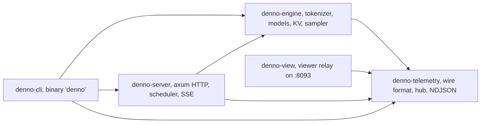
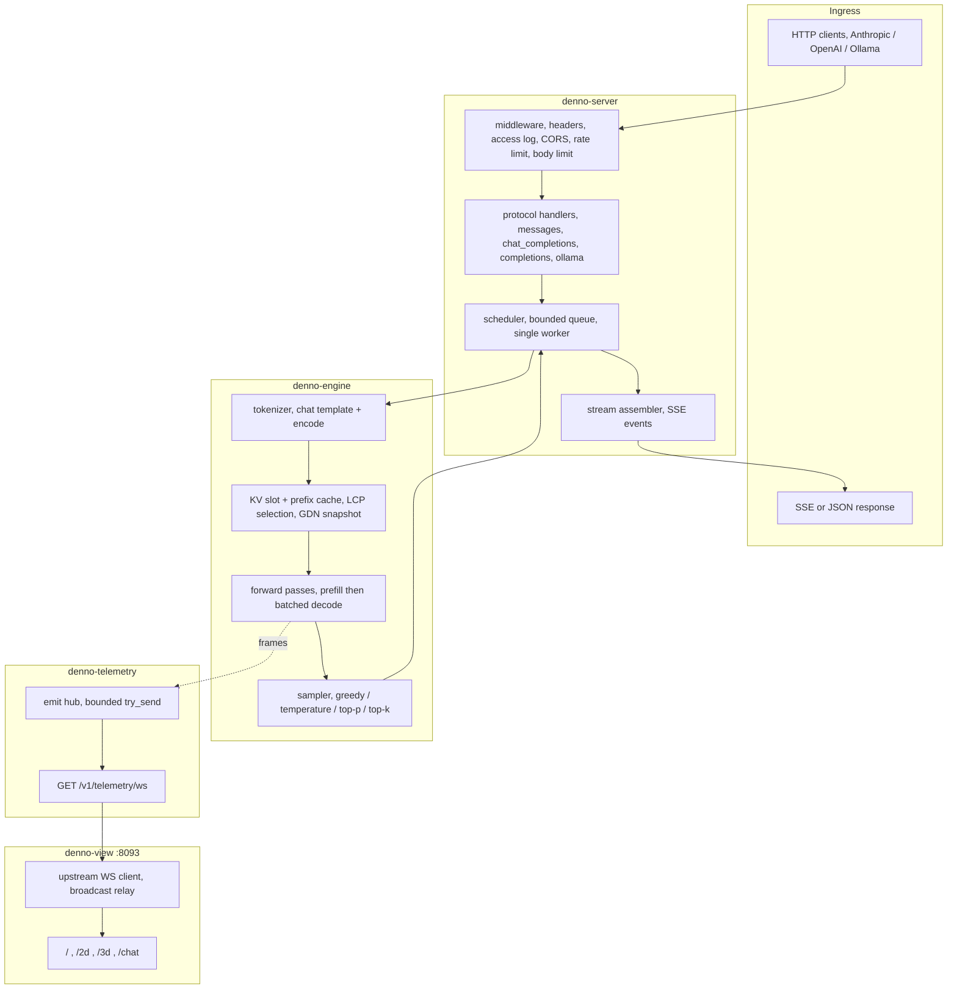
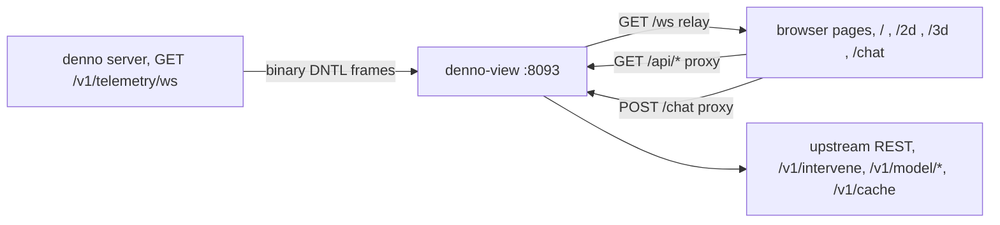

# denno Architecture: Crates, Data Flow, and the Inference Path

This is the entry-point architecture document for the `denno` workspace. It maps
the five crates, the two HTTP front ends, the request lifecycle, the inference
engine internals (dense, hybrid SSM/attention, and MoE), the telemetry bus, and
the `denno-view` visualization relay. Every crate name, module path, route, and
environment variable below was checked against the source tree; the commands
used to re-check them are in [Verifying this document](#11-verifying-this-document).

For model-internals deep dives see [ARCHITECTURE.en.md](ARCHITECTURE.en.md) and
[ARCHITECTURE.ja.md](ARCHITECTURE.ja.md). For runnable examples see
[API_COOKBOOK.md](API_COOKBOOK.md) and [CLIENTS.md](CLIENTS.md).

---

## 1. Scope and Reading Order

| You want to know | Read |
| --- | --- |
| Which crate owns what | §2, §3 |
| How one HTTP request becomes tokens | §4 |
| How a token becomes a forward pass | §5 |
| How to see inference live | §6, §7 |
| Which knob changes what | §8 |
| Which tests guard this document | §9 |

Two server front ends exist and they are **not** the same code path:

| Binary | Started by | Default bind | Implementation |
| --- | --- | --- | --- |
| `denno` (`denno serve <repo>`) | `crates/denno-cli/src/main.rs` | `127.0.0.1:8080` | axum router in `crates/denno-server` over `denno_engine::Engine` |
| `denno` (`denno serve-flash`) | `crates/denno-cli/src/main.rs` | `127.0.0.1:8098` | hand-written HTTP server in `crates/denno-cli/src/serve_flash.rs` over `Qwen4ExpDecoder` |

`serve` speaks Anthropic, OpenAI, and Ollama wire formats. `serve-flash` speaks
the Anthropic route set plus model-control and steering admin routes, and
returns 404 for the OpenAI and Ollama routes. The route split is verified by
`crates/denno-server/tests/openapi_contract.rs` against
[openapi.yaml](openapi.yaml).

---

## 2. Workspace and Crate Dependency Graph

The workspace is declared in the root `Cargo.toml` with five members:



`denno-telemetry` intentionally has **zero dependencies** (std only). The
engine, server, CLI, and viewer therefore share one frame definition without
pulling a runtime into the format crate.

### 2.1 Crate responsibilities

| Crate | Role | Key modules |
| --- | --- | --- |
| `denno-engine` | Tokenization, model loading, forward passes, KV cache, prefix cache, sampling, quantization | `engine.rs`, `model/`, `kv_cache.rs`, `prefix_cache.rs`, `kv_snapshot.rs`, `sampler.rs`, `quant.rs`, `tensor.rs`, `gguf.rs`, `kquant.rs`, `tokenizer.rs` |
| `denno-server` | HTTP surfaces, middleware, request scheduler, SSE assembly, metrics, lifecycle | `lib.rs`, `scheduler.rs`, `openai.rs`, `ollama.rs`, `ratelimit.rs`, `metrics.rs`, `lifecycle.rs`, `stream_asm.rs`, `startup.rs` |
| `denno-cli` | `denno` subcommands; owns the `serve-flash` front end | `main.rs`, `serve_flash.rs`, `serve_metrics.rs`, `serve_flash_synth.rs`, `config.rs`, `bench.rs`, `chat.rs`, `doctor.rs`, `abliterate.rs`, `pull.rs`, `inspect.rs`, `tokenize.rs`, `kv_radix.rs`, `flash_telemetry.rs` |
| `denno-telemetry` | Binary frame format (`DNTL`), bounded emit hub, f16/varint codecs, NDJSON bridge | `lib.rs` |
| `denno-view` | Separate-process viewer: telemetry relay, REST proxy, chat proxy, static UI plus `.mjs` modules | `main.rs`, `index.html`, `index2d.html`, `index3d.html`, `chat.html`, `*.mjs` |

### 2.2 `denno-cli` subcommands

`denno` is one binary with a `clap` subcommand tree (`crates/denno-cli/src/main.rs`):

- `pull`, `models`, `info` — model cache management.
- `generate` — single-shot generation without a server.
- `serve <repo>` — the multi-protocol server (`denno-server`, axum).
- `serve-flash` — the Qwen3.8-Flash-Next server (`qwen4exp`, hand-written HTTP).
- `chat` — interactive REPL against a running server.
- `bench` — reproducible pp/tg benchmark against a running server.
- `abliterate` — residual-stream capture, steering recipe export, OFF/ON eval.
- `inspect`, `tokenize`, `doctor` — offline introspection and preflight checks.

The `serve-flash` flag resolution order is **CLI argument > `DENNO_*`
environment variable > TOML config file > built-in default**
(`crates/denno-cli/src/config.rs`).

---

## 3. End-to-End Data Flow



Dotted edges are observation only: telemetry never sits on the numeric path
(§6).

---

## 4. Request Lifecycle (`denno serve`)

### 4.1 Router and middleware order

`crates/denno-server/src/lib.rs::router_with_body_limit` builds the axum router.
Routes are registered there; the Ollama admin routes live in
`ollama.rs::admin_router` and the cache admin routes in `cache_admin_router`.

| Method and path | Handler | Purpose |
| --- | --- | --- |
| `GET /health` | `health` | liveness, no auth |
| `GET /ready` | `ready` | readiness: model loaded, worker alive, not draining |
| `GET /metrics` | `metrics_endpoint` | Prometheus text, no auth |
| `GET /v1/models` | `models` | OpenAI model list |
| `GET /v1/models/:id` | `openai::model_by_id` | OpenAI model lookup |
| `GET /v1/cache/stats` | `cache_stats` | prefix-cache statistics |
| `DELETE /v1/cache` | `cache_flush` | drop cached prefixes |
| `POST /v1/messages` | `messages` | Anthropic Messages, JSON or SSE |
| `POST /v1/messages/count_tokens` | `count_tokens` | token estimate without prefill |
| `POST /v1/chat/completions` | `openai::chat_completions` | OpenAI chat, JSON or SSE |
| `POST /v1/completions` | `openai::completions` | OpenAI legacy raw prompt |
| `GET /api/tags` | `ollama::tags` | Ollama model list |
| `GET /api/version` | `ollama::version` | Ollama version |
| `POST /api/chat` | `ollama::chat` | Ollama chat, NDJSON stream |
| `POST /api/generate` | `ollama::generate` | Ollama raw generation |
| `POST /api/show`, `GET /api/ps` | `ollama::admin_router` | Ollama admin surface |
| `GET /v1/telemetry/ws` | `telemetry_ws` | binary telemetry stream |

Middleware is applied from the inside out; the effective order on the way in is:

1. `header_hygiene` (outermost) — adds `nosniff`, `cache-control`,
   `x-accel-buffering`, charset to every response including 404/405/413/429.
2. `log_requests` — access log line or JSON record.
3. CORS — loopback origins allowed by default; `DENNO_CORS_ORIGIN` or
   `--cors-origin` widens it.
4. Rate limit — token bucket, off unless configured.
5. Body limit — `DefaultBodyLimit` plus a JSON-envelope 413 wrapper.
6. Protocol handler.

Unknown routes return an OpenAI-shaped 404 envelope; unsupported methods return
405. Both go through the same middleware stack.

### 4.2 Authentication, rate limiting, body size

- **Auth** (`check_auth`): when at least one key is configured, a request must
  present it in `x-api-key` or `Authorization: Bearer <key>`. All configured
  keys and both header candidates are scanned, comparisons are constant-time,
  and no early return leaks which key matched. Keys come from
  `--api-key`/`--api-keys` and `DENNO_API_KEYS`, normalized into one
  comma-separated list in `AppState::api_key`. Unset means open access.
- **Rate limit** (`ratelimit.rs`): token bucket over inference paths only
  (`/v1/messages`, `/v1/messages/count_tokens`, `/v1/chat/completions`,
  `/v1/completions`, `/api/chat`, `/api/generate`). `/health`, `/ready`, and
  `/metrics` bypass it. Configured with `DENNO_RATE_LIMIT_RPM` and
  `DENNO_RATE_LIMIT_BURST`; unset or 0 disables it. Rejections are 429 with
  `error.type = rate_limit_error`, `error.code = rate_limit_exceeded`, and
  `Retry-After`.
- **Body size**: default 16 MiB (`DEFAULT_MAX_BODY_MB`), resolved as CLI
  `--max-body-mb` > `DENNO_MAX_BODY_MB` > 16, clamped to 4096 MiB. Oversize
  bodies get HTTP 413 in the standard error envelope.

### 4.3 Handler to scheduler

Protocol handlers validate the request (model name, message shape, tool schema,
JSON-schema `response_format`), pick per-request `GenParams`, then submit one of
the `Job` variants to the scheduler:

- `Job::Chat` — non-streaming; result returned through a `oneshot`.
- `Job::Stream` — Anthropic SSE; events go through a tokio mpsc channel.
- `Job::OpenaiStream` — OpenAI/Ollama streaming shapes.

The queue is a bounded `std::sync::mpsc::sync_channel` (`--max-queue`, default
`DEFAULT_MAX_QUEUE_DEPTH = 32`). A full queue returns `QueueFull`; the handler
maps that to the protocol's overload response:

| Protocol | Saturation response |
| --- | --- |
| Anthropic | 503 `overloaded_error` |
| OpenAI | 429 `rate_limit_exceeded` |
| Ollama | 503 |

`Retry-After: 1` (`QUEUE_RETRY_AFTER_SECS`) is attached where the protocol
allows it.

### 4.4 Scheduler worker and continuous batching

`crates/denno-server/src/scheduler.rs` runs exactly one worker thread. It holds
the engine `Mutex` for **one forward step at a time**, never for a whole
request, so control-plane endpoints stay responsive.

- `MAX_ACTIVE_SESSIONS = 4` caps concurrently *running* requests. This is a
  scheduler policy, independent of the number of KV slots the engine allocates
  (default up to 32, see §5.5).
- Every running request owns a KV slot until completion.
- Decode for all resident sessions is combined into one
  `Engine::step_chat_batch` forward, which shares weight reads across sessions.
- New prefills interleave between decode steps; priority is running decode >
  new prefill.
- The queue is FIFO, so admission order equals execution-start order. There is
  no per-protocol priority.
- Per-request wall-clock and progress limits are enforced at step boundaries:

| Limit | Default | Meaning |
| --- | --- | --- |
| `admit` | 300 s | queue wait plus slot wait before the request is failed |
| `stall` | 900 s | maximum time without progress for a running request |
| `send` | 30 s | maximum block on an SSE send to a slow client |
| `request` | 0 (off) | per-request wall clock, `DENNO_REQUEST_TIMEOUT_SECS` |

Client disconnects are detected through the SSE sink or the oneshot receiver and
abort the run at the next step boundary; the slot is released and other runs are
unaffected.

### 4.5 Engine: session admission and prefix decision

For each admitted job the worker calls `Engine::begin_chat` (or
`begin_completion` for raw prompts), which:

1. Applies the model's chat template and tokenizes (`tokenizer.rs`, minijinja
   with `pycompat` string methods).
2. Clamps `max_tokens` to the remaining context and builds the sampler.
3. Records the generation-prompt boundary for recurrent models (used as a
   stable prefix snapshot point).

`Engine::install_session` then:

1. Rejects prompts over `DENNO_MAX_PROMPT_TOKENS` (default 32768) and requests
   whose `prompt + max_tokens` exceeds the slot or the KV budget
   (`DENNO_KV_BUDGET_MB`, default 12288).
2. Picks the free slot with the longest live prefix match.
3. Chooses a reuse path: a multi-entry prefix-cache hit (`PrefixHit::Entry`), a
   live slot truncation (`PrefixHit::Live`), or a full prefill
   (`PrefixHit::None`).
4. Restores KV and, for recurrent models, the GDN state **as a pair**.

`step_chat` / `step_chat_batch` then run prefill (one forward over the prompt, or
two when a recurrent generation-prompt boundary is snapped) followed by
one-token decode steps until a stop condition.

### 4.6 Response assembly

`stream_asm.rs` turns engine output into protocol events. Anthropic SSE uses
`event: <type>` plus `data: {...}` lines, 2-second keep-alive pings, and
`message_start` / `content_block_delta` / `message_delta` / `message_stop`.
`usage.cache_read_input_tokens` reports the reused prefix length. OpenAI and
Ollama use their own chunk shapes over the same engine output.

The engine's `StopReason` enum has three values: `end_turn`, `max_tokens`, and
`stop_sequence`. The Anthropic handler adds a fourth wire value, `tool_use`,
when a tool call was emitted. Anthropic parity rule: when `stop_reason` is
`tool_use`, `stop_sequence` is emitted as null.

---

## 5. Model Execution

### 5.1 Two model paths

`crates/denno-engine/src/model/mod.rs::load_model` dispatches on
`config.json`'s `model_type`:

| `model_type` | Implementation | Notes |
| --- | --- | --- |
| `gpt2` | `model/gpt2.rs` | LayerNorm + GELU |
| `qwen2` | `model/llama.rs` | RMSNorm + RoPE + SwiGLU + GQA |
| `qwen3` | `model/llama.rs` | adds QK-Norm on top of the Qwen2 path |
| `qwen3_5` | `model/qwen35.rs` | hybrid GDN plus gated full attention, GGUF loader |
| `qwen4exp` | not loaded by `Engine` | served by `serve-flash` through `Qwen4ExpDecoder` |

Both paths implement the `Model` trait: `forward`, `forward_batch`,
`new_cache`, `context`, `eos_ids`, and `is_recurrent`. The batch contract is
that each session's logits must be **bit-identical** to a standalone forward.

### 5.2 Dense path (`serve`)

Prefill is a batched GEMM; decode is an m=1 matvec parallelized over output
columns. Kernels live in `tensor.rs` (sgemm via `matrixmultiply`, norm, RoPE,
activations) and `quant.rs` (int8 weights, SIMD dot products). Quantization is
`fp32` by default; `--quant int8` is deterministic but not bit-equal to fp32.
See [QUANT_SUPPORT_MATRIX.md](QUANT_SUPPORT_MATRIX.md) for the supported GGML
types and dequant guarantees.

Sampling (`sampler.rs`) supports greedy, temperature, top-k, top-p,
repetition penalty, frequency penalty, presence penalty, and no-repeat n-gram,
plus optional tool-constrained decoding (`toolmask.rs`). Per-session RNG state
means batching composition never changes a request's output.

### 5.3 Hybrid SSM/attention path (`qwen3_5`)

`model/qwen35.rs` implements a 3:1 layer schedule: most layers are
Gated DeltaNet linear-attention (SSM) layers, every fourth is full attention.
The math core is `gdn.rs`, a sequential autoregressive reference:

```
g    = ssm_a * softplus(alpha + ssm_dt)
S   <- S * exp(g)
sk   = k^T S
d    = beta * (v - sk)
S   <- S + k d^T
o    = q^T S
```

`q` and `k` are L2-normalized; `q` is scaled by `1/sqrt(head_k_dim)`, and the
output passes through a gated RMSNorm. Qwen3.5 uses a `silu` output gate;
Qwen3.8-Flash-Next uses `sigmoid`.

GDN state is sequence-global, not per-token. `KvCache` therefore holds an
optional `(conv, ssm)` slot per layer, and prefix reuse for recurrent models is
allowed only when the new prompt has the cached prompt as a **full prefix**
(`best_full_match`). Partial truncation would desynchronize the recurrent
state.

### 5.4 MoE path (`qwen4exp`, `serve-flash`)

`serve-flash` drives `Qwen4ExpDecoder` directly because this architecture has
no `Engine` implementation. `model/qwen4exp/` handles the parameter and tensor
layout; the pieces are:

- **Layer mix**: `full_attention_interval = 4`, so layers 3, 7, ..., 47 (12 of
  48) are full attention and the other 36 are SSM (`is_recr`).
- **MoE**: 512 experts per layer, top-10 routing, one shared expert. Routing
  order is a numerical contract: gate dot, softmax, top-k with index tie-break,
  optional renormalization, experts in ascending index order, shared expert
  last (`model/moe.rs`).
- **Hyper-connections**: four parallel residual streams mixed and combined per
  block (`model/hyper.rs`, `hc = 4`, `n_embd = 2560`).
- **QSA / indexer**: sparse attention selection (`qwen4exp_qsa.rs`,
  `model/indexer.rs`).
- **PLE**: n-gram lookup table feeding layer 2 (`ple.rs`,
  `qwen4exp/pf_dq_cache.rs`).
- **MTP**: optional nextn head (`model/mtp.rs`, `DENNO_MTP_PATH`).

### 5.5 Expert weight tiers and caching

Flash-Next expert weights are about 77 GB at Q4_K/Q5_1, so they do not fit in
VRAM or RAM. One token touches top-10 experts × 3 matrices, roughly 30 MB. The
cache keys entries by `(layer, expert)` and can serve them from three tiers:

| Tier | Mechanism | Gate |
| --- | --- | --- |
| SSD | `pread` at absolute GGUF offsets, LRU of resident slots | always available |
| Host RAM | `expert_cache` LRU over raw expert bytes | `DENNO_EXPERT_RAM_MB` |
| VRAM | device LRU with slab allocation and GPU GEMV | `DENNO_EXPERT_VRAM_MB` plus `DENNO_EXPERT_GPU=1` |

Cache hits and misses change only where the bytes come from, not the GEMV
entry point or the accumulation order. `DENNO_EXPERT_GPU_CHECK=1` compares the
GPU expert contribution against the CPU reference per layer. Tier occupancy is
reported to the viewer as `TIER_STATS` and `EXPERT_RESIDENCY` frames.

The 27B dense/hybrid path (`serve`) has a much smaller working set and does not
use this tiered expert cache.

### 5.6 KV cache, slots, and prefix reuse

`KvCache` (`kv_cache.rs`) stores per-layer K and V buffers, growing on demand up
to `max_len`. Layers that hold GDN state do not write KV, reducing bytes per
token on hybrid models. Key properties:

- One `KvCache` per slot; `Engine` owns `caches: Vec<KvCache>`.
- Slot count defaults to `DEFAULT_BATCH_SLOTS = 32`, reduced to what fits in
  `DENNO_KV_BUDGET_MB` (default 12288) under a 4096-token per-session reserve.
- `prefix_cache.rs` is a multi-entry LRU keyed by prompt tokens; it selects the
  longest common prefix and evicts by a token-weighted budget.
- `kv_snapshot.rs` writes a disk snapshot (`DNKVSNAP`, version 1, little
  endian, header plus layer payload, FNV-1a checksum) so `serve-flash` can skip
  a cold prefill after restart. Snapshot and restore preserve f32 bit patterns,
  including NaN.
- `DENNO_PREFIX_CACHE_MAX_TOKENS` caps the prefix-cache budget; unset derives it
  from the KV budget, with a 2048-token floor.

### 5.7 Exactness and determinism

The top-level discipline is: same input, same output. Concretely:

- Every dot product has a fixed accumulation order.
- Batch decode kernels preserve the k-direction order of a standalone matvec;
  fp32 k-splitting is forbidden, int8 i32 accumulation is allowed.
- Each session owns its RNG, so batching does not perturb sampling.
- Optimizations are gated by environment variables that default to off or to
  numerically identical behaviour.
- GGML dequantization is bit-exact with llama.cpp where the loader claims it;
  see [NUMERIC_POLICY.en.md](NUMERIC_POLICY.en.md) and
  [NUMERIC_POLICY.ja.md](NUMERIC_POLICY.ja.md).

---

## 6. Telemetry Bus

### 6.1 Wire format

`denno-telemetry` defines a compact binary frame:

```
magic "DNTL" (4 bytes) | version (1 byte) | kind (1 byte) | payload
```

Integers inside payloads are LEB128 varints; probabilities are f16 bit patterns
(u16). The full payload layout per kind is in
[TELEMETRY_PROTOCOL.md](TELEMETRY_PROTOCOL.md). An NDJSON bridge exists for
trace files and human-readable logs.

### 6.2 Frame kinds

| Kind | ID | Emitted when |
| --- | --- | --- |
| `SERVER_INFO` | 1 | WS connect: model, quant, slots, context, layers |
| `SESSION_ADMIT` | 2 | session gets a KV slot |
| `SESSION_DONE` | 3 | session ends and reports a stop reason |
| `PREFILL` | 4 | prefill completes |
| `TOKEN` | 5 | a token is produced |
| `STEP` | 6 | one decode step completes |
| `OP_SUMMARY` | 7 | per-op timing totals |
| `KV_USAGE` | 8 | KV slot occupancy |
| `GAP` | 9 | frames were dropped |
| `TOP_K` | 10 | sampler top-k and entropy (gated) |
| `LAYER_RUN` | 11 | op sequence inside one layer forward |
| `LAYER_ACT` | 12 | top-K neuron activations per layer (gated) |
| `ROLE_ACT` | 13 | normalized role activity per layer (gated) |
| `EXPERT_RESIDENCY` | 14 | VRAM-resident experts per layer |
| `TIER_STATS` | 15 | VRAM/RAM/SSD tier counts |
| `ROUTER_TOPK` | 16 | selected experts and gate weights |
| `EXPERT_SKIP` | 17 | experts the router wanted but intervention disabled |

### 6.3 Hub and backpressure

`denno_telemetry::emit` only tries a non-blocking send into a bounded channel
(`CHANNEL_CAP = 4096`). If the channel is full or disconnected the frame is
dropped and a counter increments; the relay later emits a `GAP` frame. Inference
never waits on telemetry.

On the server side, one relay thread (`start_telemetry_relay`) drains the hub
into a `tokio::sync::broadcast` channel. Each `GET /v1/telemetry/ws` client gets
a `SERVER_INFO` frame first, then binary frames. A lagging client receives a
`GAP` frame rather than silent loss.

### 6.4 Enabling telemetry

| Process | Default | Gate |
| --- | --- | --- |
| `denno serve` | off | `DENNO_TELEMETRY=1` before startup |
| `denno serve-flash` | on | `DENNO_TELEMETRY=0` disables |

Observation gates, all off by default except where noted: `DENNO_TELEMETRY_ACT`
(layer activations, K via `DENNO_TELEMETRY_ACT_TOPK`, default 64),
`DENNO_TELEMETRY_TOPK` (sampler top-8), `DENNO_TELEMETRY_ARCH` (role activity,
router top-k, expert residency, tier stats), `DENNO_TELEM_EXPERT_SKIP`, and
`DENNO_TELEM_LAZY` (on by default: skip expensive observation when no clients
are connected).

---

## 7. denno-view

`denno-view` is a separate process that never touches the engine. It connects
to the upstream telemetry WebSocket, keeps the latest `SERVER_INFO` and
`KV_USAGE` frames as snapshots for new clients, and fans frames out to browser
tabs.



### 7.1 Routes served by `denno-view`

| Route | Purpose |
| --- | --- |
| `GET /` | dashboard: rates, KV/VRAM/latency, op timing, input tokens, API examples |
| `GET /2d` | architecture map with intervention, steering, presets, abliteration |
| `GET /3d` | topology view: layers, experts, KV band, prediction head, chat |
| `GET /chat` | minimal chat page; pure logic in `chat.mjs` |
| `GET /ws` | telemetry relay WebSocket to the browser |
| `GET /replay`, `GET /capture.bin` | replay and capture frame streams |
| `GET /tokenizer.json` | token text decoding, when `VIEW_TOKENIZER` is set |
| `GET /code/src` | real implementation snippets for the code pane |
| `GET /api/*` | any-method REST proxy to the upstream server |
| `GET /v1/limits` | proxy of upstream generation limits |
| `POST /chat` | proxy to upstream `POST /v1/messages` |
| `GET /*.mjs`, `GET /vendor/*` | UI modules and vendored assets |

### 7.2 Viewer environment variables

| Variable | Default | Effect |
| --- | --- | --- |
| `VIEW_UPSTREAM` | `ws://127.0.0.1:8080/v1/telemetry/ws` | upstream telemetry URL |
| `VIEW_PORT` | `8093` | listen port |
| `VIEW_RECORD` | unset | append received frames to a file |
| `VIEW_REPLAY` | unset | serve a recording at `/replay` |
| `VIEW_CAPTURE` | unset | serve a concatenated frame stream at `/capture.bin` |
| `VIEW_TOKENIZER` | unset | `tokenizer.json` used for token text |

When the upstream is `serve-flash`, set `VIEW_UPSTREAM` to port 8098; the
default points at `serve` on 8080. Page details, keyboard shortcuts, selector
grammar, and replay behaviour are in [VIEWER.en.md](VIEWER.en.md) and
[VIEWER.ja.md](VIEWER.ja.md).

### 7.3 Pages and their data needs

- `/` consumes the base frames (`SERVER_INFO`, `KV_USAGE`, `STEP`, `OP_SUMMARY`,
  `TOKEN`) and needs no extra gates.
- `/2d` additionally uses `TOP_K` for token probabilities, `ROLE_ACT` and
  `ROUTER_TOPK` for the block map, and `EXPERT_RESIDENCY` for hit/miss badges.
- `/3d` uses the same topology frames plus `LAYER_ACT` for neuron lighting and
  `TIER_STATS` to place experts at their VRAM/RAM/SSD heights.

Missing gates degrade the page rather than break it: the 3D view falls back to a
simulated demo when no frames arrive.

---

## 8. Configuration Map

### 8.1 `serve` knobs

| Variable | Default | Effect |
| --- | --- | --- |
| `DENNO_API_KEYS` | unset | comma-separated accepted keys (merged with `--api-key`/`--api-keys`) |
| `DENNO_RATE_LIMIT_RPM` | unset | requests per minute; 0 or unset disables |
| `DENNO_RATE_LIMIT_BURST` | rpm/60 | token bucket capacity |
| `DENNO_CORS_ORIGIN` | loopback only | allowed origin list or `*` |
| `DENNO_MAX_BODY_MB` | 16 | request body cap in MiB |
| `DENNO_MAX_QUEUE_DEPTH` | 32 | queued requests beyond the running set |
| `DENNO_REQUEST_TIMEOUT_SECS` | 0 | per-request wall clock; 0 disables |
| `DENNO_DRAIN_TIMEOUT_SECS` | see `lifecycle.rs` | graceful shutdown drain |
| `DENNO_SERVER_METRICS` | on | `0`/`false`/`no` freezes `/metrics` counters |
| `DENNO_TELEMETRY` | off | enable the telemetry hub and WebSocket |

### 8.2 Engine knobs

| Variable | Default | Effect |
| --- | --- | --- |
| `DENNO_BATCH_SLOTS` | 32 | KV slots before budget scaling |
| `DENNO_KV_BUDGET_MB` | 12288 | total KV byte budget |
| `DENNO_MAX_PROMPT_TOKENS` | 32768 | prompt length ceiling |
| `DENNO_PREFIX_CACHE_MAX_TOKENS` | derived | multi-entry prefix-cache budget |
| `DENNO_KV_RADIX` | off | radix index for prefix slots in `serve-flash` |
| `DENNO_PROFILE` | off | in-process profiler |
| `DENNO_METRICS` | on | `serve-flash` Prometheus gate |

### 8.3 `serve-flash` knobs

| Variable | Default | Effect |
| --- | --- | --- |
| `DENNO_FLASH_DIR` | config file | directory of split GGUF files |
| `DENNO_FLASH_HOST` / `DENNO_FLASH_PORT` | `127.0.0.1` / `8098` | bind address |
| `DENNO_FLASH_MAX_CTX` | 4096 | KV/GDN capacity |
| `DENNO_FLASH_MAX_TOKENS` | 512 | generation cap |
| `DENNO_FLASH_NAME` | `qwen3.8-flash-next` | advertised model id |
| `DENNO_KV_SLOTS` | 2 | KV/prefix slots |
| `DENNO_EXPERT_RAM_MB` | 0 | host-RAM expert cache size |
| `DENNO_EXPERT_VRAM_MB` | 0 | VRAM expert cache size |
| `DENNO_EXPERT_GPU` | 0 | enables GPU expert GEMV |
| `DENNO_MTP_PATH` | unset | MTP/nextn head safetensors |
| `DENNO_AUTO_CONFIG` | unset | derive unset `DENNO_*` from card capacity |
| `DENNO_STEER_RECIPE` | unset | steering recipe applied at startup |

Tuning-only switches for individual kernels exist, but they default to values
that preserve the reference numeric path. See
[PERFORMANCE_TUNING.md](PERFORMANCE_TUNING.md) and
[DETAILS.en.md](DETAILS.en.md) before changing them.

---

## 9. Observability Surfaces

- `denno serve` `/metrics`: Prometheus text without a client library. Handler
  in `lib.rs`, counters in `metrics.rs`, gate `DENNO_SERVER_METRICS`.
- `denno serve-flash` `/metrics`: separate implementation in
  `crates/denno-cli/src/serve_metrics.rs`, vLLM-compatible series names, gate
  `DENNO_METRICS`, default on.
- Access logs: text by default, JSON with `--log-format json`. `logging.rs`
  writes from a non-blocking stdout wrapper so a stalled log consumer cannot
  block the server thread.
- `denno doctor`: preflight checks including CPU and memory, model directory,
  disk space (`statvfs`), file descriptor limits (`getrlimit`), and the effective
  environment.
- `denno-telemetry` NDJSON: trace recording and offline replay; see
  [OBSERVABILITY.md](OBSERVABILITY.md).

Operational limits and measured baselines are in [KPI.md](KPI.md). Security
guidance, including loopback binding and auth defaults, is in
[SECURITY.md](SECURITY.md).

---

## 10. Invariants Worth Knowing

1. `denno-telemetry` stays dependency-free; every other crate may depend on it,
   and it depends on nothing.
2. The engine mutex is never held across a whole request. Handlers read cached
   `EngineInfo`; only the worker steps the engine.
3. Control-plane endpoints (`/health`, `/ready`, `/metrics`, `/v1/models`,
   `/v1/cache/*`) do not lock the engine, so they answer during generation.
4. Observation is off the numeric path. Telemetry drops rather than blocks.
5. Recurrent models restore KV and GDN state together, and only from a full
   prompt prefix.
6. Queue saturation maps to protocol-native errors; the scheduler itself only
   reports `QueueFull`.
7. Two front ends, one wire contract: `openapi_contract.rs` checks
   `docs/openapi.yaml` against both implementations and their `x-denno-impl`
   markers.

---

## 11. Verifying This Document

The architecture claims above can be re-checked without a GPU:

```bash
# crate graph and members
grep -A8 '\[workspace\]' Cargo.toml

# routes served by the axum server
grep -n 'route(' crates/denno-server/src/lib.rs

# routes served by serve-flash
grep -n '"/v1/\|"/health"' crates/denno-cli/src/serve_flash.rs

# viewer routes
grep -n '\.route(' crates/denno-view/src/main.rs

# telemetry frame kinds
grep -n 'pub const .*: u8' crates/denno-telemetry/src/lib.rs

# environment variables
grep -rhoE 'DENNO_[A-Z0-9_]+' crates --include=*.rs | sort -u
```

Documentation hygiene is enforced by
`crates/denno-server/tests/docs_consistency_1249.rs`, which scans every `.md`
and `.yaml` file under `docs/` for private IPv4 ranges and internal absolute
paths. The link targets in this file are checked by hand against `docs/`; run
`cargo test --release -p denno-server --test docs_consistency_1249` after
editing.

---

## 12. Related Documents

| Document | Contents |
| --- | --- |
| [ARCHITECTURE.en.md](ARCHITECTURE.en.md) / [ARCHITECTURE.ja.md](ARCHITECTURE.ja.md) | Model internals, tensor layout, per-stage dataflow |
| [API_COOKBOOK.md](API_COOKBOOK.md) | Copy-paste requests for every wire protocol |
| [CLIENTS.md](CLIENTS.md) | SDK and curl integration examples |
| [TELEMETRY_PROTOCOL.md](TELEMETRY_PROTOCOL.md) | Byte-level frame format and golden tests |
| [VIEWER.en.md](VIEWER.en.md) / [VIEWER.ja.md](VIEWER.ja.md) | Viewer pages, shortcuts, replay |
| [FEATURES.md](FEATURES.md) | Feature matrix across both server binaries |
| [DETAILS.en.md](DETAILS.en.md) | Flash-Next layout, env vars, other models |
| [DECODE_PATH.md](DECODE_PATH.md) | Where per-token time goes |
| [PREFILL_PATH.md](PREFILL_PATH.md) | Prefill structure and optimization history |
| [QUANT_SUPPORT_MATRIX.md](QUANT_SUPPORT_MATRIX.md) | GGML type support and gates |
| [OBSERVABILITY.md](OBSERVABILITY.md) | Metrics, logs, doctor, telemetry traces |
| [TESTING.md](TESTING.md) | Test layout, release mode, exactness suites |
| [TROUBLESHOOTING.md](TROUBLESHOOTING.md) | Common failures and fixes |
| [SECURITY.md](SECURITY.md) | Binding, auth, hardening |
| [ABLITERATION_GUIDE.md](ABLITERATION_GUIDE.md) | Capture, steer, and evaluate residual directions |
| [KPI.md](KPI.md) | Measurement protocol and baselines |
| [QUICK_REFERENCE.md](QUICK_REFERENCE.md) | One-page doc index |
| [openapi.yaml](openapi.yaml) | Machine-readable route contract |
| [history/README.md](history/README.md) | Development history by volume |

---

## Appendix A: `serve-flash` Route Inventory

`serve-flash` uses a hand-written HTTP loop, so its routes are string matches
rather than axum registrations:

| Method and path | Purpose |
| --- | --- |
| `GET /health`, `GET /healthz` | liveness |
| `GET /ready` | readiness |
| `GET /metrics` | Prometheus text |
| `GET /v1/models` | model list |
| `POST /v1/messages` | Anthropic Messages, JSON or SSE |
| `GET /v1/telemetry/ws` | telemetry WebSocket |
| `GET /v1/limits` | generation limits |
| `GET /v1/model/shape` | layer and MoE topology for the viewer |
| `GET/POST/DELETE /v1/intervene` | expert, block, and residual-stream intervention |
| `GET /v1/model/choices` | selectable models |
| `POST /v1/model/select` | restart with another model |
| `GET /v1/cache/stats`, `GET /v1/cache`, `DELETE /v1/cache` | prefix-cache admin |
| `GET /v1/experts/stats` | expert cache statistics |
| `GET/POST/DELETE /v1/steer/*` | record, apply, analyze, export, import steering |
| `POST /v1/abort` | abort the in-flight generation |

`serve-flash` deliberately does not implement the OpenAI chat/completions
routes or the Ollama routes; requests there return a 404 error envelope. The
authoritative mapping of every operation to its implementation is in
[openapi.yaml](openapi.yaml) via the `x-denno-impl` extension.
