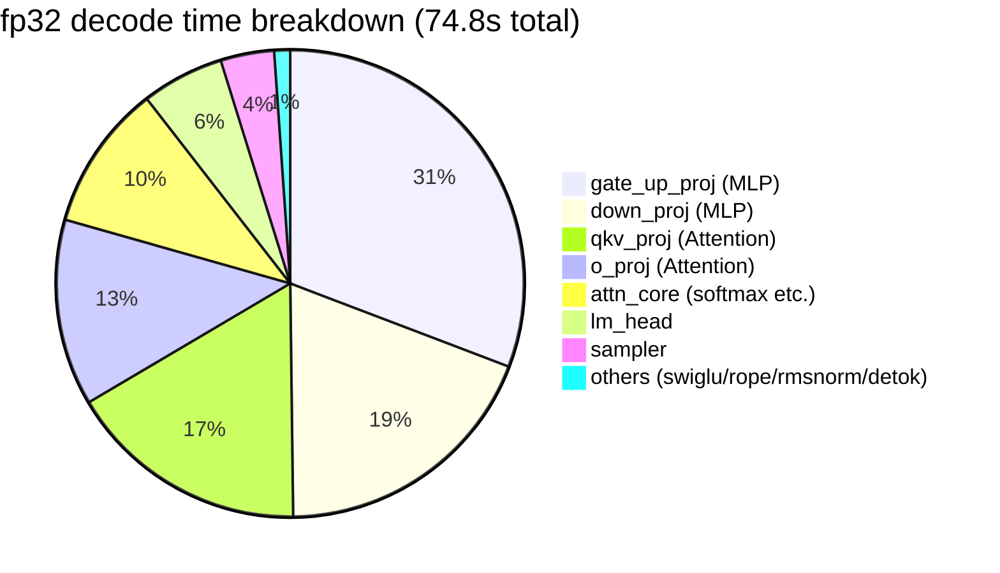
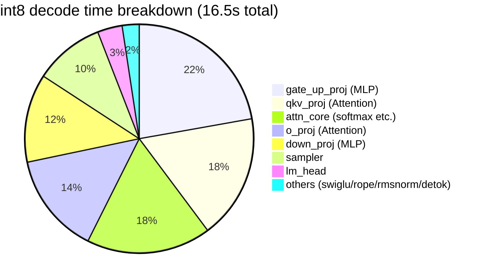
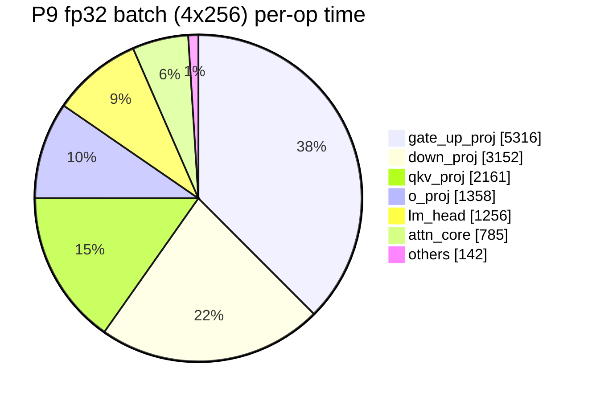

# denno-beta Development History

> Architecture details: see the [Architecture Guide](ARCHITECTURE.en.md).
> This note is the **development log**. New features are appended at the end in this format:
>
> **Entry format**: under `### Pn: Feature (date, commit)`, record **Implementation** / **Tests** / **Profile** / **Next up**. Completed items are reflected in the candidate list under "Next up".

**Updated**: 2026-10-13
**Repository**: https://github.com/ahinore/denno-beta (main, `3ff6175` synced)

---

## 1. Development Environment and Deployment

```
[dev machine: x86_64 Linux (everything inside Docker)]
├─ denno-beta container (port 8080)            … LLM API server (production)
│    └─ model cache: ai_work/denno-beta/data/.cache
└─ dev container … dev agent + dev denno (8090) / denno-view (8093)
     └─ /work/denno-beta (= host ai_work/denno-beta, git-managed)

Dev flow: agent implements → cargo test → exactness check → commit
        → GitHub sync → CI (build+test+exactness)
        → production container docker compose build && up -d → health/generation tests
```

- CI: `.github/workflows/ci.yml` — build+test (push/PR), exactness (push only, downloads real models). **All green on x86-64-v3**
- GitHub push: currently synced via the Windows repository checkout. Container-direct push awaits deploy key registration
- Reference output (exactness): "1+1は?" → `1+1は1です。これは数学的定理で、1と1を加えることによって得られます。` (seed 42, temp 0, fp32). Confirmed identical on the CI x86 runner

## 2. Timeline (early → P2: summary)

| Stage | Content |
|---|---|
| Initial implementation | single binary (cli/engine/server), GPT-2/Qwen2.5-0.5B, Anthropic API compatible + SSE, exact decoding (seed 42) |
| Optimization #1 | `target-cpu=native`, attention scalar loop → sgemm, decode matvec output-split parallelism → prefill 88s→24s, decode 1s/token→0.1s |
| P1 | KV cache + LRU prefix cache (single entry) → subsequent prefills ≈0 (1519→11 tokens) |
| P2 | multi-entry LRU prefix cache (largest-LCP selection, 32k token budget) → `reuse 47/48` even in alternating sessions |

## 3. Phase Records

### P3: int8 weight-only quantization ✅ (2026-10-11, commit `89aae74`)

- **Implementation**: per-channel scale quantization + dequant-in-matvec kernel (new `quant.rs`, 430 lines). fp32 default fully preserved; active only with `--quant int8`
- **Tests**: 77 tests green. fp32 exactness unchanged; int8 identical across 3 runs (deterministic)
- **Profile**: speed flat (14.4 → 13.9 tok/s). Dequantization overhead cancels the bandwidth savings; the value is halved memory (weights ~1GB → ~0.5GB)
- **Next**: SIMD int8 dot product (→ done in P5), continuous batching (→ P4)

### P4: Continuous batching ✅ (2026-10-11, commits `f65281f` → `4e9058a` → `e3ad3ca`)

- **Implementation**: request scheduler (`scheduler.rs`) — bounded queue (503 when full) + engine stepper advanced by `step_chat` (1 forward). New prefills interrupt decode; multiple sessions rotate via KV suspend/resume (`MAX_ACTIVE_SESSIONS=4`)
- **Tests**: 86 tests green. **Each output is bit-identical to a solo run even under interleaving** (verified with KvSensitiveModel). CI (x86) 3 consecutive full greens
- **Profile**: none taken. Instead found a real bug: the worker held the mutex almost continuously, starving the HTTP handler's `engine.lock()` by hundreds of ms → fixed by caching the model name in AppState
- **Next**: int8 SIMD kernel (→ P5), true parallel decode (→ P6 candidate)

### P5: int8 SIMD kernel ✅ (2026-10-12, commit `eec5624`)

- **Implementation**: redesigned P3's "dequantize weights and multiply in fp32" into **"dynamic activation quantization + true i8×i8 integer dot product"**. aarch64 NEON `vdotq_s32` / x86 AVX2 `_mm256_madd_epi16`, switched by cfg
- **Tests**: 91 tests green (+5). i32 accumulation's associativity makes SIMD/scalar bit-identical (property test). Also verified on the CI x86 AVX2 path. Deterministic within int8 (3 runs, same md5), fp32 fully unchanged
- **Profile**: kernel-only 5.4–12.9× (lm_head 5.39ms→1.0ms), e2e decode **~14.4 → ~51 tok/s**
- **Next**: true parallel decode (P6)

### P6: Continuous batching (batched parallel decode) ✅ (2026-10-12, commit `52f5742`)

- **Implementation**: KV cache changed from single to a **slot pool** (`caches: Vec<KvCache>`, `DENNO_BATCH_SLOTS` default 4). Sessions stay resident in their own slots until completion (old suspend/restore rotation removed), and one decode step of all resident sessions is combined into **a single `forward_batch`**. Kernel layer: new multi-column matvec `matvec_rows_bt`/`matvec_rows_bt_i8` — **each element's k-direction accumulation order exactly matches a standalone matvec** (no sgemm, which would change accumulation order = bit-identical even in fp32). rayon row-block parallelism shares raw pointers via a `SendPtr::write` method (an edition-2021 disjoint-closure-capture workaround). Scheduler converted to continuous batching (admit while slots free, prefill-priority interleaving, batched decode `step_chat_batch`, 503 when full)
- **Tests**: **106 tests green** (engine 99 + server 7). Contract tests that `forward_batch` matches solo decode bit-for-bit for B∈{1,2,3} over multiple steps, alternating-session exactness, all passing on CI x86-64 too. **On hardware**: 0.5B with 4 concurrent sessions, fp32/int8 both solo==batch fully identical (including repeated runs), reference output unchanged
- **Profile** (0.5B, 4 requests × 256 cap, same machine): sequential 604 tokens/20.6s → batch 604 tokens/14.8s. Aggregate throughput **fp32 13.9→18.7 tok/s (1.35×), int8 38.8→66.2 tok/s (1.7×)**. 131 steps consumed 272 tokens across 4 sessions = batching fully working. **At b=4 the regime shifts from bandwidth-bound to compute-bound** (fp32: 72ms→110ms per step, int8: 27ms→36ms) = the weight stream runs once but FLOPs are 4×. Next breakthrough would be order-preserving SIMD widening in the k direction
- **Size dependence measured** (3B int8, b=2, 128 cap): solo 12.8 tok/s → batch aggregate 20.5 tok/s (**1.6×**). Batch step time almost unchanged (solo 78ms → 81ms at b=2) = **3B still weight-bandwidth-bound** (weights 3GB/step vs relatively small FLOPs). Confirmed the prediction "larger models benefit from batching more directly". 3B also verified solo==batch bit-identical
- **Design note**: `release_session` keeps KV rows and `cached_prompts[slot]` in place so the next session with the same prefix can reuse them zero-copy with truncate only (reproducing the old single-cache behavior). Eviction goes to the prefix store (`contains_prompt` avoids duplicates). Prefill processes the remaining prompt in one forward (splitting would change GEMM accumulation order = exactness NG)
- **Next**: sampler optimization (→ P8, completed before P6 work began)

### P7: Large Qwen model support ✅ (2026-10-12, commit `9fb18ab`)

- **Implementation**: sharded safetensors (`model.safetensors.index.json` + download all shards / tensor name resolution, new `WeightStore`), untied lm_head (`tie_word_embeddings: false`)
- **Tests**: 93 tests green (+2). 0.5B exactness fully unchanged. **0.5B/1.5B/3B/7B all answered normally ("1+1は2です。" etc.)**
- **Profile** (by size, 20-core CPU):

| Model | fp32 | int8 | Notes |
|---|---|---|---|
| 0.5B | 14.4 tok/s | ~51 tok/s | production |
| 1.5B | — | — | runs unchanged on the existing binary |
| 3B | ~2 tok/s | ~4.7 tok/s (2.4×) | sharded checkpoint + untied |
| 7B | ~1.2 tok/s | ~2.1 tok/s (1.8×) | weights 28GB, RAM 121GB with room to spare |

- **Next**: profiler introduction for bottleneck visibility (→ P7.5)

### P7.5: Profiler + bottleneck visualization ✅ (2026-10-12, commit `40e209d`)

- **Implementation**: lightweight self-profiler `prof.rs`. Enabled with `DENNO_PROFILE=1`; on request completion logs accumulated time per phase at INFO. Zero overhead when disabled, never touches the numeric path
- **Tests**: 93 tests still green. exactness reference output unchanged (profiler disabled). CI ✅, deployed
- **Profile**: below (later measurements appended here in this format)

#### Profiling method constraints

Inside Docker, `perf` (denied by perf_event_paranoid=4), `valgrind/callgrind` (SIGILL on aarch64 native code), and `gdb` (ptrace forbidden) are all unavailable → **in-code measurement (self-instrumentation) is the only proper way**

#### Measurement conditions

Qwen2.5-0.5B, one long generation request (cumulative incl. prefill).

**fp32 decode time breakdown** (800 tokens total, 74.8s overall):



**int8 decode time breakdown** (461 tokens to EOS, 16.5s overall):



#### What it tells us

1. **Linear layers (matvec) dominate** — ~80% in fp32. Decode is weight-bandwidth-bound as expected. int8+SIMD compresses this to ~70% and yields ~4.5× speed
2. **attn_core share grows in int8** (10%→18%) — it surfaces relatively as linear layers speed up. KV cache reads + scales/softmax. Grows further with long contexts
3. **sampler is a fixed ~3.5ms/step cost** — 3.7% in fp32, ~10% in int8. Softmax + top-p sort over the full 152k vocabulary is the bottleneck
4. swiglu/rope/rmsnorm/embed total ~1% — numerically confirmed "no optimization needed"

- **Next**: sampler optimization (top candidate) / resume P6 (true parallel decode)

### P8: Sampler optimization ✅ (2026-10-12, commit `119dd92`)

- **Implementation**: responding to the P7.5 profile (fixed ~3.5ms/step sampler cost), `sampler.rs` fully rewritten. top_k=`select_nth_unstable`+partial sort (with a reference-implementation test that ties break bit-identically to the old code) / top_p-only = compute over the top-2048 subset with fallback to the old full path on boundary hits / plain temperature (production default) = sort-free two-pass O(n) + scratch reuse. **The greedy path is completely unchanged** (temperature=0 goes straight to argmax)
- **Tests**: 98 tests green (+5 sampler tests including bit-identical reference checks). **Declared as a spec change**: the temperature path's RNG→token mapping differs from the old implementation (greedy unchanged). 0.5B greedy reference output unchanged, CI ✅
- **Profile**: sampler 3.5ms→**0.66ms/step (5.3×)**. Share 3.7%→0.7% (fp32), 9.9%→2% (int8)
- **Next**: P6 continuous batching (→ completed as P6)

### P9: fp32 batch kernel SIMD (order-preserving lane parallelism) ✅ (2026-10-12, commit `1bbffff`)

- **Implementation**: SIMDized the fp32 batch kernel `matvec_rows_bt` after P6 found "b=4 shifts to compute-bound". **Lanes run only along i (4 sessions in the batch) and j (4 output channels for ILP), never along k** — each output element's k accumulation stays strictly sequential (only separate multiply and add instructions, no FMA = rounding kept separate) → bit-identical to solo decode (`matvec_bt`) is preserved. Activations are transposed to `[k][mp]` with zero padding to keep lane loads contiguous (m*k is at most tens of KB, transposition cost negligible). aarch64 NEON / x86 SSE (`_mm_mul_ps`) dual implementations + scalar fallback for other targets
- **Tests**: 106 tests green. Bit-identity test shapes extended (m∈{1..8}, k∈{1,4,65,896}, with remainders). CI exactness ✅ on the x86 SSE path too. **On hardware**: fp32/int8 both 4 concurrent sessions == solo fully identical, reference output unchanged
- **Profile**: below

#### Profile

**① Server per-op** (`DENNO_PROFILE=1`, 0.5B fp32, solo/batch measured in separate sessions)

| op | solo: ms (calls) | solo share | batch: ms (calls) | batch share |
|---|---:|---:|---:|---:|
| gate_up_proj | 1,642 (3,600) | 33.8% | 5,316 (6,432) | 37.0% |
| down_proj | 1,196 (1,800) | 24.7% | 3,152 (3,216) | 22.0% |
| qkv_proj | 828 (5,400) | 17.0% | 2,161 (9,648) | 15.0% |
| o_proj | 502 (1,800) | 10.3% | 1,358 (3,216) | 9.5% |
| lm_head | 405 (75) | 8.3% | 1,256 (134) | 8.7% |
| attn_core | 187 (1,800) | 3.8% | 785 (3,216) | 5.5% |
| rope/sampler/rmsnorm/detok | 42 | 0.9% | 142 | 2.3% |
| **TOTAL** | **4,854** | 100% | **14,362** | 100% |

- **solo**: 75tok/4.88s = **15.4 tok/s** (64.7ms/step), linear layers total **94.2%**
- **batch**: 279tok/130 steps, average batch width **2.15** (early-finishing sessions with outputs of 45–83 tokens), aggregate **19.4 tok/s** (21.8 without the profiler)
- **Per-token linear-layer cost 61.0→47.5ms (1.28×)**. Attention unchanged per token (2.5→2.8ms) = wider within a step but the same per token
- The in-server batch linear layers don't reach the microbenchmark bandwidth floor (width 4 = solo step time) → attributed to the drop in average width (2.15) + memory-system contention in the real server (activation/KV interfering with the weight stream)



**② Kernel-only microbenchmark** (0.5B shapes, m=4): gate_up(k=896, n=4864) **3.92×** / down(k=4864, n=896) **5.86×** (vs 4× standalone `matvec_bt`). Shipped as an `#[ignore]` test `bench_matvec_rows_bt_m4` (`cargo test --release bench_matvec -- --ignored --nocapture`)

- **e2e limiting factors identified** (profile analysis): the batch aggregate factor (fp32 1.36×) almost matches the per-token linear improvement (1.28×) — linear layers are no longer the main bottleneck. In theory width 4 could cut per-token linear cost to ~1/4 (61→~15ms), so **the remaining bottlenecks are ① average batch width drop (completion-time skew, avg 2.15), ② in-server memory-system contention, ③ attention/prefill (unchanged per token, doesn't grow with width)**. Next levers: session-lifetime flattening + attention batching
- **Next**: attention batching (P10 candidate) / b=4 measurements for 3B/7B

### P10: Attention parallelization (session × KV head) ✅ (2026-10-12, commit `4e2428f`)

- **Implementation**: `forward_batch`'s attention parallelized with rayon. Task granularity is **(session i × KV head kvh)** (up to 32 tasks at 0.5B); each task owns a non-overlapping slice of `att`. The op sequence inside a task is exactly the solo decode (n==1) path (sgemm_acc→softmax→matmul, same shapes) and there is no numeric interaction between sessions/KV heads, so **bit-identity is trivially preserved**. KV reads use the new `KvCache::kv_bufs_ref(&self)` (read-only) shared accessor. Solo decode and prefill paths untouched (discipline: don't touch the reference paths)
- **Tests**: 106 tests green (the fp32/int8 batch==solo bit-identity tests directly cover the parallel path; test model is GQA-shaped). Hardware: fp32/int8 both 4 concurrent == solo fully identical. CI 38240311689 ✅ (passes on x86 too)
- **Profile** (interleaved A/B measurement, see lessons below):

  | Measurement | new (P10) | old (P9) |
  |---|---:|---:|
  | batch 4×256 aggregate | **33.4 / 33.1 tok/s** (avg 33.2) | 31.6 / 32.2 tok/s (avg 31.9) |
  | solo 256 | 17.3 tok/s (unchanged) | same |

  - **P10 effect: aggregate +4%** (new code won in both interleaved pairs, reproducible). Physically consistent: P9's profile had attn_core at 5.5% in batch; parallelization recovers most of that wall time
  - **Measured-pollution example**: a naive before/after comparison showed new 6.78s/41.2tok/s vs old 12.99s/21.8tok/s (2×!), but interleaved A/B showed only +4% — **other resident inference workloads on the same host use the CPU**, so background load varies by time of day and distant absolute values are incomparable
  - Lesson: **on the same host, always measure performance with new/old interleaved + same workload** (script `p10_ab2.sh`)
- **Next**: analysis of remaining bottlenecks (average batch width drop, memory contention) / b=4 for 3B/7B / quantifying prefill interruption impact

### P11: Streaming detok byte-split character fix + gpt2 exactness baseline refresh ✅ (2026-10-12, commit `16319c7`)

- **Trigger**: gpt2 exactness test failing with garbled output. Re-downloading the model produced the **same file** (548,105,171B, English raw generation normal) and the failure persisted → not the model
- **Cause 1 (stale baseline)**: CI's exactness job only pulled Qwen, so the gpt2 test was "model not cached → skip" and **had never actually run**. The baseline string dated from the original conditions
- **Cause 2 (streaming detok bug)**: in byte-level BPE (GPT-2), multibyte characters split across token boundaries and incomplete byte sequences decode to U+FFFD. Letting that U+FFFD into the confirmed text shifts subsequent byte diffs and drops characters (the "??の??は?" symptom)
- **Verification (reference implementation)**: installed HF transformers (fp32, greedy) in a container and compared the same prompt → **fully matches denno's output** (GPT-2 base repeats the input with the fallback-template prompt = the echo is plain greedy behavior)
- **Implementation**: `emit_delta_and_check_stop` — **hold back** tokens whose tail is U+FFFD and flush them together once the character completes. New `flush_stream` — flushes held tokens at generation end (EOS/max_tokens) in both step_chat/step_chat_batch (EOS excluded from decode). **Text path only; the numeric path is untouched** (outside profiling scope, performance-neutral — confirmed by the reference output and 4-session solo==batch)
- **Tests**: unit 99+7 all green + exactness 5 all green. **CI 38244751670 ✅** — workflow now pulls gpt2, and **the gpt2 test actually runs and passes on x86** (baseline proven to match the reference implementation). Deployed; reference output unchanged

### P12: Remaining bottleneck analysis + decode attention optimization (probs@V row merge + direct strided reference) ✅ (2026-10-12, commits `55c1de0`/`f3dea3b`)

- **Trigger**: with the dev environment migration complete, quantified P9's remaining bottlenecks (average batch width drop / memory contention / prefill interruption) in a clean environment with no other workload load
- **Analysis 1 (batch-width scaling)**: concurrent firing × 256-token cap (natural EOS termination; token counts differ per width, so **compare aggregate tok/s**). fp32 scales linearly up to W=8 (16.2→~50); int8 **tops out at W=4** (149→132–135, slightly down at W=8). Slots are `DENNO_BATCH_SLOTS` (default 4); a true width-8 batch needs 8 (default 4 gives two-way queuing)
- **Analysis 2 (per-op profile)**: fp32 W=4 has linear layers + lm_head at ~85% (bandwidth-bound as expected). int8 W=4: gate_up 29.5% / **attn_core 19.4%** / down 18.0% / lm_head 10.8% — **in int8, attention is the second bottleneck after linear layers** (KV contiguous copy + m=1 sgemm ×7 per (kvh,g) + 23 allocations/task; the t×dh buffer crosses the mmap threshold and mmaps/munmaps every step)
- **Finding (kernel-swap pitfall)**: matrixmultiply **picks different SIMD kernels by stride and row count, changing the numbers**. The scores side (passing b in transposed layout rs=1/cs=k) is not bit-identical with either row merging (rows=m) or strided reference (confirmed empirically). The probs@V side (row-major b) **is bit-identical with row merge + strided reference** (measured) → only the V side can honor the bit-exact discipline
- **Implementation**: ①`tensor::matmul_rows_bstrided` — probs@V as per-g matmul (m=1) × group + vh contiguity copy → **one row-merged sgemm with direct strided cache reference** (no copy) ②new `attention_decode_kvhead` — forward() (n==1) and forward_batch() now share one function ③qg copy removed; kh/scores reused in thread_local scratch (mmap churn removed) ④scores side keeps the old path (sgemm_acc (m=1) + kh contiguity copy — proven numerically necessary)
- **Tests**: unit 100+7 green + `decode_attention_probs_v_bitexact` (row-merge+stride vs old per-row, to_bits comparison) + **exactness 5 all green (bit-identical including reference output)**
- **A/B measurements** (clean environment, old 1a7fee6 vs P12, 2 interleaved rounds, 8 slots):

#### Profile

| Config | old (1a7fee6) | P12 (55c1de0) | diff |
|---|---:|---:|---:|
| fp32 W=4 | 26.8 / 26.8 tok/s | 27.7 / 27.7 tok/s | **+3.4%** |
| int8 W=4 | 126.4 / 122.5 tok/s | 130.4 / 126.2 tok/s | **+3.1%** |
| int8 W=8 | 119.0 / 113.5 tok/s | 121.3 / 119.3 tok/s | **+3.4%** |

| per-op (int8 W=4, 1022tok, profiler ON) | old ms | P12 ms |
|---|---:|---:|
| attn_core | 1,543 | **1,193 (-22.6%)** |
| gate_up_proj | ~2,343 | 2,432 |
| down_proj | 1,430 | 1,480 |
| lm_head | 854 | 869 |
| TOTAL | 7,942 | 7,796 |

- **Measurement lessons**: ①A/B servers were started under different binary names (`/tmp/denno_old`/`/tmp/denno_p12`), but the pkill pattern `denno serve` **did not match `denno_old serve`, so all 12 runs hit the same server — invalid data** (fixed in round 2 by checking the quant-mode log every time) ②`grep -A14 … | tail -13` on per-op profiles **truncates the top line (largest op)** — the first analysis misread attn as 48.9% (the gate_up row was cut; the truth: 29.5% gate_up / 19.4% attn)
- **Next**: fundamental scores-side optimization (k-direction SIMD/pack reuse) is incompatible with the bit-exact discipline → **needs a decision on whether updating the reference output is acceptable**. b=4 measurements for 3B/7B. CUDA optimization (§8)

### P13: Inference visualization (denno-trace) telemetry foundation + denno-view relay ✅ (2026-10-13, commit `69663e6`)

- **Trigger**: the user-requested inference visualization feature (§11 of the architecture guide). First stage (L0 flow / L1 statistics) of streaming the call stack, hidden layers, and KV state to a separate server for real-time display
- **Implementation**: ①new `denno-telemetry` crate (**zero deps / std only** — engine, server, and viewer (incl. WASM) share one format). Frame format v1 = `"DNTL"` (4B) + version (1B) + kind (1B) + payload, integers as LEB128 varint, probabilities as f16 (self-implemented RNE). kinds: ServerInfo/SessionAdmit/SessionDone/Prefill/Token/Step/OpSummary/KvUsage/Gap/TopK ②engine capture hooks (install/release/step_chat/step_chat_batch; all guarded by `telem::enabled()` and read-only, never touching the numeric path) ③prof.rs op timing also accumulates into telemetry (delegation via lib.rs avoids a direct prof→telemetry dependency) ④WS endpoint `/v1/telemetry/ws` in denno-server (binary frames, ServerInfo right after connect; hub→broadcast relay thread; 503 when telemetry disabled) ⑤new `denno-view` crate — WS client to the upstream denno (2s retry on disconnect), multiplex relay to multiple browsers, `VIEW_RECORD` replay recording ([u32 len][bytes] append format; input for the P14 scrubber), simple live dashboard (HTML+JS decoder; WASM in P14)
- **Design principles implemented** (§11): ①fully decoupled from inference (capture only emits) ②never make inference wait (hub is a bounded SyncSender 4096 + try_send; on full → drop + Gap frame marking the loss) ③OFF by default (without `DENNO_TELEMETRY` no capture code runs at all = zero cost)
- **Tests**: unit 100 + telemetry integration 1 + server 7 + telemetry crate 5, all green. The integration test covers OFF→ON lifecycle (SessionAdmit/Prefill/Token/TopK/KvUsage/OpSummary/SessionDone) + **generation output fully identical ON/OFF** (testutil dummy model) + all frames encode→decode reversible. exactness 5 all green. **JS decoder also verified** (all 10 frame kinds generated by Rust decoded in node → exact match, including f16 2.75/0.5/0.25 and u64 varint)
- **e2e on hardware** (local denno-dev:8090 + denno-view:8093): with telemetry ON the reference output is **bit-identical** (usage 34/26). denno-view logs `server: denno-dev (quant=fp32, slots=4, ctx=32768)` / `session 1 admit (slot 0, prompt 34 tok)` / `session 1 done (reason 0, 26 tok)`, **Gap 0**. Dashboard HTML served OK
- **2 bugs found in e2e**: ①**f16 decode subnormal path exponent off by 2^14** (found by a round-trip test; 6.1e-5→0x03FF→mangles into 0.999; after the k-loop the f32 exponent is 113-k) ②**idle KvUsage frame flood** — the scheduler worker keeps polling `step_chat_batch` with empty batches while idle, so emitting KvUsage on empty batches produced thousands of frames/sec → hub full → Gap flood (fixed: no emission on empty batches; idle polling itself is existing design)
- **CI**: 38275707105 ✅ (build+test+exactness). Deployed; reference output bit-identical (production runs telemetry OFF)
- **Next**: P14 (WASM viewer: wasm-bindgen + canvas/WebGL2, replay scrubber) / P15 (L2 tensor focus)

### P14: denno-view inference-flow animation (call graph + layer panel + KV/variables) ✅ (2026-10-13, commit `8befe3f`, JS version; WASM port pending)

- **Trigger**: the user-specified denno-view spec — a model-driven program call graph in the center (prompt drops down, functions light up in order, values pass as pulses), a stack of model layers on the right (lighting up when referenced), and the KV cache + hidden variables on the left (lighting up on stores with values shown)
- **Telemetry extension**: frames extended with the data needed to light the call graph sequentially — ①`LayerRun { layer, ops }` (one layer's op sequence bundled into one frame in execution order, 24 frames/token) ②`ServerInfo.layers` ③`Prefill.tokens` (for the drop animation). Implemented with a thread-local layer buffer + `prof::time_layer`
- **denno-view UI**: 3 columns (center = call graph + implementation-code panel / left = KV slots + variables + op timing / right = model structure). The browser side keeps the **never-make-inference-wait** design with a playback queue + decimation
- **Verification**: all tests green + exactness 5/5 + JS decoder 12 kinds matched + e2e reference output **bit-identical** with Gap 0 (509 LayerRun frames). CI 38298659275
- **P14.1–P14.3 feature additions (2026-10-13, commits `6b198f2`/`e34e411`/`06df5ed`)**: ①layer panel fix — view keeps ServerInfo/KvUsage snapshots so browsers opened later render immediately + layer rows show op names/measured ms ②token text display — `VIEW_TOKENIZER` → `/tokenizer.json` serving, BPE inverse map + streaming UTF-8 decoding correctly restores multibyte characters across token boundaries; input/output tokens shown as text chips ③built-in chat — view's `POST /chat` relays to the upstream denno `/v1/messages`, and sending a message drives the animation automatically
- **P14.4 stepping code + model structure (2026-10-13, commit `91bbb6a`)**: implementation-code panel in the center-left (pseudo-code; the running line advances like a debugger PC + `li = N/24` watch), right panel rebuilt as **model structure** (embed→decoder×24[ATT+MLP chips]→final_norm→lm_head, chips lighting individually per LayerRun)
- **P14.4b–k UI polish (details omitted, commits `62acfc8`–`5e64eef`)**: layout fixes (gaps/equal split/pane separation/section dividers), magnifying cone (code panel = magnified callout of the model_forward node), token placement (input above the graph, output below), fly-dots to KV/variables (SVG fly-lines), UI fully in English, heading "denno (LLM Server)", speed slider (low/high, fastest by default, low = watchable slow motion), ServerInfo model_id added (real model ID display). **The never-make-inference-wait design held throughout**
- **P14.4l–q code panel accuracy + real-code toggle (commits `091da66`–`3ff6175`)**: ①pseudo-code execution order fixed to match the real implementation — KV writes are inside the loop (right after rope), attn_core reads the cache (`&kv[li][..pos+1]`), prefill branch (p1-p4) added. During prefill the cursor walks p1→p2 (bulk KV write)→layer cascade→p3 ②**pseudo⇔real code toggle** ("real code ▸" button, pseudo default) — scheduler.rs/engine.rs/llama.rs embedded at compile time via `include_str!` + served at `/code/src` (the displayed code is always the same generation as the running binary), pseudo↔real mapped by content anchors so cursor/state lighting/fly-lines work in both modes ③**usage sites** of the KV cache and hidden x shown as fly-lines (KV→attn read, x→rmsnorm/final_norm)
- **P14.4r chat output synced to emit_token (commit `b1e6ecb`)**: the built-in chat used to display the whole reply at once regardless of the animation speed. Now **each token is appended to the chat bubble when its Token frame plays** (with speed=low the output display slows down accordingly). The session is captured at the first SessionAdmit after sending, and the bubble is finalized with usage once all output tokens are played. Fallbacks to showing the full reply (4s watchdog) when the tokenizer is missing, telemetry is off, or Token frames are dropped. Also fixed a latent bug where tokText was called twice per token (consuming the streaming UTF-8 decoder twice). Verified: JS syntax OK, dev server rebuilt+restarted, chat reply OK, p143_check CHAT_OK (19 token frames)
- **P15 Qwen3 support (commit `e67eeb2`)**: **Qwen3 = Qwen2 + QK-Norm** — q_norm/k_norm.weights applied as per-head_dim RMSNorm after the QKV bias, before RoPE (`qknorm_rows_inplace`, new `qk_norm` profiler op). Batch/solo decode bit-identity covered by a unit test (`qk_norm_batch_matches_solo_decode_bit_exactly`). **KV memory budget** (`DENNO_KV_BUDGET_MB`, default 12288MB): explicit env vars win, slots first + prefix cache with the remainder (min 2048 tokens guaranteed), small-KV models keep their previous configuration entirely — fixes the ~47GB KV preallocation SIGKILL on Qwen3-0.6B. **minijinja-contrib pycompat**: registers the Python-style str methods (startswith etc.) that HF chat templates rely on, so Qwen3's thinking template renders. Exactness: Qwen3-0.6B greedy output verified fully identical to an HF transformers (fp32) reference implementation + CI now pulls Qwen3-0.6B
- **P16 replay scrubber (commit `5def63e`)**: playback UI for the recorded frame stream in denno-view. Server side: `VIEW_REPLAY=/path` makes `GET /replay` serve the record ([u32 len][bytes] concatenation) **read per request** (recording can continue while replaying; a record truncated mid-write by a killed process is tolerated — the parser reads up to the last complete frame). Browser side: scrubber bar in the header (replay/live toggle, play/pause, jump-to-start, step −1/+1, slider seek, position display). **Seek rebuilds state by fast-forwarding from frame 0** (snapshot frames ServerInfo/KvUsage via the normal path; animation frames Token/LayerRun/TopK/Prefill state-only, transient effects skipped — the `RP_FFWD` flag). Playback reuses the live pacing (queue+drain); live WS frames are ignored while in replay mode. Verified: JS syntax OK, record→`/replay` byte-identical (same md5), 146/300-frame parse check, UI serving check
- **Remaining**: ①WASM port (wasm-bindgen for the decoder + state machine; JS version stays as the working implementation) ②L2 tensor focus (P18; hidden-variable values are currently L1 statistics only — KV length/top-k/tokens)

### P17: CUDA int8 offload kernels (bit-exact to the CPU int8 path) ✅ (2026-10-13, commit `11281dd`)

> User direction: "establish CUDA optimization before other model families". Foundation of migration step 1 (linear layers) from §8. The L2 tensor focus previously labeled P17 in the candidate list moves down to **P18**.

- **Implementation** (`denno-engine/src/cuda.rs`, feature `"cuda"`): the CUDA Driver API is resolved at runtime via **dlopen** (zero dependency crates; builds without the feature — CI / GPU-less environments — are completely unaffected). The kernel `kernels_int8.cu` is **compiled to compute_75 PTX and committed** (`nvcc -ptx -arch=compute_75 -fmad=false`; the driver JIT runs it on all newer archs sm_86/89/120 — verified on an RTX 5090 sm_120 / driver 13010). Kernels: ①per-row dynamic activation quantization (dno_quantize_rows, 1 block/row, shared-memory maxabs reduction) ②int8 GEMV/GEMM (dno_matvec_rows_bt_i8, 1 warp per output, lanes sweep k coalesced + warp i32 reduction)
- **Bit-identity design** (CPU: `tensor::quantize_row_i8` / `matvec_rows_bt_i8`): ①maxabs involves no rounding so the sweep order is irrelevant; `roundf` = `f32::round` (half-away-from-zero); the ±127 clamp follows the same rule ②i8×i8→i32 accumulation is **integer, so associativity holds** — the output is independent of warp-reduction/lane-split order (this is why it matches the CPU AVX2/sdot kernels bit-for-bit) ③the output scale multiplies `(float)dot * ascale[i] * scale[j]` left-to-right (same associativity as the CPU)
- **GPU runtime environment** (new): the **denno-gpu container** on rtx5090 (nvidia/cuda:12.9.1-devel-ubuntu22.04 + rustc 1.99.0, `--gpus all`; /work/denno-beta binds the same host tree as hermes-dev; builds use `CARGO_TARGET_DIR=/tmp/denno-target`). RTX 5090 = 32GB / sm_120 (requires CUDA 12.8+, so the existing 12.6 image could not be used)
- **Verification**: `cuda_quantize_rows_bit_exact_vs_cpu` / `cuda_linear_int8_bit_exact_vs_cpu` — across decode m=1, batch decode m>1 and prefill GEMM, **to_bits fully identical** on the RTX 5090 for real model shapes (Qwen2.5-1.5B) including lm_head 1536×151936
- **Microbenchmark** (weights resident in VRAM, decode m=1, activations H2D every call): **lm_head 18.6×** (5.46ms→0.294ms, effective 794 GB/s) / down 11.1× / gate_up 2.6× / qkv·o 0.4–0.6× — small layers are dominated by the per-call fixed overhead (launch + sync + H2D/D2H ≈ 40µs). gate_up at batch m=8 reaches 4.1×
- **CI**: added `cargo check -p denno-engine --features cuda` (compile-only, no GPU needed)
- **Next** (P17b: engine integration): weights resident in VRAM + a **device-resident activation pipeline** (one sync per step → removes the small-layer fixed overhead) → attention fusion kernel → sampler → paged KV (in §8.4 order)

### P17b: CUDA engine integration (resident weights + pinned async pipeline) ✅ (2026-10-13, commit `197a06c`)

> Wires the P17 kernels into the real path of every int8 linear layer and proves bit-identity plus 3.4× e2e. The first phase to confirm §8.3.5 — "with int8, GPU offload does not change the output" — at the e2e level.

- **A single funnel as the integration point**: hooking `maybe_gpu_linear` into the int8 paths of `quant::Linear::apply_bt` / `apply_batch_bt` / `apply` is all it takes. Every int8 linear layer of llama/gpt2 (qkv, o, gate/up, down, lm_head) flows through these three functions, so **zero model-side code changes**. A `None` return falls back to the existing CPU kernels (both are bit-identical, so the output is unchanged)
- **The resident-weight registry is keyed by uid**: the first attempt keyed on the buffer pointer of `Quant8Linear.w`, but a test exposed a collision — **Vec free→realloc reuses addresses, so a different weight set can appear at the same address** (happens between different Linears of identical size and shape). `Quant8Linear` now gets a `uid` assigned at construction (Clone shares the uid safely: a clone is a deep copy of identical content), and the registry uploads on first use keyed by uid. A debug_assert also checks the shape match per uid
- **Pinned + async, one sync per pipeline**: H2D(x, async) → quantize kernel → GEMV kernel → D2H(out, async) → `cuCtxSynchronize` ×1 per linear layer. P17 synced on every copy and launch (×4, ≈40µs fixed); with pinned host buffers (`cuMemHostAlloc(PORTABLE)`) + default-stream ordering the overhead drops to **≈28µs** (qkv 0.041→0.033ms, lm_head 0.286→0.220ms @ decode m=1)
- **Decode-only offload**: GEMV-style kernels (1 warp per output) re-read the weights proportionally to m, so they lose to prefill GEMMs (**measured 0.39× at m=128**). `m > DENNO_CUDA_MAX_M` (default 16) stays on CPU — prefill performance is untouched; only decode and batch decode (m ≤ threshold) run on the GPU
- **Verification**: ①pipeline bit-exactness via apply_bt (4 shapes, including lm_head 1536×151936) ②whole-forward GPU offload bit-exactness on the tiny model (prefill + batch decode vs solo) ③the 106 CPU tests regress to zero changes (without the cuda feature) ④**e2e**: Qwen2.5-1.5B int8 — CPU serve vs GPU serve produce fully identical response text and usage (2 prompts, 200-token greedy; concurrent batch decode of 2 requests also matches solo)
- **e2e measurement**: 200-token greedy generation **CPU 9.08s → GPU 2.66s (3.4×)**. VRAM usage is lm_head 234MB + layer weights ≈ just over 1GB
- **Per-op profile comparison** (`DENNO_PROFILE=1`, 200-token greedy ×3 requests, 600 decode steps + prefill cumulative):

  | op | CPU ms | CPU % | CUDA ms | CUDA % | speedup |
  |---|---:|---:|---:|---:|---:|
  | lm_head | 3,049 | 10.7% | 281 | 2.9% | **10.9×** |
  | gate_up | 11,685 | 40.9% | 2,340 | 24.2% | **4.99×** |
  | down | 6,108 | 21.4% | 1,432 | 14.8% | 4.26× |
  | o | 1,594 | 5.6% | 590 | 6.1% | 2.70× |
  | qkv | 2,051 | 7.2% | 1,614 | 16.7% | 1.27× |
  | attn_core | 3,190 | 11.2% | 2,767 | 28.6% | 1.15× |
  | swiglu | 554 | 1.9% | 420 | 4.3% | 1.32× |
  | other | ≈361 | 1.3% | ≈243 | 2.5% | 1.49× |
  | **TOTAL** | **28,591** | 100% | **9,686** | 100% | **2.95×** |

  Decode 22.1→**75.8 tok/s** (e2e 3.4×). **The linear layers shrink from 86% to 62% and attn_core becomes the top op (28.6%)** — clearly identifying attention fusion as the next bottleneck. qkv stays at 1.27× (3 split calls × 50,400 — fixed overhead dominates) → fused in P17c

### P17c: Fused GPU linear groups (qkv / gate+up single call) ✅ (2026-10-13, commit `7bf9eb0`)

> Resolves the "qkv split into 3 calls × 50,400 invocations (600 steps × 28 layers × 3) fixed overhead" identified in the P17b profile. Linear layers that consume the same input are fused into one GPU call; e2e improves 19%.

- **Fusion = row concatenation**: the weight rows of q/k/v (or gate/up) are concatenated in part order into a single buffer, registered and computed under a uid-vector cache key, and the output is split by column blocks. Per-row arithmetic (quantization rule, i32 accumulation, scale multiply order) is exactly identical to the individual calls, so **bit-exactness is guaranteed structurally** (no new arithmetic rules introduced). The host-side concat buffer is dropped after upload, so no steady-state RAM growth. When the GPU is disabled/errored or a part is fp32, it falls back to the previous separate 3+2 calls
- **Discovery: CUDA current context is thread-local (the biggest lesson of this phase)**: libtest spawns a **new thread per test even with `--test-threads=1`**, so calling `cuCtxSetCurrent` once on the initializing thread leaves `cuMemAlloc` failing on other threads with **error 201 INVALID_CONTEXT**. Worse, the failure is silently absorbed by GPU_BROKEN→CPU fallback, so "GPU tests green" no longer means "ran on the GPU" (only the new fusion test `expect`ed on None, which exposed it — the P17b model-integration test could have been passing as CPU-vs-CPU). Fixed by calling `CudaCtx::make_current()` at every GPU entry point; this also removes a latent bug in the multithreaded server
- **Verification**: ①fused vs separate-call bit-exactness (qkv-type 3 parts with differing n + gate/up-type 2 parts, m=1/4) ②whole-forward bit-exactness on the tiny model (prefill + batch decode) ③the 106 CPU tests regress to zero changes ④**e2e**: Qwen2.5-1.5B int8 200-token greedy — **text and usage fully identical** to CPU serve (3 requests, usage 49 in/200 out)
- **e2e measurement**: 200-token generation **GPU 2.638s → 2.146s (−19%)**, matching the theoretical prediction (overhead removed 84µs/layer/step × 28 layers × 600 steps ≈ 0.47s/request → 2.64−0.47=2.17s). CPU 10.67s → **4.96×**. Weight uploads: grouped 56 (=28 layers × 2 groups) + separate 57 (=down 28 + o 28 + lm_head 1), fully consistent with the call breakdown
- **Post-fusion profile re-acquisition** (`DENNO_PROFILE=1`, same workload as the P17b section — the pre-fusion distribution is the P17b table):

  | op | P17b GPU ms | P17c GPU ms | change |
  |---|---:|---:|---:|
  | qkv | 1,614 | 610 | **−62%** |
  | gate_up | 2,340 | 1,850 | **−21%** |
  | attn_core | 2,767 | 2,623 | −5% |
  | swiglu | 420 | 405 | −4% |
  | lm_head | 281 | 275 | −2% |
  | down | 1,432 | 1,426 | ±0% |
  | o | 590 | 591 | ±0% |
  | **TOTAL** | **9,686** | **8,021** | **−17%** |

  The CPU side re-measures at TOTAL 28,532ms (nearly unchanged from P17b's 28,591ms). Op-sum ratio **2.95×→3.56×**, decode **75.8→96.1 tok/s**, e2e (CPU 9.07s → GPU 2.08s) **4.36×**. The reductions match theory (qkv: 2 calls' worth 941ms/3req theoretical vs −1,004ms measured; gate_up: 470ms vs −489ms). **attn_core becomes even more dominant (28.6%→32.7%)** — attention fusion is confirmed as the next bottleneck
- Remaining CUDA candidates: attention fusion kernel (attn_core 32.7% = top GPU op), paged KV, sampler kernel

### P17d: Elementwise GPU kernels + decode chain (device-resident hidden state) ✅ (2026-10-13, commit `121aa3a`)

> The P17c profile left swiglu (5.1%) and host round-trips in place, so this phase (1) GPU-izes the elementwise ops (rmsnorm/residual/swiglu) and (2) turns one solo decode step into a device-resident pipeline. CPU attention uses `matrixmultiply::sgemm` (SIMD/FMA accumulation order is implementation-defined), so moving attention to GPU requires relaxing the exactness contract → deferred; this phase was done first since it needs no decision.

- **Elementwise kernels (`kernels_elem.cu`)**: `dno_add_rmsnorm` (residual add + RMSNorm; the sum of squares is computed sequentially in one thread in the same order as CPU, then `1/(ss+eps).sqrt()` → `x*inv*w` left-associated), `dno_swiglu` (silu + up multiply), `dno_expf_probe` (test entry). Compiled with `-fmad=false` plus explicit `__*_rn` intrinsics so contraction is fully controlled
- **Exact glibc expf replication (the hardest part of P17d)**: swiglu's `exp(-v)` must match Rust `f32::exp` (= glibc expf) bit-for-bit. glibc's e_expf uses f64 internal arithmetic + the `__exp2f_data` table (32 entries) + a cubic polynomial, all reproducible on GPU — but the **actual CPU binary is the FMA-contracted build** (the multiarch IFUNC selects the FMA variant), which differs from a naive sequential implementation by 1 ULP in the final f32 (measured at x=32.564632f: the single mismatch out of a 455M-value sweep). Experiments with gcc -O2 -mfma plus disassembly identified **5 contraction sites** (1. `kd = fma(InvLn2N, xd, SHIFT)`, 2. `r = fma(InvLn2N, xd, -kd)`, 3-5. the three polynomial mul+add pairs); replicating them with `__fma_rn` achieves **bit-exactness on 455,078,062 values** (specials + full exponent scan 0x3C..0xC2 at mantissa step 5 + random bits). Note: this contract depends on the host's glibc build (FMA variant selection)
- **Decode chain**: one solo decode step (n==1) becomes a device-resident pipeline: "embed H2D → [rmsnorm(+residual) → qkv(grouped) → (CPU: rope/attention/KV) → o_proj → rmsnorm(+residual) → gate/up(grouped) → swiglu → down] × layers → final norm → lm_head → logits D2H". Host round-trips are only qkv and logits, with **one sync per layer (waiting on the qkv D2H) while the GPU pre-executes the next layer's FFN during CPU attention**. Linears use the same P17b/c kernels and uid registry, rmsnorm/swiglu replicate the CPU op order → bit-exactness is structurally preserved. Unsupported structures (bias / Qwen3 QK-Norm / partially fp32) or runtime errors fall back via GPU_BROKEN to the existing path (k/v writes are idempotent and advance happens once at the end, so retry is safe)
- **Verification**: (1) GPU tests 12/12 (new: 455M-value expf bit-exact + whole-chain bit-exact), (2) CPU 106 tests unchanged, (3) **e2e**: GPU serve vs CPU serve on Qwen2.5-1.5B int8 produce **identical responses** (2 prompts; byte-identical except the random msg id), (4) measured: 200-token request GPU 2.1s vs CPU 6.6s (**3.2×**); 150-token 1.46s vs 6.6s (**4.5×**)
- Lessons: (1) the `f32::exp` loop used as the test's reference can be auto-vectorized by LLVM into **libmvec** (the vector expf, which differs from scalar by 1 ULP) — pin it to scalar calls via `#[inline(never)]`. (2) `cargo build -p denno-cli` does **not propagate the cuda feature** into the CLI binary (`-p denno-cli -p denno-engine --features cuda` is required) — a feature-less binary runs silently on CPU with no GPU logs
- Remaining CUDA candidates: attention fusion kernel (needs the exactness-contract relaxation decision = deferred), paged KV, sampler kernel

## 4. Candidate List

- [x] ~~**sampler optimization**: softmax + top-p sort over the 152k vocab cost a fixed ~3.5ms/step (found in P7.5)~~ → **done in P8** (0.66ms/step, greedy unchanged)
- [x] ~~**P6 resume: true parallel decode**: batched matrix form for concurrent session decode~~ → **done in P6** (slot pool + forward_batch, fp32 1.35× / int8 1.7× @b=4). **Remaining: b=4 shifts to compute-bound, so k-direction order-preserving SIMD widening** (SDOT etc., pairwise adds that keep accumulation order) could further improve batch efficiency
- [x] ~~**Batch efficiency improvement (P6 addendum)**: k-direction SIMD of `matvec_rows_bt` (order-preserving)~~ → **done in P9**. What was implemented was not k-direction but **i-direction (batch-lane) parallelism** (k-direction SIMD is impossible in fp32 because accumulation order changes; i-direction keeps each element's k accumulation sequential while computing 4 sessions simultaneously = bit-identity preserved). Kernel 3.9–5.9×. Per the profile, the next e2e bottlenecks are **average batch width drop (completion skew) + attention (per-session processing) + memory-system contention**
- [x] ~~**Attention batching (P10 candidate)**: `forward_batch`'s attention core was a per-session sequential loop~~ → **done in P10** (rayon parallel over session × KV head, bit-identity preserved). Effect: **aggregate +4%** (interleaved A/B; attn_core was 5.5% in batch, matching the theoretical cap). softmax's max subtraction/sum are session-independent so determinism held under batching too
- [x] ~~gpt2 exactness test failure (garbled text)~~ → **done in P11** (not fixed by re-downloading. Causes: ①the test was skipped in CI so the baseline went stale ②streaming detok byte-split character bug. Baseline updated to match the HF transformers reference + detok hold/flush + CI pulls gpt2)
- [x] ~~**Remaining bottleneck analysis**: from the P9 profile — ①average batch width drop ②in-server memory contention ③prefill interruption~~ → **done in P12** (quantified in a clean environment. fp32 scales to W=8 / int8 tops at W=4. int8 per-op: gate_up 29.5% / attn 19.4% / down 18.0% / lm_head 10.8%. Attention overhead (V-side merge + copies + allocations) reduced in P12. Fundamental scores-side optimization is incompatible with bit-exactness — the reference-update decision remains)
- [x] ~~**Inference visualization (denno-trace) P13: telemetry foundation**: fully decouple observation from the inference process (details in Architecture Guide §11). `denno-telemetry` crate (versioned flat format, f16/varint, Gap frames) + denno-side capture (L0 flow / L1 statistics: prof hooks, phase transitions, sampler top-k, KV usage, output tokens) + WS endpoint (`/v1/telemetry/ws`) + denno-view server skeleton. Principles: ①visualization not inside inference (denno only streams) ②bounded channel + drop-allowed so inference never waits ③OFF by default + read-only capture compatible with bit-exactness (all-green exactness as the gate)~~ → **done in P13** (commit `69663e6`. ON/OFF outputs fully identical, e2e Gap 0, JS decoder all 10 kinds matched. Details in the P13 section)
- [x] ~~**Inference visualization P14: viewer (L0/L1)**: flow diagram, token stream, KV usage grid, sampler top-k view, replay recording + scrubber~~ → **done in P14 (JS version first, commit `8befe3f`)**: the user-specified animation UI (model-driven program + implementation-code panel + layer panel + KV/variables + built-in chat). **WASM port and replay scrubber remain** (details in the P14 section)
- [ ] **Inference visualization P18: L2 tensor streaming** (formerly P17 — CUDA optimization took P17, so this moves down): focus protocol (viewer specifies session × layer × tensor kind; denno streams only that combination). Hidden-state heatmap, attention probability map (which past tokens a token attends to), raw K/V viewer. Budget: ≤5% for the focused session (f16 + narrowing)
- [ ] **b=4 measurements for 3B/7B**: measurement only. If still bandwidth-bound, wider batches should scale linearly (measure with interleaved A/B). Requires pulling large models into the cache (`denno pull`)
- [x] ~~**CUDA optimization**: the analysis is in Architecture Guide §8 (linear→cuBLAS, attention fusion, sampler kernel, paged KV). The int8 route can keep CPU/GPU bit-identity. P6's slot pool + forward_batch structure is isomorphic to GPU continuous batching and ports directly~~ → **step 1 done in P17** (commit `11281dd`: int8 linear-layer kernels implemented **bit-exactly** against the CPU int8 path, verified on an RTX 5090, lm_head 18.6×. Hand-written kernels via dlopen + the Driver API (zero deps) rather than cuBLAS, so exactness is guaranteed structurally). **Engine integration done in P17b** (commit `197a06c`: uid-keyed resident-weight registry + pinned async pipeline + decode-only offload; 3.4× e2e with fully identical responses — details in the P17b section). **Fused qkv/gate_up GPU calls done in P17c** (commit `7bf9eb0`: linear layers sharing the same input fused into one call, e2e 4.96× — details in the P17c section). **Elementwise GPU kernels + decode chain done in P17d** (commit `121aa3a`: glibc expf replicated exactly including the FMA contraction sites, device-resident hidden-state pipeline — details in the P17d section). **Attention kernel fusion / paged KV remain** — details in the P17 section)
- [ ] **GitHub push automation**: direct container push after deploy key registration
- [ ] tool use (Anthropic API tools parameter)
- [ ] Llama-family variants (models without GQA, RoPE scaling)
- [ ] **Other model families**: DeepSeek series (MoE + shared experts), GLM series, gpt-oss (attention sink + sliding window + MXFP4). ~~Qwen3 (QK-Norm)~~ → **done in P15** (thinking-mode switch and MoE variants not covered)
- [ ] **Visualizing each family's unique mechanisms**: MoE routing (which experts fired per token + router probabilities), MLA latent-compressed KV (cache-size comparison vs regular MHA), attention sink (attention concentrating on the first token), sliding-window band pattern (attention mask visualization), thinking-mode token flow
- [ ] sliding window attention (long-context KV memory reduction)
- [ ] multi-model serving (several models in one process)

## 5. Lessons (Design Decisions on Record)

- **Determinism first**: every optimization/parallelization is verified against the reference output for "same input → same output". Now CI-enforced (verified on x86 too)
- **A test skipped in CI is the same as never having run** (P11 lesson): `#[ignore]` + early return on missing model cache means a stale baseline goes unnoticed forever. Update baselines by checking against a reference implementation (HF transformers etc.) and add model pulls to CI so the test actually runs
- **matrixmultiply picks SIMD kernels by stride/row count, changing the numbers** (P12 lesson): optimizations that change GEMM shape/stride can only be adopted after bit-identity is confirmed by measurement (to_bits comparison). The scores side (transposed layout) fails both row-merge and stride; the probs@V side (row-major) passes both — the same library behaves differently per path. Keep the unit tests forever
- **Measurement script lessons** (P12): ①pkill patterns must match the actual command line (`denno serve` doesn't match `/tmp/denno_old serve` → all 12 A/B runs hit the same server — invalid data). Confirm the server identity each time via the startup `quant mode` log ②`tail -n` on per-op profiles truncates the top (largest op) line — reading shares without the largest op misleads
- **Adding observation hooks to always-polling loops causes floods** (P13 lesson): the scheduler worker keeps running `step_chat_batch` on empty batches while idle, so emitting KvUsage regardless of batch content produces thousands of frames/sec → hub full → Gap flood. **The emission condition must be "a meaningful event happened"** (no emission on empty batches) — a telemetry design principle. After adding any observation, always check frame rates in a hardware e2e
- **Hand-rolled f16 pitfalls** (P13): decoding subnormals is easier to get wrong than encoding (RNE rounding/subnormal/Inf/NaN) — the exponent was off by 2^14 and 6.1e-5 mangled into 0.999. Known-value tests need **both directions**: "expected-value table for encode" + "known values for decode (0x0001/0x0400/0x03FF)". Round-trip (relative error) tests catch one-direction bugs but subnormal round-trip error is large, so known values are the reliable check
- **CI lessons**: `target-cpu=native` is dangerous on shared CI (rust-cache shares artifacts across runners; SIGILL on different CPU generations). Use a fixed target on CI (x86-64-v3); native optimization only on self-hosted production builds
- **Mutex starvation lesson**: a thread acquiring a std::sync::Mutex (unfair) in a near-continuous loop can starve other threads for hundreds of ms. Cache immutable data referenced by handlers outside the lock
- **The reality of quantization**: "quantize weights only, multiply in fp32 with dequant" doesn't get faster (proven in P3). Dynamic activation quantization + true integer ops + SIMD is what delivers the big speedup (P5, ~3.5×). Integer i32 accumulation is associative, so SIMD keeps determinism
- **Profiling inside containers**: perf (kernel restriction), valgrind (SIGILL on aarch64 native code), gdb (ptrace forbidden) are all unavailable → lightweight self-instrumentation (`prof.rs`) is the optimal answer. env-var gating + no touching the numeric path keeps exactness intact
- **Agent-driven development operations**: sessions break at a 40-turn cap, so alternating "implementation (agent) → verification/commit (agent or human)" is stable. The test suite makes handovers easy. **Never run multiple agents on the same working tree simultaneously** (P6 conflict lesson)
- **Performance measurement on a shared host requires interleaved A/B (P10 lesson)**: other resident inference workloads use the same host's CPUs + the production server always runs, so background load varies a lot by time of day (the same code measured 8.4s↔16s). **Distant before/after comparisons are invalid** — rebuild new/old alternately and measure the same workload, comparing averages. A naive comparison that looked like a "2× improvement" was +4% in interleaved A/B (script `p10_ab2.sh`)
- **Prefix cache design**: the key is "pick the entry with the largest LCP" (picking the most recent always misses in alternating sessions)
- **Batching and determinism (the core of P6)**: fp32 sgemm changes accumulation order → not bit-identical, so "make each element's k-direction accumulation order in the multi-column matvec identical to a standalone matvec" is how the exactness contract is realized. If the sampler gives each session an independent RNG, batch composition has zero effect on each session's output (verified on hardware: 4 sessions solo==batch). **Batching helps bandwidth-bound decode, but growing b shifts to compute-bound** (weight stream once, FLOPs × b). Extending the factor requires k-direction SIMD widening, which coexists with the "order-preserving" constraint just like i32 accumulation (P5)
- **Order-preserving SIMD is possible in fp32 (the core of P9)**: k-direction lanes are impossible, but **splitting lanes along i (batch) and j (ILP) keeps each element's k accumulation sequential** → NEON/AVX2 gives 4× parallelism while bit-identical. Key points: ①avoid FMA and use separate `vmul`+`vadd` (keep product rounding independent), ②transpose activations to [k][4] for contiguous lane loads, ③avoid dependency-chain stalls with ILP across "independent chains of multiple output channels" (splitting d across multiple accumulators would change order — not allowed). int8 is order-free anyway thanks to i32 associativity (P5's SDOT applies as-is) — only fp32 carries this special constraint
- **Rust NLL pitfall**: `Vec<&mut dyn FnMut>` (a Vec of reference-typed elements) extends the borrow region to the implicit drop position → the simplest fix is an API that takes `Box<dyn FnMut>` directly. When sharing raw pointers with rayon, edition-2021 disjoint closure capture captures per-field (`cp.0`) and raises E0277, so capture the whole struct via a method like `SendPtr::write(self, idx, v)`
- **Model porting walls**: if the architecture is the same (qwen2), models differing only in dimension run unchanged. Walls are checkpoint format (sharding) and weight sharing (tied/untied) — "loader-side differences" (proven in P7)
- **Production/dev separation**: production on port 8080 (denno-beta container), dev testing on 8090. Production is not stopped for long periods
- **Known model quirks**: "1たす1は?" (kanji numerals) produces broken output — a model weakness, not a bug. "1+1は?" is fine
- **KV preallocation is determined by slot count × max context** (P15 lesson): Qwen3-0.6B reaches ~9.4GB per KV slot even with GQA (kv_heads 8) — 28 layers × 40960 ctx — and tried to allocate ~47GB (4 slots + prefix), dying with SIGKILL (exit 137). It wasn't OOM but preallocation — when "memory seems available but the process dies", suspect KV preallocation. `resolve_kv_budget` (pure function + unit tests) keeps the footprint within budget while explicit env vars take priority
- **HF chat templates depend on Python str methods** (P15 lesson): Qwen3's template uses `startswith` — minijinja's unknown-method fallback fails silently, so it's easy not to notice the template isn't being applied. The official fix is registering `minijinja_contrib::pycompat::unknown_method_callback` via `set_unknown_method_callback`. **Verify template rendering by checking the first token of the output** (a thinking template starts with `<think>`)
- **int8 associativity enables CPU/GPU bit-identity** (core of P17): i32 accumulation is independent of addition order, so no matter how the GPU splits warps/lanes/tiles, it matches the CPU SIMD kernels bit-for-bit. What must match: ①the same quantization rule (maxabs involves no rounding so its order is irrelevant; CUDA `roundf` = Rust `f32::round`; the ±127 clamp identical) ②the associativity of the scale multiplies (`(float)dot * ascale * scale[j]` left-to-right). fp32 changes with reduction order and has no such guarantee — per §8.3.5, int8 is the definitive GPU exactness route. **To use CUDA with zero dependencies: dlopen + the Driver API** (no link-time dependency; builds without the feature are untouched in CI / GPU-less environments). Commit the kernel as compute_75 PTX and let the driver JIT handle it (no rebuild needed even on new archs like sm_120). **The first wall of GPU porting is not kernel throughput but the fixed overhead of small ops** (launch + sync + H2D/D2H ≈ 40µs per call) — a device-resident pipeline (one sync per step) is the mandatory design at integration time
- **A green GPU test is not evidence the GPU ran** (P17c lesson): CUDA runtime errors are **silently absorbed** by GPU_BROKEN→CPU fallback, so a "GPU result vs CPU result" comparison test can pass as CPU-vs-CPU without the GPU ever running. Tests that must exercise the GPU path should `expect` on the returned None. Also, **the CUDA current context is thread-local** (libtest spawns a new thread per test even with `--test-threads=1`), so a shared context must call `cuCtxSetCurrent` at every GPU entry point — setting it once on the initializing thread makes cuMemAlloc fail on other threads with error 201
- **Debugging examples (early days)**: sgemm stride design mistake → SIGSEGV; discovery of Qwen2's QKV bias (optional load); Hermes' `max_tokens: 65535` clamp; missing SSE `event:` lines causing infinite retries; idle disconnects from missing keep-alive during prefill
