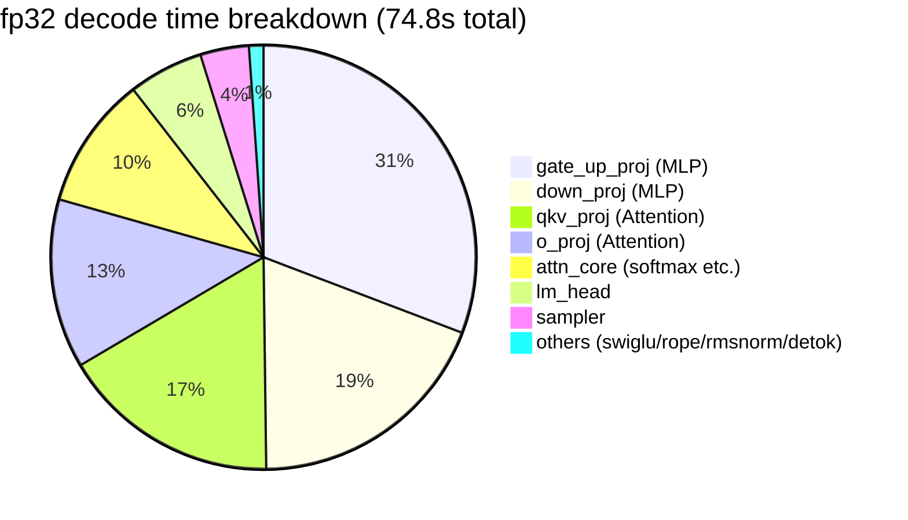
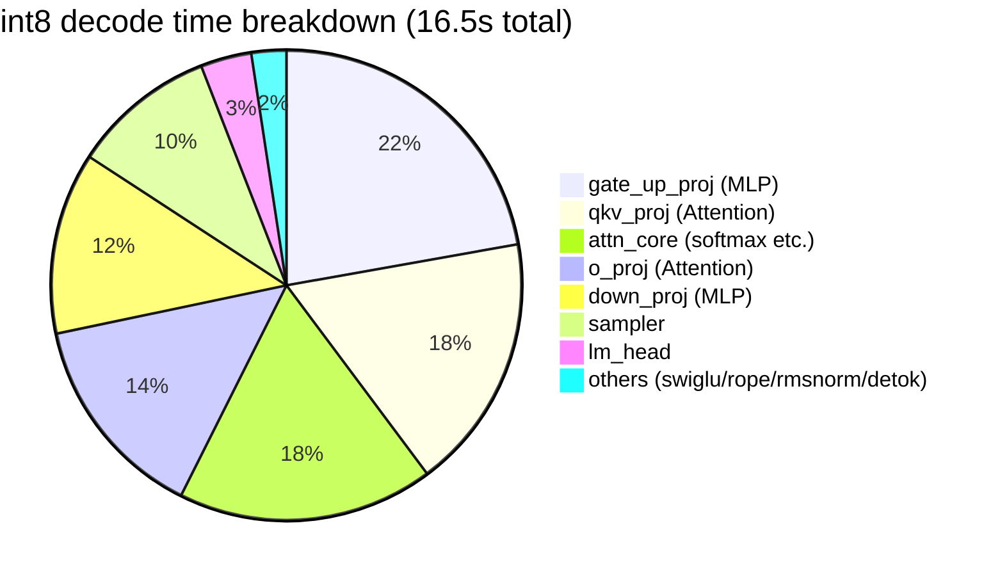
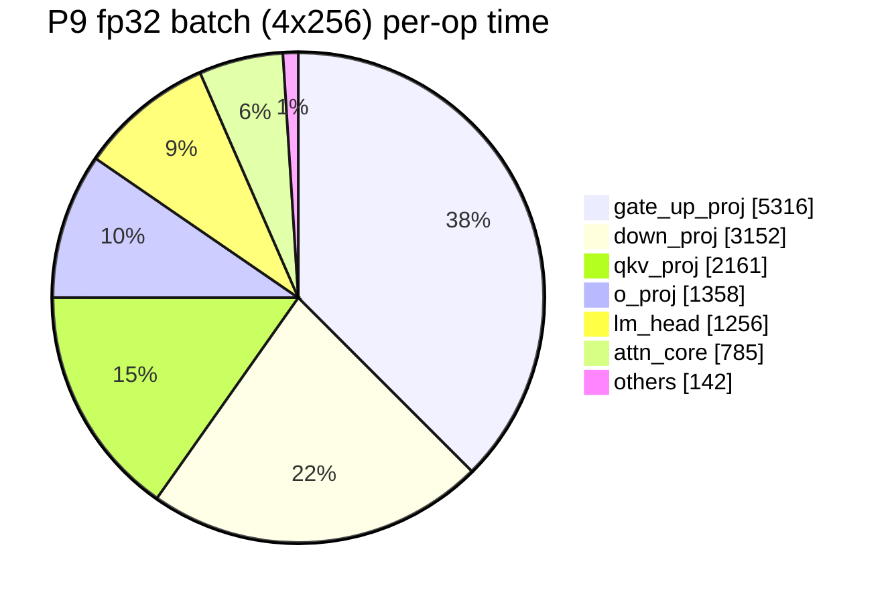

# denno-beta Development History

> Architecture details: see the [Architecture Guide](ARCHITECTURE.en.md).
> This note is the **development log**. New features are appended at the end in this format:
>
> **Entry format**: under `### Pn: Feature (date, commit)`, record **Implementation** / **Tests** / **Profile** / **Next up**. Completed items are reflected in the candidate list under "Next up".

**Updated**: 2026-10-15
**Repository**: https://github.com/ahinore/denno-beta (main, `9183e7e` synced)

---

## 1. Development Environment and Deployment

```
[dev machine: x86_64 Linux (everything inside Docker)]
├─ denno-beta container (port 8080)            … LLM API server (production)
│    └─ model cache: ai_work/denno-beta/data/.cache
└─ dev container … dev agent + dev denno (8090) / denno-view (8093)
     └─ /work/denno-beta (= host ai_work/denno-beta, git-managed)

Dev flow: agent implements → cargo test → exactness check → commit
        → GitHub sync → CI (build+test+exactness)
        → production container docker compose build && up -d → health/generation tests
```

- CI: `.github/workflows/ci.yml` — build+test (push/PR), exactness (push only, downloads real models). **All green on x86-64-v3**
- GitHub push: currently synced via the Windows repository checkout. Container-direct push awaits deploy key registration
- Reference output (exactness): "1+1は?" → `1+1は1です。これは数学的定理で、1と1を加えることによって得られます。` (seed 42, temp 0, fp32). Confirmed identical on the CI x86 runner

## 2. Timeline (early → P2: summary)

| Stage | Content |
|---|---|
| Initial implementation | single binary (cli/engine/server), GPT-2/Qwen2.5-0.5B, Anthropic API compatible + SSE, exact decoding (seed 42) |
| Optimization #1 | `target-cpu=native`, attention scalar loop → sgemm, decode matvec output-split parallelism → prefill 88s→24s, decode 1s/token→0.1s |
| P1 | KV cache + LRU prefix cache (single entry) → subsequent prefills ≈0 (1519→11 tokens) |
| P2 | multi-entry LRU prefix cache (largest-LCP selection, 32k token budget) → `reuse 47/48` even in alternating sessions |

## 3. Phase Records

### P3: int8 weight-only quantization ✅ (2026-10-11, commit `89aae74`)

- **Implementation**: per-channel scale quantization + dequant-in-matvec kernel (new `quant.rs`, 430 lines). fp32 default fully preserved; active only with `--quant int8`
- **Tests**: 77 tests green. fp32 exactness unchanged; int8 identical across 3 runs (deterministic)
- **Profile**: speed flat (14.4 → 13.9 tok/s). Dequantization overhead cancels the bandwidth savings; the value is halved memory (weights ~1GB → ~0.5GB)
- **Next**: SIMD int8 dot product (→ done in P5), continuous batching (→ P4)

### P4: Continuous batching ✅ (2026-10-11, commits `f65281f` → `4e9058a` → `e3ad3ca`)

- **Implementation**: request scheduler (`scheduler.rs`) — bounded queue (503 when full) + engine stepper advanced by `step_chat` (1 forward). New prefills interrupt decode; multiple sessions rotate via KV suspend/resume (`MAX_ACTIVE_SESSIONS=4`)
- **Tests**: 86 tests green. **Each output is bit-identical to a solo run even under interleaving** (verified with KvSensitiveModel). CI (x86) 3 consecutive full greens
- **Profile**: none taken. Instead found a real bug: the worker held the mutex almost continuously, starving the HTTP handler's `engine.lock()` by hundreds of ms → fixed by caching the model name in AppState
- **Next**: int8 SIMD kernel (→ P5), true parallel decode (→ P6 candidate)

### P5: int8 SIMD kernel ✅ (2026-10-12, commit `eec5624`)

- **Implementation**: redesigned P3's "dequantize weights and multiply in fp32" into **"dynamic activation quantization + true i8×i8 integer dot product"**. aarch64 NEON `vdotq_s32` / x86 AVX2 `_mm256_madd_epi16`, switched by cfg
- **Tests**: 91 tests green (+5). i32 accumulation's associativity makes SIMD/scalar bit-identical (property test). Also verified on the CI x86 AVX2 path. Deterministic within int8 (3 runs, same md5), fp32 fully unchanged
- **Profile**: kernel-only 5.4–12.9× (lm_head 5.39ms→1.0ms), e2e decode **~14.4 → ~51 tok/s**
- **Next**: true parallel decode (P6)

### P6: Continuous batching (batched parallel decode) ✅ (2026-10-12, commit `52f5742`)

- **Implementation**: KV cache changed from single to a **slot pool** (`caches: Vec<KvCache>`, `DENNO_BATCH_SLOTS` default 4). Sessions stay resident in their own slots until completion (old suspend/restore rotation removed), and one decode step of all resident sessions is combined into **a single `forward_batch`**. Kernel layer: new multi-column matvec `matvec_rows_bt`/`matvec_rows_bt_i8` — **each element's k-direction accumulation order exactly matches a standalone matvec** (no sgemm, which would change accumulation order = bit-identical even in fp32). rayon row-block parallelism shares raw pointers via a `SendPtr::write` method (an edition-2021 disjoint-closure-capture workaround). Scheduler converted to continuous batching (admit while slots free, prefill-priority interleaving, batched decode `step_chat_batch`, 503 when full)
- **Tests**: **106 tests green** (engine 99 + server 7). Contract tests that `forward_batch` matches solo decode bit-for-bit for B∈{1,2,3} over multiple steps, alternating-session exactness, all passing on CI x86-64 too. **On hardware**: 0.5B with 4 concurrent sessions, fp32/int8 both solo==batch fully identical (including repeated runs), reference output unchanged
- **Profile** (0.5B, 4 requests × 256 cap, same machine): sequential 604 tokens/20.6s → batch 604 tokens/14.8s. Aggregate throughput **fp32 13.9→18.7 tok/s (1.35×), int8 38.8→66.2 tok/s (1.7×)**. 131 steps consumed 272 tokens across 4 sessions = batching fully working. **At b=4 the regime shifts from bandwidth-bound to compute-bound** (fp32: 72ms→110ms per step, int8: 27ms→36ms) = the weight stream runs once but FLOPs are 4×. Next breakthrough would be order-preserving SIMD widening in the k direction
- **Size dependence measured** (3B int8, b=2, 128 cap): solo 12.8 tok/s → batch aggregate 20.5 tok/s (**1.6×**). Batch step time almost unchanged (solo 78ms → 81ms at b=2) = **3B still weight-bandwidth-bound** (weights 3GB/step vs relatively small FLOPs). Confirmed the prediction "larger models benefit from batching more directly". 3B also verified solo==batch bit-identical
- **Design note**: `release_session` keeps KV rows and `cached_prompts[slot]` in place so the next session with the same prefix can reuse them zero-copy with truncate only (reproducing the old single-cache behavior). Eviction goes to the prefix store (`contains_prompt` avoids duplicates). Prefill processes the remaining prompt in one forward (splitting would change GEMM accumulation order = exactness NG)
- **Next**: sampler optimization (→ P8, completed before P6 work began)

### P7: Large Qwen model support ✅ (2026-10-12, commit `9fb18ab`)

- **Implementation**: sharded safetensors (`model.safetensors.index.json` + download all shards / tensor name resolution, new `WeightStore`), untied lm_head (`tie_word_embeddings: false`)
- **Tests**: 93 tests green (+2). 0.5B exactness fully unchanged. **0.5B/1.5B/3B/7B all answered normally ("1+1は2です。" etc.)**
- **Profile** (by size, 20-core CPU):

| Model | fp32 | int8 | Notes |
|---|---|---|---|
| 0.5B | 14.4 tok/s | ~51 tok/s | production |
| 1.5B | — | — | runs unchanged on the existing binary |
| 3B | ~2 tok/s | ~4.7 tok/s (2.4×) | sharded checkpoint + untied |
| 7B | ~1.2 tok/s | ~2.1 tok/s (1.8×) | weights 28GB, RAM 121GB with room to spare |

- **Next**: profiler introduction for bottleneck visibility (→ P7.5)

### P7.5: Profiler + bottleneck visualization ✅ (2026-10-12, commit `40e209d`)

- **Implementation**: lightweight self-profiler `prof.rs`. Enabled with `DENNO_PROFILE=1`; on request completion logs accumulated time per phase at INFO. Zero overhead when disabled, never touches the numeric path
- **Tests**: 93 tests still green. exactness reference output unchanged (profiler disabled). CI ✅, deployed
- **Profile**: below (later measurements appended here in this format)

#### Profiling method constraints

Inside Docker, `perf` (denied by perf_event_paranoid=4), `valgrind/callgrind` (SIGILL on aarch64 native code), and `gdb` (ptrace forbidden) are all unavailable → **in-code measurement (self-instrumentation) is the only proper way**

#### Measurement conditions

Qwen2.5-0.5B, one long generation request (cumulative incl. prefill).

**fp32 decode time breakdown** (800 tokens total, 74.8s overall):



**int8 decode time breakdown** (461 tokens to EOS, 16.5s overall):



#### What it tells us

1. **Linear layers (matvec) dominate** — ~80% in fp32. Decode is weight-bandwidth-bound as expected. int8+SIMD compresses this to ~70% and yields ~4.5× speed
2. **attn_core share grows in int8** (10%→18%) — it surfaces relatively as linear layers speed up. KV cache reads + scales/softmax. Grows further with long contexts
3. **sampler is a fixed ~3.5ms/step cost** — 3.7% in fp32, ~10% in int8. Softmax + top-p sort over the full 152k vocabulary is the bottleneck
4. swiglu/rope/rmsnorm/embed total ~1% — numerically confirmed "no optimization needed"

- **Next**: sampler optimization (top candidate) / resume P6 (true parallel decode)

### P8: Sampler optimization ✅ (2026-10-12, commit `119dd92`)

- **Implementation**: responding to the P7.5 profile (fixed ~3.5ms/step sampler cost), `sampler.rs` fully rewritten. top_k=`select_nth_unstable`+partial sort (with a reference-implementation test that ties break bit-identically to the old code) / top_p-only = compute over the top-2048 subset with fallback to the old full path on boundary hits / plain temperature (production default) = sort-free two-pass O(n) + scratch reuse. **The greedy path is completely unchanged** (temperature=0 goes straight to argmax)
- **Tests**: 98 tests green (+5 sampler tests including bit-identical reference checks). **Declared as a spec change**: the temperature path's RNG→token mapping differs from the old implementation (greedy unchanged). 0.5B greedy reference output unchanged, CI ✅
- **Profile**: sampler 3.5ms→**0.66ms/step (5.3×)**. Share 3.7%→0.7% (fp32), 9.9%→2% (int8)
- **Next**: P6 continuous batching (→ completed as P6)

### P9: fp32 batch kernel SIMD (order-preserving lane parallelism) ✅ (2026-10-12, commit `1bbffff`)

- **Implementation**: SIMDized the fp32 batch kernel `matvec_rows_bt` after P6 found "b=4 shifts to compute-bound". **Lanes run only along i (4 sessions in the batch) and j (4 output channels for ILP), never along k** — each output element's k accumulation stays strictly sequential (only separate multiply and add instructions, no FMA = rounding kept separate) → bit-identical to solo decode (`matvec_bt`) is preserved. Activations are transposed to `[k][mp]` with zero padding to keep lane loads contiguous (m*k is at most tens of KB, transposition cost negligible). aarch64 NEON / x86 SSE (`_mm_mul_ps`) dual implementations + scalar fallback for other targets
- **Tests**: 106 tests green. Bit-identity test shapes extended (m∈{1..8}, k∈{1,4,65,896}, with remainders). CI exactness ✅ on the x86 SSE path too. **On hardware**: fp32/int8 both 4 concurrent sessions == solo fully identical, reference output unchanged
- **Profile**: below

#### Profile

**① Server per-op** (`DENNO_PROFILE=1`, 0.5B fp32, solo/batch measured in separate sessions)

| op | solo: ms (calls) | solo share | batch: ms (calls) | batch share |
|---|---:|---:|---:|---:|
| gate_up_proj | 1,642 (3,600) | 33.8% | 5,316 (6,432) | 37.0% |
| down_proj | 1,196 (1,800) | 24.7% | 3,152 (3,216) | 22.0% |
| qkv_proj | 828 (5,400) | 17.0% | 2,161 (9,648) | 15.0% |
| o_proj | 502 (1,800) | 10.3% | 1,358 (3,216) | 9.5% |
| lm_head | 405 (75) | 8.3% | 1,256 (134) | 8.7% |
| attn_core | 187 (1,800) | 3.8% | 785 (3,216) | 5.5% |
| rope/sampler/rmsnorm/detok | 42 | 0.9% | 142 | 2.3% |
| **TOTAL** | **4,854** | 100% | **14,362** | 100% |

- **solo**: 75tok/4.88s = **15.4 tok/s** (64.7ms/step), linear layers total **94.2%**
- **batch**: 279tok/130 steps, average batch width **2.15** (early-finishing sessions with outputs of 45–83 tokens), aggregate **19.4 tok/s** (21.8 without the profiler)
- **Per-token linear-layer cost 61.0→47.5ms (1.28×)**. Attention unchanged per token (2.5→2.8ms) = wider within a step but the same per token
- The in-server batch linear layers don't reach the microbenchmark bandwidth floor (width 4 = solo step time) → attributed to the drop in average width (2.15) + memory-system contention in the real server (activation/KV interfering with the weight stream)



**② Kernel-only microbenchmark** (0.5B shapes, m=4): gate_up(k=896, n=4864) **3.92×** / down(k=4864, n=896) **5.86×** (vs 4× standalone `matvec_bt`). Shipped as an `#[ignore]` test `bench_matvec_rows_bt_m4` (`cargo test --release bench_matvec -- --ignored --nocapture`)

- **e2e limiting factors identified** (profile analysis): the batch aggregate factor (fp32 1.36×) almost matches the per-token linear improvement (1.28×) — linear layers are no longer the main bottleneck. In theory width 4 could cut per-token linear cost to ~1/4 (61→~15ms), so **the remaining bottlenecks are ① average batch width drop (completion-time skew, avg 2.15), ② in-server memory-system contention, ③ attention/prefill (unchanged per token, doesn't grow with width)**. Next levers: session-lifetime flattening + attention batching
- **Next**: attention batching (P10 candidate) / b=4 measurements for 3B/7B

### P10: Attention parallelization (session × KV head) ✅ (2026-10-12, commit `4e2428f`)

- **Implementation**: `forward_batch`'s attention parallelized with rayon. Task granularity is **(session i × KV head kvh)** (up to 32 tasks at 0.5B); each task owns a non-overlapping slice of `att`. The op sequence inside a task is exactly the solo decode (n==1) path (sgemm_acc→softmax→matmul, same shapes) and there is no numeric interaction between sessions/KV heads, so **bit-identity is trivially preserved**. KV reads use the new `KvCache::kv_bufs_ref(&self)` (read-only) shared accessor. Solo decode and prefill paths untouched (discipline: don't touch the reference paths)
- **Tests**: 106 tests green (the fp32/int8 batch==solo bit-identity tests directly cover the parallel path; test model is GQA-shaped). Hardware: fp32/int8 both 4 concurrent == solo fully identical. CI 38240311689 ✅ (passes on x86 too)
- **Profile** (interleaved A/B measurement, see lessons below):

  | Measurement | new (P10) | old (P9) |
  |---|---:|---:|
  | batch 4×256 aggregate | **33.4 / 33.1 tok/s** (avg 33.2) | 31.6 / 32.2 tok/s (avg 31.9) |
  | solo 256 | 17.3 tok/s (unchanged) | same |

  - **P10 effect: aggregate +4%** (new code won in both interleaved pairs, reproducible). Physically consistent: P9's profile had attn_core at 5.5% in batch; parallelization recovers most of that wall time
  - **Measured-pollution example**: a naive before/after comparison showed new 6.78s/41.2tok/s vs old 12.99s/21.8tok/s (2×!), but interleaved A/B showed only +4% — **other resident inference workloads on the same host use the CPU**, so background load varies by time of day and distant absolute values are incomparable
  - Lesson: **on the same host, always measure performance with new/old interleaved + same workload** (script `p10_ab2.sh`)
- **Next**: analysis of remaining bottlenecks (average batch width drop, memory contention) / b=4 for 3B/7B / quantifying prefill interruption impact

### P11: Streaming detok byte-split character fix + gpt2 exactness baseline refresh ✅ (2026-10-12, commit `16319c7`)

- **Trigger**: gpt2 exactness test failing with garbled output. Re-downloading the model produced the **same file** (548,105,171B, English raw generation normal) and the failure persisted → not the model
- **Cause 1 (stale baseline)**: CI's exactness job only pulled Qwen, so the gpt2 test was "model not cached → skip" and **had never actually run**. The baseline string dated from the original conditions
- **Cause 2 (streaming detok bug)**: in byte-level BPE (GPT-2), multibyte characters split across token boundaries and incomplete byte sequences decode to U+FFFD. Letting that U+FFFD into the confirmed text shifts subsequent byte diffs and drops characters (the "??の??は?" symptom)
- **Verification (reference implementation)**: installed HF transformers (fp32, greedy) in a container and compared the same prompt → **fully matches denno's output** (GPT-2 base repeats the input with the fallback-template prompt = the echo is plain greedy behavior)
- **Implementation**: `emit_delta_and_check_stop` — **hold back** tokens whose tail is U+FFFD and flush them together once the character completes. New `flush_stream` — flushes held tokens at generation end (EOS/max_tokens) in both step_chat/step_chat_batch (EOS excluded from decode). **Text path only; the numeric path is untouched** (outside profiling scope, performance-neutral — confirmed by the reference output and 4-session solo==batch)
- **Tests**: unit 99+7 all green + exactness 5 all green. **CI 38244751670 ✅** — workflow now pulls gpt2, and **the gpt2 test actually runs and passes on x86** (baseline proven to match the reference implementation). Deployed; reference output unchanged

### P12: Remaining bottleneck analysis + decode attention optimization (probs@V row merge + direct strided reference) ✅ (2026-10-12, commits `55c1de0`/`f3dea3b`)

- **Trigger**: with the dev environment migration complete, quantified P9's remaining bottlenecks (average batch width drop / memory contention / prefill interruption) in a clean environment with no other workload load
- **Analysis 1 (batch-width scaling)**: concurrent firing × 256-token cap (natural EOS termination; token counts differ per width, so **compare aggregate tok/s**). fp32 scales linearly up to W=8 (16.2→~50); int8 **tops out at W=4** (149→132–135, slightly down at W=8). Slots are `DENNO_BATCH_SLOTS` (default 4); a true width-8 batch needs 8 (default 4 gives two-way queuing)
- **Analysis 2 (per-op profile)**: fp32 W=4 has linear layers + lm_head at ~85% (bandwidth-bound as expected). int8 W=4: gate_up 29.5% / **attn_core 19.4%** / down 18.0% / lm_head 10.8% — **in int8, attention is the second bottleneck after linear layers** (KV contiguous copy + m=1 sgemm ×7 per (kvh,g) + 23 allocations/task; the t×dh buffer crosses the mmap threshold and mmaps/munmaps every step)
- **Finding (kernel-swap pitfall)**: matrixmultiply **picks different SIMD kernels by stride and row count, changing the numbers**. The scores side (passing b in transposed layout rs=1/cs=k) is not bit-identical with either row merging (rows=m) or strided reference (confirmed empirically). The probs@V side (row-major b) **is bit-identical with row merge + strided reference** (measured) → only the V side can honor the bit-exact discipline
- **Implementation**: ①`tensor::matmul_rows_bstrided` — probs@V as per-g matmul (m=1) × group + vh contiguity copy → **one row-merged sgemm with direct strided cache reference** (no copy) ②new `attention_decode_kvhead` — forward() (n==1) and forward_batch() now share one function ③qg copy removed; kh/scores reused in thread_local scratch (mmap churn removed) ④scores side keeps the old path (sgemm_acc (m=1) + kh contiguity copy — proven numerically necessary)
- **Tests**: unit 100+7 green + `decode_attention_probs_v_bitexact` (row-merge+stride vs old per-row, to_bits comparison) + **exactness 5 all green (bit-identical including reference output)**
- **A/B measurements** (clean environment, old 1a7fee6 vs P12, 2 interleaved rounds, 8 slots):

#### Profile

| Config | old (1a7fee6) | P12 (55c1de0) | diff |
|---|---:|---:|---:|
| fp32 W=4 | 26.8 / 26.8 tok/s | 27.7 / 27.7 tok/s | **+3.4%** |
| int8 W=4 | 126.4 / 122.5 tok/s | 130.4 / 126.2 tok/s | **+3.1%** |
| int8 W=8 | 119.0 / 113.5 tok/s | 121.3 / 119.3 tok/s | **+3.4%** |

| per-op (int8 W=4, 1022tok, profiler ON) | old ms | P12 ms |
|---|---:|---:|
| attn_core | 1,543 | **1,193 (-22.6%)** |
| gate_up_proj | ~2,343 | 2,432 |
| down_proj | 1,430 | 1,480 |
| lm_head | 854 | 869 |
| TOTAL | 7,942 | 7,796 |

- **Measurement lessons**: ①A/B servers were started under different binary names (`/tmp/denno_old`/`/tmp/denno_p12`), but the pkill pattern `denno serve` **did not match `denno_old serve`, so all 12 runs hit the same server — invalid data** (fixed in round 2 by checking the quant-mode log every time) ②`grep -A14 … | tail -13` on per-op profiles **truncates the top line (largest op)** — the first analysis misread attn as 48.9% (the gate_up row was cut; the truth: 29.5% gate_up / 19.4% attn)
- **Next**: fundamental scores-side optimization (k-direction SIMD/pack reuse) is incompatible with the bit-exact discipline → **needs a decision on whether updating the reference output is acceptable**. b=4 measurements for 3B/7B. CUDA optimization (§8)

### P13: Inference visualization (denno-trace) telemetry foundation + denno-view relay ✅ (2026-10-13, commit `69663e6`)

- **Trigger**: the user-requested inference visualization feature (§11 of the architecture guide). First stage (L0 flow / L1 statistics) of streaming the call stack, hidden layers, and KV state to a separate server for real-time display
- **Implementation**: ①new `denno-telemetry` crate (**zero deps / std only** — engine, server, and viewer (incl. WASM) share one format). Frame format v1 = `"DNTL"` (4B) + version (1B) + kind (1B) + payload, integers as LEB128 varint, probabilities as f16 (self-implemented RNE). kinds: ServerInfo/SessionAdmit/SessionDone/Prefill/Token/Step/OpSummary/KvUsage/Gap/TopK ②engine capture hooks (install/release/step_chat/step_chat_batch; all guarded by `telem::enabled()` and read-only, never touching the numeric path) ③prof.rs op timing also accumulates into telemetry (delegation via lib.rs avoids a direct prof→telemetry dependency) ④WS endpoint `/v1/telemetry/ws` in denno-server (binary frames, ServerInfo right after connect; hub→broadcast relay thread; 503 when telemetry disabled) ⑤new `denno-view` crate — WS client to the upstream denno (2s retry on disconnect), multiplex relay to multiple browsers, `VIEW_RECORD` replay recording ([u32 len][bytes] append format; input for the P14 scrubber), simple live dashboard (HTML+JS decoder; WASM in P14)
- **Design principles implemented** (§11): ①fully decoupled from inference (capture only emits) ②never make inference wait (hub is a bounded SyncSender 4096 + try_send; on full → drop + Gap frame marking the loss) ③OFF by default (without `DENNO_TELEMETRY` no capture code runs at all = zero cost)
- **Tests**: unit 100 + telemetry integration 1 + server 7 + telemetry crate 5, all green. The integration test covers OFF→ON lifecycle (SessionAdmit/Prefill/Token/TopK/KvUsage/OpSummary/SessionDone) + **generation output fully identical ON/OFF** (testutil dummy model) + all frames encode→decode reversible. exactness 5 all green. **JS decoder also verified** (all 10 frame kinds generated by Rust decoded in node → exact match, including f16 2.75/0.5/0.25 and u64 varint)
- **e2e on hardware** (local denno-dev:8090 + denno-view:8093): with telemetry ON the reference output is **bit-identical** (usage 34/26). denno-view logs `server: denno-dev (quant=fp32, slots=4, ctx=32768)` / `session 1 admit (slot 0, prompt 34 tok)` / `session 1 done (reason 0, 26 tok)`, **Gap 0**. Dashboard HTML served OK
- **2 bugs found in e2e**: ①**f16 decode subnormal path exponent off by 2^14** (found by a round-trip test; 6.1e-5→0x03FF→mangles into 0.999; after the k-loop the f32 exponent is 113-k) ②**idle KvUsage frame flood** — the scheduler worker keeps polling `step_chat_batch` with empty batches while idle, so emitting KvUsage on empty batches produced thousands of frames/sec → hub full → Gap flood (fixed: no emission on empty batches; idle polling itself is existing design)
- **CI**: 38275707105 ✅ (build+test+exactness). Deployed; reference output bit-identical (production runs telemetry OFF)
- **Next**: P14 (WASM viewer: wasm-bindgen + canvas/WebGL2, replay scrubber) / P15 (L2 tensor focus)

### P14: denno-view inference-flow animation (call graph + layer panel + KV/variables) ✅ (2026-10-13, commit `8befe3f`, JS version; WASM port pending)

- **Trigger**: the user-specified denno-view spec — a model-driven program call graph in the center (prompt drops down, functions light up in order, values pass as pulses), a stack of model layers on the right (lighting up when referenced), and the KV cache + hidden variables on the left (lighting up on stores with values shown)
- **Telemetry extension**: frames extended with the data needed to light the call graph sequentially — ①`LayerRun { layer, ops }` (one layer's op sequence bundled into one frame in execution order, 24 frames/token) ②`ServerInfo.layers` ③`Prefill.tokens` (for the drop animation). Implemented with a thread-local layer buffer + `prof::time_layer`
- **denno-view UI**: 3 columns (center = call graph + implementation-code panel / left = KV slots + variables + op timing / right = model structure). The browser side keeps the **never-make-inference-wait** design with a playback queue + decimation
- **Verification**: all tests green + exactness 5/5 + JS decoder 12 kinds matched + e2e reference output **bit-identical** with Gap 0 (509 LayerRun frames). CI 38298659275
- **P14.1–P14.3 feature additions (2026-10-13, commits `6b198f2`/`e34e411`/`06df5ed`)**: ①layer panel fix — view keeps ServerInfo/KvUsage snapshots so browsers opened later render immediately + layer rows show op names/measured ms ②token text display — `VIEW_TOKENIZER` → `/tokenizer.json` serving, BPE inverse map + streaming UTF-8 decoding correctly restores multibyte characters across token boundaries; input/output tokens shown as text chips ③built-in chat — view's `POST /chat` relays to the upstream denno `/v1/messages`, and sending a message drives the animation automatically
- **P14.4 stepping code + model structure (2026-10-13, commit `91bbb6a`)**: implementation-code panel in the center-left (pseudo-code; the running line advances like a debugger PC + `li = N/24` watch), right panel rebuilt as **model structure** (embed→decoder×24[ATT+MLP chips]→final_norm→lm_head, chips lighting individually per LayerRun)
- **P14.4b–k UI polish (details omitted, commits `62acfc8`–`5e64eef`)**: layout fixes (gaps/equal split/pane separation/section dividers), magnifying cone (code panel = magnified callout of the model_forward node), token placement (input above the graph, output below), fly-dots to KV/variables (SVG fly-lines), UI fully in English, heading "denno (LLM Server)", speed slider (low/high, fastest by default, low = watchable slow motion), ServerInfo model_id added (real model ID display). **The never-make-inference-wait design held throughout**
- **P14.4l–q code panel accuracy + real-code toggle (commits `091da66`–`3ff6175`)**: ①pseudo-code execution order fixed to match the real implementation — KV writes are inside the loop (right after rope), attn_core reads the cache (`&kv[li][..pos+1]`), prefill branch (p1-p4) added. During prefill the cursor walks p1→p2 (bulk KV write)→layer cascade→p3 ②**pseudo⇔real code toggle** ("real code ▸" button, pseudo default) — scheduler.rs/engine.rs/llama.rs embedded at compile time via `include_str!` + served at `/code/src` (the displayed code is always the same generation as the running binary), pseudo↔real mapped by content anchors so cursor/state lighting/fly-lines work in both modes ③**usage sites** of the KV cache and hidden x shown as fly-lines (KV→attn read, x→rmsnorm/final_norm)
- **P14.4r chat output synced to emit_token (commit `b1e6ecb`)**: the built-in chat used to display the whole reply at once regardless of the animation speed. Now **each token is appended to the chat bubble when its Token frame plays** (with speed=low the output display slows down accordingly). The session is captured at the first SessionAdmit after sending, and the bubble is finalized with usage once all output tokens are played. Fallbacks to showing the full reply (4s watchdog) when the tokenizer is missing, telemetry is off, or Token frames are dropped. Also fixed a latent bug where tokText was called twice per token (consuming the streaming UTF-8 decoder twice). Verified: JS syntax OK, dev server rebuilt+restarted, chat reply OK, p143_check CHAT_OK (19 token frames)
- **P15 Qwen3 support (commit `e67eeb2`)**: **Qwen3 = Qwen2 + QK-Norm** — q_norm/k_norm.weights applied as per-head_dim RMSNorm after the QKV bias, before RoPE (`qknorm_rows_inplace`, new `qk_norm` profiler op). Batch/solo decode bit-identity covered by a unit test (`qk_norm_batch_matches_solo_decode_bit_exactly`). **KV memory budget** (`DENNO_KV_BUDGET_MB`, default 12288MB): explicit env vars win, slots first + prefix cache with the remainder (min 2048 tokens guaranteed), small-KV models keep their previous configuration entirely — fixes the ~47GB KV preallocation SIGKILL on Qwen3-0.6B. **minijinja-contrib pycompat**: registers the Python-style str methods (startswith etc.) that HF chat templates rely on, so Qwen3's thinking template renders. Exactness: Qwen3-0.6B greedy output verified fully identical to an HF transformers (fp32) reference implementation + CI now pulls Qwen3-0.6B
- **P16 replay scrubber (commit `5def63e`)**: playback UI for the recorded frame stream in denno-view. Server side: `VIEW_REPLAY=/path` makes `GET /replay` serve the record ([u32 len][bytes] concatenation) **read per request** (recording can continue while replaying; a record truncated mid-write by a killed process is tolerated — the parser reads up to the last complete frame). Browser side: scrubber bar in the header (replay/live toggle, play/pause, jump-to-start, step −1/+1, slider seek, position display). **Seek rebuilds state by fast-forwarding from frame 0** (snapshot frames ServerInfo/KvUsage via the normal path; animation frames Token/LayerRun/TopK/Prefill state-only, transient effects skipped — the `RP_FFWD` flag). Playback reuses the live pacing (queue+drain); live WS frames are ignored while in replay mode. Verified: JS syntax OK, record→`/replay` byte-identical (same md5), 146/300-frame parse check, UI serving check
- **Remaining**: ①WASM port (wasm-bindgen for the decoder + state machine; JS version stays as the working implementation) ②L2 tensor focus (P18; hidden-variable values are currently L1 statistics only — KV length/top-k/tokens)

### P17: CUDA int8 offload kernels (bit-exact to the CPU int8 path) ✅ (2026-10-13, commit `11281dd`)

> User direction: "establish CUDA optimization before other model families". Foundation of migration step 1 (linear layers) from §8. The L2 tensor focus previously labeled P17 in the candidate list moves down to **P18**.

- **Implementation** (`denno-engine/src/cuda.rs`, feature `"cuda"`): the CUDA Driver API is resolved at runtime via **dlopen** (zero dependency crates; builds without the feature — CI / GPU-less environments — are completely unaffected). The kernel `kernels_int8.cu` is **compiled to compute_75 PTX and committed** (`nvcc -ptx -arch=compute_75 -fmad=false`; the driver JIT runs it on all newer archs sm_86/89/120 — verified on an RTX 5090 sm_120 / driver 13010). Kernels: ①per-row dynamic activation quantization (dno_quantize_rows, 1 block/row, shared-memory maxabs reduction) ②int8 GEMV/GEMM (dno_matvec_rows_bt_i8, 1 warp per output, lanes sweep k coalesced + warp i32 reduction)
- **Bit-identity design** (CPU: `tensor::quantize_row_i8` / `matvec_rows_bt_i8`): ①maxabs involves no rounding so the sweep order is irrelevant; `roundf` = `f32::round` (half-away-from-zero); the ±127 clamp follows the same rule ②i8×i8→i32 accumulation is **integer, so associativity holds** — the output is independent of warp-reduction/lane-split order (this is why it matches the CPU AVX2/sdot kernels bit-for-bit) ③the output scale multiplies `(float)dot * ascale[i] * scale[j]` left-to-right (same associativity as the CPU)
- **GPU runtime environment** (new): a **denno-gpu container** on the dev host (nvidia/cuda:12.9.1-devel-ubuntu22.04 + rustc 1.99.0, `--gpus all`; /work/denno-beta binds the same host tree as the existing dev container; builds isolated via `CARGO_TARGET_DIR`). RTX 5090 = 32GB / sm_120 (requires CUDA 12.8+, so the existing 12.6 image could not be used)
- **Verification**: `cuda_quantize_rows_bit_exact_vs_cpu` / `cuda_linear_int8_bit_exact_vs_cpu` — across decode m=1, batch decode m>1 and prefill GEMM, **to_bits fully identical** on the RTX 5090 for real model shapes (Qwen2.5-1.5B) including lm_head 1536×151936
- **Microbenchmark** (weights resident in VRAM, decode m=1, activations H2D every call): **lm_head 18.6×** (5.46ms→0.294ms, effective 794 GB/s) / down 11.1× / gate_up 2.6× / qkv·o 0.4–0.6× — small layers are dominated by the per-call fixed overhead (launch + sync + H2D/D2H ≈ 40µs). gate_up at batch m=8 reaches 4.1×
- **CI**: added `cargo check -p denno-engine --features cuda` (compile-only, no GPU needed)
- **Next** (P17b: engine integration): weights resident in VRAM + a **device-resident activation pipeline** (one sync per step → removes the small-layer fixed overhead) → attention fusion kernel → sampler → paged KV (in §8.4 order)

### P17b: CUDA engine integration (resident weights + pinned async pipeline) ✅ (2026-10-13, commit `197a06c`)

> Wires the P17 kernels into the real path of every int8 linear layer and proves bit-identity plus 3.4× e2e. The first phase to confirm §8.3.5 — "with int8, GPU offload does not change the output" — at the e2e level.

- **A single funnel as the integration point**: hooking `maybe_gpu_linear` into the int8 paths of `quant::Linear::apply_bt` / `apply_batch_bt` / `apply` is all it takes. Every int8 linear layer of llama/gpt2 (qkv, o, gate/up, down, lm_head) flows through these three functions, so **zero model-side code changes**. A `None` return falls back to the existing CPU kernels (both are bit-identical, so the output is unchanged)
- **The resident-weight registry is keyed by uid**: the first attempt keyed on the buffer pointer of `Quant8Linear.w`, but a test exposed a collision — **Vec free→realloc reuses addresses, so a different weight set can appear at the same address** (happens between different Linears of identical size and shape). `Quant8Linear` now gets a `uid` assigned at construction (Clone shares the uid safely: a clone is a deep copy of identical content), and the registry uploads on first use keyed by uid. A debug_assert also checks the shape match per uid
- **Pinned + async, one sync per pipeline**: H2D(x, async) → quantize kernel → GEMV kernel → D2H(out, async) → `cuCtxSynchronize` ×1 per linear layer. P17 synced on every copy and launch (×4, ≈40µs fixed); with pinned host buffers (`cuMemHostAlloc(PORTABLE)`) + default-stream ordering the overhead drops to **≈28µs** (qkv 0.041→0.033ms, lm_head 0.286→0.220ms @ decode m=1)
- **Decode-only offload**: GEMV-style kernels (1 warp per output) re-read the weights proportionally to m, so they lose to prefill GEMMs (**measured 0.39× at m=128**). `m > DENNO_CUDA_MAX_M` (default 16) stays on CPU — prefill performance is untouched; only decode and batch decode (m ≤ threshold) run on the GPU
- **Verification**: ①pipeline bit-exactness via apply_bt (4 shapes, including lm_head 1536×151936) ②whole-forward GPU offload bit-exactness on the tiny model (prefill + batch decode vs solo) ③the 106 CPU tests regress to zero changes (without the cuda feature) ④**e2e**: Qwen2.5-1.5B int8 — CPU serve vs GPU serve produce fully identical response text and usage (2 prompts, 200-token greedy; concurrent batch decode of 2 requests also matches solo)
- **e2e measurement**: 200-token greedy generation **CPU 9.08s → GPU 2.66s (3.4×)**. VRAM usage is lm_head 234MB + layer weights ≈ just over 1GB
- **Per-op profile comparison** (`DENNO_PROFILE=1`, 200-token greedy ×3 requests, 600 decode steps + prefill cumulative):

  | op | CPU ms | CPU % | CUDA ms | CUDA % | speedup |
  |---|---:|---:|---:|---:|---:|
  | lm_head | 3,049 | 10.7% | 281 | 2.9% | **10.9×** |
  | gate_up | 11,685 | 40.9% | 2,340 | 24.2% | **4.99×** |
  | down | 6,108 | 21.4% | 1,432 | 14.8% | 4.26× |
  | o | 1,594 | 5.6% | 590 | 6.1% | 2.70× |
  | qkv | 2,051 | 7.2% | 1,614 | 16.7% | 1.27× |
  | attn_core | 3,190 | 11.2% | 2,767 | 28.6% | 1.15× |
  | swiglu | 554 | 1.9% | 420 | 4.3% | 1.32× |
  | other | ≈361 | 1.3% | ≈243 | 2.5% | 1.49× |
  | **TOTAL** | **28,591** | 100% | **9,686** | 100% | **2.95×** |

  Decode 22.1→**75.8 tok/s** (e2e 3.4×). **The linear layers shrink from 86% to 62% and attn_core becomes the top op (28.6%)** — clearly identifying attention fusion as the next bottleneck. qkv stays at 1.27× (3 split calls × 50,400 — fixed overhead dominates) → fused in P17c

### P17c: Fused GPU linear groups (qkv / gate+up single call) ✅ (2026-10-13, commit `7bf9eb0`)

> Resolves the "qkv split into 3 calls × 50,400 invocations (600 steps × 28 layers × 3) fixed overhead" identified in the P17b profile. Linear layers that consume the same input are fused into one GPU call; e2e improves 19%.

- **Fusion = row concatenation**: the weight rows of q/k/v (or gate/up) are concatenated in part order into a single buffer, registered and computed under a uid-vector cache key, and the output is split by column blocks. Per-row arithmetic (quantization rule, i32 accumulation, scale multiply order) is exactly identical to the individual calls, so **bit-exactness is guaranteed structurally** (no new arithmetic rules introduced). The host-side concat buffer is dropped after upload, so no steady-state RAM growth. When the GPU is disabled/errored or a part is fp32, it falls back to the previous separate 3+2 calls
- **Discovery: CUDA current context is thread-local (the biggest lesson of this phase)**: libtest spawns a **new thread per test even with `--test-threads=1`**, so calling `cuCtxSetCurrent` once on the initializing thread leaves `cuMemAlloc` failing on other threads with **error 201 INVALID_CONTEXT**. Worse, the failure is silently absorbed by GPU_BROKEN→CPU fallback, so "GPU tests green" no longer means "ran on the GPU" (only the new fusion test `expect`ed on None, which exposed it — the P17b model-integration test could have been passing as CPU-vs-CPU). Fixed by calling `CudaCtx::make_current()` at every GPU entry point; this also removes a latent bug in the multithreaded server
- **Verification**: ①fused vs separate-call bit-exactness (qkv-type 3 parts with differing n + gate/up-type 2 parts, m=1/4) ②whole-forward bit-exactness on the tiny model (prefill + batch decode) ③the 106 CPU tests regress to zero changes ④**e2e**: Qwen2.5-1.5B int8 200-token greedy — **text and usage fully identical** to CPU serve (3 requests, usage 49 in/200 out)
- **e2e measurement**: 200-token generation **GPU 2.638s → 2.146s (−19%)**, matching the theoretical prediction (overhead removed 84µs/layer/step × 28 layers × 600 steps ≈ 0.47s/request → 2.64−0.47=2.17s). CPU 10.67s → **4.96×**. Weight uploads: grouped 56 (=28 layers × 2 groups) + separate 57 (=down 28 + o 28 + lm_head 1), fully consistent with the call breakdown
- **Post-fusion profile re-acquisition** (`DENNO_PROFILE=1`, same workload as the P17b section — the pre-fusion distribution is the P17b table):

  | op | P17b GPU ms | P17c GPU ms | change |
  |---|---:|---:|---:|
  | qkv | 1,614 | 610 | **−62%** |
  | gate_up | 2,340 | 1,850 | **−21%** |
  | attn_core | 2,767 | 2,623 | −5% |
  | swiglu | 420 | 405 | −4% |
  | lm_head | 281 | 275 | −2% |
  | down | 1,432 | 1,426 | ±0% |
  | o | 590 | 591 | ±0% |
  | **TOTAL** | **9,686** | **8,021** | **−17%** |

  The CPU side re-measures at TOTAL 28,532ms (nearly unchanged from P17b's 28,591ms). Op-sum ratio **2.95×→3.56×**, decode **75.8→96.1 tok/s**, e2e (CPU 9.07s → GPU 2.08s) **4.36×**. The reductions match theory (qkv: 2 calls' worth 941ms/3req theoretical vs −1,004ms measured; gate_up: 470ms vs −489ms). **attn_core becomes even more dominant (28.6%→32.7%)** — attention fusion is confirmed as the next bottleneck
- Remaining CUDA candidates: attention fusion kernel (attn_core 32.7% = top GPU op), paged KV, sampler kernel

### P17d: Elementwise GPU kernels + decode chain (device-resident hidden state) ✅ (2026-10-13, commit `121aa3a`)

> The P17c profile left swiglu (5.1%) and host round-trips in place, so this phase (1) GPU-izes the elementwise ops (rmsnorm/residual/swiglu) and (2) turns one solo decode step into a device-resident pipeline. CPU attention uses `matrixmultiply::sgemm` (SIMD/FMA accumulation order is implementation-defined), so moving attention to GPU requires relaxing the exactness contract → deferred; this phase was done first since it needs no decision.

- **Elementwise kernels (`kernels_elem.cu`)**: `dno_add_rmsnorm` (residual add + RMSNorm; the sum of squares is computed sequentially in one thread in the same order as CPU, then `1/(ss+eps).sqrt()` → `x*inv*w` left-associated), `dno_swiglu` (silu + up multiply), `dno_expf_probe` (test entry). Compiled with `-fmad=false` plus explicit `__*_rn` intrinsics so contraction is fully controlled
- **Exact glibc expf replication (the hardest part of P17d)**: swiglu's `exp(-v)` must match Rust `f32::exp` (= glibc expf) bit-for-bit. glibc's e_expf uses f64 internal arithmetic + the `__exp2f_data` table (32 entries) + a cubic polynomial, all reproducible on GPU — but the **actual CPU binary is the FMA-contracted build** (the multiarch IFUNC selects the FMA variant), which differs from a naive sequential implementation by 1 ULP in the final f32 (measured at x=32.564632f: the single mismatch out of a 455M-value sweep). Experiments with gcc -O2 -mfma plus disassembly identified **5 contraction sites** (1. `kd = fma(InvLn2N, xd, SHIFT)`, 2. `r = fma(InvLn2N, xd, -kd)`, 3-5. the three polynomial mul+add pairs); replicating them with `__fma_rn` achieves **bit-exactness on 455,078,062 values** (specials + full exponent scan 0x3C..0xC2 at mantissa step 5 + random bits). Note: this contract depends on the host's glibc build (FMA variant selection)
- **Decode chain**: one solo decode step (n==1) becomes a device-resident pipeline: "embed H2D → [rmsnorm(+residual) → qkv(grouped) → (CPU: rope/attention/KV) → o_proj → rmsnorm(+residual) → gate/up(grouped) → swiglu → down] × layers → final norm → lm_head → logits D2H". Host round-trips are only qkv and logits, with **one sync per layer (waiting on the qkv D2H) while the GPU pre-executes the next layer's FFN during CPU attention**. Linears use the same P17b/c kernels and uid registry, rmsnorm/swiglu replicate the CPU op order → bit-exactness is structurally preserved. Unsupported structures (bias / Qwen3 QK-Norm / partially fp32) or runtime errors fall back via GPU_BROKEN to the existing path (k/v writes are idempotent and advance happens once at the end, so retry is safe)
- **Verification**: (1) GPU tests 12/12 (new: 455M-value expf bit-exact + whole-chain bit-exact), (2) CPU 106 tests unchanged, (3) **e2e**: GPU serve vs CPU serve on Qwen2.5-1.5B int8 produce **identical responses** (2 prompts; byte-identical except the random msg id), (4) measured: 200-token request GPU 2.1s vs CPU 6.6s (**3.2×**); 150-token 1.46s vs 6.6s (**4.5×**)
- Lessons: (1) the `f32::exp` loop used as the test's reference can be auto-vectorized by LLVM into **libmvec** (the vector expf, which differs from scalar by 1 ULP) — pin it to scalar calls via `#[inline(never)]`. (2) `cargo build -p denno-cli` does **not propagate the cuda feature** into the CLI binary (`-p denno-cli -p denno-engine --features cuda` is required) — a feature-less binary runs silently on CPU with no GPU logs
- Remaining CUDA candidates: attention fusion kernel (needs the exactness-contract relaxation decision = deferred), paged KV, sampler kernel

### P17e: Demand-based KV allocation (growing cache + reservation hard guarantee) ✅ (2026-10-13, commit `c889336`)

> The P15 KV memory budget assumed "one slot = the full context preallocated"; on Qwen2.5-1.5B that is ~1.9GB per slot, and the default 4 slots preallocated ~7.5GB before serving. Since real sessions mostly use a few hundred to a few thousand tokens, this phase switches to **growing buffers by the amount actually written**, which allows many more slots. Fully paged KV (block-based) is a larger structural change and stays deferred; the design keeps the **contiguous layout intact** while making allocation demand-based.

- **KvCache rewrite**: the old implementation preallocated `[max_len, kv_dim]` at slot creation (one slot = full ctx width × bytes_per_token). The new one **allocates 0 initially** and grows all layers' buffers geometrically (doubling, capped at max_len, amortized O(1), realloc preserves written rows). The memory layout stays "contiguous buffer with the first `len` rows in use", so **every numeric path including attention is completely identical to the old implementation (bit-identical)** — a structural change that never touches the exactness contract
- **Slot count recomputed**: `DEFAULT_BATCH_SLOTS` changed 4 → **32 (cap)**; the default is derived from "one session's tentative reservation of 4096 tokens (`SESSION_RESERVE_TOKENS`) × bytes_per_token fits the KV budget". On Qwen2.5-1.5B int8 (bpt 57,344B) that is 235MB/slot → 32 slots within the 12GB budget. Because KV is demand-based, **the pre-serve allocation is 0**
- **Hard guarantee at install**: `install_session` registers `prompt + max_tokens` as a KV reservation and verifies (1) the reservation fits the slot's `max_len`, (2) the sum of all busy slots' reservations × bytes_per_token fits `DENNO_KV_BUDGET_MB`. Exceeding either returns 400 (`invalid_request_error`) — closing the weakness of grow-on-demand ("OOM can strike mid-generation") with reservations
- **Measured**: startup RSS on Qwen2.5-1.5B int8 **~9.9GB → ~2.5GB** (the old build preallocated 4 slots × 1.88GB). e2e (200 tok): GPU 2.15s vs CPU 9.1s, **GPU/CPU responses fully identical** (byte-identical except the msg id). A server started with a 1MB budget correctly rejected the over-reservation request with 400 on real hardware
- **Verification**: CPU tests 110 ok (kv_cache unit tests expanded for growth/preservation/snapshot/restore), GPU tests 12/12, denno-server wire tests unchanged
- Lesson: **models (dummy models) that advance `len` via `advance()` alone could skip capacity allocation** — demand-based allocation introduces the contract "a model writing KV must call `kv_bufs(layer, n)` before writing", and the 3 dummy models plus denno-server's test model were adapted to it. The old build made "snapshot works after advance alone" pass silently because everything was preallocated, which hid the contract from tests
- Remaining CUDA candidates: attention fusion kernel (needs the exactness-contract relaxation decision = deferred), paged KV, sampler kernel

### P17f: Fundamental scores-side optimization (baseline update, user-approved) ✅ (2026-10-13, commit `d7d126e`)

> The scores-side transposed-layout optimization deferred since P12 was implemented with user approval ("change the baseline"). matrixmultiply switches SIMD kernels based on strides/row counts, so numerics change — but **determinism (same shapes → same results) is preserved**. Per the baseline-update rule, verified against the HF transformers reference before landing.

- **Decode scores**: per-g `sgemm_acc(m=1, kh contiguous copy)` × group → a single `sgemm_scores_kvstrided(m=group, kc strided reference)`. Eliminates the kh contiguous copy (t_total×dh × kv_heads×layers per step) and KH_SCRATCH
- **Prefill**: all qg/kh/vh contiguous copies removed; scores computed with strided references into the Q row buffer and the KV buffers. probs@V now uses `matmul_rows_bstrided_par` (row-chunked parallel) reading v in place
- **Numerics**: intentionally not bit-identical to the P12 path (as expected). However **the greedy output text of all 6 stored baselines is unchanged** (0.5B fp32 "1+1", "日本の首都は?", GPT-2, Qwen3 included). **HF verification: 0.5B fp32 200-token greedy generation is identical to the transformers reference** (prefecture enumeration prompt)
- **Determinism**: solo/batch decode bit-exactness and prefix-cache exactness tests all pass (identical shapes always produce identical results)
- **Performance** (1.5B int8, 200-token e2e): CPU warm 9.10s → **8.46s**; GPU chain 2.15s → **1.57s** (the chain's CPU attention goes through the same function and improves automatically)
- **Fix (discovered)**: the committed `kernels_elem.ptx` **did not match** compiling the committed `.cu` with `nvcc -arch=compute_75 -fmad=false` (committed at P17d without a hash check); this caused a 1/455,078,062 mismatch in the GPU expf test. Replaced with a fresh compile; GPU tests back to 12/12. **Lesson: always hash-verify generated artifacts (.ptx) against the validated build before committing**
- Verification: engine CPU 110 ok + workspace green + GPU cuda_ 12/12 + e2e GPU/CPU responses fully identical (18091/18092)

### P17g: GPU offload of decode attention (dno_attention kernel + GPU KV mirror) ✅ (2026-10-13, commit `bf2a3c6`)

> With user approval ("CPU/GPU mismatch is acceptable"), only the attention exactness contract is relaxed to enable GPU offload. The bit-exactness contracts for linear layers (int8) / expf / swiglu / rmsnorm are unchanged.

- **dno_attention kernel**: grid=(heads), block=(dh); one block handles one q head (GQA: kvh=h/group). scores → softmax (exp uses dno_expf to minimize the CPU delta) → probs@V. Shared memory dh*4 bytes
- **GPU KV mirror**: the host KvCache stays authoritative; a decode-chain copy is kept per session on the device (keyed by `KvCache::kv_id()`, no collisions since caches are not cloned). Missing rows are bulk-uploaded H2D on the next chain_attention; rollback/evict re-seed automatically via the len comparison. LRU eviction beyond `DENNO_GPU_KV_MB` (default 8192MB)
- **Applied on both paths**: solo (forward/forward_decode_gpu) and batch (forward_batch/chain_attention_batch). **GPU attention only consumes already-biased q/k/v and is independent of bias/QK-Norm**, so it does not depend on chain_compatible (the solo chain condition). Adopted only when all sessions succeed; any failure redoes all sessions with CPU attention (no mixing) → the solo/batch bit-identity contract (P6) is preserved
- **Key finding**: production Qwen2.5-1.5B **has QKV biases** (from safetensors), so the solo chain had never fired since P17d (the P17f GPU e2e speedup came from per-op GPU linears). The initial implementation gated GPU attention on chain_compatible, so it never engaged either; identified by temporary logging, then the gate was removed and the per-op path also wired up. **Lesson: "green" does not prove a path fires — verify path gates once against the real model structure**
- **`DENNO_GPU_ATTN=0`**: escape hatch that disables GPU attention and restores the bit-exact CPU attention path
- Tests: `cuda_attention_kernel_vs_cpu_close` (kernel vs CPU reference, maxabs 2.98e-8) and `cuda_gpu_attention_forward_vs_cpu_close` (GPU/CPU greedy token match + small logits tolerance). GPU cuda_ **14/14**, CPU **110**, exactness **6 criteria** pass
- **Performance** (1.5B int8, long-context decode, t≈7700, 128 tokens): CPU attention **18.52s → GPU attention 4.23s** (**4.4x**). At short contexts (t≈130) ON/OFF are nearly equal (sync-bound); the benefit concentrates at long context
- **Known remaining items**: ① long-prompt prefill is slow (~100s at t≈2810; pre-existing issue unrelated to P17g, needs investigation) ② GPU/CPU e2e responses now differ due to the relaxed attention (start the GPU side with `DENNO_GPU_ATTN=0` to restore bit-exact comparison) ③ GPU attention gains little at short context (rope/syncs remain — next candidate)

### P17h: GPU offload of rope + sync-free decode chain (dno_rope_qkv + device-resident qkv) ✅ (2026-10-13, commit `b090d03`)

> Resolves P17g remaining item ③ (little gain at short context = rope/syncs remain). rope is NOT part of the relaxed contract, so it is GPU-offloaded while **staying bit-exact**.

- **dno_rope_qkv kernel**: performs qkv bias addition + rope in one kernel. grid=(heads + 2*kv_heads), block=(dh). Blocks b < heads handle q heads (bias+rope), heads ≤ b < heads+kv_heads handle k heads (bias+rope), the rest handle v heads (bias only). Bias is a single concatenated [qb | kb | vb] buffer (NULL when absent)
- **Bit-exact design**: cos/sin are computed on the host (glibc sinf/cosf of the same process) with the **same formula** as CPU `rope_row`, and uploaded as a `[cos(half)|sin(half)]` table once per step (`chain_rope_prepare`). Device-side arithmetic uses `-fmad=false` mul.rn/add.rn/sub.rn (same rounding as Rust scalar ops). Bias is added before rope (same order as the CPU path). Verified bit-exact by `cuda_rope_qkv_bitexact_vs_cpu` at pos0=0/1/7/63, with and without bias
- **Removing per-step syncs**: the qkv linear output stays device-resident (no CPU download); rope/attention complete on-device. Roped k/v are asynchronously D2H-copied into a pinned staging buffer, and the host KvCache (always authoritative) is updated once per step after the final sync (logits download) via `chain_kv_stage_flush`. Pinned buffers abandon ping-pong in favor of **dedicated slots per (layer × purpose)** (with no syncs, async DMA overwrites are avoided by id assignment)
- **Applied path**: forward_batch **delegates b==1 to the solo chain (forward_decode_gpu)** (so P17h reaches the server's actual decode path; falls back to the batch path on failure). The qkv-bias condition is removed from chain_compatible (dno_rope_qkv supports bias)
- Tests: `cuda_solo_chain_bias_rope_gpu_matches_cpu` (bias-bearing Qwen2.5-like structure; **asserts the chain fires** via Some return + CPU greedy match). GPU cuda_ **16/16**, CPU **110**, exactness **6 criteria** pass, 0 errors in the serve log
- **Performance** (1.5B int8, dev 8090): short request (t≈38, 2 tokens) **11.0ms** (vs 14.4ms on the `DENNO_GPU_ATTN=0` batch path — sync-removal effect); long decode (t≈7657, 128 tokens, warm) **4.23s → 3.88s** (1.09x). Cold prefill unchanged (~366s; pre-existing issue)
- **PTX**: sha256 `a78c645c23b4e0d17504c705c23fb4fbbf10ba0737a0ca3c12bd65c342fe10e5` (verified against a fresh `nvcc -arch=compute_75 -fmad=false -ptx` compile)

### P17i: GPU offload of int8 linears for long prefill (tiled GEMM, dno_gemm_i8) ✅ (2026-10-13, commit `f2c1831`)

> Resolves the post-P17h remaining issue "cold prefill unchanged (~100s at t≈2810)". Profiling had shown 83% of prefill time in CPU GEMMs of the linears (gate_up 47s, down 29s), so the `maybe_gpu_linear` gate **m > DENNO_CUDA_MAX_M (default 16) → CPU** was replaced with a GEMM path.

- **dno_gemm_i8 kernel** (kernels_int8.cu): 64×64 tiles, 1 thread computes 4×4 outputs, dp4a, A/B tiles in shared memory. **Bit-exactness rationale**: integer accumulation is associative, so tiling/ordering cannot change the result; the f32 side uses the same order as the GEMV kernel, `((dot as f32) * ascale) * scale[j]`. When k is not a multiple of 4/32, zero padding at tile boundaries handles the edge correctly
- **Dispatch**: GEMM path when `m > max_m() && m >= gemm_min_m()` (default 256, `DENNO_CUDA_GEMM_MIN_M`); `m <= max_m()` keeps the GEMV path; **17..255 stays on CPU** (for small m the per-layer syncs cost more than the CPU GEMM; short prompts are fastest on CPU). `DENNO_CUDA_GEMM=0` disables the GEMM path (escape hatch)
- **Tests**: `cuda_gemm_i8_bit_exact_vs_cpu` (8 shapes: tile edges 63/64/65/100/128/130, k not a multiple of 4 such as 1533/17911; **also bit-exact vs the GEMV kernel on the same input** — verifying order-invariance of integer accumulation). GPU cuda_ **17/17**, CPU **110**, exactness **6 criteria** pass
- **Performance** (1.5B int8, dev 8090, longreq2 t=2827/max 256): **cold ~100s → 32.4s**; warm (prefix cache hit) 3.70s (same as P17h 3.88s = no decode regression); short request (t=38, 2 tokens) **11.1ms (identical to P17h** — below the threshold, short prompts stay on the CPU path)
- **Bit-exactness in production**: the cold-prefill response is **identical** to P17h (CPU prefill) — compared via the longreq2 output text. 0 errors in the serve log
- **PTX** (kernels_int8): sha256 `9021673e1a10214eaf11d1bfe1a3a697ee7b6dde10d5f0f0c5be0a39f10c02da` (verified against a fresh `nvcc -ptx -arch=compute_75 -fmad=false -O3` compile)
- Known observation: responses on a prefix-cache hit (warm) may differ from cold — **pre-existing behavior unrelated to P17i** (prefill does not run at all on a warm hit)

### P17j: GPU offload of long-prefill attention (flash-style online softmax, dno_attention_prefill) ✅ (2026-10-14)

> Measured profile finding: in an ~8000-token cold prefill, **attn_core took 334s of 395.8s total (84.5%)** (after P17i GPU-offloaded the linears, the O(m²) CPU attention dominates). The playbook's next candidate "sampler kernel" measured 0.001% and was dropped; this item was done instead. The exactness contract is the same frame as P17g (**relaxed numerics for attention only, user-approved; determinism maintained**).

- **dno_attention_prefill kernel** (kernels_elem.cu): flash-style online softmax. grid=(heads, ceil(n/PF_BQ)), block=(dh), dynamic shmem=(PF_BQ+2·PF_BK)·dh+PF_BQ·PF_BK+2·PF_BQ floats (≤48KB; PF_BQ=16/PF_BK=32). Block (h, qt) owns query rows [qt·PF_BQ, +PF_BQ) of q head h. kvh=h/group, kh_off=kvh·dh. scores[i,j]=q·K·scale (causal, j=0..pos0+i), exp via dno_expf (glibc replica). K/V are read directly from the P17g GPU KV mirror ([t_total, kv_dim] row-major, same layout as the host KvCache). **Determinism**: fixed accumulation order — tiles ascending, kk ascending within a tile, output dim d owned by thread tid=d (no atomics). Constraints: dh≥PF_BQ (a block owns PF_BQ rows + output dim tid) and shmem≤48KB (dh≤152) — verified on the host; non-qualifying shapes fall back to CPU
- **Host side**: `chain_attention_prefill` (cuda.rs) — uploads q ([n, heads·dh], rope/QK-Norm already applied), syncs the KV mirror, launches the kernel, and writes the result to CH_ATT. Returning None = CPU fallback. Since prefill completes within the attention block, fallback works **without re-running the whole forward and without touching host state** (a design difference from the P17g decode chain). A `#[cfg(feature="cuda")]` hook was added to llama.rs's prefill attention path
- **Tests**: `cuda_attention_prefill_vs_cpu_reference` — **close match** against the CPU reference path (sgemm_scores_kvstrided+causal+softmax+matmul_rows_bstrided_par; maxabs 1.49e-7), plus ①determinism (two launches on the same input are bit-identical) ②causal check (rewriting future K/V leaves past rows bit-identical; rows in the changed window do change). GPU cuda_ **18/18** (stable across 5 consecutive parallel runs), CPU **110**, exactness **6 criteria**, workspace all green
- **Performance** (1.5B int8, dev 8090, longreq400 **input_tokens 13,252 measured**; the earlier "~8000 tokens" labeling was wrong): **~13k-token cold: 395.8s → 58.6s wall** (PROFILE cumulative TOTAL 71.5s = combined with the preceding longreq (3,352tok) request), **attn_core 334s → 11.8s**, response is sane ("OK"). 3,352-token cold: TOTAL 15.8s, attn_core 1.03s (6.5%). **The remaining bottleneck is gate_up_proj 49.8% → next candidate (investigated in P17k, see below)**
- **PTX** (kernels_elem): sha256 `c41520a9c7b50b4f2aaea0c6fe6b2083c8361efd87e7a997999b89de1ad57971` (compiled twice inside the container with `nvcc -ptx -arch=compute_75 -fmad=false -O3` and cross-checked)
- **Test-infrastructure fixes (a flake latent since P17g was surfaced and resolved)**: ①tests that toggle the global `GPU_ATTN` flag raced with tests that depend on the flag's state (bit-exact vs close-match changes with the flag) under parallel execution — `test_lock()` now serializes the flag-toggling / flag-dependent cuda tests (poisoning recovered via `unwrap_or_else(PoisonError::into_inner)`) ②`chain_upload` shares a pinned buffer (pin_x), so **two consecutive uploads without a sync in between** overwrite the pinned buffer before the first DMA completes, corrupting the device-side input (`cuda_chain_elem_bit_exact_vs_cpu` flaked under parallel execution; production paths always have a download sync between uploads so they are unaffected — added `ctx.sync()` in the test)

### P17k: device-resident prefill linear layers — FFN block (gate_up → swiglu → down) ✅ (2026-10-14)

> Remaining bottleneck of the 13,252-token cold prefill after P17j (single request, PROFILE TOTAL 73.6s): gate_up_proj 36.0s (49.0%) / attn_core 12.1s (16.4%) / swiglu 8.2s / down_proj 5.2s / qkv_proj 4.5s / rope 2.7s / o_proj 2.4s / rmsnorm 2.3s. **GPU utilization during prefill is near 0%** (spikes only) — wall time is dominated by CPU-side work + transfers + the sync structure, not kernels.

- **Investigation** (first half of 2026-10-14, `cuda_gemm_i8_bench_prefill_shapes`, #[ignore]): one call at m=13,252 — gate_up (k=1536, n=17920) **508ms** (output 949MB!), down (k=8960, n=1536) 125ms, qkv (k=1536, n=2048) 65ms. Via the production path (linear_gemm: Scratch+pinned) 28 consecutive calls degrade to **845ms/call** (+66% vs single — suspected throttling/memory pressure under sustained load)
- **Structural problem**: `linear_gemm` round-trips the **entire [m,n] fp32 output to the host every call (949MB D2H) + to_vec (949MB Vec alloc+copy)**, then H2Ds it back as the next layer's input. One gate_up call moves ~1.9GB host⇔device
- **Implementation (steps 1+2: device-resident FFN)**:
  - New kernel **`dno_swiglu_int`** (kernels_elem): swiglu reading directly from the [m, 2ff] interleaved layout (per-row [gate|up]) — a variant that consumes the grouped GEMM output without D2H. Identical op sequence to dno_swiglu (dno_expf + `__fdiv_rn` + `__fadd_rn` + `__fmul_rn`), so it is **bit-exact** vs CPU (silu_inplace + elementwise product)
  - **`maybe_gpu_ffn` (cuda.rs)**: gate_up GEMM → swiglu_int → act quantize → down GEMM, all chained **on device**, with only the down output [m, e] (81MB) going D2H. Eliminates the 949MB D2H + to_vec + gate/up split copies + CPU swiglu + H2D entirely. Scratch gains act/aq2/asc2/out2. Profiling attributes to GATE_UP/SWIGLU/DOWN (queue wait lands in DOWN, which contains the sync)
  - llama.rs prefill mlp block gets a `#[cfg(feature="cuda")]` hook (on success: residual add + `continue`; on failure/out-of-scope: the existing path). **Every stage is bit-exact vs CPU** (GEMM: integer accumulation; quantize/swiglu: proven identical ops) — no relaxation needed
  - **Test**: `cuda_ffn_bit_exact_vs_cpu_reference` — **bit-exact** vs the CPU reference (grouped matvec → silu_inplace + product → down matvec, with the same per-row gate split as the existing prefill path). GPU cuda_ **20/20** (stable across 3 runs), CPU **110**, exactness **6 checks**
  - **Performance** (13,252-token cold): **wall 77.9s → 33.6s, PROFILE TOTAL 73.6s → 29.1s**. gate_up_proj 36.0s → **0.6ms**, swiglu 8.2s → **0.2ms** (both gone). FFN block effectively 1.77s/layer → 0.18s/layer (**~10x**). Response sane ("OK"). Remaining: attn_core 12.1s (41%) / down 5.1s (actually includes the gate_up+swiglu queue wait) / qkv 4.5s / rope 2.7s / o_proj 2.4s
  - **PTX** (kernels_elem): sha256 `da87a462ef27bf7b71fbe5f5b1a0701a36807ba5b2651cb0f576ce90461d100a` (adds dno_swiglu_int, recompile-verified)
- **Step 3: device continuity after attention + exp2f (✅ 2026-10-14, commit 870bb87)**:
  - **`maybe_gpu_oproj` (cuda.rs)**: reads att directly from the CH_ATT device slot written by `chain_attention_prefill` and runs o_proj on device (quantize → dno_gemm_i8 → only the [m, e] output goes D2H). Removes the 81MB att D2H + to_vec + re-H2D round trip per layer. o_proj GEMM is in the bit-exact frame, so no relaxation. llama.rs prefill hook: after a successful GPU attention it tries the GPU o_proj (on failure only, it falls back to chain_download + the CPU path)
  - **exp2f in `dno_attention_prefill`**: `dno_expf` (f64-based exact glibc replica, 1/64 DP rate on desktop GPUs) → `exp2f((x-mx)*LOG2E_F)` (hardware op MUFU.EX2). Within the approved attention-relaxation frame; **determinism maintained** (same input → same result). Diff vs CPU reference: **maxabs 1.79e-7** (nearly unchanged from 1.49e-7 with expf). The decode `dno_attention` kernel stays on dno_expf (bit-exact frame)
  - **Finding: attn_core was NOT expf-bound** — exp2f left attn_core at 11.86s → 11.11s (nearly unchanged). GPU SM utilization sampled 30/30 at 0% during the request (7257MiB), and concurrent nvidia-smi sampling during the GEMM bench confirmed that **nvidia-smi reports 0% SM utilization during DMA transfers** → the remaining ~400ms/layer of attn_core is transfer + sync structure
  - **pinned H2D experiment**: switching the attention q upload (81MB) from a synchronous pageable `copy_from` to pinned staging + async H2D → **attn_core 11.1s → 11.3s (unchanged)**. The H2D itself is not the bottleneck (the change is kept; the async upload is groundwork for the next step)
  - **Performance** (13,252-token cold): **PROFILE TOTAL 29.1s → 26.4s, wall 33.6s → 30.7s**. o_proj 2.37s → **0.49s**. Remaining: attn_core 11.1s (42%) / down 5.0s (includes queue wait) / qkv 4.5s / rope 2.8s / rmsnorm 2.3s. Tests: GPU cuda_ **20/20**, exactness **6**, response OK
  - **PTX**: sha256 `528563f5a8e5ac59372a4f37051378affb615980ab8163fb48c13b7e3754cbc0`
- **Step 4: attn_core breakdown + 3.3x prefill attention kernel (✅ 2026-10-14, commit 99d2940)**:
  - **Diagnostic benches** (`cuda_transfer_bench` and `cuda_attn_pf_bench`, both #[ignore]): raw transfer bandwidth is 14.2GB/s H2D / 14.3GB/s pinned D2H (pageable D2H 8.6GB/s) — transfers account for only ~25-35ms per layer, while **the attention kernel alone measured 368ms/call at the request shape (n=t=13252, 14 heads)** (x28 layers = 10.3s) — nearly all of attn_core was the kernel itself
  - **Three fixes** (all inside the approved attention-relaxation frame, determinism maintained): ①grid swapped from (heads, row-blocks) to **(row-blocks, heads)** — with x as the fastest dimension, concurrently running blocks share one head's 27MB K/V slice in L2 (the old layout had a ~380MB working set across 14 heads and was DRAM-bound; numerically unchanged) ②**padded the q/k/v smem row stride to dh+1** — dh=128 is a multiple of 32, so the score-dot smem reads suffered **32-way bank conflicts** (~1/32 effective smem bandwidth); layout-only change, numerically identical ③**PF_BQ 16→48 / PF_BK 32→8** — K/V re-read traffic is inversely proportional to BQ (~314GB→104GB), with smem kept in the empirically safe range
  - **Kernel-only measurements**: 368ms → 149.5ms (padding) → **112.2ms/call (3.3x)**
  - **Performance** (13,252-token cold): **attn_core 11.1s → 5.12s, PROFILE TOTAL 26.4s → 20.5s, wall 30.7s → 24.5s**. Remaining bottlenecks: down 5.1s (incl. queue wait) / qkv 4.5s / attn_core 5.1s / rope 2.8s / rmsnorm 2.3s. maxabs vs CPU unchanged at 1.79e-7, GPU cuda_ **22/22** (incl. the 2 benches), exactness **6**, response correct ("OK")
  - **Empirical caveat**: dynamic smem is stable up to ~35KB but the kernel faults with an illegal address (**error 700**) above ~43KB (reproduced with BQ=64/BK=8 and BQ=48/BK=16; cause unresolved). Treat BQ=48/BK=8 (34.9KB) as the practical ceiling
  - **PTX**: sha256 `28f50332e4f2262dcaa5ae1e8caa6470f8c998d08b31fecd7f43c1253c91e9bc`
- **Step 5: device continuity of qkv → rope → K/V write → attention (✅ 2026-10-14)**:
  - **Why it did not fire at first (initial E2E stayed at 24.7s)**: diagnostic logs showed `qkv dev gate: qb=true kb=true vb=true` — **Qwen2.5-1.5B carries QKV biases** (the config has no explicit `attention_bias`, but `q/k/v_proj.bias` exists in the safetensors), so the original "no-bias only" gate fell back on every layer. Fixed by implementing a **concatenated [qb|kb|vb] bias add (before rope)** in `dno_rope_qkv_pf` (same order as the CPU path's add_bias→rope_rows, bit-exact)
  - **Per-layer device flow**: h uploaded once (H2D) after rmsnorm → qkv GEMM (dno_gemm_i8, device-resident) → **dno_rope_qkv_pf** (grid=(heads+2·kv_heads, n), block=(dh)) ropes q into a contiguous qout buffer and ropes k/v directly into rows (pos0+i) of the GPU KV mirror → attention reads device q with the step-4 kernel → only K/V rows [pos0..t_total) are D2H'd (27MB/layer). The old host qkv 122MB D2H + q 81MB H2D + CPU rope are fully eliminated
  - **Performance** (13,252-token cold): **qkv_proj 4,511ms → 0.7ms, rope 2,754ms → 0.4ms, PROFILE TOTAL 20.4s → 12.7s, wall 24.5-24.7s → 17.6s**. Remaining bottlenecks: down 5.0s (39%) / attn_core 4.7s / rmsnorm 2.3s. maxabs unchanged at 1.79e-7, GPU cuda_ **23/23** (new rope_qkv_pf bit-exact test), response correct ("OK")
  - **Test infrastructure fix**: the test-only GPU mirror key collided with real KvCache kv_ids (global sequence), polluting other tests (failed only in full runs) → switched to the sentinel key `u64::MAX-1`
  - **Infra fix (denno-server)**: the PROFILE logger emitted empty blocks ~250k times/sec while idle, growing the serve log **~470GB/hour** (3rd disk-full incident). A timed-out investigation grep also kept holding the deleted 506GB log, adding ~700GB of invisible usage (df−du gap; recovered via lsof +L1 → kill -9). Root fix: PROFILE output limited to one line after the last session completes (`done.iter().any(|&d| d)` gate)
  - **PTX**: sha256 `21fc893194c8f68ad2b11311e471dc55b9558772d5332aea83feb32e18cecfdd`
- **Step 6: GEMM kernel improvement — 128×128 tiles + smem stride padding (✅ 2026-10-14)**:
  - **Problem with the old kernel**: with 64×64 tiles and a 32B smem row stride, the **sB row reads (adjacent threads on different rows) all hit the same bank and serialized 16-way** (32B stride is a multiple of 32 banks), and compute density between syncs was low (16 dp4a/thread/chunk)
  - **Fix**: **128×128 tiles, 8×8 outputs per thread** + smem stride padded to `GEMM_TK+1` (33B — adjacent threads' 8-row gap = 264B = 66 words → banks 2 apart, conflict-free) + A re-reads halved. **Integer accumulation structurally guarantees bit-exactness** (dp4a and the f32 epilogue are identical to the old kernel)
  - **Performance**: GEMM bench (m=8000): down 125ms → **48.1ms (2.6x)**, qkv 65 → 33.5ms, gate_up 508 → 260ms, bit-exact 8 cases OK. **E2E (13,252-token cold): down_proj 5,009ms → 1,147ms (4.4x), o_proj 494 → 272ms, PROFILE TOTAL 12.7s → 8.4s, wall 17.6s → 13.0s**. GPU cuda_ **23/23**, response correct ("OK")
  - **PTX (kernels_int8)**: sha256 `a008361079c039166edcc68219d256fba8f97d8506f649ab271c11ed87ff2c51`
- **Step 7: prefill attention kernel optimization + host constant mismatch fix (✅ 2026-10-14)**:
  - **Critical latent bug (since step 4)**: host constants `ATTN_PF_BQ/BK` were still **16/32** while the kernel had moved to 48/8. (1) the grid was `ceil(n/16)` — **~4x too many blocks**, with i0 >= n invalid blocks running the full time loop for nothing; (2) dynamic smem was computed on the 16/32 basis, and **when it fell below the kernel's requirement the kernel wrote out of bounds → error 700 (illegal address)** — the true cause of the long-standing "~43KB+ triggers error 700" mystery. Unified to 64/8
  - **Kernel changes (kernels_elem.cu)**: (4) software pipelining of K/V tiles (next tile prefetched into registers, hiding global-load latency under compute; numerically unchanged), (5) 4-way unrolled score dot (independent chains, fixed combine order), (6) **2r×2k quad dot** (each thread owns 4 pairs, sharing q/k smem loads → score-phase smem reads halved from 2 to 1 per FMA). (4)+(5) alone gave only ~1% — **the kernel is smem-bandwidth bound**; (6) took the bench from 90.2 → **69.3ms/call (1.3x)**. A 2×dh (256-thread) block was tried with no effect (confirming the bandwidth bound)
  - **Performance** (13,252-token cold): **attn_core 4,517ms → 3,514ms, PROFILE TOTAL 8.4s → 7.4s, wall 13.0s → 12.2s / 11.96s (two cold runs)**. Bench (n=t=13252, 14 heads): 112.4ms → **69.3ms (1.62x)**. Response correct ("OK", input 13252)
  - **Tests**: GPU cuda_ **24/24** (new `cuda_attention_prefill_vs_cpu_large` for large n — n=2056, multiple row-blocks × many tiles, approximate match + determinism. The n=37-only tests left the prefetch nearly idle: a 1-block launch). maxabs 1.79e-7 (n=37) / 1.97e-7 (n=2056), **determinism preserved**
  - **Lesson (workflow)**: after a source edit, the compiled PTX sha256 came out **identical to the previous build** (the sync hadn't landed) and the host/kernel constant mismatch shipped → E2E produced non-deterministic garbage (the grid computed only part of the rows, leaving uninitialized att to flow downstream). **Syncs now require md5 verification on both sides**
  - **PTX (kernels_elem)**: sha256 `efc3a7113af791aaf86ddf0110f82a36424879e58b380a0c5d31bc330eababaa`
- **Remaining candidates (step 8 onward)**:
  1. **attn_core 3.5s (remaining 47%)**: reduce v re-reads in the V accumulation (row chunking); larger BK (>48KB smem needs opt-in via `cuFuncSetAttribute`)
  2. **GPU rmsnorm**: rmsnorm 2.3s (~20ms/layer) sits serially before the h upload (81MB H2D). Generating h on device in the prefill path would remove that upload too (elementwise ops are already bit-exact)

### P19: Qwen3.5 support (GGUF loader + Gated DeltaNet hybrid) through B2 model integration + E2E ✅ (2026-10-14, commits `49ac073`/`0bbfa79`/`cb9d30b`/`feab1c8`)

> Origin: supporting Qwen3.8-27B (UD-IQ2_XXS mixed-quant GGUF) → stepwise implementation of the Qwen3.5 hybrid architecture (**Gated DeltaNet 3:1 + full attention**). Stages: A = GGUF+dequant foundation → B = GDN CPU reference → B2 = model integration + E2E (this section) → GPU offload → 9B → 27B scale.

- **GGUF foundation (`49ac073`)**: ① GGUF container reader (`gguf.rs`, mmap, header/KV/tensor info) ② dequant for **18 GGML k-quant/IQ types** (`kquant.rs` + generated `kquant_tables.rs` via `ref/gen_kquant_tables.py`) ③ **bit-exact verification vs llama.cpp** with an LCG fixture (16 blocks × 18 types, all matching) + real-GGUF verification over 320 tensors. The table file is strictly generated (no manual edits). The initial commit failures were caused by `.gitignore`'s `data/` rule excluding the fixture (fixed with negation patterns)
- **GDN CPU reference (`0bbfa79`/`cb9d30b`)**: 1:1 port of llama.cpp `delta-net-base.cpp` `build_delta_net_autoregressive` (sequential AR form). Math: g = ssm_a (negative) × softplus(alpha + dt_bias) → S ← S·exp(g) → delta rule (sk=Σk·S, d=β(v−sk), S+=k⊗d, o=Σq·S), q/k L2-normalized, output = gated RMS norm (rmsnorm(o)·w·silu(z)), causal depthwise conv + SiLU. softplus follows the ggml convention. **Bit-exactness vs llama.cpp is not required** (the denno contract is same-input→same-output + determinism; the sequential AR form is mathematically equivalent to the chunked form)
- **B2 model integration (`feab1c8`)**: `model/qwen35.rs` (`model_type: qwen3_5` dispatch) — 24 layers = 18 GDN + 6 full attention (3:1) · full-attention layers use fused Q+gate (attn_output_gate) · partial MRoPE (interleaved [11,11,10], equivalent to standard RoPE for text) · QK-Norm · sigmoid output gate · tied embeddings (vocab 248,320) · **GGUF (incl. Unsloth Dynamic mixed quants) → dequant → re-quantize into the existing Fp32/Int8 pipeline** (no new GEMM needed). Large matrices use the existing `Linear`; tiny f32 tensors (conv1d/ssm_a/ssm_dt/ssm_norm) go through a `GdnCore<'a>` reference view + `forward_token_core`. GDN state lives in per-layer GDN slots of the KvCache (conv buffer + SSM matrix)
- **Three bugs found and fixed during implementation**:
  1. **KV capacity bug**: `cache.len()` does not advance until forward() finishes, so per-token `kv_bufs(li,1)` panics out-of-range on the 2nd token → pre-allocate capacity for all tokens at the top of forward()
  2. **Recurrent state × prefix reuse** (most important): KV live-reuse `truncate` / prefix-entry restore invalidates GDN conv/SSM state (recurrent state is not position-sliceable) → measured **nondeterminism where the same seed produced different outputs**. Added `Model::is_recurrent()`; recurrent models reuse KV only on pure extension (lcp == current length), otherwise fall back to full prefill
  3. **int8 quality degradation on control signals**: a per-tensor quantization-error probe (test included) showed all tensors at 0.8–1.5% (normal range) with the worst on `ssm_beta/ssm_alpha` (control signals passing through sigmoid/softplus) → these are **kept Fp32 even in Int8 mode** (< ~1MB across 24 layers, negligible cost)
- **Tests**: gdn lib 4/4 (independent oracle match, batched-prefill vs token-by-token bit-exact, determinism) · real-GGUF layer-0 (Q8_0/UD-IQ2_XXS both, decay exp(g)=0.0086–0.9995 confirming multi-timescale behavior) · `qwen35_model` (load/forward/determinism 2-run bit-exact/**cache continuity forward(3)+forward(1)==forward(4) bit-exact**) · lib 114 passed
- **E2E verification** (GPU dev environment, both fp32 and int8; UD-IQ2_XXS is the default pick so the mixed-quant path is the production path): Japanese QA (correct answer), English haiku, 307-token summarization all coherent · greedy (temp=0) correct on both int8 and fp32 · **identical output across 3 consecutive requests at seed 42**. prefill ~90ms/token, decode ~20ms/token (CPU token-by-token) → GPU offload is the next bottleneck
- **Next**: GDN/prefill GPU offload → 9B (untied) → 27B
##### P19-B2.5: GitHub sync + CI fixes ✅ (2026-10-14, commits `31790f9`/`3a42252`/`1cecae7`/`2769c7f`)

- **Implementation**: pushed P19's 4 commits (`49ac073`–`feab1c8`). Added the P19 section and the candidate list (Qwen3.5 main line) to docs/HISTORY.ja.md + en.md
- **Publication-discipline fix**: environment-specific names (hostnames etc.) remaining in the P17 documents were generalized (`3a42252`)
- **CI fix**: the exactness job (runs `cargo test -- --ignored` on push) panicked on environment-dependent tests (`GGUF_PATH`/`QWEN35_DIR` expected) → **5 tests (gdn_gguf/qwen35_model×2/gguf_inspect/qwen35_int8_probe) now skip gracefully (eprintln + return) when the env vars are unset**. Verified locally with `cargo test -p denno-engine --release -- --ignored` all green, then pushed
- **Result**: commit `2769c7f` — **CI green** (build-test + exactness success)
- **Lesson**: even `#[ignore]` tests are run with `--ignored` by the exactness workflow, so model/GGUF-dependent tests must always include a graceful skip for unset env vars

##### P19-A1: Qwen3.5 GPU acceleration, stage 1 (automatic Linear offload + batch prefill) ✅ (2026-10-14, commit `57727f4`)

**Goal**: run the qwen35 model with CUDA ON and remove the prefill bottleneck (token-by-token m=1 projections).

- **Stage 1 (automatic Linear offload)**: qwen35 goes through the existing `Linear`, so with CUDA ON larger matrices are offloaded to the GPU automatically (reusing the P17b/P17i machinery). The GDN core stays on CPU.
  - E2E measurement (285 in / 64 out, int8): **5.59s** (CPU ≈ 28s → **~5x**)
  - **Bit-identity verification**: the `"text"` md5 of responses from the GPU server (8091) and the CPU int8 server (8092) matched exactly (2 requests). 3 consecutive runs identical (determinism).
- **Stage 2 (batch prefill, commit `57727f4`)**: added `forward_prefill` (n>1), firing projections per layer with m=n in one shot (GPU tiled GEMM).
  - **Key to bit-exactness**: Q8 projections accumulate in i32, order-independent → m=n matches m=1 row-by-row. **F32 projections (ssm_beta/ssm_alpha stay Fp32 even in Int8 mode) do not match m=1 because `matmul_bt` (sgemm) accumulates in a different order**, so the new `Linear::apply_bt_rows` uses P9's `matvec_rows_bt` (order-preserving lanes).
  - The GDN scan / full-attention core stays token-sequential due to recurrent state → split into `gdn_scan` / `full_attn_core` helpers shared with the token path (token path unchanged).
  - Tests: `qwen35_prefill_batch_matches_tokenwise` (batch of 12 tokens == 12 sequential calls + 1 follow-up token, all 248,320 logits bit-identical). lib 114 passed, CI green.
  - **Refactor verified numerically identical** (same values as the feab1c8 code).
  - E2E measurement: 285 in/64 out → **5.11–5.83s**, 16 in/48 out → 0.94s, text md5 exactly matches CPU int8.

**Lesson**: F32 m>1 sgemm changes accumulation order (documented in `matvec_rows_bt`'s docs). Keeping bit-identity under batching requires choosing the path per dtype: Q8 (i32) vs F32 (order-preserving). Next bottleneck: the GDN scan itself (A1 continues: GDN kernel GPU port).

###### P19-A1 step 3: GPU kernel for the GDN scan itself ✅ (2026-10-14, commit `8e9a874`)

- **Kernel**: `kernels/gdn.cu` + `kernels_gdn.ptx` (sha256 `65f28863…`, generated and cross-checked twice). Keeps **one block per head (grid=nv), threads = S columns (dv)** → all delta-rule updates (sk/outer product/output) complete within a thread, **no inter-thread reduction needed**. conv (causal depthwise d_conv=4) register-rolls the window over the 3 assigned channels (q/k/v). q/k L2 normalization and output RMS use thread0's sequential sum inside the block (same order as CPU).
- **Determinism guarantee** (GDN has a no-bit-identity contract): fixed launch configuration, no atomics/warp reductions, all sums in fixed order. `expf`/`logf` allowed.
- **cuda.rs**: `PTX_GDN` include_bytes + public `gdn_scan_batch` API (synchronous single launch, GPU_BROKEN → CPU fallback). Preconditions asserted: dk==dv, d_conv==4.
- **qwen35.rs**: `forward_prefill`'s GDN scan GPU-accelerated when `n>1 && dk==dv` (`#[cfg(feature="cuda")]` gated). Token-sequential fallback extracted as `gdn_scan_rows`. decode (n==1) stays CPU-sequential as before.
- **Verification**:
  - New test `gdn_gpu_scan_close_to_cpu` (cuda feature only, graceful skip without DENNO_CUDA): **y maxabs=3.353e-8, ssm maxabs=7.451e-9** (effectively fp32 noise, ample margin vs the relaxed 1e-3 bound), conv state bit-identical. qwen35_model 4 passed, lib 114 passed (cuda feature).
  - **E2E (285 in/64 out)**: resp2 **5.11s → 2.09s (2.4x)**, resp1 0.94s → **0.68s**.
  - **Determinism: 3 consecutive resp2 md5 matches (`e9302a99…`)**. The md5 differs from the CPU int8 anchor (`e2ee5b52…`) because GDN numerics change slightly on the GPU (per contract); the text remains a natural Japanese summary.
- **Lessons**: `launch_async` is unsafe → must be inside an unsafe block. The payload's `model` name must match the server-registered ID (`local/qwen35-0.8b`) (cause of 404s).

###### P19-A2: Qwen3.5-9B real E2E ✅ (2026-10-14–15, commit `9183e7e`)

Resolved the 9B (nk=16/nv=32, untied, 32 layers = 24 GDN + 8 full) garble with two bug fixes:

1. **GDN k-head convention fix**: changed the v-head→k-head mapping from `h % nk` to `h * nk / nv` (repeat_interleave = HF / llama.cpp ggml_repeat's blocked tiling) (gdn.rs/gdn.cu + PTX regenerated). Harmless for 0.8B (nk==nv), visible on 9B. Confirmed by inspecting ops.cpp:1698-1760 + layer-0 numpy verification (blocked 0.27% vs interleaved 73%).
2. **Untied lm_head root cause**: the 9B config.json is in VLM-wrapper form with `tie_word_embeddings: false` at the **top level**, not inside `text_config`. The loader treated it as tied via `tc["tie_word_embeddings"].unwrap_or(true)` → used the embedding as lm_head → logits destroyed (consistent with the symptom: hidden states matched numpy for all 32 layers while only the output garbled). 0.8B is genuinely tied, so unaffected. Fix: fall back to the top level when text_config doesn't resolve it.

- **Verification (numpy reference × QWEN35_DUMP)**: fp32 single-token all-32-layer numpy match (max relerr 1e-4) / 3-token sequential logits numpy match (1e-4) / sequential == batch prefill bit-identity (P19 contract) / llama.cpp on the same GGUF produces correct output (isolating the engine-specific bug).
- **E2E result (int8 GPU)**: q35_9b_1 yields natural thinking output. md5 `90fe7e5850b48d4b7aba157922af7113` bit-identical across 2 consecutive runs + a server restart (determinism contract met). fp32 also runs but repeats at temperature 0 greedy (not int8-specific — a template/generation-quality issue → next step).
- Debug scaffolding (qwen35.rs diagnostic methods + qwen35_9b_debug_trace test, host numpy reference tmp/ref_*.py) removed before commit. Lesson: 9B is the first untied model ⇒ the lm_head path was exercised in battle for the first time.

###### A2.5: Qwen3.5-9B generation quality — repetition penalty ✅ (2026-10-15)

Addressed the repetition degradation at temperature 0 greedy (q35_9b_2 repeating the same phrase; similar tendency in fp32) with a chat-template audit and a repetition penalty implementation:

1. **Chat template audit → confirmed compliant with the official Qwen3.5 spec (no mismatch)**: fully expanded the `chat_template` in `tokenizer_config.json` and verified the minijinja+pycompat rendering with a real CPU test (thinking markers, enable_thinking handling, `<|im_start|>`/`<|im_end|>` structure). The template was not the cause of the repetition — no change needed.
2. **Repetition penalty implementation (HF-compatible, deterministic)**: `sampler::apply_repetition_penalty` — applies once to the **unique** tokens already present in the context (prompt + generated): `logit > 0 → logit / penalty`, `logit <= 0 → logit * penalty` (same rule as HF transformers' `RepetitionPenaltyLogitsProcessor`). Applied before temperature/top-k/top-p (raw logits). Uses no RNG, so greedy is fully deterministic and the sampling sequence with a fixed seed remains bit-reproducible. `penalty == 1.0` is an exact bit-level no-op (bit-identical to the existing path). Exposed via `GenParams.repetition_penalty`, an optional `/v1/messages` field (denno extension), and the CLI `denno generate --repetition-penalty`. Applied just before sampling in both server decode paths (sequential step_chat and batch P6).
3. **Verification**:
   - Unit tests (sampler.rs): positive/negative logit rules, duplicate ids applied once (HF set semantics), out-of-vocab ids ignored, penalty=1.0 bit no-op, greedy loop breaking + determinism.
   - **9B int8 E2E (penalty 1.1)**: q35_9b_1 breaks the loop and keeps the thinking structure. md5 `4551f00f5fcab87e6cf03e8ca18915e0` bit-identical across 2 consecutive runs + a server restart (determinism contract met). q35_9b_2 also keeps its structure and escapes the loop (md5 `7562493ed6e3bdf13dd3b488a389c493`).
   - penalty 1.15/1.3 over-suppresses → **1.1 is the sweet spot** (matches the llama.cpp default).
   - Confirmed the old GPU binary (from A2) ignores the new request field without an error (forward compatibility).
   - Added the durable regression test `qwen35_9b_int8_penalty_determinism` (ignored, graceful skip without `QWEN35_9B_DIR`) to qwen35_model.rs: determinism (2 consecutive bit-identical runs) + a top-4-gram canary to detect repetition loops.

- **Remaining work**: the root numerical cause of the repetition is still unidentified (continue isolating via a llama.cpp same-GGUF comparison) · handling of thinking-mode output · GPU server binary rebuild (the GPU needs a new binary to use the penalty) · investigate why the A2 md5 anchor (`90fe7e58…`) did not reproduce locally under greedy without penalty.

###### A3: Qwen3.8-27B scale support ✅ (2026-10-15)

Structural verification and VRAM/RAM/KV budget re-check to run the 27B (64 layers = 48 GDN + 16 full, untied lm_head) on the existing paths. The real GGUF is not placed yet, so a **synthetic model with the exact 27B structure is generated inside the tests** to verify loader → forward → KV budget end to end:

1. **Verified the real 27B config**: the published Qwen3.8-27B config matches the handoff notes — 64 layers (`full_attention_interval: 4`, 48 GDN + 16 full), untied lm_head, VLM-wrapper form. It adds a key absent from the 9B, `output_gate_type: "swish"` → cross-checked against three reference implementations (transformers main / vLLM / llama.cpp master): **none of them consumes this key**, and the correct behavior is a sigmoid full-attention output gate + silu (=swish) GDN z gate. This matches our existing behavior, so the numerical path is unchanged. When the key is present we log an info line (and a warn for unknown values) — output quality is to be confirmed in the real-machine E2E.
2. **Synthetic 27B-shape tests** (in qwen35.rs `#[cfg(test)]`): a minimal F32-only GGUF v3 writer synthesizes a small model with the 27B structure ratios (64 layers = 48 GDN + 16 full, nv = 3*nk, untied lm_head, VLM-wrapper config) and verifies — structure asserts (48/16 layers, untied, int8 requantization), determinism (2 consecutive bit-identical runs), cache continuity (3+1 == 4 bit-identical), **batch prefill == token-sequential bit-exact** (re-confirming the A1 contract at the 27B shape), int8-vs-fp32 logits correlation (cos > 0.8, relaxed because untrained random weights accumulate rounding over 64 layers), and plain (non-wrapper) config loading.
3. **GDN head-ratio guard**: the repeat_interleave convention (gdn.rs: v-head `h` → k-head `h * nk / nv`) requires `n_v_heads` to be a multiple of `n_k_heads` (0.8B 1x, 9B 2x, 27B 3x). A non-divisible config would silently mis-map, so loading now rejects it with a clear error.
4. **KV budget re-check → stopped allocating KV buffers for GDN layers (1/4 the real usage)**: KvCache allocated and accounted KV buffers for all layers including GDN layers (which never write KV) — for the 27B that meant 512KB/token, 4x the real usage. GDN-slot layers are now excluded from allocation, `bytes_per_token`, and snapshots → **128KB/token for the 27B** (9B also drops 256KB → 64KB). Snapshots store empty vectors for GDN layers and restore skips them (recurrent models never use the prefix-cache entry-restore path, so no impact; llama/gpt2 without GDN slots keep the previous behavior). No numerical path changes at all (GDN-layer KV buffers were unused).
5. **27B budget estimate** (int8, default 12GB KV budget): linear layers int8 ~24.6GB + embedding fp32 ~5.1GB + lm_head int8 ~1.3GB ≈ **~31GB of host RAM**. GPU-resident is the int8 linear weights ~24.6GB (+lm_head) → on a 32GB-class GPU the remaining ~6GB covers the KV mirror + workspaces. At 128KB/token, a 32K prefill = 4GB; the default budget yields 24 slots (512MB reservation per slot) and a ~98K-token single-request cap. The full 262,144 ctx needs ~34GB of KV, exceeding the default budget — raise `DENNO_KV_BUDGET_MB`. The UD-IQ2_XXS GGUF is ~7.3GB (unsloth, single file) and all of its quant formats (iq2_xxs/iq3_xxs/q2_K/q4_K/q8_0) are already supported by the dequant path.
6. **Verification**: 128 lib tests passed (7 new: structure+KV budget, determinism+continuity, prefill bit-exactness, int8 vs fp32, plain config, head-ratio rejection, kv_cache GDN exclusion) · workspace tests green (server 7, cli 5).

- **Remaining work**: placing the real 27B GGUF and running the real-machine E2E (UD-IQ2_XXS, GPU determinism md5, generation quality) · tracking if reference implementations ever start consuming `output_gate_type`.

###### A1-r2: GDN chunked scan + GDN GPU decode ✅ (2026-10-15)

Resolves the leftovers of P19-A1 step 3 (① further long-prefill speedup — the single-shot kernel scans tokens serially with one block per head ② decode (n==1) was still CPU-sequential):

- **chunked scan (GPU-only, 3-pass)**: one delta-rule step is a **linear** map on S, S ← eg·(I − βkkᵀ)·S + βkvᵀ, so the cross-chunk dependency decomposes into "local transition computation" and "state propagation". K1 `dno_gdn_chunk_pre` (chunks in parallel): W[ci] = end state of a local AR scan from S=0, M[ci] = transition propagated from the identity → K2 `dno_gdn_chunk_state` (chunks serial): Sinit[0]=S_in, Sinit[ci+1] = M[ci]·Sinit[ci] + W[ci] → K3 `dno_gdn_chunk_scan` (chunks in parallel): sequential AR within each chunk from Sinit[ci]. Determinism policy is identical to the existing `dno_gdn_scan` (fixed launch config, ascending sequential sums, no atomics)
- **CPU reference** (`gdn.rs`): `chunk_plan` + `scan_chunked_core`. **Not called from the CPU forward paths** (the existing "sequential == batch prefill bit-identity" contract is preserved). A single chunk is bit-identical to sequential AR (test-guaranteed); multiple chunks are mathematically equivalent (only rounding order differs). Numerical safety: k is L2-normalized (‖k‖≈1), β ∈ (0,1), eg = exp(g) < 1 → every factor has spectral norm ≤ 1 and M is a contraction, so rounding error is not amplified
- **cuda.rs**: 3 new kernel handles · `gdn_scan_chunked_impl` (3 launches + sync) · threshold routing in `gdn_scan_batch` (**chunked for n ≥ 2048**, otherwise the existing single-shot kernel). Chunking is shared with the CPU reference via `chunk_plan(n, 2048, 1024, 16)`. decode (n==1) also enters through `gdn_scan_batch` (single-shot kernel)
- **qwen35.rs**: the decode path (n==1) `gdn_scan` is now GPU-accelerated (`#[cfg(feature="cuda")]`). Same kernel and launch configuration as batch prefill, so **on the GPU the token-by-token and batch GDN outputs are bit-identical**. Falls back to CPU-sequential when the GPU is unavailable/GPU_BROKEN (no retry after GPU_BROKEN)
- **PTX**: `kernels_gdn.ptx` regenerated (nvcc 12.9.86, `-arch=compute_75 -fmad=false -O3`, cudart 12.6.77 headers). The existing `dno_gdn_scan` PTX is bit-identical to the old file (kernel-body comparison done; sha256 `4c14d84a…` → whole-file `456fe750…`)
- **Tests**: gdn lib +6 (`chunk_plan` boundaries · single-chunk bit-identity · multi-chunk relaxed match maxabs<1e-3 / cos>0.999 · state continuity chunked prefill → sequential decode · partition invariance · determinism over 2 bit-identical runs) · `qwen35_model` gains `gdn_gpu_chunked_scan_close_to_cpu` (cuda feature, graceful skip without DENNO_CUDA, chunked route exercised at n=5000, relaxed CPU match + determinism over 2 bit-identical runs). Workspace all green (lib 134 passed)
- **Remaining work**: real-GPU E2E measurement (chunked benefit, decode latency) needs a GPU binary rebuild + server restart, so it is an operator task.

###### A4: GDN state snapshot in the prefix cache ✅ (2026-10-15)

Through A3, recurrent models (Qwen3.5 GDN) never used prefix-cache entry restoration and always ran a full prefill (a KV-only copy cannot restore the GDN state and risks silent nondeterminism). A4 implements a **paired KV + GDN-state restore**, so multi-turn conversations can skip the prefill from turn 2 on:

- **GDN state snapshot**: the GDN state (conv + SSM) is a function of the whole sequence and cannot be stored per token position. A single snapshot taken at the **prompt boundary (right after prefill, before decode)** is stored paired with the KV rows (`KvCache::gdn_snapshot()` / `gdn_restore()`, a bit-exact copy)
- **Evacuation timing change**: the KV used to be pushed into the prefix store at completion (`release_session`), but by then the GDN state has already advanced by the generated tokens, so the snapshot is now taken **right after prefill** (the prefill branch of `step_chat`). KV rows are stored at exactly the prompt length (restore is limited to `n <= prompt.len`, so generated rows could never be restored anyway)
- **Restore condition (`best_full_match`)**: restoration only happens when the new prompt fully contains the entry prompt as a prefix (the state is valid only at the prompt-boundary position). On a partial match even the KV-only restore is refused (`false`) and the request falls back to a full prefill — **there is structurally no path that restores the KV only and leaves the recurrent state inconsistent**. Re-running an identical prompt also full-prefills (the final token's logits cannot be produced from the prompt-boundary state)
- **Eviction weight**: the GDN snapshot's byte size is divided by `bytes_per_token`, converted to a token count, and counted into the KV budget (a 27B entry carries ~150MB of state, and total memory still stays inside the budget). `PrefixCache::new(max_tokens, bytes_per_token)`
- **Priority vs live reuse**: for recurrent models live truncate is impossible, so entry restoration is preferred unless the live cache is a pure extension (copy-free, the best case). Non-recurrent keeps the previous "entry only when strictly longer" rule
- **Numerical contract**: the continuation after restoration is **bit-identical** to a full prefill (follows from cache continuity forward(a)+forward(b)==forward(a++b) plus the bit-exact state copy). No changes to the CPU reference or numerical paths (snapshot/restore are pure memory copies)
- **Tests +13**: kv_cache 4 (`gdn_snapshot_restore_roundtrip_is_bit_exact`, 3 restore-panic cases) · prefix_cache 4 (`best_full_match_requires_full_prefix`, `gdn_state_counts_into_eviction_weight`, `gdn_entry_restores_state_only_at_prompt_boundary`, `insert_snapshot_replaces_gdn_state_on_dedupe`) · engine 3 (multi-turn entry restore == full prefill exact match via `RecurStateModel` — a new deterministic dummy model depending on both the GDN state and the KV · partial-match fallback · identical-prompt fallback) · qwen35 2 (synthetic 27B-shape snapshot-restore continuation **bit-exact** + Engine-route multi-turn match). **Contrast experiment**: restoring the KV only (without the GDN state) does change the output — confirming the tests actually exercise state restoration (teeth check)
- **Verification**: workspace all green (lib 147 passed = 134 + 13, server 7, cli 5, 0 failures)
- **Remaining work**: real-machine multi-turn E2E measurement (turn-2 prefill skip benefit). On the 27B a single entry carries ~150MB of state, so its impact on the prefix-cache budget (default 32k token-equivalents) needs measuring.

### B1: prefill rmsnorm GPU offload — device-resident hidden-state chain ✅ (2026-10-15)

> Remaining bottleneck after P17k: rmsnorm 2.3s (~31% of TOTAL) sits serially before the h upload (81MB/layer) (P17k "remaining candidates" item 2). Beyond offloading the two rmsnorms, prefill (n>1) was restructured into a chain that uploads the embedding once, keeps everything inside a layer device-resident, and downloads only the final row — structurally removing the h/proj/down host round-trips.

- **`forward_prefill_gpu` (llama.rs, `#[cfg(feature="cuda")]`)**: prefill runs as "embedding H2D → [rmsnorm #1 (fused with the previous layer's down residual add) → qkv GEMM (reads device-resident h directly) → rope → (GPU attention) → o_proj (reads CH_ATT) → residual+rmsnorm #2 → FFN (device-resident)] × layers → final residual+norm (m=n) → download the last row → lm_head (m=1 matvec, same code as before)". Deltas vs the P17k path: (1) the 2 CPU rmsnorms per layer are GPU-offloaded via dno_add_rmsnorm (same op order as CPU tensor::rmsnorm, **bit-exact**); (2) the h/proj/down host round-trips (81MB ×4/layer at e=1536 on a 13k prefill ≈ ~9GB per request) and the CPU x += proj/down elementwise ops all disappear. Remaining host transfers are the KV mirror row D2H (unchanged from P17k, 27MB/layer) and a single last-row hn D2H. Attention stays inside the P17j/P17k relaxed contract (user-approved)
- **In-place residual accumulation**: `dno_add_rmsnorm` writes x += proj back into its input buffer (CH_X), so the residual stream accumulates across layers in the single CH_X slot (no path that re-uploads h to the host exists structurally)
- **New cuda.rs functions**: `maybe_gpu_ffn_dev` (in_slot → CH_DOWN, no sync/host round-trip) / `maybe_gpu_oproj_dev` (CH_ATT → CH_O, no sync) / `prefill_chain_gpu_supported` (pre-gate: dno_add_rmsnorm dynamic shmem ≤48KB · dno_attention_prefill constraints) / `gemm_path_active` (mirror of the GEMM-path gate) / `chain_download_at` (partial D2H at an offset inside a slot — fetching the final hn row, avoiding a full [n,e] download). `chain_qkv_rope_prefill` gained `h_dev: Option<usize>` (Some(slot) reads the device-resident CH_H directly; the host h H2D is dropped)
- **All-or-nothing contract**: a mid-chain failure re-runs the whole forward on the conventional path (same as the P17d decode chain; KV writes are idempotent and advance happens exactly once, so this is safe). Unsupported structures (Qwen3 QK-Norm, some fp32 weights, an incomplete [qb|kb|vb] bias triple) and kernel-constraint violations are rejected by the pre-gate, avoiding needless GPU_BROKEN latching
- **Numerical contract**: rmsnorm/GEMM/rope/swiglu/residual adds all use the same kernels and op order as the conventional path → **bit-exact** (no relaxation needed). Only attention stays in the relaxed slot (unchanged since P17j). **No new kernels** (reuses the existing kernels_elem/int8 PTX; sha256 unchanged)
- **Test**: `cuda_prefill_chain_bit_exact_vs_cpu` (`#[ignore]`) — the exact call sequence of forward_prefill_gpu (single layer, m=40/e=96/ff=64/heads=4/kv_heads=2/dh=16/pos0=5, `DENNO_CUDA_GEMM_MIN_M=8`) verifies bit-exactness of the rope'd q (device-resident qkv_q), the K/V cache rows [pos0..t_total) (rope kernel → D2H; history rows also verified unchanged), the final hn (all CH_H rows + the last row via `chain_download_at`), and the final residual (all CH_X rows — including the in-place x += proj/down) against a CPU reference (tensor::rmsnorm + matvec_rows_bt_i8 + rope_rows + silu_inplace). Attention is injected as a random att into CH_ATT (relaxed contract; the kernel itself is covered by cuda_attention_prefill_vs_cpu_reference)
- **Verification**: cargo test --workspace (CPU) all green (lib 147, server 7, cli 5, 0 failures) + cargo check --workspace + the cuda-feature build (check --tests) green. **Real machine**: the ignored cuda tests including the new GPU test were run on the real GPU in session 11 (27/27 all green, §3 27B section). The remaining real-machine GPU E2E measurement is human follow-up on a wall-clock basis
- **Remaining work**: real-machine E2E wall measurement (effect of removing rmsnorm + the host round-trips; per-op accounting is absorbed into the final sync after the B1 chain → wall-clock basis)

### B2: attn_core V-accumulation optimization — row-chunked probs@V ✅ (2026-10-15)

> Remaining bottleneck after B1: attn_core 3,514ms (largest op of the 13,252-token cold prefill; it surfaced as the top op once B1 removed rmsnorm). Implements P17k "remaining candidates" item 1, "reduce v re-reads in the V accumulation (row chunking)". A kernel-internal rebuild only — **numerics are bit-identical** (same output as the old kernel).

- **Kernel change (kernels_elem.cu — only the probs@V accumulation of `dno_attention_prefill`)**: the old code re-read `v_sm[kk]` once per row (PF_BQ=64 times) inside the row loop, issuing s 512 + v 512 + corr 64 shared-memory load instructions per thread per tile. v_sm[kk] is now hoisted out of the row loop (one read per kk) and reused across 2 interleaved rows, with s_sm/corr_sm loaded as float2 (8B) → **s 256 + v 8 + corr 32** (v re-reads 64× → 1×, ~3.7× fewer LDS instructions). s_sm row starts are on PF_BK=8-float (32B) strides and the dynamic smem base is 16B-aligned, so the float2 accesses are always aligned (kk steps in pairs)
- **Numerical contract: bit-identical** — the FMA sequence into each acc[r] is exactly the old one ("fixed r, ascending kk": `fmaf(p.y, v1, fmaf(p.x, v0, acc))` computes kk inside and kk+1 outside). Attention sits in the relaxed slot, but the numbers are fully unchanged (the maxabs 1.79e-7/1.97e-7 vs the CPU reference should be identical to the old kernel too) and determinism keeps the fixed order (no atomics). Verification: a host C++ simulation comparing old vs new loops over 128 threads × 64 rows × random values (including denormals/±0/FLT_MAX) — **all bits equal at -O0 and -O2**
- **Side effect found in static PTX analysis**: the old PTX spilled acc[PF_BQ] to local memory (ld.local 81/st.local 33); the new code has **zero spills** (dynamic smem loads in the V phase drop from ~1,088 to ~296 instructions per thread per tile). All other kernels (dno_swiglu/swiglu_int/add_rmsnorm/attention(decode)/rope_qkv/rope_qkv_pf) are byte-identical to the old PTX (the diff is local to dno_attention_prefill)
- **PTX (kernels_elem.ptx)**: sha256 `f196f07ec1747c4a6d34b9bc1e02352788cddcfa750fa335d20aac112db0ce54`. Procedure: ①first verified that recompiling the pre-change source matches the committed PTX by sha256 (`efc3a711…`) ②then regenerated after the change. Host side is **unchanged** (sh_f/grid/block/ATTN_PF_BQ=64/BK=8 identical; no new Rust code)
- **BK expansion deferred**: BK 8→16 would need ~54KB smem (a cuFuncSetAttribute opt-in) and risks dropping occupancy from 2 blocks/SM to 1 (worse latency hiding in the score phase). It should only be judged by an on-machine A/B test, so it stays a leftover
- **Verification**: cargo test --workspace (CPU) all green (lib 147 unchanged) + cargo check --features cuda --tests green. **Real-machine re-verification**: ②the maxabs/determinism re-check of `cuda_attention_prefill_vs_cpu_reference/large` is done (session 11, ignored cuda tests 27/27 all green on the real GPU, §3 27B section). Remaining human follow-up: ①`cuda_attn_pf_bench` (n=t=13252) kernel timing (improvement over the old 69.3ms/call) ③E2E wall measurement
- **Remaining work**: real-machine E2E wall measurement + a BK-expansion A/B experiment (smem >48KB opt-in) + further score-phase sharing (4r×2k)

### B3: rope GPU for b>1 batches — new `dno_rope_qk_batch` kernel ✅ (2026-10-15)

> Item B3 of the P17-family leftovers (low priority — "syncs are hidden in batch mode", so the benefit is mainly CPU-work reduction). The batch path (`forward_batch`, b>1) applied rope on the CPU per session via `tensor::rope_row`, running powf/cos/sin for sessions × (heads+kv_heads) × half × layers × steps. This GPU-offloads it by reusing the same approach as the proven bit-exact P17-family rope kernels (P17h `dno_rope_qkv` / P17k `dno_rope_qkv_pf`): a host-generated table + mul/sub only.

- **New kernel `dno_rope_qk_batch` (kernels_elem.cu)**: grid = (heads + kv_heads, b), block = (dh), no shared memory. blockIdx.x < heads handles a q head (rope q[i, b*dh..]), heads and above handle a k head (k[i, kh*dh..]). q [b, heads*dh] / k [b, kv_dim] are row-major in-place; the table tab is [b, dh] (row i = [cos(half)|sin(half)] for session i's pos). bias/QK-Norm are already applied on the CPU by the caller (rope is independent of them)
- **Numerical contract: bit-identical (rope is not in the relaxed slot)** — rope is excluded from the exactness relaxation (P17h section: "rope must stay bit-exact"), so the CPU path must be matched bit-for-bit. ①the table is generated on the host with the exact same expression as `tensor::rope_row` (same-process glibc powf/cosf/sinf) → table values are bit-identical ②the kernel does mul/sub only (-fmad=false → the PTX uses only mul.rn/sub.rn/add.rn, no fma contraction = the same rounding as Rust scalar ops). Verification: a host C++ simulation (table gen + apply vs rope_row's direct computation, including denormals/±0/FLT_MAX, 8 shapes × 4 thetas × 3 positions × 40 trials) — **5,427,840 element comparisons, all bit-exact at -O0 and -O2 (-ffp-contract=off)**. All existing kernels are byte-identical to the old PTX (the diff is local to the 104 appended lines of dno_rope_qk_batch)
- **Rust side (`batch_rope_qk` newly added in cuda.rs)**: q/k device buffers + a [q|k] concatenated pinned staging (H2D → kernel → sync → D2H → sync → host write-back). **On failure the host q/k are untouched and it returns false** (the host is written only after the D2H completes) → the caller retries with the CPU rope (no GPU/CPU mixing). The table is cached on an exact (poss, dh, theta) match (the per-layer loop of one step repeats the same poss, so layers 2+ skip generation + H2D). Shape guards (b ≤ 65535 = grid.y limit, dh ≤ 1024 = block limit, heads+kv_heads ≤ 65535) fall back silently to the CPU
- **Call site (`forward_batch` in llama.rs)**: `batch_rope_qk` is tried at the top of the rope block (also reached by b==1 falling back from the solo chain). On success GPU, on failure the previous CPU rope. The KV write / attention below are unchanged (they use the rope'd q/k as before; the attention q re-upload is also unchanged)
- **PTX (kernels_elem.ptx)**: sha256 `364dc15312a58cb4b5ff05c4a9de0f25e688c50e2c00e4a2d6fadf88c9c59be0`. Procedure: ①first verified that recompiling the pre-change source matches the committed PTX (f196f07e… = B2) by sha256 ②then regenerated after the change
- **Test**: new `cuda_batch_rope_qk_bitexact_vs_cpu` (cuda feature + #[ignore]; b=1/3/8 × pos0=0/1/7/63 verifying all-bit equality between the GPU batch rope and the CPU per-session rope_row, for both the table-cache generate and hit paths). cargo test --workspace (CPU) all green (lib 147 unchanged) + cargo test --features cuda --no-run green
- **Real-machine check (session 11)**: the cuda tests of ①③ (`cuda_batch_rope_qk_bitexact_vs_cpu` and the existing rope-related ones) are 27/27 all green on the real GPU (§3 27B section). Remaining human follow-up: ②the rope-phase reduction in a b>1 multi-session E2E wall measurement (DENNO_PROFILE per-op accounting is meaningless after B1)

### 8095 GPU E2E regression investigation — Qwen3.5-9B GPU prefill broken (investigation record, 2026-10-15)

> During operation after A2-green (`9183e7e`), a regression was detected where the GPU server's Qwen3.5-9B int8 E2E output is garbled while the CPU server is fine with the same payload. Session 1 reproduced and triaged it; session 2 completed the code-identity audit and the CPU reproduction check; session 3 settled the explanation with a drift-injection experiment (this section is an investigation record — no code change).

**Triage results (session 1)**:
- The GPU output is broken from the very first token (with `max_tokens=1` the single GPU/CPU tokens differ) → **the prefill path is at fault** (the A1-r2 n==1 GPU GDN decode entry is unrelated)
- A cold prompt (a true full prefill) is also broken → **the full prefill running on the GPU itself is broken**
- 5 identical requests produce exactly the same output → a persistent error (determinism itself holds); the GPU server responds to repetition_penalty → a post-A2.5 binary
- B1 (`forward_prefill_gpu`) is llama-only and never reached by Qwen3.5; B2's `dno_attention_prefill` does not fire on the Qwen3.5 prefill either

**Code identity audit (session 2)** — full function-level diff of the GPU-path files between A2-green and HEAD (`699d902`), attributing each diff hunk to its enclosing function via an old-file line-number map:
- Only 3 existing functions changed in `cuda.rs`: ①`CudaCtx`/`new` — A1-r2 added the 3 chunked-kernel handles (existing behavior unchanged) ②`gdn_scan_batch` — added chunked routing (`n >= 2048 && dk==dv && d_conv==4`); **otherwise it forwards to the old `gdn_scan_impl` with identical arguments** ③`chain_qkv_rope_prefill` — B1's `h_dev` addition (llama-only). The body of `gdn_scan_impl` is unchanged. All other diffs are pure additions of new functions (llama chain / chunked / tests)
- `gdn.rs` and `kernels/gdn.cu`: **zero changed lines, pure additions** (the chunked CPU reference + 3 appended kernels). `kernels_elem.cu` changed only in B2's `dno_attention_prefill` (llama-only)
- PTX: `kernels_int8.ptx` has an identical sha256 at A2-green and HEAD. `kernels_gdn.ptx` is unchanged since A1-r2 and its single-shot `dno_gdn_scan` part is byte-identical to A2-green (verified in session 1). The `kernels_elem.ptx` diff is local to dno_attention_prefill (verified in B2)
- → Established that **no A2-green → HEAD change reaches the Qwen3.5 GPU prefill path**

**CPU reproduction check**: a local CPU build of HEAD (`699d902`) running the same payload as the GPU server (`q35_9b_1.json` equivalent, `--seed 42 --quant int8`) produced output md5 (content) = `3a0ddf1c4fbe9c9213f6d13b11d0685c`, an **exact match** with the CPU server → the HEAD code's CPU path is healthy (the breakage is specific to GPU execution)

**Remaining hypotheses**: H1 = the GPU server binary was built from different sources (sync miss / dirty tree / host-vs-PTX mismatch) (most likely) / H2 = a GPU environment change (e.g. driver update)

**Diagnostic tool (not committed)**: with `DENNO_DEBUG_LAYER_CHKSUM=1`, an env-gated patch prints per-layer hidden-state checksums of the Qwen3.5 prefill (last-row bitsum/maxabs/ssq at emb / L00..L31 attn/ffn / final hf / final logits argmax) as `[LCHK]` lines on stderr (`diag_layer_checksum.patch`, touches only `qwen35.rs`, verified working: 32 layers printed by the CPU build, output md5 unchanged). Pairing the `[LCHK]` lines of the GPU binary against `DENNO_CUDA=0` (CPU mode) pinpoints the first diverging layer (small drift at GDN layers is expected under the relaxed contract; full-attention layers should be bit-identical until drift propagates in)

**Remaining work (human follow-up)**: ①rebuild + restart the GPU binary with the diagnostic patch applied and compare `[LCHK]` lines (if the output becomes correct, H1 is confirmed = deployment mismatch) ②or rebuild from a clean `699d902` checkout to test H1 directly. See REPORT_NEXT.md for the detailed procedure

**GDN drift amplification experiment (session 3)** — the human-run GPU E2E with the diagnostic patch pinned down the first diverging layer: **L00 (first GDN layer) attn with a relative ssq delta of ~4e-7 (a drift within the GDN relaxed contract)**, amplified through deeper layers until the final argmax splits; the embedding and full-attention layers are bit-identical. H1 (binary built from different sources) and H3 (model corruption) are ruled out (driver unchanged; the model GGUF md5 matches the source). The remaining question — "is it normal for such a tiny drift to be amplified into a quality collapse under temperature-0 greedy?" — was settled with a drift-injection experiment on the CPU build (no code change; the experiment code is kept out of the commit, archived as `diag_drift_inject.patch`):

- **Method**: inject a deterministic random perturbation with relative ssq ‖p‖²/‖x‖²=eps into the hidden state right after each layer's residual add (the same points LCHK measures), env-gated (`DENNO_DRIFT_INJECT`). 32 injection configs = eps ∈ {1e-7, 4e-7, 1e-6, 1e-5, 1e-4} × positions {L00 attn/ffn, L16/L24/L31 attn} × scope {all token rows, last row}, plus an eps=0 control and 2 baseline runs (determinism check). Generation uses a greedy loop identical to step_chat; payload equivalent to q35_9b_1 (14 tokens in, 48 generated)
- **Results**: **even eps=1e-7 (smaller than the observed drift) splits the final argmax when injected at L00**. Among the 9 configs whose argmax splits, the dominant target is the runner-up at the final position, **8160 ("Here"), 6/9**; the final position's top-2 are 90700 ("Thinking") and 8160 with a logit gap of only 2.03 (a near-tie). The hidden-state relative ssq delta is chaotically amplified 3–4 orders of magnitude across the 32 layers (~1e-5 → O(0.1)). A 4e-7 injection at deep layers (L24/L31) leaves the output unchanged — **the earlier the origin layer, the larger the amplification** (consistent with the GPU divergence originating at the earliest GDN layer, L00)
- **Verdict**: the GPU observation is **explainable as temperature-0 greedy instability (a specification-level fragility) — there is no evidence that the GDN GPU kernel drift is abnormally large**. The observed value (LCHK metric 4e-7) is an order of magnitude smaller than the experiment's injection scale; the split target matches the GPU observation's attractor; and the GPU-side determinism is consistent
- **Implication**: the GPU E2E regression criterion for GDN models should be **"GPU-side determinism (same payload → same output) + output sanity"**, not bit-equality with the CPU (a near-tie prompt can split under greedy even with a within-contract drift). New canonical payload anchors: `q35_9b_1b.json` → output md5 `3a0ddf1c4fbe9c9213f6d13b11d0685c`, `q35_9b_2b.json` → `95199a33a6f5e58ff0b9236736fe41fe` (clean CPU build, HTTP path, 2 consecutive runs + restart match for each). **GPU anchors (added in session 4)**: with seed 42, int8, and a HEAD-equivalent binary, `q35_9b_1b.json` → `1a4ea71aa353ee293baae8e6f6f7fcb1`, `q35_9b_2b.json` → `b4e58cb38fbc8655dda25279f940e922` (2 consecutive exact matches each = GPU-side determinism confirmed). The GPU outputs differ from the CPU ones because of the within-contract GDN drift amplified by the temperature-0 greedy instability explained in this section; the GPU E2E regression criterion remains **"(a) GPU-side determinism (b) output sanity"** per REPORT_NEXT.md §6

### tool use support (Anthropic Messages API compatible tools / tool_choice) ✅ (2026-10-16)

> Completes the §4 operations candidate "tool use (Anthropic API tools parameter support)". This finishes the design-v5 work (implementation started in sessions 7/8 and left uncommitted) by carrying that diff through. API handler layer only — no changes to model/engine numeric paths (the no-tools path is bit-identical to before).

- **Request side**: parses `tools` (Anthropic-style tool definition array, `input_schema` required) and `tool_choice` (`auto`/`none`/`any`/`{"type":"tool","name":...}`). `any`/`tool` (forced) behave identically to auto because there is no constrained decoding (accepted only; Named is validated against the defined tools). `tool_choice` without tools, invalid definitions/choices, and `tools`+`stream:true` return 400
- **Prompt side**: validated tools are converted to the Qwen/HF form (`{"type":"function","function":{name,description,parameters}}`) and passed to the chat template's `tools` variable (`apply_chat_template` gained a tools argument; minijinja gained the json feature). `tool_choice: none` and no-tools never pass tools to the template (same prompt as the legacy path). The Qwen3.5 official template's tool support was verified as conforming to the official implementation
- **History weaving**: an assistant `tool_use` block is converted to the `<tool_call>` XML form the official template makes the model emit (`tool_use_to_xml`; string values raw, non-strings like tojson). A user `tool_result` block is wrapped in `<tool_response>` (consistent with the official template's multi_step_tool detection). Validates in-conversation uniqueness of `tool_use.id` and forward-reference of `tool_result.tool_use_id` (unknown reference → 400)
- **Response side**: complete `<tool_call>` blocks are structurally extracted from the model output (`extract_tool_calls`). In addition to the official template's XML form, the JSON form (`{"name":...,"arguments":{...}}` — `parameters`/`input` keys also accepted) is allowed. **Only blocks that parse successfully are removed from the text** (failed/incomplete blocks stay as text — a defense against the model printing a format example in prose). With tools active + ≥1 extracted call, content = [text block (only if non-empty)] + tool_use blocks (`toolu_`+24hex id) and `stop_reason:"tool_use"`; otherwise the legacy text + original stop_reason
- **Determinism/exactness**: no-tools requests are bit-identical to the legacy behavior on all paths (the template's `tools` variable receives null = identical to the old hardcode; the `to_text` text-block concatenation is unchanged). Generation on the tools path uses the same sampler as ordinary greedy
- **Tests**: 8 new tool tests in the denno-server lib (tool_choice parsing, tools validation, tool_use/tool_result history conversion and 400 cases, extractor XML/JSON/multiple/invalid blocks, message_json block assembly) + 8 wire-level integration tests in `tests/tools.rs` (tools request accepted, tool_choice none, stream+tools 400, tool_result second turn, unknown tool_use_id 400, etc. with the dummy model). `tests/scheduler.rs` follows the Job signature change (tools argument). The denno-engine lib gains a template tools-variable test (148 = 147+1)
- **Real-model curl verification** (in-container CPU server, qwen35-test int8, stopped after verification): with tools, a tool_use block is generated (in=277, `{"city":"Tokyo"}`, stop_reason tool_use) → the second turn with a tool_result produces an answer reflecting the result (in=332) → `tool_choice: none` produces output identical to no-tools (privacy proven) → the tools path is deterministic across 2 consecutive runs (in/out/stop_reason/name/input match)
- **Future work**: streaming tool_use support (content_block_start/input_json_delta — currently tools+stream is rejected with 400) and constrained decoding for `any`/`tool`. Parallel calls (multiple tool_calls in one response) are already supported, returned as multiple tool_use blocks in extraction order

### Qwen3.8-27B structure verification and load-time guards — out-gate hypothesis rejected + MTP (nextn) exclusion ✅ (2026-10-16)

> The "27B out-gate structure mismatch" hypothesis raised in session 10 to explain the broken 27B E2E output on the real GPU was **rejected**. This section records (1) the settled structure-verification results (session 10 investigation), (2) the load-time guard implementation so unexpected structures are never silently misread (implemented in session 10, docs/commit in session 11), and (3) session 11's real-machine check results.

**Settled 27B full-attention structure (hypothesis rejected)** — cross-checked against transformers `modeling_qwen3_5.py`, llama.cpp `src/models/qwen35.cpp`, and the real GGUF headers (0.8B/9B/27B Q4_0):

| Item | 0.8B | 9B | 27B |
|---|---|---|---|
| attn_q (q+gate fused) | `[e, 2×heads×dh]` (per-head `[q|gate]`) | same | same |
| out-gate | sigmoid after attention, before o_proj | same | same |
| attn_output | non-square `[heads×dh, e]` (1024→2048) | square (4096→4096) | non-square (5120→6144) |

- The 27B full-attention structure is **exactly what the current engine implements**. 9B being square (`heads×dh == e`, 4096) is a coincidence; the engine's default path is correct as-is for the non-square 0.8B/27B (0.8B verified E2E). The out-gate position is common to all three sizes
- → **The cause of the broken 27B output is not a structure mismatch and remains unknown** (separate investigation). With the structure confirmed correct, the search space narrows to numeric-path drift / quality factors

**Load-time shape guard `expect_ne` + MTP (nextn) exclusion** (no numeric-path change — load-time validation only):

- `expect_ne(f, name, ne)`: before dequantizing any layer tensor, its GGUF header shape is checked against config-derived expectations (trailing 1s ignored; a rank higher than expected is also rejected). Unexpected structures (presence/absence of q|gate fusion, out-gate structure differences, mixed-in MTP layers) are rejected with a clear load-time error instead of being silently misread until the logits break. Applied to all layer tensors (norm/gate/up/down/attn_qkv/attn_gate/ssm_*/ssm_out/attn_q/k/v/q_norm/k_norm/attn_output/embed/output/final norm)
- **MTP (nextn) exclusion**: the portion of GGUF `block_count` exceeding config `num_hidden_layers` is skipped only when it matches `nextn_predict_layers` and each extra block carries `blk.{n}.nextn.eh_proj` without `ssm_a` (the nextn/MTP layer composition) (27B: block_count=65 = trunk 64 + 1; blk.64 carries nextn.enorm/hnorm/eh_proj + attn_*). Inconsistencies (extra blocks that are not nextn-shaped, a `nextn_predict_layers` mismatch, `block_count < n_layer`) are rejected at load — reading a nextn layer as an ordinary layer would corrupt the semantics
- **Tests**: 4 new synthetic tests (a real-27B-shaped MTP layer still loads with the trunk = config layer count and unchanged determinism · an extra non-nextn block is rejected · an `attn_output` shape mismatch `[2×heads×dh, e]` is rejected · an unfused `attn_q` `[e, heads×dh]` is rejected) + a real-27B GGUF header test `tests/qwen35_27b_header.rs` (ignored, graceful skip without `QWEN35_27B_DIR`, header-only with no dequant: block_count=64+1, 48 GDN + 16 full matching config layer_types, GDN/full tensor shapes, MTP layer composition, untied lm_head). **PASSed on the real 27B GGUF**
- **Verification**: `cargo test --workspace` 188 passed / 0 failed (engine lib 152 = 148 + 4) + cuda feature `--no-run` / `--doc` green

**Session 11 real-machine check results (human-run)**:

- **B1-B3 ignored cuda tests 27/27 all green** (denno-engine lib: cuda.rs 22 + model/llama.rs 5). B1 `cuda_prefill_chain_bit_exact_vs_cpu`, B2 `cuda_attention_prefill_vs_cpu_reference`+`_large`, B3 `cuda_batch_rope_qk_bitexact_vs_cpu` — all bit-exact on the real GPU
- **DENNO_PROFILE note**: since B1's device-resident chain, the per-op breakdown is absorbed into the final sync and per-op accounting is effectively meaningless → **future real-machine measurements use wall-clock**
- **27B startup test**: UD-IQ2_XXS cannot start because IQ1_M (GGML type id=29) dequant is unsupported → the unsloth uniform Q4_0 (16.06GB) loads and runs GPU E2E successfully (VRAM 30.2GB/32.6GB, co-resident with the 8090 server, warm decode ~0.9s/step, 3 runs with identical md5 `1aeac03a5347346086e0f02aed5559dd`). However **output quality is broken** (greedy collapse, a `` repetition loop) = unknown cause (structure confirmed correct in this section)
- **cuda doctest investigation**: the `cuda.rs` module-doc doctest does not reproduce the error in this tree, is already ignore-fenced (argument order `a, w, scale, m, k, n` matches the real `linear_bt_i8` signature), and `cargo test --features cuda --doc` is green

### Qwen3.8-27B output quality investigation — CPU triage + llama.cpp reference comparison (investigation record, 2026-10-16)

> Continuation of the real-machine GPU E2E output collapse triage (previous section). Session 12 reproduced it on in-container CPU with a logit probe; session 13 compared against mainline llama.cpp on the same GGUF. The only code change is making the diagnostic test permanent (numeric path unchanged).

**Session 12: in-container CPU reproduction — the collapse is not GPU-specific**:

- Starting the 27B unsloth uniform Q4_0 on the in-container CPU (int8) and running E2E → **the output breaks the same way as on the GPU** (prompt-fragment echo + `assistant`/`` template-fragment loop). The breakage is a code-common problem (template/loader/numeric path); "GPU numeric-path drift amplification" is essentially ruled out
- repetition penalty 1.1 does not fix it (the loop merely becomes an early end_turn = the logit distribution itself is wrong)
- GGUF header check: all metadata KVs match the config and tensor shapes are as expected. Only Q4_0/Q4_1/Q5_K/Q6_K/Q8_0/F32 are used and all are supported (no IQ types)
- chat template: the 27B tokenizer_config.json chat_template is byte-identical to the 9B one. The template supports an `enable_thinking` variable, but the engine does not pass it, so the HTTP path always runs in thinking mode (ending with `<think>\n`)

**Logit probe (sessions 12+13, diagnostic test made permanent) — the early give-up is actually a token-exact echo of the question**:

- The diagnostic test `tests/qwen35_27b_logit_probe.rs` (#[ignore], graceful skip when `QWEN35_27B_DIR` is unset) was reshaped into a permanent triage tool (removed the drift_exp file output; findings documented in the header)
- Greedy 24 steps on "What is the capital of France?" (17 tokens): **steps 0-6 echo the user's question token-for-token** (`What is the capital of France?` = exactly the question tokens 3710..30 from the prompt) and **step 7 emits `<|im_end|>` (logit 19.25, runner-up 16.5)**, after which it falls into a `<|im_start|>`/`<|im_end|>`/`\n` template-fragment loop. The session-12 note that "steps 0-6 are sane" was wrong in hindsight: it was an echo of the question, not a sane thinking start (thinking should begin like `The user is asking...`)
- The prefill is bit-identical across runs (determinism holds; last-position logits maxabs=15.79)

**Session 13: llama.cpp reference comparison — GGUF-quality candidate rejected; confirmed as an engine-specific bug**:

- Cloned mainline llama.cpp (commit `59d5fad`, with qwen35.cpp) and built for CPU (`cmake -DGGML_NATIVE=ON -DLLAMA_BUILD_TOOLS=ON -DLLAMA_BUILD_SERVER=ON` — llama-cli depends on LLAMA_BUILD_SERVER=ON because tools/cli depends on the server implementation)
- **On the same GGUF (unsloth uniform Q4_0) and the same questions (greedy), llama.cpp answers correctly**:
  - "What is the capital of France?" → thinking `We need answer simple. Need final.` → **`Paris is the capital of France.`**
  - "日本の首都は?" → thinking `The user is asking "What is the capital of Japan?" in Japanese. This is a simple factual question. The capital of Japan is Tokyo (東京). I should answer in Japanese since the question was asked in Japanese.` → answer starts `日本の` (the thinking consumed the 48-token cap and the answer was cut off mid-way; content is sane)
- Comparing the **generated step-0 distribution on the identical raw prompt** (same bytes as the engine's chat-template rendering; llama.cpp's tokens_evaluated=17 confirms identical tokenization): llama.cpp's top-1 is `The` (logprob ≈ 0, more than 10 nats above the runner-up `Simple`), while this engine's top-1 is `What` (logit 15.79) with `The` at top-2 (14.15, gap 1.63); this engine's top-1 `What` is not even in llama.cpp's top-5. **The two already diverge at generated step 0 (= the prefill last-position logits)** — the collapse is not greedy amplification but an error in this engine's 27B prefill numeric path
- → Candidate ④ "the quality of the unsloth uniform Q4_0 GGUF itself" is **rejected**. **The 27B collapse is confirmed to be an engine-specific problem**. Remaining differential candidates: ① GQA q24/kv4 (group 6; 9B is group 4) ② GDN v-head 48 (repeat 3; 9B is 2) ③ tensor mapping with the real weights (shapes are verified by expect_ne, but content transposition cannot be caught by synthetic tests). Next step: per-layer hidden-state comparison (add a [LCHK]-style per-layer checksum output to llama.cpp and identify the first diverging layer)

**9B anchor reproduction (session 13)**: today's clean build (`203deed` HEAD, release) reproduces `q35_9b_1b.json` → **`3a0ddf1c4fbe9c9213f6d13b11d0685c`** (2 consecutive identical runs) — the 9B path (loader/template/numerics) is healthy, corroborating that the problem is 27B-specific

**Disabling thinking (`enable_thinking=false`)**: the template supports it but the engine does not — not attempted in this investigation (kept as a candidate)

### Qwen3.5 GDN GQA head mapping fix (blocked → tiled repeat) — root cause of the 27B output failure confirmed and fixed ✅ (2026-10-16)

> Sessions 14–17. Of the remaining candidates left by the 27B output quality investigation in the previous section ("already diverging at the final prefill-position logits; candidates: GQA group 6 / GDN v-head 48 / real-weight tensor mapping"), the root cause turned out to be the **GDN GQA head mapping (which k/q head a v-head h refers to)**, and it has been fixed. 9B shared the same root cause — the old (blocked) implementation was "merely tolerable". The numerical-path change is a single head-index line (2 places on CPU, 3 in the GPU kernels).

**How it was found (sessions 14–16, per-layer comparison against llama.cpp)**:

- A per-layer checksum tool was added on the llama.cpp side (`tools/lchk`, [LCHK] lines) and layers were compared on the same GGUF, the same prompt, and the same tokenization → **the first divergence was the GDN layer's attn substage** (full-attention layers, emb, FFN, and final all matched). This eliminated the GQA group (full attention) and real-weight tensor mapping candidates
- A per-token GDN substage dump (`DENNO_DEBUG_GDN_DUMP`; the engine-side gdump and the llama.cpp lchk GDN detail mode, compared in the same order qkv,z,beta,gate,conv,q,k,v,o,y) showed the divergence appears at the scan output `o`, while everything before (qkv through k/v projection) matches → the difference was localized to the head mapping inside the scan
- Recomputation with different head mappings: only **strided (`kh = h % nk`, equivalent to llama.cpp ggml_repeat) matches llama.cpp's `o`** — 9B: cos ≥ 0.99984 (median 0.99998), 27B: cos 0.99999 (all tokens). The old blocked implementation (`kh = h * nk / nv` = HF `repeat_interleave` semantics) diverges
- Evidence on the llama.cpp side: the non-fused path in `qwen35.cpp` uses `ggml_repeat_4d` (cyclic tiling along the head dim) and the fused kernels use `iv1 % neq1` — both are equivalent to `h % nk`

**What was changed**:

- `gdn.rs`: in `forward_token_core` and the chunked scan (`scan_chunked_core`), `kh = h * n_k_heads / n_v_heads` → **`kh = h % n_k_heads`**
- `kernels/gdn.cu`: the same spots in `dno_gdn_scan` / `dno_gdn_chunk_pre` / `dno_gdn_chunk_scan` (GPU path unified to the same convention). **The PTX was NOT regenerated with this fix** — the container has no nvcc, so until `kernels_gdn.ptx` is regenerated (`nvcc -ptx -arch=compute_75 -fmad=false -O3 kernels_gdn.cu -o kernels_gdn.ptx`) the GPU path still runs the old blocked PTX (**human task**: re-verify GPU E2E after the regeneration)
- `model/qwen35.rs`: updated the convention comments and the load-time guard error message (repeat_interleave → tiled repeat). Configurations where n_v_heads is not a multiple of n_k_heads are still rejected at load (0.8B 1x, 9B 2x, 27B 3x)
- **Permanent diagnostics**: the per-layer checksum `[LCHK]` (`DENNO_DEBUG_LAYER_CHKSUM`, `DENNO_DEBUG_LAYER_CHKSUM_FILE`) and the GDN substage dump `[GDUMP]` (`DENNO_DEBUG_GDN_DUMP` + `DENNO_DEBUG_GDN_DUMP_LAYER`) are kept permanently, env-gated and no-op when unset (not removed). Same policy as the session-13 probe-test permanentization

**New test**: `gdn_gqa_head_mapping_is_tiled` (synthetic GDN, dk=dv=2, nk=2/nv=4, 2 tokens, no decay) — observes which k head each v-head referred to via the direction of `o`/post-gated-norm `y` and pins the strided convention. An assertion guarantees the input actually distinguishes blocked from strided (self-verification of the test itself)

**Verification (all in-container CPU, fixed release binary)**:

- `cargo test --workspace` **189 passed / 0 failed** (engine lib 153 = 152 + 1; the 14 ignored are env-gated real-model tests)
- **27B (unsloth uniform Q4_0, int8) E2E — the output failure is resolved**: "What is the capital of France?" → thinking `The user is asking a simple factual question: What is the capital of France? The answer is Paris.` → answer **`The capital of France is **Paris**.`**, `stop_reason=end_turn`, md5 `a021580f7dbb0b45c0673b264b9ae02f` reproduced twice in a row. The session-12/13 failure mode ("question echo → abandoning at step 7 with `<|im_end|>` → template-fragment loop") is gone. "日本の首都は?" is also correct (thinking → answer `日本の首都は**東京**です。`, md5 `1483c4fe9f3ab9318f6e33e4aaaa8d74`)
- **9B E2E (int8)**: `q35_9b_1b.json` → **`feea94449780dea3685980fbda6e4661`**, `q35_9b_2b.json` → **`da0b1f578575e857cba2fc70ccc44fd9`** (each reproduced twice in a row — determinism). **The previous anchors are expected to change with this fix** (old CPU: `3a0ddf1c…` / `95199a33…`, old GPU: `1a4ea71a…` / `b4e58cb3…`) — the two md5s above are the new baseline candidates. **The formal anchor update is done after the human-side GPU verification (human task)**
- **0.8B (qwen35-test int8) regression check**: `q35_gpu1.json`/`q35_gpu2.json` both respond normally (nk==nv, so the head mapping convention is unchanged and the numbers should be unchanged)

**Why strided is the correct interpretation for the GGUF path (explaining the HF discrepancy)**:

- This engine loads qwen3.5 **via the GGUF path only**. In the GGUF+llama.cpp semantics, the v-head→k/q-head correspondence is a cyclic tile (`ggml_repeat_4d` = `h % nk`); the substage comparison on the real GGUFs reproduced `o` with cos≈1 under this interpretation, and llama.cpp answers correctly on the same GGUFs (previous section) — so **the correct interpretation for these GGUF files is cyclic, confirmed empirically**
- Meanwhile, HF transformers (5.19.0) `GatedDeltaNet` reshapes the in_proj output to `[b, s, H_k, dk]` and then applies `repeat_interleave` (**blocked**; v-head h → k-head h//g) (`modeling_qwen3_5.py:610-612`) — it assumes safetensors row order is read blocked
- For both to be correct, the GGUF conversion (unsloth / newer convert_hf_to_gguf) must rearrange the k/q rows (interleave). The mainline clone locally (59d5fad) lacks qwen3.5 support in convert_hf_to_gguf.py, so the converter itself could not be checked directly (**remaining verification, candidate human task**). Since this engine consumes GGUF only, the convention for these GGUFs is settled empirically as above (the engine has no path that reads safetensors directly)
- 0.8B is nk==nv, so both conventions coincide (unaffected)

### C4: qwen35 device-resident decode chain (GDN state GPU mirror) — implemented, verified on CPU (2026-10-16)

> Sessions 18–20. Following DESIGN_C4.md, one decode step (n==1) of qwen35 now runs through a device-resident chain with the same skeleton as the llama P17b-g/P17h solo chain. Since the container has no GPU/nvcc, **numerical verification is CPU-side only (cargo check/test)** — regenerating kernels_elem.ptx and the real-GPU E2E are human tasks (below).

**Design (one decode step = one embedding H2D → all layers chained on GPU → one sync+D2H for the final logits)**:

- `forward_decode_chain` (`model/qwen35.rs`, cfg cuda): same skeleton as llama `forward_decode_gpu`. Branches per layer kind — GDN (`chain_q35_gdn_scan`) vs full attention (`chain_q35_fullattn`) — and the decode branch (n==1) of `forward()` tries it: Some returns immediately, None falls through to the legacy per-op path
- **GDN state GPU mirror**: KvMirror extended to hold conv/ssm in a ping-pong pair (`dno_gdn_scan` requires separate in/out pointers — in==out aliasing is invalid because multiple blocks share the same conv channels when nv>nk). New states are staged async D2H → after the logits download's sync, `chain_q35_gdn_stage_flush` reflects them into the host cache — **the host state stays correct at all times** (CPU re-run / snapshot contract preserved). On failure it returns None before advance and the whole forward is redone on the legacy path (host untouched; the mirror re-seeds automatically via position matching)
- **Activation gates (unsupported → quiet fallback to the legacy path)**: all-int8 linears + Q8 lm_head + F32 beta/alpha (`q35_chain_compatible`) · kernel shape limits (dk==dv / d_conv==4 / dk≤256 / dh≤1024 / n_rot≤dh even / GQA divisibility — `q35_chain_shapes_ok`) · `DENNO_GPU_ATTN` (escape hatch) · the new kernels exist in kernels_elem.ptx (lazy fetch; failure caches None and does NOT set GPU_BROKEN — zero impact on the llama path). Validation (pos≥ctx / tok≥vocab) is delegated to the legacy path's contract
- fp32 weights (beta/alpha/QK-Norm/conv1d/ssm family) are cached on the device keyed by `(model_id, layer, tag)` because `Linear::F32` has no uid — `model_id` is assigned per load (`Q35_MODEL_SEQ`, so a model reload never hits a stale cache)
- The KV mirror skips KV cap growth on GDN-layer calls (`with_mirror_ext` with alloc_kv=false) — avoids multi-GB wasted allocation at 27B scale (GDN state size is fixed)

**Three new kernels (`kernels/kernels_elem.cu` — PTX regeneration is a human task)**:

- `dno_matvec_f32`: fp32 matvec (dedicated to the beta/alpha control projections — int8 breaks the delta-rule gate precision, so Fp32 retention is the spec). One thread per output, sequential over k (`__fadd_rn`/`__fmul_rn` keep multiply and add rounding separate = -fmad=false equivalent) → **bit-identical** to `tensor::matvec_bt`
- `dno_qknorm_rope_pi`: QK-Norm + partial interleaved rope in one launch, bit-exact. Thread 0 performs the same sequential sum-of-squares as CPU `tensor::rmsnorm` → pairs (2d, 2d+1) are rotated (the table is generated on the host with the same formula as `rope_partial_interleaved` → cos/sin bit-identical). q goes from the CH_QKV [q|gate] fusion (stride 2dh) to the new slot CH_Q35_Q; k is written directly into the mirror's pos0 row
- `dno_attn_gate_mul`: sigmoid output gate (`dno_expf` + `__fdiv_rn` → bit-identical to `full_attn_core`)

**Exactness contract**: rmsnorm / int8 GEMV / swiglu / expf / rope / QK-Norm / sigmoid gate / fp32 matvec are bit-identical; only attention scores/softmax stay in the relaxation window (P17g, user-approved); the GDN scan reuses the existing `dno_gdn_scan` (bit-identity not required — determinism only).

**New tests (4 + 1 GPU ignored)**:

- `q35_rope_pi_table_bit_matches_rope_partial_interleaved`: the rotation via the rope table (`q35_rope_pi_table`) is **bit-identical** to `rope_partial_interleaved` (sweeps n_rot/dh/pos; also verifies the partial contract that d≥n_rot is unrotated)
- `q35_model_id_unique_per_load`: mid is unique per load (including same-dir reload and the Fp32 load)
- `q35_chain_gate_on_synthetic_model`: the synthetic 27B shape (int8 load) is chain-compatible; the Fp32 load is not
- `q35_chain_shapes_ok_gates` (cfg cuda, pure function): 1 positive + 12 negative cases of the shape gate (dk!=dv / d_conv!=4 / dk>256 / dk=0 / e=0 / ff=0 / dh=0 / dh>1024 / n_rot>dh / n_rot odd / GQA non-divisible / heads=0)
- `qwen35_solo_chain_gpu_matches_cpu` (#[ignore], cfg cuda): on a real GPU + regenerated PTX the chain **fires** (Some return verified via expect — lesson ⑭) and matches the CPU greedily + logits maxabs<0.05 (same shape as llama `cuda_solo_chain`)

**Verification (CPU)**:

- Both `cargo check --features cuda --lib` and `cargo check --lib` pass (zero new warnings from the new code — the existing 12/8 warnings are identical to HEAD)
- `cargo test --workspace` **192 passed / 0 failed** (engine lib 156 = 153 + 3)
- `cargo test --features cuda --lib` also compiles (including cfg-cuda tests; the shape-gate test passes)

**Human tasks (GPU)**:

1. `nvcc -ptx -arch=compute_75 -fmad=false -O3 kernels/kernels_elem.cu -o kernels/kernels_elem.ptx` — until then the GPU path keeps the C4 chain inactive (lazy fetch returns None; all existing per-op paths keep working as-is)
2. Real-GPU E2E re-verification + `cargo test --features cuda --lib qwen35_solo_chain -- --ignored` — explicit activation + greedy match + logits closeness
3. Re-acquire the 9B/27B anchors (together with the new baseline candidates `feea9444…`/`da0b1f57…` from the previous section)

### tool_choice constrained decoding (token-level constraint for `any`/`tool`) ✅ (2026-10-16)

> Completes the `any`/`tool` constrained decoding item from the future-work list of the §3 "tool use support" section. The design was settled across sessions 21-24, the implementation landed in session 25, and session 26 finished it (test fix + commit). Engine layer (new `toolmask.rs`) plus server wiring only — the model/numeric paths are untouched (the unconstrained path is bit-identical).

**Design (a logits mask applied just before sampling forces the official template's tool_call block format)**:

- New `toolmask.rs`: `ToolConstraint { names }` (tool names to constrain to) and the `ToolMask` state machine. States: `Watch` (free text; watches for `<tool_call>` with KMP-style advancement) → `Head` (forces `\n<function=` byte by byte) → `Name` (only prefixes of allowed names; byte-level aware, so a name spanning multiple tokens is tracked) → `Body` (arguments area is free; watches for the CLOSE terminator `</tool_call>` via KMP) → `Done` (constraint satisfied; no mask)
- The allowed set is computed by tentatively feeding every vocab id into the current state and keeping survivors (`compute_allowed`; recomputed only on state change and cached). Applying the mask just sets everything outside the allowed set to -inf (O(V+A), allocation-free) — the numeric path is never touched
- **EOS forcing**: while the constraint is unsatisfied, EOS is excluded from the allowed set (prevents early termination mid-block) → once CLOSE completes (Done), EOS is allowed again = natural termination right after CLOSE (EndTurn). If the vocabulary is too small and the allowed set comes up empty, the mask is relaxed with a warning (better than breaking with all-zero probability)
- Dead-end prevention: after sampling, the sampled token's piece advances the state machine; if a transition becomes impossible (mask/feed mismatch), the state drops to Done and the constraint is lifted (prevents infinite loops, with a warning)
- Extractor alignment: tools whose name contains `>` (or is empty) are excluded from the constraint (incompatible with the `<function=NAME>` convention)

**Wiring (engine / server)**:

- `engine.rs`: `ChatSession` gains `tool_mask`, `begin_chat_with_tools` gains a `constraint` argument (None = no mask). Both decode paths — solo (`step_chat`) and batch (`step_chat_batch`) — apply the mask before sampling and feed the sampled token afterwards. `begin_chat` (no tools) keeps its signature
- `tokenizer.rs`: new `piece_bytes` (converts byte-level BPE escape notation back to raw bytes; the result equals the UTF-8 bytes of `decode([id])`; plain non-byte-level tokenizers pass through) — the common foundation for allowed-set computation
- `server/lib.rs` + `scheduler.rs`: builds a `ToolConstraint` from the normalized `tool_choice` (`any` = all defined tool names, `tool` = only the named tool, `auto`/`none` = None = no mask). `Job::Chat`/`Job::Stream` carry the constraint through the scheduler (applying it on the streaming side is future wiring)

**Tests (engine lib 169 = 156 + 13)**:

- 9 unit tests in `toolmask.rs`: Watch-state allowed set (only EOS forbidden) · byte-wise Head scaffold forcing · Named blocks other names · Body is free and recovers from mid-CLOSE deviation via KMP fallback · EOS allowed after Done · OPEN/CLOSE split across tokens · multibyte name split into bytes · names with `>`/empty names excluded
- 4 engine E2E tests (testutil gains a 32-entry TOOL_VOCAB + ByteLevel-decoder tokenizer + a one-hot script model `ScriptModel`; same call path as the scheduler's `build_run`): no constraint = plain generation · **a fully compliant script produces bit-identical output with and without the mask** · Named forces a disallowed tool-name peak onto the allowed name (demonstrates the mask banning the peak and falling back) · a multibyte name built from per-character tokens passes
- `cargo test --workspace` **205 passed / 0 failed** (engine lib 169 = 156 + 13) · `cargo check --features cuda --lib` passes (zero new warnings from the new code — the existing 12 are identical to HEAD)

**Determinism/exactness**: with no constraint (`auto`/`none`/no tools) the mask does not exist and the path is bit-identical to before; with a constraint, Done is also unmasked = identical. The mask only rewrites logits to -inf and never touches forward/numerics. Real-model `any`/`tool` curl verification is not yet done (a future hardware-verification candidate)

### C4 GPU segfault fix (out-of-bounds write past a staged D2H pinned buffer + full-attention k-path layout error) — hardware verification is a human task (2026-10-16)

> Session 27. C4 (18c97fe) was 192-green on CPU, but the human-side GPU hardware verification hit a **process death on the first request (segfault in libcuda.so · 3/3 reproductions · fault address with an identical trailing pattern every time)**. The container has no GPU/nvcc, so the cause was located by source analysis plus CPU-side tests.

**Cause 1 (the segfault itself): the GDN staged-D2H pinned buffer was sized for one layer only**

- `chain_q35_gdn_scan` stacks the new GDN state (conv/ssm) into a shared pinned buffer (`q35_gdn_stage`) **layer by layer** (stacking position `prev` = end of the previous entry, cumulative), yet the requested size `need` was **always one layer's worth** `(conv+ssm)*4`. Grow-only `ensure_pin` saw the layer-1 allocation as big enough for all later layers and never reallocated → **the second GDN layer's `cuMemcpyDtoHAsync` wrote past the end of the pinned region (at exactly the allocation end = prev*4 bytes)**
- A DtoH on the null (legacy default) stream is executed by the driver on the host side, so a store to an out-of-region host address becomes a **SIGSEGV inside libcuda** (fault address = pinned base + a fixed offset — matching the identical trailing pattern every run). It also matches the observation that death came right after chain activation (layers 0 and 1 are GDN → dead at layer 1's D2H)
- **Fix**: ① `chain_q35_gdn_stage_begin` now takes the whole-step byte count and **pre-allocates all GDN layers up front at step start** (unifying with kv_stage's "allocate the full size first" convention; mid-step grow reallocation is also forbidden because freeing (`cuMemHostFree`) a pinned buffer still in use by an in-flight async D2H is undefined) ② the scan-side ensure now requests the **cumulative size** `(prev + conv + ssm) * 4` (a no-op once begin has pre-sized — belt and braces). New pure function `q35_gdn_stage_bytes(n_gdn, nk, nv, dk, dv, d_conv)` is the single source for the byte count

**Cause 2 (data corruption — not fatal, but wrong results): the full-attention k path read outside CH_QKV's k section / wrote outside the mirror row**

- The CH_QKV layout is `[qg (heads*2dh) | k (kv_heads*dh) | v (kv_heads*dh)]` (chain_linear_grouped concatenates parts in order), so the k section starts at `heads*2*dh`. The old code passed `hd = heads*dh` (the second half of qg = the gate parts), **treating gate values as k for QK-Norm+rope**
- It also used `kv_dim` as the per-head stride (correct value: `dh`): head b's read left the k section and read v/gate values, and the **write landed outside the mirror row (kv_dim wide)** — head kv_heads-1 wrote several KB past the row end, i.e. ~25 KB past the mirror buffer itself on the last row (device-side OOB write)
- **Fix**: new `q35_fullattn_k_off(heads, dh)` makes the k-section start single-sourced; src_off = `heads*2*dh`, x_stride = `dh`, dst_stride = `dh` (the v-row start in vp_src also goes through k_off)

**Tests (2 new cfg-cuda pure-function tests, no GPU needed)**:

- `q35_gdn_stage_bytes_covers_all_layers_staging`: every layer's stacking position prev and write end fit inside the pre-allocated element count (the old one-layer-only sizing fails at i=1) · 2 shapes (9B/27B-like and 0.8B-like) × 4 n_gdn values
- `q35_fullattn_k_layout_matches_ch_qkv_sections`: k-section placement, per-head read/write ranges stay in bounds, and reproducing asserts that the old src_off/stride always left the section under GQA

**Verification (CPU)**:

- `cargo test --workspace` **205 passed / 0 failed** (engine lib 169 = unchanged; the 2 new tests are cfg cuda) · `cargo test --features cuda --lib q35_` 6 passed (including the 2 new ones)
- `cargo check --features cuda --lib` passes — 12 warnings on the lib build / 27 on the cuda test build, both **exactly identical to HEAD** (zero new warnings)

**Human tasks (GPU · hardware verification of this fix)**:

1. Rebuild cuda in a clean worktree → 9B GPU E2E (the process must survive the first request and answer normally)
2. `cargo test --features cuda --lib qwen35_solo_chain -- --ignored` (explicit chain activation + greedy match + logits closeness)
3. Measure speed (improvement over the rolled-back fc78586 binary's 77 ms/step)
4. Re-take the 9B/27B anchors (the k-path fix changes the full-attention layers' k, so C4-chain output may change; after the fix it should match the CPU path — confirm against the CPU anchors)

### C4 output nondeterminism fix (mid-step grow reallocation freed in-flight kernel buffers) — hardware verification is a human task (2026-10-16)

> Session 28. After applying 2994feb (the segfault fix), the real-machine verification hit **run-to-run nondeterminism: all four requests produced different text** (q35_9b_1b run1/run2, q35_9b_2b run1/run2; run1 started with garbage like "Thinkingyaçm"). Speed was normal at 27.9 ms/step (2.8× the old 77 ms). With no GPU in the container, the null-stream ordering, pinned/device buffer lifetimes, and step-boundary sync points were fully audited and the race identified.

**Root cause: mid-step grow reallocation of CH_QKV / CH_ATT / aq freed in-flight buffers**

- `Scratch::ensure` is grow-only, but **on shortfall it frees the old buffer and allocates a new one**. The C4 chain has no sync inside a step (only the single final logits download; null stream fully ordered), so the just-launched kernel's write target / read source can collide with that free
- **CH_QKV (confirmed direct cause)**: right after the GDN layer's grouped GEMV `[qkv (conv_dim) | z (vd)]`, the `chain_ensure_buf(CH_QKV, width*4)` at the top of `chain_q35_gdn_scan` (width = conv_dim + vd + 2*nv, including the beta/alpha tail) triggers a grow reallocation. **It fires deterministically on the first decode step that passes a GDN layer in a process**: the grouped GEMV's in-flight write target is freed, nobody ever writes `[0..qkv+z)` of the new buffer, and `dno_gdn_scan` reads uninitialized VRAM. Since uninitialized VRAM contents differ per process launch, this explains all observations: ① all runs differ ② garbage at the very start of generation (corruption enters at layer 0 of the first step and propagates) ③ speed is normal ④ before 2994feb the layer-1 segfault killed the process first, so it was never observed. The four all-different E2E requests are consistent with a process restart per run (each run's first step fires the race)
- **aq (same class, minor)**: `chain_linear_grouped` grows per group k, so the first down GEMV (k=ff) reallocates and frees the just-launched gate/up GEMV's in-flight read source (freed blocks usually keep their contents, but this is UB)
- **CH_ATT (same class, latent)**: for shapes with `heads*dh > vd`, the full layer's ensure could free the just-launched GDN scan's in-flight write target (not triggered on the 9B where vd == heads*dh)

**Fix: the "allocate the full step size up front" convention extended to every step buffer**

- Three new pure functions (single source for the byte counts): `q35_ch_qkv_bytes(heads, dh, kv_heads, nk, nv, dk, dv)` (max of the GDN `[qkv|z|beta|alpha]` and full `[qg|k|v]` layouts), `q35_ch_att_bytes(nv, dv, heads, dh)` (max(vd, heads*dh)), and `q35_kv_stage_bytes(n_layers, kv_dim)` (replaces the inline computation in fullattn)
- Three new public entry points: `chain_q35_step_reserve(slot, bytes)` / `chain_q35_step_reserve_aq(max_k)` / `chain_q35_kv_stage_begin(bytes)`. `forward_decode_chain` reserves CH_QKV, CH_ATT, aq, and kv_stage in one go at step start (**before chain_upload, before any kernel launch**) → every in-step ensure becomes a no-op and freeing an in-flight buffer is structurally impossible (gdn_stage was done in 2994feb; kv_stage is now doubly defended)
- No change to the numeric path (allocation timing only). Steps 2+, second-and-later requests, and the llama path are unaffected

**Tests (3 new cfg-cuda pure-function tests, no GPU needed)**:

- `q35_ch_qkv_bytes_covers_gdn_and_full_sections`: the GDN z/beta/alpha section ends and the full k/v section end all fit inside the reservation, plus a reproduction assert that the post-grouped-GEMV size is smaller than the reservation (= the old path did grow)
- `q35_ch_att_bytes_covers_gdn_y_and_full_att`: both write widths (vd and heads*dh) fit (equal / GDN-larger / full-larger)
- `q35_kv_stage_bytes_matches_full_layer_staging`: every li's staging end (with GDN skips) fits in the total

**Verification (CPU)**:

- `cargo test --workspace` **205 passed / 0 failed** (engine lib 169, unchanged) · `cargo test --features cuda --lib q35_` **9 passed** (including the 3 new)
- `cargo check --features cuda --lib` passes — 12 lib warnings / 27 cuda-test-build warnings are **identical to HEAD** (zero new warnings)

**Human tasks (GPU)**:

1. Re-verify the 9B GPU E2E: the same payload twice in one process + twice after a process restart → all four md5s must match (before the fix, 4/4 differed)
2. `cargo test --features cuda --lib qwen35_solo_chain -- --ignored`
3. Re-measure speed (vs 27.9 ms/step; the allocation happens once per process, so the impact should be zero)
4. Re-take the anchors (C4-chain output changes from the corrupted pre-fix values → confirm they match the CPU anchors)

### streaming tool_use support (SSE assembler) ✅ (2026-10-16)

> Completes the §3 "tool use support" future-work item "streaming tool_use" (implementation body written in session 33; borrow errors and test mismatches fixed in session 34 to finish). Server wiring plus a new SSE assembler only — no changes to engine numeric paths (the no-tools stream delta path is bit-identical).

**Design (the same semantics as non-streaming `extract_tool_calls`, ported to the delta stream)**:

- New `server/stream_asm.rs`: `StreamAssembler` receives detokenized delta pieces and builds the Anthropic-style SSE event sequence (text block / tool_use block start/delta/stop) while detecting `<tool_call>` block boundaries. One per Stream job
- **Only complete blocks become tool_use**: once the OPEN..CLOSE span is fully arrived, `parse_tool_call_inner` parses it — success emits a tool_use block (content_block_start → input_json_delta → content_block_stop, completed immediately), failure keeps the whole block as text (same as the non-streaming "failed blocks stay as text" rule). OPEN/CLOSE split across delta boundaries are tracked in a `scan` buffer; confirmed text is not emitted while the tail of `scan` could still be an OPEN prefix (so a partially-arrived OPEN is never flushed as text)
- **Trim rules also match non-streaming**: leading whitespace is dropped until the first non-whitespace is emitted; trailing whitespace is held (it may become interior whitespace after a block, or be trimmed at the end) and cut at finish → any delta split yields exactly the text of `extract_tool_calls(full)` (unit tests verify every chunk size / every byte boundary)
- An unfinished block (no CLOSE) becomes text at finish (same as the non-streaming "incomplete is not a block" rule). When at least one tool_use block was emitted, `finish_run`'s message_delta stop_reason is `"tool_use"` (same rule as non-streaming `message_json`)

**Wiring (server)**:

- `scheduler.rs`: `Run` gains `asm: Option<StreamAssembler>`. Each decode step takes the assembler out of the Run, hands it to the delta callback (the callback captures `&mut StreamAssembler` inside a `Box<dyn FnMut>`), and puts it back after the step. `finish_run` flushes the assembler's remaining events (tail text + closing the open block) before message_delta
- `lib.rs`: the tools+stream 400 rejection is removed; `submit_stream` now receives `tools_for_prompt`/`tool_constraint` (constrained decoding from sessions 21-26 is now active on the streaming path too — wiring the arguments added to `Job::Stream` in a16b203)
- `engine.rs`: `step_chat_batch`'s `on_deltas` becomes `Box<dyn FnMut(&str) + '_>` (so the scheduler can capture a short-lived borrow of the assembler taken out of the Run; a bare `Box<dyn FnMut>` demands 'static). `testutil.rs`: TOOL_VOCAB gains `</function>` (32) and the E2E script emits a complete XML block

**Tests (server lib 25 = 15 + stream_asm 10 / workspace 215 = 205 + 10)**:

- 10 `stream_asm.rs` unit tests: text-only / text+block with every chunk size (1-100) matching `extract_tool_calls` text exactly · block-only (closes the empty text block 0, tool block is index 1) · unparsable block becomes text · OPEN/CLOSE split at every byte boundary still detected · partial OPEN prefix (`<` etc.) held not emitted · incomplete block becomes text at finish · multiple blocks with ascending indices and text-block reopening · whitespace-only region before a block emits no delta · whitespace around blocks becomes interior
- Integration `tests/tools.rs`: `tools_with_stream_is_rejected` (400) replaced by `tools_with_stream_is_accepted` (SSE completeness: every event type's `event:` line, no tool_use block when the model emits none, joined deltas = greedy expectation, stop_reason)
- `cargo test --workspace` **215 passed / 0 failed** (engine lib 169 unchanged)·`cargo check --features cuda --lib` passes — the 12 warnings are **identical to HEAD** (the engine.rs signature change adds no new warnings)

### Scheduler worker idle busy-spin fix + code-level audit of the intermittent hang (2026-10-16)

> Code-level audit (session 37) of the intermittent hang observed on the hardware box (request accepted with 200+ping, then generation never starts; GPU 0%; one denno-scheduler thread spins at 100% CPU forever; recurs a few requests after each restart; independent of tools/max_tokens/stream; gdb showed frame #0 inside `Qwen35::full_attn_core` on the spinning thread). The audit **rules out** the "infinite spin on a sync/event wait" and "swallowed pinned-allocation failure falling into a wait loop" hypotheses — neither exists in the code. The real spin source found (scheduler worker idle busy-loop) is fixed; the most plausible explanation for the hang itself is O(n²) prefill attention on the CPU fallback path, with hardware verification delegated to the human.

**Audit results (hypotheses rejected, real defect identified)**:

1. **No infinite loop in full_attn_core**: every loop is bounded by heads / dh / t_total, and t_total ≤ ctx is enforced by the `bail!` guards in `forward` / `forward_prefill` plus the `t_total_overflow` gate of the decode chain. `full_attn_core` is a pure CPU function containing no sync / cuCtxSynchronize call (the GPU chain lives in cuda.rs and propagates per-op via `?`/`ok()`). The gdb reading of "sync inlined into full_attn_core spinning forever" does not hold (sampler / softmax / kv_cache / tokenizer also verified to contain no rejection or convergence loops)
2. **No swallowed allocation failure, no wait/retry loop**: the only entry points for GPU buffer allocation are `DevBuffer::alloc` (cuMemAlloc) and `PinMem::alloc` (cuMemHostAlloc), both propagating via `check()` → `Result`. Callers go through `Scratch::ensure` / `ensure_pin` → `ok()` / `chain_err` (GPU_BROKEN latch + CPU fallback) or `tracing::error!` + latch; a crate-wide loop/while audit found no wait/retry loops
3. **The real spin**: the idle busy-loop in the `scheduler.rs` worker. The old implementation kept spinning `try_recv` + engine Mutex + empty `step_chat_batch` at full speed even with no active sessions and an empty queue (the P17k comment records "hundreds of thousands of iterations per second"), so **the denno-scheduler thread burned 100% CPU permanently even while idle**. The P17k fix only stopped the empty-PROFILE-block log flood (the 470GB/h incident) and left the loop itself in place — a second symptom of the same spin
4. **Most plausible explanation for the observed hang**: qwen35 prefill full attention has no GPU kernel and **always runs on the CPU** (`forward_prefill` calls `full_attn_core` per token; the decode chain's `chain_q35_fullattn` is n==1 only) at O(n²) single-threaded. A transient GPU error (e.g. cuMemHostAlloc / cuMemAlloc OOM under memory pressure) **permanently latches GPU_BROKEN**, decode also falls back to CPU, and a longer-context forward looks like a "permanent spin". Streaming emits nothing until prefill completes and non-streaming blocks the whole response — matching the symptoms regardless of tools/max_tokens/stream. "Recurs a few requests after each restart" fits: normal operation until the latch happens to fire, then every request takes the slow CPU path. When the latch fires, `cuda chain failed (falling back to CPU)` / `CUDA ... failed, using CPU` is printed once to stderr + tracing, so the hardware log can confirm it

**Fix (scheduler.rs · no numeric-path change)**: the worker loop now blocks in `rx.recv()` when no session is active (wakes immediately on job arrival; exits when all senders drop — responsiveness and termination identical to the old try_recv polling). The permanent 100% CPU burn while idle is gone, removing constant CPU contention in memory/CPU-pressured environments

**Test**: new `server/tests/scheduler_idle.rs` — measures utime+stime from `/proc/self/task/<tid>/stat` around a 500ms idle window and asserts the delta stays under 20 ticks (verified both ways: ~50-tick increase = FAIL on the old code, near-zero = PASS on the fix). Built as a standalone test binary to avoid same-name thread interference. `cargo test --workspace` **216 passed / 0 failed** (was 215 + 1)·`cargo check --features cuda --lib` passes (all 12 warnings identical to HEAD, no new warnings)

**Human follow-up (hardware triage)**:

- On hang reproduction, check stderr / tracing logs for `cuda chain failed (falling back to CPU)` / `CUDA ... failed, using CPU` (evidence of the permanent GPU_BROKEN latch firing; "memory pressure → pinned alloc failure" is implemented as latch + CPU fallback, not a swallow, and always logs when it fires)
- Check the prompt token count of the hanging request (above a few thousand confirms the O(n²) CPU prefill attention hypothesis; prefill full attention is not GPU-offloaded so runtime grows quadratically with prompt length)
- Sample the spinning thread's PC twice with gdb/perf — if the location moves, it is "progressing but slow" (inside the O(n²) computation)
- No GPU rebuild needed (the fix touches only scheduler.rs; unrelated to PTX; numeric paths unchanged)
- Root-cause candidates for a follow-up task: GPU-offloading qwen35 prefill full attention (consider reusing `chain_attention_prefill`) or prefill chunking. Time-based reset of the GPU_BROKEN latch needs a design decision (retrying doubles full-prefill work on persistent errors)

### Client-disconnect detection and generation abort (SSE streaming) ✅ (2026-10-16)

> Confirmed operator task (session 38). On the hardware box, when the desktop client abandoned the connection (aborted/timeout), the server kept generating (observed 13+ minutes; with the single worker, every subsequent request queued up) — one of the main causes of "never comes back". The server now detects client disconnects for SSE streaming and aborts the corresponding Run (no change to the numeric path or the engine's sampling/decode computation).

**Detection path**: the SSE response body is a `ReceiverStream` (the receiving side of the events channel). When the client drops the connection, hyper detects broken pipe / connection reset **on write** (SSE events / keep-alive pings every 2s) and drops the body → all channel receivers disappear and `Sender::is_closed()` turns true. The worker checks for this closure at every step boundary. The previous implementation swallowed send failures inside the delta callback (`let _ = blocking_send`), and while nothing was being sent (during prefill or while queued) a disconnect could never be noticed.

**Implementation (scheduler.rs)**:

- `Run::client_gone()`: closure check of the events channel (Stream jobs only; Job::Chat is None → always false)
- Disconnect sweep: at **every decode / prefill step boundary** the worker checks all active Runs, and for a closed one removes it from active + `release_session` (KV slot freed) + a single log line (`client disconnected; generation aborted`). Disconnects between queue pull and the first prefill are also caught, so no wasted prefill is run for a gone client
- Post-decode-step check: in the same back-to-front removal pass used for completion, a closed channel aborts the Run (same removal path as normal completion, so no impact on other Runs or on engine KV/Scratch state)
- Pull-path consolidation (`admit_job`): the duplicated admit + error handling at the two pull sites is now one function; when admit fails (e.g. the SSE preamble write hits a broken pipe) and the channel is closed, it is recorded as an abort (one info line) instead of an error (`tracing::error!`)

**Scope and limits**:

- **Non-streaming (Job::Chat) is out of scope**: after the request body is read, hyper has no opportunity to observe the connection state until the response is written (neither reads nor writes happen), so the handler/worker cannot learn of the disconnect. Detection tricks exist (sending response headers early, whitespace keep-alives), but they change the wire format for all clients (chunked encoding, leading whitespace in JSON) and were declined (recorded as a future option in REPORT_NEXT14.md)
- **Aborts happen at step boundaries**: an in-flight forward (e.g. an O(n²) prefill of several thousand tokens) cannot be cut mid-way; the abort takes effect once that forward finishes. Decode is one token per step, so in practice it is immediate
- The aborted Run's KV slot is freed immediately, clearing the queue wait for subsequent requests

**Tests**: new `server/tests/client_disconnect.rs`, 4 cases (disconnect reproduced over a real TCP socket; a no-EOS model that sleeps per forward creates a "generation that never finishes unless disconnected"):

- Disconnect mid-generation (after the first delta) → in_flight returns to 0 within 5s and a subsequent non-streaming request completes immediately (**FAILS on the pre-fix code** — stayed 1 until generation finished)
- Disconnect before the first token (after message_start) → likewise aborted (**FAILS on the pre-fix code**)
- Job whose receiver is dropped first (direct Scheduler use, no HTTP) → aborted at pull/admit; a normal job then completes
- Healthy path: an SSE request that keeps the connection open runs to completion (no false abort; concatenated deltas are non-empty)

`cargo test --workspace` **220 passed / 0 failed** (was 216 + 4)·`cargo check --features cuda --lib` passes (all 12 warnings identical to HEAD, no new warnings)

### Default max_tokens cap for chat (applied only when unspecified) ✅ (2026-10-16)

> Confirmed operator task (session 39). Mitigation for the hardware box where a thinking model kept generating for a very long time and, with the single-worker design, left every subsequent request queued. A default cap is applied **only when** the chat completions API's `max_tokens` / `max_completion_tokens` is unspecified; explicit values are respected (the numeric path and sampling computation are untouched — this is only a default for a config value). Unspecified requests used to fail with 400 (missing required field), so this change makes the server accept them with a default cap of 4096, guaranteeing a bound on worker occupancy per request. The session-38 disconnect detection only helps when the client drops the connection (non-streaming is out of scope); this change complements it by bounding requests before generation starts.

**Implementation (server/src/lib.rs)**:

- New constant `DEFAULT_MAX_TOKENS = 4096` + `resolve_max_tokens(max_tokens, max_completion_tokens)` (pure function): prefers `max_tokens`, falls back to the OpenAI chat completions alias `max_completion_tokens`, and to 4096 when neither is given. Explicit values (including 0) are respected as-is
- `MessagesRequest.max_tokens` changed from required (`usize`) to optional (`Option<usize>`) + new `max_completion_tokens`. The Anthropic API spec requires max_tokens, but since this server is a learning tool, unspecified requests are accepted with the default cap instead of a 400
- Applied in one place only — the `GenParams` construction in the `messages` handler → affects both the non-streaming (Job::Chat) and streaming (Job::Stream) paths identically
- Rationale for 4096: same value as the engine's `SESSION_RESERVE_TOKENS` (the per-session KV reservation guideline from P17e), keeping it consistent with the KV budget design assumption. Handling explicitly-huge values (e.g. Hermes' `max_tokens: 65535`) remains, as before, the engine's context clamp — untouched by this change

**Scope decision**: the server's only chat endpoint is `/v1/messages` (the rest are `/v1/models`, `/health`, `/v1/telemetry/ws`), and Job::Chat / Job::Stream correspond to its two paths, so there was nothing else to align. `max_completion_tokens` is accepted purely as an alias so OpenAI-style clients get identical treatment (existing Anthropic clients never send it → zero impact; when both are given, `max_tokens` wins). The CLI (`denno generate` / `denno serve`) is the local generation path and out of scope — `serve`'s `--max-tokens` flag has always been ignored and was left untouched

**finish_reason**: when truncated at the cap, the existing path emits the Anthropic-style `stop_reason = "max_tokens"` (equivalent to OpenAI's `finish_reason = "length"`) — verified for both the non-streaming response JSON and the SSE `message_delta` (`delta.stop_reason` + `usage.output_tokens`)

**Tests**: new `server/tests/max_tokens_default.rs`, 7 cases (a local EndlessModel that never emits EOS — generation always runs to max_tokens, so the effective cap is directly observable via `usage.output_tokens`):

- `resolve_max_tokens` unit: unspecified → 4096 · explicit (5 / 0 / 100000) → respected · alias only → adopted · both → `max_tokens` wins
- Unspecified (non-streaming) → 200 · output_tokens = 4096 · stop_reason = "max_tokens" (**the pre-fix code returned 400 for the missing required field**)
- Unspecified (stream=true) → the same truncation in the SSE message_delta (stop_reason + usage.output_tokens)
- Explicit 5 → output_tokens = 5 (not raised to 4096) · alias-only 7 → 7 · both → `max_tokens` wins · explicit 0 → 0 (empty output)

`cargo test --workspace` **227 passed / 0 failed** (was 220 + 7)·`cargo check --features cuda --lib` passes (all 12 warnings identical to HEAD, no new warnings)

### GPU KV mirror content-generation (epoch) validation — root-cause fix for the 2b two-value output split ✅ (2026-10-16)

> Sessions 41–42. Identifies and fixes the root cause of the 2b (283-token prefill payload) GPU output two-value split (md5 pair `3a1fbabe` / `d46ab41f`) that REPORT_NEXT12 had left unresolved. This extends to the KV mirror the discipline established by 0c94b05 (the decode-chain grow-race fix): allocate/validate the full extent up front, before the work begins (the mirror-row canonicality check now happens in the pre-sync before prefill starts). The numeric path (arithmetic and sampling) is unchanged; the CPU reference md5s (`feea9444` / `da0b1f57`) are unchanged by design.

**Root cause (mirror-row reuse)**:

- The GPU KV mirror (P17g) keeps a per-layer mirrored-row count `len` per kv_id (slot) and H2D-syncs only the diff, on the assumption that "rows [0..have) are identical to the host cache". The old validity check was **shrink detection only**: "if `len > t_total`, roll back and re-seed everything"
- When the same slot is reused by a **longer conversation after a shorter one**, `0 < len ≤ t_total` and the rollback guard does not fire — the previous conversation's rows [0..len) are treated as canonical rows of the new conversation. A fresh first use always has len=0 (full re-seed) and a next conversation of equal-or-greater length triggers the rollback guard, so **only the single request right after a short→long switch** gets a polluted prefill
- In the real-machine E2E (1b→2b sequence), when 2b (283 rows) lands on a released slot whose mirror still holds 1b (14 rows) the prefill is polluted; when it lands on a fresh slot the prefill is correct — slot-assignment jitter split the output into exactly two values. Decode continues deterministically from the prefill result, which is why the split is stable at two values (consistent with REPORT_NEXT12 §6). **The branch md5 pair `3a1fbabe`/`d46ab41f` was the fingerprint of this mirror-row reuse**

**Fix**:

- `KvCache` gains a content generation `epoch: u64`. It is bumped only by operations that invalidate row contents (`reset` / `restore`); appends (`kv_bufs` / `advance`) and `truncate` (which preserves leading rows) leave it unchanged
- `with_mirror` / `with_mirror_ext` now take `cache.epoch()`; when the mirror's epoch mismatches the host, **all layers' `len` and the GDN state positions `gdn_pos` are invalidated** (full re-seed of all rows / states on the next per-layer call). A reused kv_id can never serve a previous conversation's rows as canonical again
- Applied at: decode path (`chain_attention` / `chain_attention_dev` / `chain_q35_fullattn`) · prefill path (`chain_attention_prefill` / `chain_qkv_rope_prefill` / `chain_attention_prefill_dev` — llama.rs passes the new epoch argument) · GDN state mirror (both the acquire and finalize calls in `chain_q35_gdn_scan`)

**Tests**:

- New in-crate `kv_cache.rs::epoch_advances_only_on_content_invalidating_ops`: epoch advances only on reset / restore and stays unchanged on append / truncate (the premise of the mirror validation)
- New `engine.rs::short_then_long_conversation_matches_standalone_outputs`: **reproduction test for the 1b→2b order** (synthetic model; the CPU path is the anchor). Asserts that running a short conversation A followed by a long conversation B on the same engine matches B's standalone output exactly (the old implementation broke on the GPU path exactly in this order). Long→long (rollback path), long→short, and repeated switching (entry-restore path) are also pinned
- New `#[ignore]` cuda test `cuda.rs::cuda_kv_mirror_epoch_invalidation`: directly observes that an epoch mismatch invalidates the mirror's `len` / `gdn_pos` (**requires the GPU box**: `cargo test --release --features cuda -p denno-engine -- --ignored`)

`cargo test --workspace` **229 passed / 0 failed** (was 227 + 2)·`cargo check --features cuda --lib` passes (all 12 warnings identical to HEAD, no new warnings). **Human follow-up: re-run the 1b→2b sequence on the real machine to confirm the split is gone**

### Plan B: rayon parallelization of the CPU prefill (bit-exactness contract kept) ✅ (2026-10-16)

> Session 42. Implements Plan B, the option recommended by the option study in REPORT_NEXT16 (comparison of Plans A/B/C). Countermeasure for the 8095 issue where a large system+tools prompt (n≈2000-2500) makes prefill take ~40 s with the GPU near 0% and a single CPU core at 100%: the CPU part of prefill — the O(n²) token-sequential full attention and the sequential `matmul_bt_i8` GEMM — is replaced with a parallelization that "never changes the accumulation order per output element". The determinism/exactness contract is untouched (the prefill-batch == token-sequential bit-exactness contract is kept structurally; all CPU reference md5s remain valid by design) and `.cu` / PTX are unchanged (no PTX regeneration needed; only rebuilding the cuda binary for 8095 deployment is a human follow-up).

**Implementation (tensor.rs)**:

- `matmul_bt_i8` (the Q8 GEMM used by prefill projections — the old implementation only claimed parallelization in its comment while actually running a sequential `chunks_exact`; see REPORT_NEXT16 §0 side-finding 1) is now rayon-parallelized. (1) the dynamic per-row quantization (row-independent) runs row-parallel via `par_chunks_exact_mut`; (2) the GEMM core is parallelized over j blocks of 32 channels (avoiding false sharing) with output writes via `SendPtr` (the same pattern as P6 `matvec_rows_bt_i8`); the remainder block stays sequential. The per-output-element op sequence (quantize → i32 dot → f32 convert × asc × scale) is identical to before, so results are bit-identical and thread-count independent

**Implementation (model/qwen35.rs)**:

- `full_attn_core` (the decode n==1 path) is split into `full_attn_prepare` (KV write + QK-Norm + partial interleaved RoPE — shared with decode, run sequentially in token order) and `full_attn_attend_head` (per-head scores → softmax → probs@V → sigmoid output gate; read-only). Decode calls the same function sequence sequentially — unchanged
- The prefill batch path (the Full branch of `forward_prefill`) runs prepare for all tokens sequentially in token order, then runs attend in parallel over (i, head) via `att.par_chunks_exact_mut(dh)` with rayon — attend is read-only and independent per (i, head), and scores are task-local scratch (the same pattern as llama.rs SCORES_SCRATCH). The O(n²) token-sequential full attention was the dominant bottleneck of long prefills (REPORT_NEXT16 §1.2)
- Row-independent stages (rmsnorm ×2, residual adds ×3, SwiGLU) are also row-parallelized (`par_chunks_exact_mut`)

**Determinism**: only i/j-direction parallelism — the accumulation order per output element is unchanged, the same guarantee class as the existing P6/P9 (`matvec_rows_bt` family). The CPU reference md5s (`feea9444` / `da0b1f57`) and all existing anchors are unchanged (re-confirmed on the 9B real-model E2E at both 16T and 1T). The GPU path is untouched, so this is fully independent of the post-epoch-fix 2b split confirmation on the real machine

**Tests** (2 new):

- `tensor.rs::matmul_bt_i8_parallel_bit_exact_and_thread_count_independent`: every output row matches `matvec_bt_i8` (the decode single-row reference) exactly at `to_bits` level; identical results with a local pool of 1/4 threads (n=300 covers both a multiple of JB=32 and a remainder block)
- `qwen35.rs::qwen38_27b_shape_prefill_thread_count_bit_exact`: on the synthetic 27B shape, prefill (n=24) + one follow-up decode match bit-for-bit across a local pool of 1/2/7/16 threads (1 thread ≡ sequential). Together with the existing `qwen38_27b_shape_prefill_batch_bit_exact` (parallel prefill == token-sequential), "parallelized output still matches sequential bit-for-bit" is pinned from both sides

**Measurements** (9B real-model E2E on the dev container's CPU build (8C/16T), int8, seed 42, long prompt n=2480 / max_tokens 4):

- 1b / 2b anchor md5s unchanged at both 16T and 1T: `feea9444` / `da0b1f57`
- Long-prompt E2E wall (prefill + 4-token decode): 16 threads **111.6 s**, 1 thread **568.4 s** (5.09x the 16T time — identical output md5 `f9b7f6be`)
- Per-stage prototype measurements from REPORT_NEXT16 §2 (outside the repo, same container CPU): attention layer 9.2-10.3x, `matmul_bt_i8`-equivalent 8.2-8.9x, SwiGLU 5.6x — bit-identical to the sequential version in all configurations (1T/8T/16T)

`cargo test --workspace` **231 passed / 0 failed** (was 229 + 2)·`cargo check --features cuda --lib` passes (all 12 warnings identical to HEAD, no new warnings). Rebuilding the cuda binary for 8095 deployment is a human follow-up (no PTX regeneration needed)

## 4. Candidate List

### Qwen3.5 main line (final goal: Qwen3.8-27B running — uniform Q4_0 for now since UD-IQ2_XXS needs unsupported IQ1_M)

- [x] **A1: GDN/prefill GPU acceleration — done** (commit `57727f4` stage 1 + batch prefill → `8e9a874` GDN kernel): automatic Linear offload + m=n batched projections (F32 via `apply_bt_rows`/matvec_rows_bt to preserve bit-identity) + **GDN scan GPU kernel** (one block per head, S columns resident, no reduction needed). 285 in/64 out: CPU ~28s → 5.1–5.8s → **2.09s (~13x)**. GPU/CPU delta y maxabs=3.4e-8, determinism over 3 runs (md5 identical). decode (n==1) remains CPU-sequential (chunked scan is future work)
- [x] ~~**A1 leftovers (optional)**: GDN chunked scan (further long-prefill speedup) · GDN GPU decode~~ → **done (2026-10-15, A1-r2)**: long prefill (n ≥ 2048) routes to the chunked 3-pass kernels and decode (n==1) also runs on the GPU (single-shot kernel). Real-GPU E2E measurement remains
- [x] **A2: Qwen3.5-9B real E2E — done** (commit `9183e7e`): garble resolved by the GDN k-head convention fix + untied lm_head fix. fp32 all-32-layer numpy match, sequential == batch prefill bit-identity, int8 GPU E2E deterministic md5 (repeat + restart)
- [x] ~~**A3: Qwen3.8-27B scale**~~ → **done (code/budget side, 2026-10-15)**: verified 64 layers = 48 GDN + 16 full with a synthetic model (determinism, prefill bit-exactness contract, untied lm_head) · `output_gate_type: "swish"` is unconsumed by reference implementations, so behavior is unchanged · dropping KV buffers for GDN layers cuts real KV usage to 1/4 (512KB → 128KB B/token) · load-time guard for the GDN head ratio. Real-GGUF startup + E2E done (2026-10-16, §3 27B section): UD-IQ2_XXS is not possible (unsupported IQ1_M) → the uniform Q4_0 loads and runs GPU E2E (deterministic md5), though the output quality problem (greedy collapse) remains unknown, so productionization continues as an investigation
- [x] ~~**A2.5: 9B generation quality (recommended before A3)**~~ → **done**: chat template verified against the official Qwen3.5 spec (no mismatch) · repetition penalty implemented (HF-compatible, deterministic; 1.1 breaks the loop). Root-cause isolation (llama.cpp same-GGUF comparison) continues
- [x] ~~**A4: GDN state snapshot in the prefix cache** (optional): recurrent models always full-prefill (correctness first)~~ → **done (2026-10-15)**: paired KV + GDN-state restore (prompt-boundary snapshot, restored only via `best_full_match`; partial matches and identical prompts fall back to a full prefill). The continuation after restore is bit-identical to a full prefill, and the snapshot timing moved to right after prefill. Real-machine multi-turn E2E measurement remains
- [x] ~~**Resolve the 8095 GPU E2E regression**~~ → **explanation settled (session 3, 2026-10-15)**: the `[LCHK]` comparison from the human-run GPU E2E with the diagnostic patch pinned the first diverging layer at L00 GDN attn (drift ~4e-7 = within contract) and ruled out H1/H3. A CPU drift-injection experiment explains it quantitatively as temperature-0 greedy instability — a near-tie (90700 "Thinking" vs 8160 "Here", logit gap 2.03) flipped by a tiny drift chaotically amplified across the 32 layers (see §3; no evidence of an abnormal GPU kernel). **Remaining items are operational (human follow-up)**: ①~~restore the original payload + re-verify GPU E2E~~ → **done (session 4)**: GPU anchors acquired for the new canonical payloads (seed 42, int8, HEAD-equivalent binary, 2 consecutive exact matches each = GPU-side determinism confirmed, see §3) ②clean GPU binary rebuild + deployment ③B1/B2 real-machine measurement ④revise the E2E regression criterion (GPU determinism + output sanity) ⑤confirm the GPU LCHK log's final argmax (8160/90700). New anchors: CPU `q35_9b_1b.json`→`3a0ddf1c…`, `q35_9b_2b.json`→`95199a33…` / GPU `q35_9b_1b.json`→`1a4ea71a…`, `q35_9b_2b.json`→`b4e58cb3…`
- [x] ~~**Resolve the 27B output quality problem**~~ → **done (2026-10-16, sessions 14–17)**: the root cause was the **GDN GQA head mapping** (fixed from blocked `h*nk/nv` to tiled repeat `h % nk`, 2 places on CPU + 3 in the GPU kernels). The per-layer/substage comparison against llama.cpp identified the first divergence at the GDN scan output `o`, where only strided matches with cos≈1 (9B/27B). 27B CPU E2E now answers France/Japan correctly (the early `<|im_end|>` abandonment and the template-fragment loop are gone). 9B shared the same root cause; new baselines `feea9444…`/`da0b1f57…` (each reproduced twice). **Remaining is a human task**: re-verify GPU E2E and formally update the anchors (the old GPU anchors `1a4ea71a…`/`b4e58cb3…` change with this fix). See the §3 "GDN GQA head mapping fix" section. Startup assumes the unsloth uniform Q4_0 (UD-IQ2_XXS needs unsupported IQ1_M dequant)

### P17-family leftovers (CUDA)

- [x] ~~**B1: rmsnorm GPU offload**: 2.3s left per the P17k profile (~31% of TOTAL). An extension of the P17d elementwise kernels; easy to implement~~ → **done (2026-10-15)**: prefill (n>1) now runs as a device-resident hidden-state chain — the 2 CPU rmsnorms per layer are GPU-offloaded via dno_add_rmsnorm (fused residual add, bit-exact vs CPU), resolving "rmsnorm 2.3s serial with the h H2D". The h/proj/down host round-trips (81MB ×4/layer) are gone too. Real-machine ignored cuda tests 27/27 all green (bit-exact, 2026-10-16, §3 27B section). E2E wall measurement remains (per-op accounting is absorbed into the final sync after the B1 chain → wall-clock basis)
- [x] ~~**B2: attn_core V accumulation**: 3.51s left (largest op). dno_attention extension (attention already has a relaxed contract)~~ → **done (2026-10-15)**: the probs@V accumulation of `dno_attention_prefill` is rebuilt as v-hoist + 2-row interleave + float2 loads (v re-reads 64× → 1×, the FMA sequence into each acc keeps ascending kk = **bit-identical** to the old kernel, and the old kernel's acc local spill is gone too). Host side unchanged. Real-machine ignored cuda tests 27/27 all green (bit-exact, 2026-10-16, §3 27B section). `cuda_attn_pf_bench`, the BK-expansion A/B, and E2E wall measurement remain
- [x] ~~**B3: rope GPU for b>1 batches** (low priority): syncs are hidden in batch mode~~ → **done (2026-10-15)**: `forward_batch`'s rope is GPU-offloaded via `dno_rope_qk_batch` (same approach as P17h/P17k = host-generated table + mul/sub only, bit-identical to the CPU `rope_row`, rope not in the relaxed slot, table cache skips regeneration across the layer loop, on failure the host is untouched and it falls back to the CPU). See §3 B3. Real-machine ignored cuda tests 27/27 all green (bit-exact, 2026-10-16, §3 27B section). E2E wall measurement (rope reduction for b>1) remains
- [x] ~~**3B/7B b=4 measurement**~~ → **done in P17k** (target changed to Gemma3n 13,252 tok)
- [x] ~~**C4: qwen35 device-resident decode chain (GDN state GPU mirror)**~~ → **implemented, verified on CPU (2026-10-16)**: decode (n==1) becomes a solo chain of "one embedding H2D → all layers chained on GPU → one sync+D2H for the final logits" (same skeleton as llama P17h; GDN state is a ping-pong GPU mirror + staged D2H keeping the host correct; on failure it returns None before advance and falls back to the legacy per-op path). Three new kernels (dno_matvec_f32 / dno_qknorm_rope_pi / dno_attn_gate_mul, all under the bit-identity contract). **kernels_elem.ptx regeneration + real-GPU E2E are human tasks** — until regenerated the chain stays inactive (lazy fetch caches None, no GPU_BROKEN) and the existing paths keep running. See the §3 "C4" section. **The segfault found during the real-GPU verification is fixed (2026-10-16 · see the §3 "C4 GPU segfault fix" section · hardware re-verification is a human task)**: the GDN staged-D2H pinned buffer was sized for one layer (later layers wrote out of bounds → SIGSEGV inside libcuda), plus the full-attention k path's wrong src_off/strides (out-of-section reads, out-of-row writes). **The output nondeterminism found during the post-sefault-fix verification (all four requests different) is fixed too (2026-10-16 · see the §3 "C4 output nondeterminism fix" section · hardware re-verification is a human task)**: mid-step grow reallocation (CH_QKV/aq/CH_ATT) freed grouped-GEMV etc. in-flight buffers and dno_gdn_scan read uninitialized VRAM → the whole step is now reserved up front (same convention as kv_stage/gdn_stage; no change to the numeric path)
- [x] ~~**Identify and fix the 2b (283-token prefill) two-value output split**~~ → **done (sessions 41–42, 2026-10-16)**: the root cause was the GPU KV mirror treating a previous conversation's rows [0..have) as canonical when the same kv_id (slot) was reused (fires only on the single request right after a short→long switch; slot-assignment jitter splits the output into two values — the branch md5 pair `3a1fbabe`/`d46ab41f` was the fingerprint of this mirror-row reuse). `KvCache` now carries a content generation (epoch) and `with_mirror_ext` validates it, invalidating all layers on mismatch. See the §3 "GPU KV mirror content-generation (epoch) validation" section. Human follow-up: re-run the 1b→2b sequence on the real machine to confirm the split is gone

### Ops & peripheral

- [x] ~~**C1: P19 GitHub sync**~~ → **done** (push `64827e6..feab1c8` + 4 CI-fix commits, CI green)
- [x] ~~**C2: add P19 to docs/HISTORY.ja.md+en.md**~~ → **done** (`31790f9`; P17 doc generalization of environment-specific names `3a42252`)
- [ ] **C3: P19 binary for the dev server (8090)**: currently at P17i. engine.rs's is_recurrent is a no-op for non-recurrent models, so safe
- [ ] **GitHub push automation**: register a deploy key to push directly from the container
- [x] ~~tool use (Anthropic API tools parameter support)~~ → **done (2026-10-16)**: see the §3 "tool use support" section. ~~Constrained decoding for `any`/`tool`~~ → **done (2026-10-16)**: see the §3 "tool_choice constrained decoding" section. ~~Streaming tool_use~~ → **done (2026-10-16)**: see the §3 "streaming tool_use support" section
- [x] **Client-disconnect detection (abort streaming generation)** → **done (2026-10-16)**: see the §3 "Client-disconnect detection and generation abort" section. Non-streaming requests are out of scope (no detection path exists)
- [x] **Default max_tokens cap for chat (only when unspecified · explicit values respected)** → **done (2026-10-16)**: see the §3 "Default max_tokens cap for chat" section. Default 4096 (same as the engine's SESSION_RESERVE_TOKENS) · numeric path unchanged
- [ ] Llama-family variants (models without GQA, RoPE scaling)
- [ ] **Other families**: DeepSeek series (MoE + shared experts), GLM series, gpt-oss (attention sink + sliding window + MXFP4). The GGUF route (P19) widens the entry point
- [ ] **Per-model mechanism visualization**: MoE routing, MLA latent-compressed KV, attention sink, sliding-window band patterns, thinking mode
- [ ] sliding window attention (KV memory reduction for long contexts)
- [ ] multi-model serve (multiple models in one process)
- [ ] **Inference visualization P18: L2 tensor streaming**: focus protocol (viewer specifies session × layer × tensor type; denno streams only those). Hidden-state heatmaps, attention probability maps, K/V entity viewer
- [ ] **denno-view WASM port** (the JS version remains as the early implementation)

**Recommended order**: ~~C1+C2~~ (done) → **continue A1 (GDN core GPU)** → A2 (9B) → A3 (27B). Reason for A1 first: verifying large models with CPU-sequential prefill exceeds practical time, so "invest in large models only once GPU acceleration is in sight" is efficient. B1/B2 are small tasks that fit between A1 steps.

## 5. Lessons (Design Decisions on Record)

- **Determinism first**: every optimization/parallelization is verified against the reference output for "same input → same output". Now CI-enforced (verified on x86 too)
- **A test skipped in CI is the same as never having run** (P11 lesson): `#[ignore]` + early return on missing model cache means a stale baseline goes unnoticed forever. Update baselines by checking against a reference implementation (HF transformers etc.) and add model pulls to CI so the test actually runs
- **matrixmultiply picks SIMD kernels by stride/row count, changing the numbers** (P12 lesson): optimizations that change GEMM shape/stride can only be adopted after bit-identity is confirmed by measurement (to_bits comparison). The scores side (transposed layout) fails both row-merge and stride; the probs@V side (row-major) passes both — the same library behaves differently per path. Keep the unit tests forever
- **Measurement script lessons** (P12): ①pkill patterns must match the actual command line (`denno serve` doesn't match `/tmp/denno_old serve` → all 12 A/B runs hit the same server — invalid data). Confirm the server identity each time via the startup `quant mode` log ②`tail -n` on per-op profiles truncates the top (largest op) line — reading shares without the largest op misleads
- **Adding observation hooks to always-polling loops causes floods** (P13 lesson): the scheduler worker keeps running `step_chat_batch` on empty batches while idle, so emitting KvUsage regardless of batch content produces thousands of frames/sec → hub full → Gap flood. **The emission condition must be "a meaningful event happened"** (no emission on empty batches) — a telemetry design principle. After adding any observation, always check frame rates in a hardware e2e (2026-10-16 addendum: the idle polling itself was later changed to block in `rx.recv()` when no session is active and the queue is empty — see the "Scheduler worker idle busy-spin fix" section in §3; the empty-batch suppression remains useful for transient batch transitions)
- **Hand-rolled f16 pitfalls** (P13): decoding subnormals is easier to get wrong than encoding (RNE rounding/subnormal/Inf/NaN) — the exponent was off by 2^14 and 6.1e-5 mangled into 0.999. Known-value tests need **both directions**: "expected-value table for encode" + "known values for decode (0x0001/0x0400/0x03FF)". Round-trip (relative error) tests catch one-direction bugs but subnormal round-trip error is large, so known values are the reliable check
- **CI lessons**: `target-cpu=native` is dangerous on shared CI (rust-cache shares artifacts across runners; SIGILL on different CPU generations). Use a fixed target on CI (x86-64-v3); native optimization only on self-hosted production builds
- **Mutex starvation lesson**: a thread acquiring a std::sync::Mutex (unfair) in a near-continuous loop can starve other threads for hundreds of ms. Cache immutable data referenced by handlers outside the lock
- **The reality of quantization**: "quantize weights only, multiply in fp32 with dequant" doesn't get faster (proven in P3). Dynamic activation quantization + true integer ops + SIMD is what delivers the big speedup (P5, ~3.5×). Integer i32 accumulation is associative, so SIMD keeps determinism
- **Profiling inside containers**: perf (kernel restriction), valgrind (SIGILL on aarch64 native code), gdb (ptrace forbidden) are all unavailable → lightweight self-instrumentation (`prof.rs`) is the optimal answer. env-var gating + no touching the numeric path keeps exactness intact
- **Agent-driven development operations**: sessions break at a 40-turn cap, so alternating "implementation (agent) → verification/commit (agent or human)" is stable. The test suite makes handovers easy. **Never run multiple agents on the same working tree simultaneously** (P6 conflict lesson)
- **Performance measurement on a shared host requires interleaved A/B (P10 lesson)**: other resident inference workloads use the same host's CPUs + the production server always runs, so background load varies a lot by time of day (the same code measured 8.4s↔16s). **Distant before/after comparisons are invalid** — rebuild new/old alternately and measure the same workload, comparing averages. A naive comparison that looked like a "2× improvement" was +4% in interleaved A/B (script `p10_ab2.sh`)
- **Prefix cache design**: the key is "pick the entry with the largest LCP" (picking the most recent always misses in alternating sessions)
- **Batching and determinism (the core of P6)**: fp32 sgemm changes accumulation order → not bit-identical, so "make each element's k-direction accumulation order in the multi-column matvec identical to a standalone matvec" is how the exactness contract is realized. If the sampler gives each session an independent RNG, batch composition has zero effect on each session's output (verified on hardware: 4 sessions solo==batch). **Batching helps bandwidth-bound decode, but growing b shifts to compute-bound** (weight stream once, FLOPs × b). Extending the factor requires k-direction SIMD widening, which coexists with the "order-preserving" constraint just like i32 accumulation (P5)
- **Order-preserving SIMD is possible in fp32 (the core of P9)**: k-direction lanes are impossible, but **splitting lanes along i (batch) and j (ILP) keeps each element's k accumulation sequential** → NEON/AVX2 gives 4× parallelism while bit-identical. Key points: ①avoid FMA and use separate `vmul`+`vadd` (keep product rounding independent), ②transpose activations to [k][4] for contiguous lane loads, ③avoid dependency-chain stalls with ILP across "independent chains of multiple output channels" (splitting d across multiple accumulators would change order — not allowed). int8 is order-free anyway thanks to i32 associativity (P5's SDOT applies as-is) — only fp32 carries this special constraint
- **Rust NLL pitfall**: `Vec<&mut dyn FnMut>` (a Vec of reference-typed elements) extends the borrow region to the implicit drop position → the simplest fix is an API that takes `Box<dyn FnMut>` directly. When sharing raw pointers with rayon, edition-2021 disjoint closure capture captures per-field (`cp.0`) and raises E0277, so capture the whole struct via a method like `SendPtr::write(self, idx, v)`
- **Never use a raw pointer as a cache key** (P17b lesson): Vec reallocation → re-allocation reuses addresses, so the same address can hold different content. Inevitable with another object of the same size/shape (surfaced in a real test). Assign a uid at construction and look up by ID; shape checks alone cannot catch same-shape collisions
- **Model porting walls**: if the architecture is the same (qwen2), models differing only in dimension run unchanged. Walls are checkpoint format (sharding) and weight sharing (tied/untied) — "loader-side differences" (proven in P7)
- **Production/dev separation**: production on port 8080 (denno-beta container), dev testing on 8090. Production is not stopped for long periods
- **Known model quirks**: "1たす1は?" (kanji numerals) produces broken output — a model weakness, not a bug. "1+1は?" is fine
- **KV preallocation is determined by slot count × max context** (P15 lesson): Qwen3-0.6B reaches ~9.4GB per KV slot even with GQA (kv_heads 8) — 28 layers × 40960 ctx — and tried to allocate ~47GB (4 slots + prefix), dying with SIGKILL (exit 137). It wasn't OOM but preallocation — when "memory seems available but the process dies", suspect KV preallocation. `resolve_kv_budget` (pure function + unit tests) keeps the footprint within budget while explicit env vars take priority
- **HF chat templates depend on Python str methods** (P15 lesson): Qwen3's template uses `startswith` — minijinja's unknown-method fallback fails silently, so it's easy not to notice the template isn't being applied. The official fix is registering `minijinja_contrib::pycompat::unknown_method_callback` via `set_unknown_method_callback`. **Verify template rendering by checking the first token of the output** (a thinking template starts with `<think>`)
- **int8 associativity enables CPU/GPU bit-identity** (core of P17): i32 accumulation is independent of addition order, so no matter how the GPU splits warps/lanes/tiles, it matches the CPU SIMD kernels bit-for-bit. What must match: ①the same quantization rule (maxabs involves no rounding so its order is irrelevant; CUDA `roundf` = Rust `f32::round`; the ±127 clamp identical) ②the associativity of the scale multiplies (`(float)dot * ascale * scale[j]` left-to-right). fp32 changes with reduction order and has no such guarantee — per §8.3.5, int8 is the definitive GPU exactness route. **To use CUDA with zero dependencies: dlopen + the Driver API** (no link-time dependency; builds without the feature are untouched in CI / GPU-less environments). Commit the kernel as compute_75 PTX and let the driver JIT handle it (no rebuild needed even on new archs like sm_120). **The first wall of GPU porting is not kernel throughput but the fixed overhead of small ops** (launch + sync + H2D/D2H ≈ 40µs per call) — a device-resident pipeline (one sync per step) is the mandatory design at integration time
- **A green GPU test is not evidence the GPU ran** (P17c lesson): CUDA runtime errors are **silently absorbed** by GPU_BROKEN→CPU fallback, so a "GPU result vs CPU result" comparison test can pass as CPU-vs-CPU without the GPU ever running. Tests that must exercise the GPU path should `expect` on the returned None. Also, **the CUDA current context is thread-local** (libtest spawns a new thread per test even with `--test-threads=1`), so a shared context must call `cuCtxSetCurrent` at every GPU entry point — setting it once on the initializing thread makes cuMemAlloc fail on other threads with error 201. The server's multithreaded paths can harbor the same class of latent bug
- **Debugging examples (early days)**: sgemm stride design mistake → SIGSEGV; discovery of Qwen2's QKV bias (optional load); Hermes' `max_tokens: 65535` clamp; missing SSE `event:` lines causing infinite retries; idle disconnects from missing keep-alive during prefill
#### Reference implementations and license review (2026-10-14)

External implementations referenced in P19 and their licensing status (the same content is noted in each source file's header comment, committed):

| Reference | License | Usage | Verdict |
|---|---|---|---|
| llama.cpp `ggml-quants.c` (dequantize_row_*) | MIT (Copyright (c) 2023-2026 The ggml authors) | **Faithful port** (bit-identity contract) | OK — MIT notice fulfilled in the `kquant.rs` header |
| k-quant tables from ggml-common.h (auto-generated kquant_tables.rs) | same | **Verbatim table extraction** (gen_kquant_tables.py) | OK — copyright notice embedded in the generated-file header (regenerated) |
| llama.cpp `delta-net-base.cpp`/`qwen35.cpp` (GDN math) | same | Port of formulas and operation order (Rust reimplementation, no verbatim copying) | OK — attribution in the `gdn.rs` header |
| llama.cpp `delta-net-base.cpp` (GDN math → CUDA kernel) | same | Same formulas ported to CUDA (`kernels/gdn.cu`, added 2026-10-14). GDN has a no-bit-identity contract, so `expf` etc. are allowed; only determinism is guaranteed | OK — MIT notice in the `gdn.cu` header |
| GGUF format spec (gguf.cpp) | same | Format reference only (parser is original) | OK — attribution in the `gguf.rs` header |
| Qwen3.5 model (config values, weights) | Apache-2.0 | Config values referenced, GGUF weights loaded | OK — attribution in the `qwen35.rs` header |

**Conclusion**: all compatible with this repository's license (MIT OR Apache-2.0). MIT-derived parts (kquant ports, table extraction) keep the upstream copyright notice in the relevant files per MIT's notice requirement. No GPL or other contamination. When new reference implementations are adopted, append to this table and the file headers.
