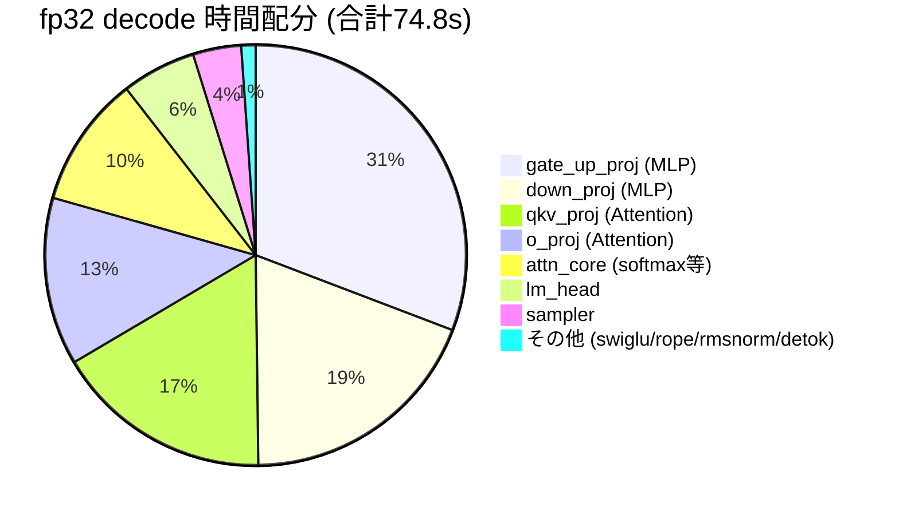
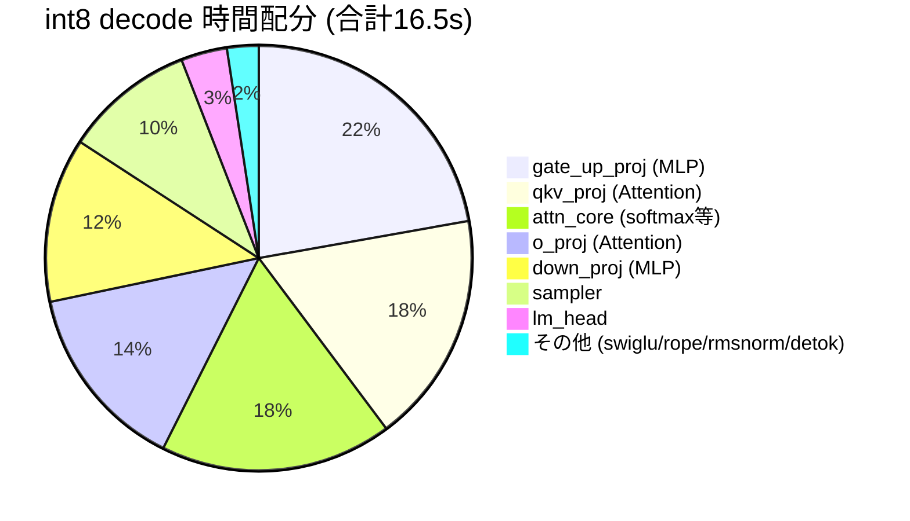
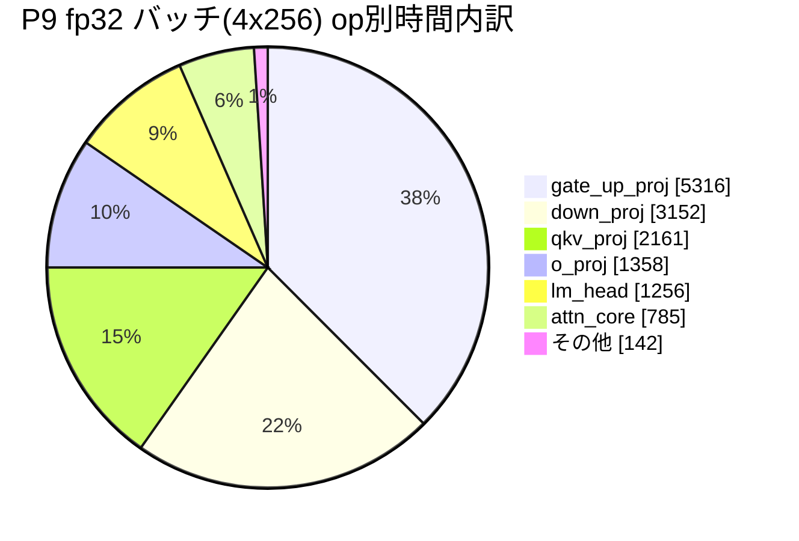

# denno-beta 開発履歴

> アーキテクチャの詳細は [アーキテクチャ解説](ARCHITECTURE.ja.md) へ。
> このノートは**開発の記録**。新機能を実装したら、末尾に以下のフォーマットで追記する:
>
> **追記フォーマット**: `### Pn: 機能名 (日付, commit)` の下に **実装** / **テスト** / **プロファイル** / **次の実装内容** を記載する。完了した項目は「次の実装内容」を候補リストへ反映する。

**更新**: 2026-10-13
**リポジトリ**: https://github.com/ahinore/denno-beta (main, `3ff6175` 同期済み)

---

## 1. 開発環境と稼働構成

```
[開発マシン: x86_64 Linux (Docker内で完結)]
├─ denno-beta コンテナ (port 8080)            … LLM APIサーバー (本番運用)
│    └─ モデルキャッシュ: ai_work/denno-beta/data/.cache
└─ 開発コンテナ … 開発エージェント + 開発用 denno(8090)/denno-view(8093)
     └─ /work/denno-beta (= ホストの ai_work/denno-beta, git管理)

開発フロー: エージェントが実装→cargo test→exactness検証→commit
           → GitHub同期 → CI自動検証(build+test+exactness)
           → 本番コンテナ docker compose build && up -d → health/生成テスト
```

- CI: `.github/workflows/ci.yml` — build+test(push/PR)、exactness(push時のみ、実モデルDL)。**x86-64-v3で全緑**
- GitHub push: 現在はWindowsリポジトリ経由で同期。deploy key登録待ちでコンテナ直pushは未設定
- 基準出力(exactness): 「1+1は?」→ `1+1は1です。これは数学的定理で、1と1を加えることによって得られます。`(seed42, temp0, fp32)。CIのx86ランナーでも同一出力を確認済み

## 2. タイムライン(初期〜P2: 要約)

| 段階 | 内容 |
|---|---|
| 初期実装 | 単一バイナリ(cli/engine/server)、GPT-2/Qwen2.5-0.5B、Anthropic API互換+SSE、exact decoding(seed 42) |
| 最適化#1 | `target-cpu=native`、attention スカラーループ→sgemm化、decode matvec出力分割並列化 → prefill 88秒→24秒、decode 1秒/トークン→0.1秒 |
| P1 | KVキャッシュ + LRU prefix cache(単一エントリ) → 2回目以降のprefill ≈0(1519→11トークン) |
| P2 | マルチエントリLRU prefix cache(LCP最大選択、トークン予算32k) → 交互セッションでも `reuse 47/48` |

## 3. フェーズ別記録

### P3: int8 weight-only量子化 ✅ (2026-10-11, commit `89aae74`)

- **実装**: per-channel scale量子化+デ量子化込みmatvecカーネル(新規 `quant.rs` 430行)。fp32デフォルト完全維持、`--quant int8` でのみ有効
- **テスト**: 77テスト全緑。fp32 exactness不変、int8は3実行完全同一(決定論)
- **プロファイル**: 速度ほぼ横ばい(14.4 → 13.9 tok/s)。デ量子化オーバーヘッドが帯域削減利益を相殺。価値はメモリ半減(重み約1GB→約0.5GB)
- **次の実装内容**: SIMD int8ドット積(→ P5で実現)、連続バッチング(→ P4)

### P4: 連続バッチング ✅ (2026-10-11, commits `f65281f` → `4e9058a` → `e3ad3ca`)

- **実装**: リクエストスケジューラ(`scheduler.rs`)— 有界キュー(満杯503)+ Engineを`step_chat`(1 forward)単位で進めるステッパ化。decode中に新規prefillを割り込み、複数セッションをKV suspend/resumeでラウンドロビン(`MAX_ACTIVE_SESSIONS=4`)
- **テスト**: 86テスト全緑。**インターリーブ下でも各出力が単独実行とビット一致**(KvSensitiveModelで検証)。CI(x86)3回連続フルグリーン
- **プロファイル**: 計測なし。その代わり実バグを発見: ワーカーがmutexをほぼ連続保持しHTTPハンドラの`engine.lock()`が数百ms starve → モデル名をAppStateにキャッシュして解決
- **次の実装内容**: int8 SIMDカーネル(→ P5)、真の並列decode(→ P6候補)

### P5: int8 SIMDカーネル ✅ (2026-10-12, commit `eec5624`)

- **実装**: P3の「重みをデ量子化してfp32積」を**「アクティベーション動的量子化+真のi8×i8整数ドット積」**に設計変更。aarch64 NEON `vdotq_s32`/x86 AVX2 `_mm256_madd_epi16`、cfg切替
- **テスト**: 91テスト全緑(+5)。i32累積の結合則でSIMD/スカラーがビット一致(プロパティテスト)。CI x86 AVX2パスでも検証。int8内で決定論(3実行md5同一)、fp32完全不変
- **プロファイル**: カーネル単体5.4〜12.9倍(lm_head 5.39ms→1.0ms)、e2e decode **約14.4 → 約51 tok/s**
- **次の実装内容**: 真の並列decode(P6)

### P6: 連続バッチング(バッチ並列decode) ✅ (2026-10-12, commit `52f5742`)

- **実装**: KVキャッシュを単一から**スロットプール**(`caches: Vec<KvCache>`、`DENNO_BATCH_SLOTS`既定4)に変更。セッションは完了まで自スロットに常駐し(旧suspend/restoreローテーション廃止)、全常駐セッションのdecode 1ステップを**1回の`forward_batch`**にまとめる。カーネル層では多列matvec `matvec_rows_bt`/`matvec_rows_bt_i8`を新設 — **各要素のk方向累積順を単独matvecと完全一致**させた(演算順序が変わるsgemmは使わない=fp32でもビット同一)。rayon行ブロック並列は`SendPtr::write`メソッド経由でrawポインタを共有(edition 2021のdisjoint closure capture回避パターン)。スケジューラは連続バッチング化(空きスロット限り同時受付、prefill優先インターリーブ、decode一括`step_chat_batch`、満席→503)
- **テスト**: **106テスト全緑**(engine 99 + server 7)。`forward_batch`がB∈{1,2,3}の複数ステップで単独decodeとビット一致する契約テスト、交互セッションexactness、CI x86-64でも全パス。**実機検証**: 0.5Bで4セッション同時実行、fp32/int8ともにsolo==batch完全一致(反復実行含む)、基準出力不変
- **プロファイル**(0.5B、4リクエスト×256上限、同一環境): 逐次 604トークン/20.6s → バッチ 604トークン/14.8s。集約スループット **fp32 13.9→18.7 tok/s (1.35倍)、int8 38.8→66.2 tok/s (1.7倍)**。131ステップで4セッション分272トークンを消化=バッチ化は完全動作。**b=4で帯域律速→演算律速に遷移**(fp32: 1ステップ72ms→110ms、int8: 27ms→36ms)= 重みストリームは1回で済むがFLOPsは4倍のため。次のブレークスルーはk方向の順序保存SIMD幅拡大
- **サイズ依存の実測**(3B int8、b=2、128上限): solo 12.8 tok/s → バッチ集約 20.5 tok/s (**1.6倍**)。バッチステップ時間は solo 78ms → b=2で81ms とほぼ不変 = **3Bはまだ重み帯域律速**(重み3GB/ステップに対し演算量が相対的に小さい)。予測通り「大型モデルほどバッチ効果が素直に効く」ことを確認。3Bでも solo==batch ビット一致確認済み
- **設計メモ**: `release_session`はKV行と`cached_prompts[slot]`を残置し、次セッションが同一接頭辞ならtruncateのみのゼロコピーlive再利用ができる(旧単一キャッシュの挙動を再現)。退避はprefix storeへ(`contains_prompt`で重複回避)。prefillはプロンプト残りを1回のforwardで処理(GEMM蓄積順が変わる分割はexactness上NG)
- **次の実装内容**: sampler最適化(→ P8、P6着手前に完了済み)

### P7: 大型Qwenモデル対応 ✅ (2026-10-12, commit `9fb18ab`)

- **実装**: 分割safetensors(`model.safetensors.index.json`+全shard DL/テンソル名解決、新規 `WeightStore`)、非結合lm_head(`tie_word_embeddings: false`)
- **テスト**: 93テスト全緑(+2)。0.5B exactness完全不変。**0.5B/1.5B/3B/7Bすべて「1+1は2です。」等の正常応答を確認**
- **プロファイル**(サイズ別、20コアCPU):

| モデル | fp32 | int8 | 備考 |
|---|---|---|---|
| 0.5B | 14.4 tok/s | ~51 tok/s | 本番稼働中 |
| 1.5B | — | — | 既存バイナリで無変更動作 |
| 3B | 約2 tok/s | 約4.7 tok/s (2.4倍) | 分割checkpoint+untied |
| 7B | 約1.2 tok/s | 約2.1 tok/s (1.8倍) | 重み28GB、RAM 121GBで余裕 |

- **次の実装内容**: ボトルネック可視化のためプロファイラ導入(→ P7.5)

### P7.5: プロファイラ+ボトルネック可視化 ✅ (2026-10-12, commit `40e209d`)

- **実装**: 軽量セルフプロファイラ `prof.rs`。`DENNO_PROFILE=1` で有効化、リクエスト完了時に各フェーズの累積時間をINFOログ出力。無効時はオーバーヘッドゼロ、数値経路に触れない
- **テスト**: 93テスト全緑維持。exactness基準出力不変(プロファイラ無効時)。CI ✅、本番反映済み
- **プロファイル**: 下記(P8以降の計測もこの形式でここに追記する)

#### プロファイル手法の制約

Docker内では `perf`(perf_event_paranoid=4で拒否)、`valgrind/callgrind`(aarch64のnativeコードでSIGILL)、`gdb`(ptrace禁止)がすべて使えない → **コード内計測(セルフインストルメンテーション)が唯一の正攻法**

#### 計測条件

Qwen2.5-0.5B、長文生成1リクエスト(prefill込み累積)。

**fp32 decode の時間配分**(計800トークン、全体74.8秒):



**int8 decode の時間配分**(461トークンでEOS、全体16.5秒):



#### 読み取れること

1. **線形層(matvec)が支配的** — fp32で約80%。decodeは重み帯域律速の通り。int8+SIMDでこれが約70%に圧縮され、速度は約4.5倍になった
2. **attn_core の割合がint8で増加**(10%→18%) — 線形層が速くなると相対的に浮かび上がる。KVキャッシュ読み+scales/softmax。長コンテキストではさらに伸びる
3. **sampler が固定コスト約3.5ms/step** — fp32 3.7%、int8では約10%に。語彙152k全体のsoftmax+top-pソートが律速
4. swiglu/rope/rmsnorm/embed は合計1%程度 — 最適化不要の結論が数値で出た

- **次の実装内容**: sampler最適化(最有力)/ P6再開(真の並列decode)

### P8: sampler最適化 ✅ (2026-10-12, commit `119dd92`)

- **実装**: P7.5のプロファイル(sampler固定コスト約3.5ms/step)を受け、`sampler.rs`を全面書き換え。top_k=`select_nth_unstable`+部分ソート(tie-breakを旧実装とビット一致させる参照実装テスト付き)/top_p単独=上位2048部分集合で計算し境界ヒット時は旧フルパスにフォールバック/plain temperature(本番デフォルト)=ソート廃止の2パスO(n)+スクラッチ再利用。**greedy経路は完全無変更**(temperature=0はargmax直行)
- **テスト**: 98テスト全緑(+5 samplerテスト、ビット一致参照チェック含む)。**仕様変更として明記**: temperature経路はRNG→トークン対応が旧実装と異なる(greedyは不変)。0.5B greedy基準出力不変、CI ✅
- **プロファイル**: sampler 3.5ms→**0.66ms/step (5.3倍)**。占拠率 fp32 3.7%→0.7%、int8 9.9%→2%
- **次の実装内容**: P6連続バッチング(→ P6として完了)

### P9: fp32バッチカーネルのSIMD化(順序保存レーン並列) ✅ (2026-10-12, commit `1bbffff`)

- **実装**: P6で「b=4で演算律速に遷移」したfp32バッチカーネル`matvec_rows_bt`をSIMD化。**レーンはi方向(バッチ内セッション4個)とj方向(出力チャネル4個のILP用)にのみ張り、k方向は張らない** — 各出力要素のk累積は厳密に逐次(乗算と加算を分離した命令のみ、FMA不使用=丸め分離)→ 単独decode(`matvec_bt`)とビット一致が保たれる。アクティベーションを`[k][mp]`に転置+ゼロパディングしてレーンロードを連続化(m*k は高々数十KBで転置コスト無視)。aarch64 NEON / x86 SSE(`_mm_mul_ps`)の二実装+その他アーキ向けスカラーフォールバック
- **テスト**: 106テスト全緑。ビット一致テストの形状を拡張(m∈{1..8}、k∈{1,4,65,896}、n端数込み)。CI x86 SSE経路でもexactness ✅。**実機検証**: fp32/int8ともに4セッション同時==solo完全一致、基準出力不変

#### プロファイル

**① サーバー op別**(`DENNO_PROFILE=1`、0.5B fp32、solo/batchを別セッションで分離計測)

| op | solo: ms (calls) | solo 割合 | batch: ms (calls) | batch 割合 |
|---|---:|---:|---:|---:|
| gate_up_proj | 1,642 (3,600) | 33.8% | 5,316 (6,432) | 37.0% |
| down_proj | 1,196 (1,800) | 24.7% | 3,152 (3,216) | 22.0% |
| qkv_proj | 828 (5,400) | 17.0% | 2,161 (9,648) | 15.0% |
| o_proj | 502 (1,800) | 10.3% | 1,358 (3,216) | 9.5% |
| lm_head | 405 (75) | 8.3% | 1,256 (134) | 8.7% |
| attn_core | 187 (1,800) | 3.8% | 785 (3,216) | 5.5% |
| rope/sampler/rmsnorm/detok | 42 | 0.9% | 142 | 2.3% |
| **TOTAL** | **4,854** | 100% | **14,362** | 100% |

- **solo**: 75tok/4.88s = **15.4 tok/s**(64.7ms/step)、線形層合計 **94.2%**
- **batch**: 279tok/130step、平均バッチ幅 **2.15**(出力長45〜83トークンで早期完了セッションが出るため)、集約 **19.4 tok/s**(プロファイラ込み・無しで21.8)
- **トークン当たりの線形層コスト 61.0→47.5ms(1.28倍)**。attentionはトークン当たり不変(2.5→2.8ms)= ステップ内では幅分かかるがトークン換算では同じ
- in-serverのバッチ線形層はマイクロベンチの帯域フロア(幅4=soloステップ時間相当)には未達 → 平均幅2.15への低下+実サーバーでのメモリ系競合(アクティベーション/KVと重みストリームの干渉)が原因と推定



**② カーネル単体マイクロベンチ**(0.5B形状、m=4): gate_up(k=896, n=4864) **3.92倍** / down(k=4864, n=896) **5.86倍**(vs 単独`matvec_bt`×4)。`#[ignore]`付き`bench_matvec_rows_bt_m4`テスト同梱(`cargo test --release bench_matvec -- --ignored --nocapture`)

- **e2eの限界要因の特定**(プロファイル分析): バッチ集約倍率(fp32 1.36倍)は線形層のトークン当たり改善(1.28倍)とほぼ一致 — 線形層はもう主要な律速ではない。理論上は幅4ならトークン当たり線形コストは約1/4(61→約15ms)になり得るので、**残る律速は①平均バッチ幅の低下(セッション完了時間の偏り、平均2.15)、②in-serverでのメモリ系競合、③attention/prefill(トークン当たり不変だが幅を上げても伸びない部分)**。次のレバーはセッション寿命の平準化+attentionのバッチ化
- **次の実装内容**: attentionのバッチ化(P10候補)/ 3B/7Bのb=4実測

### P10: attentionの並列化(セッション×KVヘッド) ✅ (2026-10-12, commit `4e2428f`)

- **実装**: `forward_batch`のattentionを rayon で並列化。タスク単位は **(セッション i × KVヘッド kvh)**(0.5Bで最大32タスク)で、各タスクは`att`の非重複スライスを担当。タスク内の演算列は単独decode(n==1)経路と完全同一(sgemm_acc→softmax→matmul、同一形状)+セッション/KVヘッド間に数値的相互作用がないため**ビット一致は自明に維持**。KV読み取りは新設の`KvCache::kv_bufs_ref(&self)`(読み取り専用)で共有。単独decode経路・prefill経路は無変更(基準経路を触らない規律)
- **テスト**: 106テスト全緑(fp32/int8のbatch==soloビット一致テストが並列経路を直接カバー、テストモデルはGQA構成)。実機: fp32/int8とも4セッション同時==solo完全一致。CI 38240311689 ✅(x86でもパス)
- **プロファイル**(交互A/B計測、下記学習メモ参照):

  | 計測 | new (P10) | old (P9) |
  |---|---:|---:|
  | バッチ4×256 集約 | **33.4 / 33.1 tok/s** (平均33.2) | 31.6 / 32.2 tok/s (平均31.9) |
  | solo 256 | 17.3 tok/s(不変) | 同左 |

  - **P10効果: 集約 +4%**(交互2ペア両方で新コード優位、再現性あり)。物理的に整合: P9プロファイルでattn_coreはバッチ時5.5%、並列化でその壁時間の大部分を回収
  - **測定汚染の実例**: 単純な前後比較では new 6.78s/41.2tok/s vs old 12.99s/21.8tok/s(2倍!)と出たが交互A/Bでは+4%しか差がなかった — **同ホストで常時稼働する他の推論ワークロードがCPUを使う**ため時間帯で背景負荷が変動し、離れた時点の絶対値は比較不能
  - 教訓: **同一ホスト上の性能計測は必ず new/old 交互+同ワークロード**(計測スクリプト `p10_ab2.sh`)
- **次の実装内容**: 残る律速(平均バッチ幅の低下・メモリ系競合)の分析/ 3B/7Bのb=4実測 / prefill割込みの影響定量化

### P11: ストリーミングdetokのバイト分割文字修正 + gpt2 exactness基準の更新 ✅ (2026-10-12, commit `16319c7`)

- **発端**: gpt2 exactness テストの失敗(文字化け出力)。モデルを再取得したが**同一ファイル**(548,105,171B、英語raw生成は正常)で失敗継続 → 原因はモデルではなかった
- **原因1(テスト基準が古い)**: CIはexactness ジョブでQwenのみpullしていたため gpt2 テストは「モデル未キャッシュ→スキップ」で**一度も実行されていなかった**。基準文字列は当時の条件のまま残存
- **原因2(ストリーミングdetokのバグ)**: バイトレベルBPE(GPT-2)ではマルチバイト文字がトークン境界で割れ、未完成バイト列がdecodeでU+FFFDになる。そのU+FFFDを確定済みテキストに混入させると以後のバイト差分がずれて文字が欠落(「??の??は?」の正体)
- **検証(参照実装)**: コンテナにHF transformers(fp32, greedy)をインストールし同一プロンプトを比較 → **denno出力と完全一致**(GPT-2 baseはフォールバックテンプレート付きプロンプトで入力を繰り返す=エコーが素の貪欲生成の挙動)
- **実装**: `emit_delta_and_check_stop` — 末尾がU+FFFDになるトークンを**保留**し、文字が完成したステップでまとめて差分として流す。新設 `flush_stream` — 生成終了時(EOS/max_tokens)に保留分をフラッシュ(step_chat/step_chat_batch両方、EOS分はdecodeから除外)。**テキスト経路のみで数値経路は不変**(プロファイル対象外、性能無関係 — 基準出力と4セッション同時==soloの実測で確認)
- **テスト**: 単体99+7 全緑 + exactness 5件全緑(aarch64)。**CI 38244751670 ✅** — ワークフローにgpt2 pullを追加し、**x86上でgpt2テストが実際に走って緑**(基準文字列は参照実装と一致することを実証)。本番デプロイ済み・基準出力不変

### P12: 残り律速の分析 + decode attention最適化(probs@V行統合+ストライド直接参照) ✅ (2026-10-12, commit `55c1de0`/`f3dea3b`)

- **発端**: 開発環境の移行が完了し、他ワークロード負荷のないクリーン環境でP9以来の残り律速(平均バッチ幅低下/メモリ系競合/prefill割込み)を定量化
- **分析1(バッチ幅スケーリング)**: 同時発火×256tok上限(EOSで自然終端、トークン数は幅間で異なるため**集約tok/sで比較**)。fp32はW=8まで素直に伸びる(16.2→~50)、int8は**W=4で頭打ち**(149→132〜135とW=8で微減)。スロット数は`DENNO_BATCH_SLOTS`(既定4)で、幅8の真のバッチには8が必要(既定4だと2ウェイのキューイングになる)
- **分析2(op別プロファイル)**: fp32 W=4では線形層+lm_headが約85%(帯域律速どおり)。int8 W=4ではgate_up 29.5% / **attn_core 19.4%** / down 18.0% / lm_head 10.8% — **int8ではattentionが線形層に次ぐ律速**(KV連続化コピー+per-(kvh,g)のm=1 sgemm 7回+23アロケーション/タスク、t×dhバッファはmmap閾値超えで毎ステップmmap/munmap)
- **発見(カーネル差し替えの落とし穴)**: matrixmultiplyは**ストライドと行数でSIMDカーネルを選び替えるため数値が変わる**。scores側(b を転置レイアウト rs=1/cs=k で渡す経路)は行統合(rows=m)・ストライド参照のどちらもビット不一致(実測で確認)。probs@V側(row-major b)は**行統合+ストライド参照でビット一致**(実測) → ビット一致規律を守れるのはV側のみ
- **実装**: ①`tensor::matmul_rows_bstrided` — probs@Vを per-g matmul(m=1)×group回+vh連続化コピー → **1回の行統合sgemm+キャッシュのストライド直接参照**(コピー無し)②`attention_decode_kvhead` 新設 — forward()(n==1)とforward_batch()が同一関数を通る構造に統一 ③qgコピー廃止、kh/scoresをthread_localスクラッチで再利用(mmapチャーン除去)④scores側は従来経路のまま(sgemm_acc(m=1)+kh連続化コピー — 数値上必須と判明)
- **テスト**: 単体100+7全緑 + `decode_attention_probs_v_bitexact`(行統合+ストライド vs 従来per-row、to_bits比較)+ **exactness 5件全緑(基準出力含めビット一致・出力不変)**
- **A/B実測**(クリーン環境、old 1a7fee6 vs P12、交互2ラウンド、スロット8):

#### プロファイル

| 構成 | old (1a7fee6) | P12 (55c1de0) | 差 |
|---|---:|---:|---:|
| fp32 W=4 | 26.8 / 26.8 tok/s | 27.7 / 27.7 tok/s | **+3.4%** |
| int8 W=4 | 126.4 / 122.5 tok/s | 130.4 / 126.2 tok/s | **+3.1%** |
| int8 W=8 | 119.0 / 113.5 tok/s | 121.3 / 119.3 tok/s | **+3.4%** |

| op別 (int8 W=4, 1022tok, プロファイラON) | old ms | P12 ms |
|---|---:|---:|
| attn_core | 1,543 | **1,193 (-22.6%)** |
| gate_up_proj | ~2,343 | 2,432 |
| down_proj | 1,430 | 1,480 |
| lm_head | 854 | 869 |
| TOTAL | 7,942 | 7,796 |

- **測定上の教訓**: ①A/Bサーバーは別バイナリ名(`/tmp/denno_old`/`/tmp/denno_p12`)で起動したが、pkillパターン`denno serve`が`denno_old serve`に**マッチせず全12回が同じサーバーに当たり無効データになった**(2回目で修正、quant modeログで毎回確認)②op別プロファイルの`grep -A14 … | tail -13`は**先頭行(最大op)を切り捨てる** — 最初の分析でattnを48.9%と誤読(gate_up行がカットされていた。正しくは29.5% gate_up / 19.4% attn)
- **次の実装内容**: scores側の根本最適化(k方向SIMD/パック再利用)はビット一致規律と両立不可 → **基準出力の更新を許容するかの判断が必要**。3B/7Bのb=4実測。CUDA最適化(§8)

### P13: 推論可視化(denno-trace)テレメトリ基盤 + denno-view中継 ✅ (2026-10-13, commit `69663e6`)

- **発端**: ユーザー指示の推論可視化機能(§11)。推論中のコールスタック・隠れ層・KV状態をストリーミングで別サーバーに転送し、WASMでリアルタイム表示する構成の第1段階(L0フロー/L1統計)
- **実装**: ①`denno-telemetry` crate新設(**依存ゼロ/stdのみ** — エンジン・サーバー・ビューア(WASM含む)が同一形式を共有するため)。フレーム形式v1 = `"DNTL"`(4B)+version(1B)+kind(1B)+payload、整数はLEB128 varint、確率はf16(RNE自前実装)。kind: ServerInfo/SessionAdmit/SessionDone/Prefill/Token/Step/OpSummary/KvUsage/Gap/TopK ②エンジン捕捉フック(install/release/step_chat/step_chat_batch。すべて`telem::enabled()`ガード+read-onlyで数値経路に非接触)③prof.rsのop計時をtelemetryにも累積(lib.rs経由の委譲でprof→telemetryの直接依存を回避)④denno-serverにWSエンドポイント`/v1/telemetry/ws`(バイナリフレーム、接続直後にServerInfo。ハブ→broadcast中継スレッド。テレメトリ無効時は503)⑤`denno-view` crate新設 — 上流dennoへWSクライアント接続(切断時2秒再試行)、複数ブラウザへのmultiplex中継、`VIEW_RECORD`でリプレイ記録([u32 len][bytes]追記形式。P14のスクラバー入力)、簡易ライブダッシュボード(HTML+JSデコーダ。WASM化はP14)
- **設計3原則の実装**(§11): ①推論と完全分離(捕捉はemitのみ)②推論を絶対に待たせない(hubはbounded SyncSender 4096+try_send、満杯→ドロップ+Gapフレームで欠落を明示)③既定OFF(`DENNO_TELEMETRY`無しでは捕捉コードが一切走らない=ゼロコスト)
- **テスト**: 単体100+telemetry統合1+server7+telemetry crate5 全緑。telemetry統合テストはOFF→ONのライフサイクル(SessionAdmit/Prefill/Token/TopK/KvUsage/OpSummary/SessionDone)+**ON/OFFで生成出力完全一致**(testutilダミーモデル)+全フレームencode→decode可逆。exactness 5件全緑。**JSデコーダも検証**(Rustが生成した全10種フレームをnodeでデコード→期待値完全一致。f16の2.75/0.5/0.25やu64 varint含む)
- **e2e実機検証**(ローカルの denno-dev:8090 + denno-view:8093): テレメトリONで基準出力**ビット一致**(usage 34/26)。denno-viewログに`server: denno-dev (quant=fp32, slots=4, ctx=32768)`/`session 1 admit (slot 0, prompt 34 tok)`/`session 1 done (reason 0, 26 tok)`、**Gap 0件**。ダッシュボードHTML配信OK
- **e2eで発見したバグ2件**: ①**f16デコードの非正規パスで指数が2^14倍オフ**(往復テストで発見。6.1e-5→0x03FF→0.999に化ける。ループk回後のf32指数は113-kが正しい)②**アイドル時のKvUsageフレーム洪水** — スケジューラワーカーはアイドル時も空バッチで`step_chat_batch`をポーリングし続けるため、空バッチでもKvUsageを発出すると毎秒数千フレーム→ハブ満杯→Gap洪水(空バッチでは発出しないよう修正。アイドルポーリング自体は既存設計のまま)
- **CI**: 38275707105 ✅(build+test+exactness)。本番反映済み・基準出力ビット一致(本番はテレメトリOFF運用)
- **次の実装内容**: P14(WASMビューア: wasm-bindgen+canvas/WebGL2、リプレイスクラバー)/ P15(L2テンソルfocus)

### P14: denno-view 推論フローアニメーション(コールグラフ+層パネル+KV/変数) ✅ (2026-10-13, commit `8befe3f`, JS版。WASM移植は残課題)

- **発端**: ユーザー指定の denno-view 仕様 — 中央にモデル駆動プログラムのコールグラフ(プロンプトが降りて関数が順に点灯・値がパルスで渡る)、右にモデル各層のスタック(参照時に発光)、左に KV キャッシュ+隠れ変数(格納時に発光・値表示)
- **テレメトリ拡張**: コールグラフ逐次点灯に必要なデータをフレームに追加 — ①`LayerRun { layer, ops }`(1 層の op 列を実行順で 1 フレームに圧縮、24フレーム/トークン)②`ServerInfo.layers` ③`Prefill.tokens`(降下アニメ用)。実装は thread-local 層バッファ+`prof::time_layer`
- **denno-view UI**: 3カラム(中央=コールグラフ+実装コードパネル/左=KVスロット+変数+op timing/右=モデル構造)。ブラウザ側も再生キュー+間引きで**推論を待たせない**設計を維持
- **検証**: テスト全緑+exactness 5/5+JSデコーダ12種一致+e2e基準出力**ビット一致**・Gap 0件(LayerRun 509フレーム)。CI 38298659275
- **P14.1〜P14.3 機能追加 (2026-10-13, commits `6b198f2`/`e34e411`/`06df5ed`)**: ①層パネル修正 — view が ServerInfo/KvUsage スナップショットを保持し後から開いたブラウザにも即時表示+層行に op 名/実測 ms ②トークン文字表示 — `VIEW_TOKENIZER`→`/tokenizer.json` 配信、BPE 逆マップ+ストリーミング UTF-8 デコードでマルチバイト境界を正しく復元、入力/出力トークンを文字チップ表示 ③内蔵チャット — view の `POST /chat` が上流 denno の `/v1/messages` へ中継され、送信するとアニメーションが自動連動
- **P14.4 ステップ実行コード+モデル構造 (2026-10-13, commit `91bbb6a`)**: 中央左に**実装コードパネル**(擬似コード、実行中行がデバッガの PC のように前進+`li = N/24` ウォッチ)、右パネルを**モデル構造**表示(embed→decoder×24[ATT+MLP チップ]→final_norm→lm_head、LayerRun に応じてチップ個別発光)
- **P14.4b〜k UI ブラッシュアップ (詳細省略, commits `62acfc8`〜`5e64eef`)**: レイアウト修正(隙間/等分/ペイン分離/セクション分離線)、拡大コーン(コードパネル=model_forward ノードの拡大コールアウト)、トークンの配置(入力=グラフ上・出力=下)、KV/変数への飛点(SVG 飛線)、UI 全面英語化、見出し「denno (LLM Server)」、speed スライダー(low/high・既定最速・low で目で追えるスローモーション)、ServerInfo に model_id 追加(実モデル ID 表示)。**推論を待たせない設計は全過程で不変**
- **P14.4l〜q コードパネルの正確化+実コード切替 (commits `091da66`〜`3ff6175`)**: ①擬似コードの実行順序を実物どおりに修正 — KV 書き込みはループ内(rope 直後)、attn_core がキャッシュを読む(`&kv[li][..pos+1]`)、prefill 分岐(p1-p4)も追加。Prefill 時はカーソルが p1→p2(KV 一括書き込み)→層カスケード→p3 と歩く ②**疑似⇔実コード切替**(「real code ▸」ボタン、既定 pseudo)— scheduler.rs/engine.rs/llama.rs を `include_str!` でコンパイル時埋め込み+`/code/src` 配信(表示コードは常に稼働バイナリと同世代)、擬似↔実を内容アンカーでマップしカーソル/状態点灯/飛線が両モードで動作 ③KV キャッシュと hidden x の**使用箇所**を飛線で可視化(KV→attn 読み出し・x→rmsnorm/final_norm)
- **P14.4r チャット出力を emit_token に同期 (commit `b1e6ecb`)**: 内蔵チャットの出力表示がアニメーション速度と無関係(応答受信後に一括表示)だったのを、**Token フレーム再生時にバブルへトークンを追記**する方式へ変更(speed=low なら出力表示もゆっくり)。送信後の最初の SessionAdmit でセッションを捕捉し、usage 確定で全トークン再生後に usage 付きで確定。tokenizer 未読込/テレメトリ無効/Token フレーム欠落時は従来どおり応答全文表示へフォールバック(4秒監視)。併せて tokText の1トークン2重呼び出し(ストリーミング UTF-8 デコーダを2回消費する潜在バグ)を1回に修正。検証: JS 構文 OK・dev サーバー再ビルド+再起動・チャット応答 OK・p143_check CHAT_OK(トークン19フレーム)
- **P15 Qwen3対応 (commit `e67eeb2`)**: **Qwen3 = Qwen2 + QK-Norm**(q_norm/k_norm.weight を head_dim 単位の RMSNorm として QKV bias 後・RoPE 前に適用。`qknorm_rows_inplace`、prof に `qk_norm` op 追加)。バッチ/単独 decode のビット一致を単体テストで担保(`qk_norm_batch_matches_solo_decode_bit_exactly`)。**KV メモリ予算**(`DENNO_KV_BUDGET_MB`、既定 12288MB): 明示 env 最優先・予算内でスロット優先+残りを prefix cache(最低 2048 トークン保証)・小 KV モデルは従来構成完全維持 — Qwen3-0.6B は KV 事前確保が約 47GB に達して SIGKILL していた問題の解消。**minijinja-contrib pycompat**: HF チャットテンプレートが使う Python 風 str メソッド(startswith 等)を登録し Qwen3 の thinking テンプレートが描画されるように。exactness: Qwen3-0.6B greedy 出力を HF transformers(fp32)参照実装と完全一致検証+CI で Qwen3-0.6B pull を追加
- **P16 リプレイスクラバー (commit `5def63e`)**: denno-view に記録フレーム列の再生 UI を追加。サーバー側: `VIEW_REPLAY=/path` で `GET /replay` が記録 ([u32 len][bytes] の連結) を**リクエスト毎に読んで**配信 (記録しながら再生できる。プロセス強制終了で末尾が途切れた記録もパーサが途中まで読む)。ブラウザ側: ヘッダーのスクラバーバー (replay/live 切替・play/pause・⏮・1フレーム戻し/送り・スライダーシーク・位置表示)。**シークは先頭からの状態再構築** (fast-forward: スナップショット系 ServerInfo/KvUsage は通常経路、アニメーション系 Token/LayerRun/TopK/Prefill は状態のみ適用して演出 skip — `RP_FFWD` フラグ)。再生はライブと同じ pacing (queue+drain) を再利用し、リプレイモード中はライブ WS フレームを無視。検証: JS 構文 OK・記録→`/replay` がバイト一致 (md5 同一)・146/300 フレームの解析確認・UI 配信確認
- **残課題**: ①WASM 移植(デコーダ+状態機械を wasm-bindgen 化 — JS 版は先行実装として維持)②L2 テンソル focus(P18、隠れ変数の実値表示は現状 KV 長/top-k/token など L1 統計のみ)

### P17: CUDA int8 オフロードカーネル(CPU int8 パスとビット一致) ✅ (2026-10-13, commit `11281dd`)

> ユーザー指示「CUDA最適化を確立してから他ファミリーへ」。§8 の移植ステップ第 1 段(線形層)の基盤。残候補で「P17」としていた L2 テンソル focus は **P18 に繰り下げ**。

- **実装** (`denno-engine/src/cuda.rs`、feature `"cuda"`): CUDA Driver API を **dlopen 実行時解決**(依存クレートゼロ。feature を外したビルド = CI/GPU 無し環境には一切影響しない)。カーネル `kernels_int8.cu` は **compute_75 向け PTX にコンパイルしてコミット**(`nvcc -ptx -arch=compute_75 -fmad=false`。ドライバ JIT が以降の全アーキ sm_86/89/120 で実行 — RTX 5090 sm_120 / driver 13010 で実機検証済み)。カーネル: ①per-row 動的量子化 (dno_quantize_rows、1 block/row、共有メモリ maxabs リダクション) ②int8 GEMV/GEMM (dno_matvec_rows_bt_i8、1 warp/出力、レーンが k 方向 coalesced 走査+warp i32 リダクション)
- **ビット一致の設計** (CPU: `tensor::quantize_row_i8` / `matvec_rows_bt_i8`): ①maxabs は丸めを伴わないので走査順序に依存しない・`roundf` = `f32::round` (half-away-from-zero)・clamp ±127 を同一規則で ②i8×i8→i32 累積は**整数なので結合則が成立**し、warp リダクション/レーン分割の順序に出力は依存しない(CPU の AVX2/sdot カーネルとビット一致の根拠)③出力スケールは `(float)dot * ascale[i] * scale[j]` を左から順に(CPU と同一の結合順)
- **GPU 実行環境** (新設): rtx5090 上に **denno-gpu コンテナ**(nvidia/cuda:12.9.1-devel-ubuntu22.04 + rustc 1.99.0、`--gpus all`、/work/denno-beta は hermes-dev と同一ホストツリーの bind。ビルドは `CARGO_TARGET_DIR=/tmp/denno-target` で分離)。RTX 5090 = 32GB / sm_120(CUDA 12.8+ が必要なため既存 12.6 イメージは使用不可)
- **検証**: `cuda_quantize_rows_bit_exact_vs_cpu` / `cuda_linear_int8_bit_exact_vs_cpu` — decode m=1・バッチ decode m>1・prefill GEMM の全経路で、lm_head 1536×151936 を含む実モデル形状(Qwen2.5-1.5B)まで **to_bits 完全一致**(RTX 5090 実機)
- **マイクロベンチ** (重み VRAM 常駐、decode m=1、アクティベーションは毎回 H2D): **lm_head 18.6x**(5.46ms→0.294ms、実効 794 GB/s)/ down 11.1x / gate_up 2.6x / qkv・o は 0.4〜0.6x — 小さい層は 1 呼び出しあたりの固定オーバーヘッド(起動+同期+H2D/D2H 約 40µs)が支配的。バッチ m=8 の gate_up は 4.1x
- **CI**: `cargo check -p denno-engine --features cuda`(コンパイルチェックのみ、GPU 不要)を追加
- **次の実装内容** (P17b: エンジン統合): 重み VRAM 常駐+**アクティベーション デバイス滞留パイプライン**(同期を 1 ステップ 1 回に→小さい層の固定オーバーヘッド解消)→ attention 融合カーネル → sampler → paged KV(§8.4 の順)

### P17b: CUDA エンジン統合(重み常駐+ピン留め非同期パイプライン) ✅ (2026-10-13, commit `197a06c`)

> P17 のカーネルを全 int8 線形層の実経路に接続し、e2e でビット一致と 3.4x を実証。§8.3.5「int8 なら GPU 化しても出力は変わらない」を e2e レベルで確認した初めてのフェーズ。

- **統合ポイントは漏斗 1 本**: `quant::Linear::apply_bt` / `apply_batch_bt` / `apply` の int8 パスに `maybe_gpu_linear` フックを入れるだけ。llama/gpt2 の全 int8 線形層(qkv・o・gate/up・down・lm_head)がこの 3 関数を通るため、モデル側のコードは変更ゼロ。None 戻りで既存 CPU カーネルにフォールバック(両者ビット一致なので出力は不変)
- **重み常駐レジストリは uid キー**: 最初は `Quant8Linear.w` のバッファポインタをキーにしたが、**Vec の解放→再確保でアドレスが再利用され、同一アドレスに別内容の重みが現れる衝突**がテストで露呈(同一サイズ・同一形状の異なる Linear で発生)。`Quant8Linear` 構築時に `uid` を採番し(Clone は同一内容のディープコピーなので uid 共有で安全)、uid キーのレジストリに初回アップロード。debug_assert で同一 uid の形状一致も担保
- **ピン留め+非同期 1 同期パイプライン**: H2D(x, async) → quantize カーネル → GEMV カーネル → D2H(out, async) → `cuCtxSynchronize` ×1/線形層。P17 はコピー・起動のたびに同期(×4、固定約 40µs)だったが、`cuMemHostAlloc(PORTABLE)` のピン留めホストバッファ+default stream 直列性により **約 28µs まで削減**(qkv 0.041→0.033ms、lm_head 0.286→0.220ms @ decode m=1)
- **decode 限定オフロード**: GEMV 型カーネル(1 warp/出力)は行数 m に比例して重み再読みが増えるため prefill の GEMM に弱い(**実測 m=128 で 0.39x**)。`m > DENNO_CUDA_MAX_M`(既定 16)は CPU のまま — prefill の性能を損なわず、decode・バッチ decode(m≤閾値)のみ GPU 化
- **検証**: ①パイプライン bit-exact(apply_bt 経由、4 形状・lm_head 1536×151936 含む)②tiny モデル forward 全体の GPU オフロード bit-exact(prefill+バッチ decode vs 単独)③CPU 106 テスト回帰変わりなし(cuda feature 無し)④**e2e**: Qwen2.5-1.5B int8 で CPU serve と GPU serve の応答テキスト・usage を完全一致(2 プロンプト・200 tok greedy・並行 2 リクエストのバッチ decode も単独と一致)
- **e2e 実測**: 200 tok greedy 生成 **CPU 9.08s → GPU 2.66s(3.4x)**。VRAM 使用は重み 234MB(lm_head)+層重み ≈ 1GB 強

## 4. 次の実装候補

- [x] ~~**sampler最適化**: 152k語彙のsoftmax+top-pソートが約3.5ms/stepの固定コスト(P7.5で判明)~~ → **P8で完了**(0.66ms/step、greedy不変)
- [x] ~~**P6再開: 真の並列decode**: バッチ行列化で複数セッション同時decode~~ → **P6で完了**(スロットプール+forward_batch、fp32 1.35倍/int8 1.7倍@b=4)。**残課題: b=4で演算律速に遷移するためk方向の順序保存SIMD幅拡大**(SDOT等、累積順を保ったペアワイズ加算)でバッチ効率をさらに伸ばせる
- [x] ~~**バッチ効率の向上(P6追補)**: `matvec_rows_bt`のk方向SIMD化(順序保存)~~ → **P9で完了**。ただし実装したのはk方向ではなく**i方向(バッチレーン)並列**(k方向のSIMDはfp32では累積順が変わり不可。i方向なら各要素のk累積を逐次のまま4セッション同時演算できる=ビット一致維持)。カーネル3.9〜5.9倍。プロファイルの結果、e2eの次の律速は**平均バッチ幅の低下(完了時間の偏り)+attention(セッション毎処理)+メモリ系競合**
- [x] ~~**attentionのバッチ化(P10候補)**: `forward_batch`内のattention本体がセッション毎の逐次ループ~~ → **P10で完了**(セッション×KVヘッドでrayon並列、ビット一致維持)。効果は**集約+4%**(交互A/B実測。attn_coreはバッチ時5.5%なので理論上限と一致)。softmaxのmax減算/sumはセッション毎独立のためバッチ化しても決定論は維持された
- [x] ~~gpt2 exactness テストの失敗(文字化け)~~ → **P11で完了**(モデル再取得では直らず。原因=①テストがCIでスキップされ続けて基準が古い②ストリーミングdetokのバイト分割文字バグ。HF transformers参照実装と一致する基準に更新+detok保留/フラッシュ機構+CIでgpt2 pull追加)
- [x] ~~**残り律速の分析**: P9プロファイルで判明した①平均バッチ幅の低下②in-serverでのメモリ系競合③prefill割込み~~ → **P12で完了**(クリーン環境で定量化。fp32はW=8までスケール/int8はW=4で頭打ち。int8のop別: gate_up 29.5% / attn 19.4% / down 18.0% / lm_head 10.8%。attentionのオーバーヘッド(V側の統合+コピー+アロケーション)をP12で削減。scores側の根本最適化はビット一致規律と両立不可 — 基準更新の判断が残る)
- [x] ~~**推論可視化(denno-trace)P13: テレメトリ基盤**: 推論プロセスから観測を完全分離する構成(詳細は[アーキテクチャ解説](ARCHITECTURE.ja.md)§11)。`denno-telemetry` crate(バージョン付きフラット形式、f16/varint、Gapフレーム)+denno側捕捉(L0フロー/L1統計: profフック・phase遷移・sampler top-k・KV使用率・出力トークン)+WSエンドポイント(`/v1/telemetry/ws`)+denno-viewサーバー骨組み。設計原則: ①可視化は推論に含めない(dennoは流すだけ)②boundedチャネル+ドロップ許容で推論を絶対に待たせない③既定OFF・read-only捕捉でbit-exact規律と両立(exactness全緑を担保条件に)~~ → **P13で完了**(commit `69663e6`。テレメトリON/OFFで出力完全一致・e2eでGap 0件・JSデコーダ全10種一致を確認。詳細はP13節)
- [x] ~~**推論可視化 P14: ビューア(L0/L1)**: フロー図・トークンストリーム・KV使用率グリッド・sampler top-kビュー・リプレイ記録+スクラバー~~ → **P14で完了(JS版で先行実装、commit `8befe3f`)**: ユーザー指定仕様のアニメーションUI(モデル駆動プログラム+実装コードパネル+層パネル+KV/変数+内蔵チャット)。**WASM移植・リプレイスクラバーは残課題**(詳細はP14節)
- [ ] **推論可視化 P18: L2テンソルストリーミング**(旧 P17 — CUDA 最適化を P17 として実施したため繰り下げ): focusプロトコル(ビューアがセッション×layer×tensor種別を指定、dennoはその組だけをストリーム)。隠れ状態ヒートマップ、attention確率マップ(1トークンがどの過去トークンを見ているか)、K/V実体ビューア。予算: focus先1セッション≤5%(f16+絞り込み)
- [ ] **3B/7Bのb=4実測**: 計測のみ。帯域律速のままならバッチ幅を増やすほど素直に効くはず(交互A/Bで計測すること)。大型モデルのキャッシュ追加(`denno pull`)が必要
- [x] ~~**CUDA最適化**: 実装ポイントの分析は[アーキテクチャ解説](ARCHITECTURE.ja.md)§8に記載(線形層→cuBLAS、attention融合、samplerカーネル、paged KV)。int8路線ならCPU/GPUでビット一致が維持できる。P6のスロットプール+forward_batch構造はGPUのcontinuous batchingと同型なのでそのまま移植可能~~ → **P17で第一段完了** (commit `11281dd`: int8 線形層カーネルを CPU int8 パスと**ビット一致**で実装・RTX 5090 で実機検証・lm_head 18.6x。cuBLAS ではなく自前カーネル(dlopen+ドライバAPI・依存ゼロ)で exactness を構造的に担保)。**エンジン統合は P17b で完了** (commit `197a06c`: 重み常駐 uid レジストリ+ピン留め非同期パイプライン+decode 限定オフロード、e2e で 3.4x・応答完全一致、詳細はP17b節)。**attention融合/paged KV は残**、詳細はP17節)
- [ ] **GitHub push自動化**: deploy key登録後にコンテナから直接push
- [ ] tool use(Anthropic APIのtoolsパラメータ対応)
- [ ] Llama系バリアント(GQA無しモデル、RoPEスケーリング)
- [ ] **他ファミリー対応**: DeepSeekシリーズ(MoE+共有エキスパート)、GLMシリーズ、gpt-oss(attention sink+sliding window+MXFP4)。~~Qwen3(QK-Norm)~~ → **P15で完了**(thinkingモード切替とMoE派生は未対応)
- [ ] **各モデル独自機構の可視化**: MoEルーティング(トークンごとに発火したエキスパート+ルータ確率の表示)、MLAの潜在圧縮KV(通常MHAとのキャッシュサイズ比較)、attention sink(先頭トークンへの注目集中)、sliding windowの帯パターン(attentionマスクの可視化)、thinkingモードのトークン流れ
- [ ] sliding window attention(長コンテキストのKVメモリ削減)
- [ ] マルチモデル同時 serve(1プロセスで複数モデル)

## 5. 学習メモ(設計判断の記録)

- **決定論を最優先**: 並列化・最適化のたびに「同一入力→同一出力」を基準出力で検証するのが開発規律。CI化済み(x86でも検証済み)
- **CIでスキップされるテストは「実行されたことがない」のと同じ**(P11の教訓): `#[ignore]`+モデル未キャッシュで早期returnするテストは、基準文字列が古くなっても誰も気づかない。参照実装(HF transformers等)との一致検証で基準を更新し、CIにモデルpullを追加して本当に走らせた
- **matrixmultiplyはストライド/行数でSIMDカーネルを選び替えるため数値が変わる**(P12の教訓): GEMM呼び出しの形状・ストライドを変える最適化は、ビット一致を実測(to_bits比較)して確認するまで採用できない。scores側(転置レイアウト)は行統合・ストライド両方不一致、probs@V側(row-major)は両方一致 — 同一ライブラリでも経路で性質が違う。単体テストを永久に残して担保する
- **測定スクリプトの教訓**(P12): ①pkillパターンは実際のコマンドラインに一致させる(`denno serve`は`/tmp/denno_old serve`にマッチしない→A/B全12回が同じサーバーに当たり無効データ)。起動ログの`quant mode`を毎回確認してサーバー Identity を保証する ②op別プロファイルの表示で`tail -n`は先頭(最大op)行を切り捨てる — 最大opが欠けた状態でshare比を読むと誤解する
- **常時ポーリングするループに観測フックを足すと洪水になる**(P13の教訓): スケジューラワーカーはアイドル時も空バッチで`step_chat_batch`を回し続ける設計のため、telemetryのKvUsage発出をバッチ内容に関係なく入れると毎秒数千フレーム→ハブ満杯→Gap洪水。**「発出条件=意味のあるイベントが起きた時」**(空バッチは発出しない)がテレメトリ設計の原則。観測系を足したら必ず実機e2eでフレーム流量を確認する
- **f16自前実装の落とし穴**(P13): エンコード(RNE丸め・非正規・Inf/NaN)より**デコードの非正規正規化で指数を取り違えやすい**(2^14倍のオフで0.999に化けた)。既知値テストは「encodeの期待値表」+「decodeの既知値(0x0001/0x0400/0x03FF)」の**両方向**を用意する。往復テスト(relative error)だけでも片方向のバグは拾えるが、非正規域は往復相対誤差が大きくなるので既知値が確実
- **CIの教訓**: `target-cpu=native` はキャッシュ共有されるCIでは危険(rust-cacheがランナー間で成果物を共有し、別世代CPUでSIGILL)。CIでは固定ターゲット(x86-64-v3)、ネイティブ最適化は自己ホストの本番ビルドでのみ
- **mutex starveの教訓**: 1つのスレッドがmutexをループでほぼ連続取得すると、std::sync::Mutex(非フェア)では他スレッドが数百ms以上奪えないことがある。ハンドラが参照するだけの不変データはロック外にキャッシュする設計が吉
- **量子化の現実**: 「重みだけ量子化してデ量子化込みfp32積」では速度が出ない(P3で実証)。アクティベーションも量子化して真の整数演算+SIMDで初めて大幅高速化(P5で約3.5倍)。整数i32累積は結合則が成立するためSIMD化しても決定論を維持できる
- **コンテナ内プロファイリング**: perf(カーネル制限)、valgrind(aarch64 native命令でSIGILL)、gdb(ptrace禁止)がすべて使えない → 軽量セルフインストルメンテーション(`prof.rs`)が最適解。env varゲート+数値経路非接触でexactnessを壊さない設計が重要
- **エージェント開発の運用**: 40ターン上限でセッションが切れるため、「実装(エージェント)→検証・コミット(エージェントor人)」を区切って回すのが安定。テストスイートがあるので引き継ぎが容易。**複数エージェントを同一作業ツリーで同時走らせない**(P6の競合教訓)
- **同一ホスト上の性能計測は交互A/B必須(P10の教訓)**: 他の常駐推論ワークロードが同ホストのCPUを使う+本番サーバーも常時稼働のため、時間帯で背景負荷が大きく変動する(同一コードで8.4s↔16sを実観測)。**離れた時点での前後比較は無効** — new/oldを交互にビルドし直して同ワークロードで計測し平均を比べる。単純前後比較で「2倍改善」に見えたものが交互A/Bでは+4%だった実例あり(計測スクリプト `p10_ab2.sh`)
- **prefix cacheの設計**: 「LCP最大のエントリを選ぶ」のがポイント(直近のものを選ぶだけだと交互セッションで常にミスする)
- **バッチ化と決定論(P6の核心)**: fp32のsgemmは累積順が変わりビット非同一 → 「多列matvecで各要素のk方向累積順を単独matvecと一致させる」のがexactness契約の実現方法。サンプラがセッション毎に独立RNGなら、バッチ構成は各セッション出力に一切影響しない(実機で4セッション solo==batch を確認)。**帯域律速のデコードにバッチは効くが、bを増やすと演算律速に遷移する**(重みストリーム1回でFLOPsはb倍)。倍率を伸ばすにはk方向のSIMD幅拡大が必要で、それはi32累積(P5)と同様「順序保存」の制約と共存できる
- **fp32で「順序保存SIMD」は可能(P9の核心)**: k方向のレーン化は不可だが、**i方向(バッチレーン)・j方向(ILP)へのレーン分割なら各要素のk累積は逐次のまま** → NEON/AVX2でビット一致のまま4倍並列。要点は ①FMAを避けて`vmul`+`vadd`に分離する(積の丸めを独立させる)、②アクティベーションを[k][4]に転置してレーンロードを連続化、③依存チェーン律速回避のILPは「複数出力チャネルの独立チェーン」で得る(複数アキュムレータのd分割は順序が変わるため不可)。int8はi32累積の結合則でそもそも順序自由(P5のSDOTがそのまま使える) — fp32だけがこの特殊制約を持つ
- **Rust NLLの落とし穴**: `Vec<&mut dyn FnMut>`(参照型を要素に持つVec)は暗黙drop位置まで借用リージョンが延びる → `Box<dyn FnMut>`を直接渡すAPIにするのが最も簡単な解。rayonでrawポインタを共有する際は、edition 2021のdisjoint closure captureがフィールド単体(`cp.0`)をキャプチャしてE0277を起こすので`SendPtr::write(self, idx, v)`のように**メソッド経由で構造体全体をキャプチャ**させる
- **モデル移植の壁**: アーキテクチャが同じ(qwen2)なら次元が違うだけのモデルは無変更で動く。壁になるのはcheckpoint形式(分割)と重み共有(tied/untied)のような「ローダ側の差分」(P7で実証)
- **本番と開発の分離**: 本番はポート8080(denno-betaコンテナ)、開発テストは8090。本番は長時間止めない
- **既知のモデル特性**: 「1たす1は？」(漢数字)だと壊れた出力になるがモデル自体の弱点でバグではない。「1+1は?」なら正常
- **KV事前確保はスロット数×最大コンテキストで決まる**(P15の教訓): Qwen3-0.6BはGQA(kv_heads 8)でも28層×40960ctxで1スロット約9.4GBになり、4スロット+prefixで約47GBを確保しようとしてSIGKILL(exit 137)した。OOMではなく事前確保の問題 — 「空きメモリが足りているのに落ちる」場合はKV事前確保を疑う。`resolve_kv_budget`(純粋関数+単体テスト)で予算内に収め、明示envは最優先とする設計
- **HFチャットテンプレートはPythonのstrメソッドに依存する**(P15の教訓): Qwen3のテンプレートは`startswith`を使用 — minijinjaのunknown method fallbackでは描画に失敗し静かにフォールバックするため「テンプレートが使われていない」ことに気づきにくい。`minijinja_contrib::pycompat::unknown_method_callback`を`set_unknown_method_callback`に登録するのが公式の解。**テンプレート描画の成否は生成結果の先頭トークンで確認する**(thinkingテンプレートなら`<think>`から始まる)
- **int8の結合則はCPU/GPUのビット一致を可能にする**(P17の核心): i32累積は加算順序に依存しないため、GPUのwarpリダクション・レーン分割・タイリングをどう変えてもCPUのSIMDカーネルとビット一致する。必要なのは①同一の量子化規則(maxabsは丸めを伴わないので順序不変、CUDA `roundf`=Rust `f32::round`、clamp±127を同一)②スケール乗算の結合順を合わせること(`(float)dot * ascale * scale[j]` を左から順)。fp32はreduction順序で値が変わるためこの保証がなく、§8.3.5の通りint8がGPU exactnessの本命。**CUDAを依存ゼロで使うならdlopen+ドライバAPI**(リンク時依存がなくfeatureを外せばCI/GPU無し環境に影響しない)。カーネルはcompute_75 PTXをコミットしてドライバJITに任せる(新アーキsm_120でも再ビルド不要)。**GPU化の第1の壁はカーネル性能ではなく小さいopの固定オーバーヘッド**(起動+同期+H2D/D2H 約40µs/呼び出し) — デバイス滞留パイプライン(同期を1ステップ1回に)が統合時の必須設計
- **デバッグ実例(初期)**: sgemmストライド設計ミス→SIGSEGV、Qwen2のQKV bias発見(optionalロード)、Hermesの`max_tokens: 65535`クランプ、SSE `event:`行欠落で無限リトライ、prefill中のkeep-alive欠落でアイドル切断
