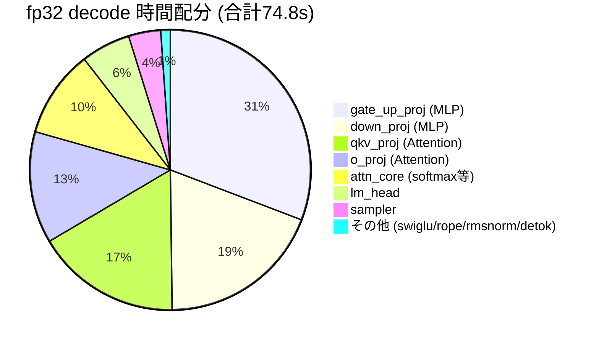
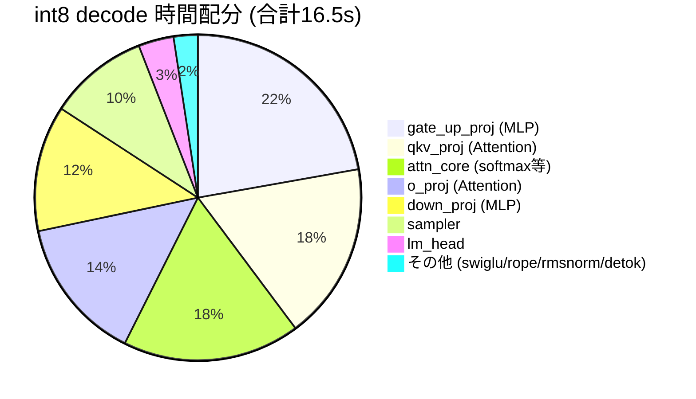
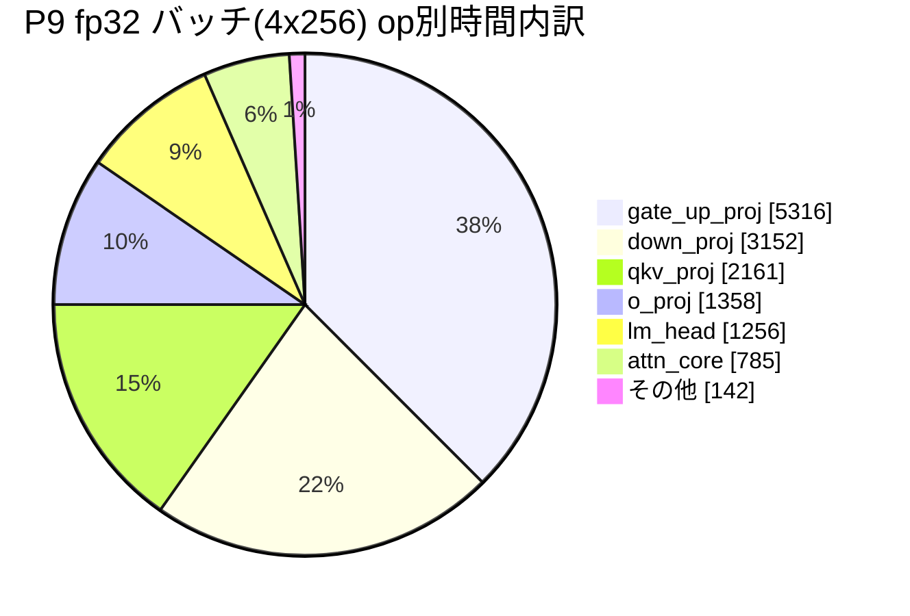

# denno-beta 開発履歴

> アーキテクチャの詳細は [アーキテクチャ解説](ARCHITECTURE.ja.md) へ。
> このノートは**開発の記録**。新機能を実装したら、末尾に以下のフォーマットで追記する:
>
> **追記フォーマット**: `### Pn: 機能名 (日付, commit)` の下に **実装** / **テスト** / **プロファイル** / **次の実装内容** を記載する。完了した項目は「次の実装内容」を候補リストへ反映する。

**更新**: 2026-10-15(P19-A2 完了・`9183e7e`)
**リポジトリ**: https://github.com/ahinore/denno-beta (main, `9183e7e` 同期済み)

---

## 1. 開発環境と稼働構成

```
[開発マシン: x86_64 Linux (Docker内で完結)]
├─ denno-beta コンテナ (port 8080)            … LLM APIサーバー (本番運用)
│    └─ モデルキャッシュ: ai_work/denno-beta/data/.cache
└─ 開発コンテナ … 開発エージェント + 開発用 denno(8090)/denno-view(8093)
     └─ /work/denno-beta (= ホストの ai_work/denno-beta, git管理)

開発フロー: エージェントが実装→cargo test→exactness検証→commit
           → GitHub同期 → CI自動検証(build+test+exactness)
           → 本番コンテナ docker compose build && up -d → health/生成テスト
```

- CI: `.github/workflows/ci.yml` — build+test(push/PR)、exactness(push時のみ、実モデルDL)。**x86-64-v3で全緑**
- GitHub push: 現在はWindowsリポジトリ経由で同期。deploy key登録待ちでコンテナ直pushは未設定
- 基準出力(exactness): 「1+1は?」→ `1+1は1です。これは数学的定理で、1と1を加えることによって得られます。`(seed42, temp0, fp32)。CIのx86ランナーでも同一出力を確認済み

## 2. タイムライン(初期〜P2: 要約)

| 段階 | 内容 |
|---|---|
| 初期実装 | 単一バイナリ(cli/engine/server)、GPT-2/Qwen2.5-0.5B、Anthropic API互換+SSE、exact decoding(seed 42) |
| 最適化#1 | `target-cpu=native`、attention スカラーループ→sgemm化、decode matvec出力分割並列化 → prefill 88秒→24秒、decode 1秒/トークン→0.1秒 |
| P1 | KVキャッシュ + LRU prefix cache(単一エントリ) → 2回目以降のprefill ≈0(1519→11トークン) |
| P2 | マルチエントリLRU prefix cache(LCP最大選択、トークン予算32k) → 交互セッションでも `reuse 47/48` |

## 3. フェーズ別記録

### P3: int8 weight-only量子化 ✅ (2026-10-11, commit `89aae74`)

- **実装**: per-channel scale量子化+デ量子化込みmatvecカーネル(新規 `quant.rs` 430行)。fp32デフォルト完全維持、`--quant int8` でのみ有効
- **テスト**: 77テスト全緑。fp32 exactness不変、int8は3実行完全同一(決定論)
- **プロファイル**: 速度ほぼ横ばい(14.4 → 13.9 tok/s)。デ量子化オーバーヘッドが帯域削減利益を相殺。価値はメモリ半減(重み約1GB→約0.5GB)
- **次の実装内容**: SIMD int8ドット積(→ P5で実現)、連続バッチング(→ P4)

### P4: 連続バッチング ✅ (2026-10-11, commits `f65281f` → `4e9058a` → `e3ad3ca`)

- **実装**: リクエストスケジューラ(`scheduler.rs`)— 有界キュー(満杯503)+ Engineを`step_chat`(1 forward)単位で進めるステッパ化。decode中に新規prefillを割り込み、複数セッションをKV suspend/resumeでラウンドロビン(`MAX_ACTIVE_SESSIONS=4`)
- **テスト**: 86テスト全緑。**インターリーブ下でも各出力が単独実行とビット一致**(KvSensitiveModelで検証)。CI(x86)3回連続フルグリーン
- **プロファイル**: 計測なし。その代わり実バグを発見: ワーカーがmutexをほぼ連続保持しHTTPハンドラの`engine.lock()`が数百ms starve → モデル名をAppStateにキャッシュして解決
- **次の実装内容**: int8 SIMDカーネル(→ P5)、真の並列decode(→ P6候補)

### P5: int8 SIMDカーネル ✅ (2026-10-12, commit `eec5624`)

- **実装**: P3の「重みをデ量子化してfp32積」を**「アクティベーション動的量子化+真のi8×i8整数ドット積」**に設計変更。aarch64 NEON `vdotq_s32`/x86 AVX2 `_mm256_madd_epi16`、cfg切替
- **テスト**: 91テスト全緑(+5)。i32累積の結合則でSIMD/スカラーがビット一致(プロパティテスト)。CI x86 AVX2パスでも検証。int8内で決定論(3実行md5同一)、fp32完全不変
- **プロファイル**: カーネル単体5.4〜12.9倍(lm_head 5.39ms→1.0ms)、e2e decode **約14.4 → 約51 tok/s**
- **次の実装内容**: 真の並列decode(P6)

### P6: 連続バッチング(バッチ並列decode) ✅ (2026-10-12, commit `52f5742`)

- **実装**: KVキャッシュを単一から**スロットプール**(`caches: Vec<KvCache>`、`DENNO_BATCH_SLOTS`既定4)に変更。セッションは完了まで自スロットに常駐し(旧suspend/restoreローテーション廃止)、全常駐セッションのdecode 1ステップを**1回の`forward_batch`**にまとめる。カーネル層では多列matvec `matvec_rows_bt`/`matvec_rows_bt_i8`を新設 — **各要素のk方向累積順を単独matvecと完全一致**させた(演算順序が変わるsgemmは使わない=fp32でもビット同一)。rayon行ブロック並列は`SendPtr::write`メソッド経由でrawポインタを共有(edition 2021のdisjoint closure capture回避パターン)。スケジューラは連続バッチング化(空きスロット限り同時受付、prefill優先インターリーブ、decode一括`step_chat_batch`、満席→503)
- **テスト**: **106テスト全緑**(engine 99 + server 7)。`forward_batch`がB∈{1,2,3}の複数ステップで単独decodeとビット一致する契約テスト、交互セッションexactness、CI x86-64でも全パス。**実機検証**: 0.5Bで4セッション同時実行、fp32/int8ともにsolo==batch完全一致(反復実行含む)、基準出力不変
- **プロファイル**(0.5B、4リクエスト×256上限、同一環境): 逐次 604トークン/20.6s → バッチ 604トークン/14.8s。集約スループット **fp32 13.9→18.7 tok/s (1.35倍)、int8 38.8→66.2 tok/s (1.7倍)**。131ステップで4セッション分272トークンを消化=バッチ化は完全動作。**b=4で帯域律速→演算律速に遷移**(fp32: 1ステップ72ms→110ms、int8: 27ms→36ms)= 重みストリームは1回で済むがFLOPsは4倍のため。次のブレークスルーはk方向の順序保存SIMD幅拡大
- **サイズ依存の実測**(3B int8、b=2、128上限): solo 12.8 tok/s → バッチ集約 20.5 tok/s (**1.6倍**)。バッチステップ時間は solo 78ms → b=2で81ms とほぼ不変 = **3Bはまだ重み帯域律速**(重み3GB/ステップに対し演算量が相対的に小さい)。予測通り「大型モデルほどバッチ効果が素直に効く」ことを確認。3Bでも solo==batch ビット一致確認済み
- **設計メモ**: `release_session`はKV行と`cached_prompts[slot]`を残置し、次セッションが同一接頭辞ならtruncateのみのゼロコピーlive再利用ができる(旧単一キャッシュの挙動を再現)。退避はprefix storeへ(`contains_prompt`で重複回避)。prefillはプロンプト残りを1回のforwardで処理(GEMM蓄積順が変わる分割はexactness上NG)
- **次の実装内容**: sampler最適化(→ P8、P6着手前に完了済み)

### P7: 大型Qwenモデル対応 ✅ (2026-10-12, commit `9fb18ab`)

- **実装**: 分割safetensors(`model.safetensors.index.json`+全shard DL/テンソル名解決、新規 `WeightStore`)、非結合lm_head(`tie_word_embeddings: false`)
- **テスト**: 93テスト全緑(+2)。0.5B exactness完全不変。**0.5B/1.5B/3B/7Bすべて「1+1は2です。」等の正常応答を確認**
- **プロファイル**(サイズ別、20コアCPU):

| モデル | fp32 | int8 | 備考 |
|---|---|---|---|
| 0.5B | 14.4 tok/s | ~51 tok/s | 本番稼働中 |
| 1.5B | — | — | 既存バイナリで無変更動作 |
| 3B | 約2 tok/s | 約4.7 tok/s (2.4倍) | 分割checkpoint+untied |
| 7B | 約1.2 tok/s | 約2.1 tok/s (1.8倍) | 重み28GB、RAM 121GBで余裕 |

- **次の実装内容**: ボトルネック可視化のためプロファイラ導入(→ P7.5)

### P7.5: プロファイラ+ボトルネック可視化 ✅ (2026-10-12, commit `40e209d`)

- **実装**: 軽量セルフプロファイラ `prof.rs`。`DENNO_PROFILE=1` で有効化、リクエスト完了時に各フェーズの累積時間をINFOログ出力。無効時はオーバーヘッドゼロ、数値経路に触れない
- **テスト**: 93テスト全緑維持。exactness基準出力不変(プロファイラ無効時)。CI ✅、本番反映済み
- **プロファイル**: 下記(P8以降の計測もこの形式でここに追記する)

#### プロファイル手法の制約

Docker内では `perf`(perf_event_paranoid=4で拒否)、`valgrind/callgrind`(aarch64のnativeコードでSIGILL)、`gdb`(ptrace禁止)がすべて使えない → **コード内計測(セルフインストルメンテーション)が唯一の正攻法**

#### 計測条件

Qwen2.5-0.5B、長文生成1リクエスト(prefill込み累積)。

**fp32 decode の時間配分**(計800トークン、全体74.8秒):



**int8 decode の時間配分**(461トークンでEOS、全体16.5秒):



#### 読み取れること

1. **線形層(matvec)が支配的** — fp32で約80%。decodeは重み帯域律速の通り。int8+SIMDでこれが約70%に圧縮され、速度は約4.5倍になった
2. **attn_core の割合がint8で増加**(10%→18%) — 線形層が速くなると相対的に浮かび上がる。KVキャッシュ読み+scales/softmax。長コンテキストではさらに伸びる
3. **sampler が固定コスト約3.5ms/step** — fp32 3.7%、int8では約10%に。語彙152k全体のsoftmax+top-pソートが律速
4. swiglu/rope/rmsnorm/embed は合計1%程度 — 最適化不要の結論が数値で出た

- **次の実装内容**: sampler最適化(最有力)/ P6再開(真の並列decode)

### P8: sampler最適化 ✅ (2026-10-12, commit `119dd92`)

- **実装**: P7.5のプロファイル(sampler固定コスト約3.5ms/step)を受け、`sampler.rs`を全面書き換え。top_k=`select_nth_unstable`+部分ソート(tie-breakを旧実装とビット一致させる参照実装テスト付き)/top_p単独=上位2048部分集合で計算し境界ヒット時は旧フルパスにフォールバック/plain temperature(本番デフォルト)=ソート廃止の2パスO(n)+スクラッチ再利用。**greedy経路は完全無変更**(temperature=0はargmax直行)
- **テスト**: 98テスト全緑(+5 samplerテスト、ビット一致参照チェック含む)。**仕様変更として明記**: temperature経路はRNG→トークン対応が旧実装と異なる(greedyは不変)。0.5B greedy基準出力不変、CI ✅
- **プロファイル**: sampler 3.5ms→**0.66ms/step (5.3倍)**。占拠率 fp32 3.7%→0.7%、int8 9.9%→2%
- **次の実装内容**: P6連続バッチング(→ P6として完了)

### P9: fp32バッチカーネルのSIMD化(順序保存レーン並列) ✅ (2026-10-12, commit `1bbffff`)

- **実装**: P6で「b=4で演算律速に遷移」したfp32バッチカーネル`matvec_rows_bt`をSIMD化。**レーンはi方向(バッチ内セッション4個)とj方向(出力チャネル4個のILP用)にのみ張り、k方向は張らない** — 各出力要素のk累積は厳密に逐次(乗算と加算を分離した命令のみ、FMA不使用=丸め分離)→ 単独decode(`matvec_bt`)とビット一致が保たれる。アクティベーションを`[k][mp]`に転置+ゼロパディングしてレーンロードを連続化(m*k は高々数十KBで転置コスト無視)。aarch64 NEON / x86 SSE(`_mm_mul_ps`)の二実装+その他アーキ向けスカラーフォールバック
- **テスト**: 106テスト全緑。ビット一致テストの形状を拡張(m∈{1..8}、k∈{1,4,65,896}、n端数込み)。CI x86 SSE経路でもexactness ✅。**実機検証**: fp32/int8ともに4セッション同時==solo完全一致、基準出力不変

#### プロファイル

**① サーバー op別**(`DENNO_PROFILE=1`、0.5B fp32、solo/batchを別セッションで分離計測)

| op | solo: ms (calls) | solo 割合 | batch: ms (calls) | batch 割合 |
|---|---:|---:|---:|---:|
| gate_up_proj | 1,642 (3,600) | 33.8% | 5,316 (6,432) | 37.0% |
| down_proj | 1,196 (1,800) | 24.7% | 3,152 (3,216) | 22.0% |
| qkv_proj | 828 (5,400) | 17.0% | 2,161 (9,648) | 15.0% |
| o_proj | 502 (1,800) | 10.3% | 1,358 (3,216) | 9.5% |
| lm_head | 405 (75) | 8.3% | 1,256 (134) | 8.7% |
| attn_core | 187 (1,800) | 3.8% | 785 (3,216) | 5.5% |
| rope/sampler/rmsnorm/detok | 42 | 0.9% | 142 | 2.3% |
| **TOTAL** | **4,854** | 100% | **14,362** | 100% |

- **solo**: 75tok/4.88s = **15.4 tok/s**(64.7ms/step)、線形層合計 **94.2%**
- **batch**: 279tok/130step、平均バッチ幅 **2.15**(出力長45〜83トークンで早期完了セッションが出るため)、集約 **19.4 tok/s**(プロファイラ込み・無しで21.8)
- **トークン当たりの線形層コスト 61.0→47.5ms(1.28倍)**。attentionはトークン当たり不変(2.5→2.8ms)= ステップ内では幅分かかるがトークン換算では同じ
- in-serverのバッチ線形層はマイクロベンチの帯域フロア(幅4=soloステップ時間相当)には未達 → 平均幅2.15への低下+実サーバーでのメモリ系競合(アクティベーション/KVと重みストリームの干渉)が原因と推定



**② カーネル単体マイクロベンチ**(0.5B形状、m=4): gate_up(k=896, n=4864) **3.92倍** / down(k=4864, n=896) **5.86倍**(vs 単独`matvec_bt`×4)。`#[ignore]`付き`bench_matvec_rows_bt_m4`テスト同梱(`cargo test --release bench_matvec -- --ignored --nocapture`)

- **e2eの限界要因の特定**(プロファイル分析): バッチ集約倍率(fp32 1.36倍)は線形層のトークン当たり改善(1.28倍)とほぼ一致 — 線形層はもう主要な律速ではない。理論上は幅4ならトークン当たり線形コストは約1/4(61→約15ms)になり得るので、**残る律速は①平均バッチ幅の低下(セッション完了時間の偏り、平均2.15)、②in-serverでのメモリ系競合、③attention/prefill(トークン当たり不変だが幅を上げても伸びない部分)**。次のレバーはセッション寿命の平準化+attentionのバッチ化
- **次の実装内容**: attentionのバッチ化(P10候補)/ 3B/7Bのb=4実測

### P10: attentionの並列化(セッション×KVヘッド) ✅ (2026-10-12, commit `4e2428f`)

- **実装**: `forward_batch`のattentionを rayon で並列化。タスク単位は **(セッション i × KVヘッド kvh)**(0.5Bで最大32タスク)で、各タスクは`att`の非重複スライスを担当。タスク内の演算列は単独decode(n==1)経路と完全同一(sgemm_acc→softmax→matmul、同一形状)+セッション/KVヘッド間に数値的相互作用がないため**ビット一致は自明に維持**。KV読み取りは新設の`KvCache::kv_bufs_ref(&self)`(読み取り専用)で共有。単独decode経路・prefill経路は無変更(基準経路を触らない規律)
- **テスト**: 106テスト全緑(fp32/int8のbatch==soloビット一致テストが並列経路を直接カバー、テストモデルはGQA構成)。実機: fp32/int8とも4セッション同時==solo完全一致。CI 38240311689 ✅(x86でもパス)
- **プロファイル**(交互A/B計測、下記学習メモ参照):

  | 計測 | new (P10) | old (P9) |
  |---|---:|---:|
  | バッチ4×256 集約 | **33.4 / 33.1 tok/s** (平均33.2) | 31.6 / 32.2 tok/s (平均31.9) |
  | solo 256 | 17.3 tok/s(不変) | 同左 |

  - **P10効果: 集約 +4%**(交互2ペア両方で新コード優位、再現性あり)。物理的に整合: P9プロファイルでattn_coreはバッチ時5.5%、並列化でその壁時間の大部分を回収
  - **測定汚染の実例**: 単純な前後比較では new 6.78s/41.2tok/s vs old 12.99s/21.8tok/s(2倍!)と出たが交互A/Bでは+4%しか差がなかった — **同ホストで常時稼働する他の推論ワークロードがCPUを使う**ため時間帯で背景負荷が変動し、離れた時点の絶対値は比較不能
  - 教訓: **同一ホスト上の性能計測は必ず new/old 交互+同ワークロード**(計測スクリプト `p10_ab2.sh`)
- **次の実装内容**: 残る律速(平均バッチ幅の低下・メモリ系競合)の分析/ 3B/7Bのb=4実測 / prefill割込みの影響定量化

### P11: ストリーミングdetokのバイト分割文字修正 + gpt2 exactness基準の更新 ✅ (2026-10-12, commit `16319c7`)

- **発端**: gpt2 exactness テストの失敗(文字化け出力)。モデルを再取得したが**同一ファイル**(548,105,171B、英語raw生成は正常)で失敗継続 → 原因はモデルではなかった
- **原因1(テスト基準が古い)**: CIはexactness ジョブでQwenのみpullしていたため gpt2 テストは「モデル未キャッシュ→スキップ」で**一度も実行されていなかった**。基準文字列は当時の条件のまま残存
- **原因2(ストリーミングdetokのバグ)**: バイトレベルBPE(GPT-2)ではマルチバイト文字がトークン境界で割れ、未完成バイト列がdecodeでU+FFFDになる。そのU+FFFDを確定済みテキストに混入させると以後のバイト差分がずれて文字が欠落(「??の??は?」の正体)
- **検証(参照実装)**: コンテナにHF transformers(fp32, greedy)をインストールし同一プロンプトを比較 → **denno出力と完全一致**(GPT-2 baseはフォールバックテンプレート付きプロンプトで入力を繰り返す=エコーが素の貪欲生成の挙動)
- **実装**: `emit_delta_and_check_stop` — 末尾がU+FFFDになるトークンを**保留**し、文字が完成したステップでまとめて差分として流す。新設 `flush_stream` — 生成終了時(EOS/max_tokens)に保留分をフラッシュ(step_chat/step_chat_batch両方、EOS分はdecodeから除外)。**テキスト経路のみで数値経路は不変**(プロファイル対象外、性能無関係 — 基準出力と4セッション同時==soloの実測で確認)
- **テスト**: 単体99+7 全緑 + exactness 5件全緑(aarch64)。**CI 38244751670 ✅** — ワークフローにgpt2 pullを追加し、**x86上でgpt2テストが実際に走って緑**(基準文字列は参照実装と一致することを実証)。本番デプロイ済み・基準出力不変

### P12: 残り律速の分析 + decode attention最適化(probs@V行統合+ストライド直接参照) ✅ (2026-10-12, commit `55c1de0`/`f3dea3b`)

- **発端**: 開発環境の移行が完了し、他ワークロード負荷のないクリーン環境でP9以来の残り律速(平均バッチ幅低下/メモリ系競合/prefill割込み)を定量化
- **分析1(バッチ幅スケーリング)**: 同時発火×256tok上限(EOSで自然終端、トークン数は幅間で異なるため**集約tok/sで比較**)。fp32はW=8まで素直に伸びる(16.2→~50)、int8は**W=4で頭打ち**(149→132〜135とW=8で微減)。スロット数は`DENNO_BATCH_SLOTS`(既定4)で、幅8の真のバッチには8が必要(既定4だと2ウェイのキューイングになる)
- **分析2(op別プロファイル)**: fp32 W=4では線形層+lm_headが約85%(帯域律速どおり)。int8 W=4ではgate_up 29.5% / **attn_core 19.4%** / down 18.0% / lm_head 10.8% — **int8ではattentionが線形層に次ぐ律速**(KV連続化コピー+per-(kvh,g)のm=1 sgemm 7回+23アロケーション/タスク、t×dhバッファはmmap閾値超えで毎ステップmmap/munmap)
- **発見(カーネル差し替えの落とし穴)**: matrixmultiplyは**ストライドと行数でSIMDカーネルを選び替えるため数値が変わる**。scores側(b を転置レイアウト rs=1/cs=k で渡す経路)は行統合(rows=m)・ストライド参照のどちらもビット不一致(実測で確認)。probs@V側(row-major b)は**行統合+ストライド参照でビット一致**(実測) → ビット一致規律を守れるのはV側のみ
- **実装**: ①`tensor::matmul_rows_bstrided` — probs@Vを per-g matmul(m=1)×group回+vh連続化コピー → **1回の行統合sgemm+キャッシュのストライド直接参照**(コピー無し)②`attention_decode_kvhead` 新設 — forward()(n==1)とforward_batch()が同一関数を通る構造に統一 ③qgコピー廃止、kh/scoresをthread_localスクラッチで再利用(mmapチャーン除去)④scores側は従来経路のまま(sgemm_acc(m=1)+kh連続化コピー — 数値上必須と判明)
- **テスト**: 単体100+7全緑 + `decode_attention_probs_v_bitexact`(行統合+ストライド vs 従来per-row、to_bits比較)+ **exactness 5件全緑(基準出力含めビット一致・出力不変)**
- **A/B実測**(クリーン環境、old 1a7fee6 vs P12、交互2ラウンド、スロット8):

#### プロファイル

| 構成 | old (1a7fee6) | P12 (55c1de0) | 差 |
|---|---:|---:|---:|
| fp32 W=4 | 26.8 / 26.8 tok/s | 27.7 / 27.7 tok/s | **+3.4%** |
| int8 W=4 | 126.4 / 122.5 tok/s | 130.4 / 126.2 tok/s | **+3.1%** |
| int8 W=8 | 119.0 / 113.5 tok/s | 121.3 / 119.3 tok/s | **+3.4%** |

| op別 (int8 W=4, 1022tok, プロファイラON) | old ms | P12 ms |
|---|---:|---:|
| attn_core | 1,543 | **1,193 (-22.6%)** |
| gate_up_proj | ~2,343 | 2,432 |
| down_proj | 1,430 | 1,480 |
| lm_head | 854 | 869 |
| TOTAL | 7,942 | 7,796 |

- **測定上の教訓**: ①A/Bサーバーは別バイナリ名(`/tmp/denno_old`/`/tmp/denno_p12`)で起動したが、pkillパターン`denno serve`が`denno_old serve`に**マッチせず全12回が同じサーバーに当たり無効データになった**(2回目で修正、quant modeログで毎回確認)②op別プロファイルの`grep -A14 … | tail -13`は**先頭行(最大op)を切り捨てる** — 最初の分析でattnを48.9%と誤読(gate_up行がカットされていた。正しくは29.5% gate_up / 19.4% attn)
- **次の実装内容**: scores側の根本最適化(k方向SIMD/パック再利用)はビット一致規律と両立不可 → **基準出力の更新を許容するかの判断が必要**。3B/7Bのb=4実測。CUDA最適化(§8)

### P13: 推論可視化(denno-trace)テレメトリ基盤 + denno-view中継 ✅ (2026-10-13, commit `69663e6`)

- **発端**: ユーザー指示の推論可視化機能(§11)。推論中のコールスタック・隠れ層・KV状態をストリーミングで別サーバーに転送し、WASMでリアルタイム表示する構成の第1段階(L0フロー/L1統計)
- **実装**: ①`denno-telemetry` crate新設(**依存ゼロ/stdのみ** — エンジン・サーバー・ビューア(WASM含む)が同一形式を共有するため)。フレーム形式v1 = `"DNTL"`(4B)+version(1B)+kind(1B)+payload、整数はLEB128 varint、確率はf16(RNE自前実装)。kind: ServerInfo/SessionAdmit/SessionDone/Prefill/Token/Step/OpSummary/KvUsage/Gap/TopK ②エンジン捕捉フック(install/release/step_chat/step_chat_batch。すべて`telem::enabled()`ガード+read-onlyで数値経路に非接触)③prof.rsのop計時をtelemetryにも累積(lib.rs経由の委譲でprof→telemetryの直接依存を回避)④denno-serverにWSエンドポイント`/v1/telemetry/ws`(バイナリフレーム、接続直後にServerInfo。ハブ→broadcast中継スレッド。テレメトリ無効時は503)⑤`denno-view` crate新設 — 上流dennoへWSクライアント接続(切断時2秒再試行)、複数ブラウザへのmultiplex中継、`VIEW_RECORD`でリプレイ記録([u32 len][bytes]追記形式。P14のスクラバー入力)、簡易ライブダッシュボード(HTML+JSデコーダ。WASM化はP14)
- **設計3原則の実装**(§11): ①推論と完全分離(捕捉はemitのみ)②推論を絶対に待たせない(hubはbounded SyncSender 4096+try_send、満杯→ドロップ+Gapフレームで欠落を明示)③既定OFF(`DENNO_TELEMETRY`無しでは捕捉コードが一切走らない=ゼロコスト)
- **テスト**: 単体100+telemetry統合1+server7+telemetry crate5 全緑。telemetry統合テストはOFF→ONのライフサイクル(SessionAdmit/Prefill/Token/TopK/KvUsage/OpSummary/SessionDone)+**ON/OFFで生成出力完全一致**(testutilダミーモデル)+全フレームencode→decode可逆。exactness 5件全緑。**JSデコーダも検証**(Rustが生成した全10種フレームをnodeでデコード→期待値完全一致。f16の2.75/0.5/0.25やu64 varint含む)
- **e2e実機検証**(ローカルの denno-dev:8090 + denno-view:8093): テレメトリONで基準出力**ビット一致**(usage 34/26)。denno-viewログに`server: denno-dev (quant=fp32, slots=4, ctx=32768)`/`session 1 admit (slot 0, prompt 34 tok)`/`session 1 done (reason 0, 26 tok)`、**Gap 0件**。ダッシュボードHTML配信OK
- **e2eで発見したバグ2件**: ①**f16デコードの非正規パスで指数が2^14倍オフ**(往復テストで発見。6.1e-5→0x03FF→0.999に化ける。ループk回後のf32指数は113-kが正しい)②**アイドル時のKvUsageフレーム洪水** — スケジューラワーカーはアイドル時も空バッチで`step_chat_batch`をポーリングし続けるため、空バッチでもKvUsageを発出すると毎秒数千フレーム→ハブ満杯→Gap洪水(空バッチでは発出しないよう修正。アイドルポーリング自体は既存設計のまま)
- **CI**: 38275707105 ✅(build+test+exactness)。本番反映済み・基準出力ビット一致(本番はテレメトリOFF運用)
- **次の実装内容**: P14(WASMビューア: wasm-bindgen+canvas/WebGL2、リプレイスクラバー)/ P15(L2テンソルfocus)

### P14: denno-view 推論フローアニメーション(コールグラフ+層パネル+KV/変数) ✅ (2026-10-13, commit `8befe3f`, JS版。WASM移植は残課題)

- **発端**: ユーザー指定の denno-view 仕様 — 中央にモデル駆動プログラムのコールグラフ(プロンプトが降りて関数が順に点灯・値がパルスで渡る)、右にモデル各層のスタック(参照時に発光)、左に KV キャッシュ+隠れ変数(格納時に発光・値表示)
- **テレメトリ拡張**: コールグラフ逐次点灯に必要なデータをフレームに追加 — ①`LayerRun { layer, ops }`(1 層の op 列を実行順で 1 フレームに圧縮、24フレーム/トークン)②`ServerInfo.layers` ③`Prefill.tokens`(降下アニメ用)。実装は thread-local 層バッファ+`prof::time_layer`
- **denno-view UI**: 3カラム(中央=コールグラフ+実装コードパネル/左=KVスロット+変数+op timing/右=モデル構造)。ブラウザ側も再生キュー+間引きで**推論を待たせない**設計を維持
- **検証**: テスト全緑+exactness 5/5+JSデコーダ12種一致+e2e基準出力**ビット一致**・Gap 0件(LayerRun 509フレーム)。CI 38298659275
- **P14.1〜P14.3 機能追加 (2026-10-13, commits `6b198f2`/`e34e411`/`06df5ed`)**: ①層パネル修正 — view が ServerInfo/KvUsage スナップショットを保持し後から開いたブラウザにも即時表示+層行に op 名/実測 ms ②トークン文字表示 — `VIEW_TOKENIZER`→`/tokenizer.json` 配信、BPE 逆マップ+ストリーミング UTF-8 デコードでマルチバイト境界を正しく復元、入力/出力トークンを文字チップ表示 ③内蔵チャット — view の `POST /chat` が上流 denno の `/v1/messages` へ中継され、送信するとアニメーションが自動連動
- **P14.4 ステップ実行コード+モデル構造 (2026-10-13, commit `91bbb6a`)**: 中央左に**実装コードパネル**(擬似コード、実行中行がデバッガの PC のように前進+`li = N/24` ウォッチ)、右パネルを**モデル構造**表示(embed→decoder×24[ATT+MLP チップ]→final_norm→lm_head、LayerRun に応じてチップ個別発光)
- **P14.4b〜k UI ブラッシュアップ (詳細省略, commits `62acfc8`〜`5e64eef`)**: レイアウト修正(隙間/等分/ペイン分離/セクション分離線)、拡大コーン(コードパネル=model_forward ノードの拡大コールアウト)、トークンの配置(入力=グラフ上・出力=下)、KV/変数への飛点(SVG 飛線)、UI 全面英語化、見出し「denno (LLM Server)」、speed スライダー(low/high・既定最速・low で目で追えるスローモーション)、ServerInfo に model_id 追加(実モデル ID 表示)。**推論を待たせない設計は全過程で不変**
- **P14.4l〜q コードパネルの正確化+実コード切替 (commits `091da66`〜`3ff6175`)**: ①擬似コードの実行順序を実物どおりに修正 — KV 書き込みはループ内(rope 直後)、attn_core がキャッシュを読む(`&kv[li][..pos+1]`)、prefill 分岐(p1-p4)も追加。Prefill 時はカーソルが p1→p2(KV 一括書き込み)→層カスケード→p3 と歩く ②**疑似⇔実コード切替**(「real code ▸」ボタン、既定 pseudo)— scheduler.rs/engine.rs/llama.rs を `include_str!` でコンパイル時埋め込み+`/code/src` 配信(表示コードは常に稼働バイナリと同世代)、擬似↔実を内容アンカーでマップしカーソル/状態点灯/飛線が両モードで動作 ③KV キャッシュと hidden x の**使用箇所**を飛線で可視化(KV→attn 読み出し・x→rmsnorm/final_norm)
- **P14.4r チャット出力を emit_token に同期 (commit `b1e6ecb`)**: 内蔵チャットの出力表示がアニメーション速度と無関係(応答受信後に一括表示)だったのを、**Token フレーム再生時にバブルへトークンを追記**する方式へ変更(speed=low なら出力表示もゆっくり)。送信後の最初の SessionAdmit でセッションを捕捉し、usage 確定で全トークン再生後に usage 付きで確定。tokenizer 未読込/テレメトリ無効/Token フレーム欠落時は従来どおり応答全文表示へフォールバック(4秒監視)。併せて tokText の1トークン2重呼び出し(ストリーミング UTF-8 デコーダを2回消費する潜在バグ)を1回に修正。検証: JS 構文 OK・dev サーバー再ビルド+再起動・チャット応答 OK・p143_check CHAT_OK(トークン19フレーム)
- **P15 Qwen3対応 (commit `e67eeb2`)**: **Qwen3 = Qwen2 + QK-Norm**(q_norm/k_norm.weight を head_dim 単位の RMSNorm として QKV bias 後・RoPE 前に適用。`qknorm_rows_inplace`、prof に `qk_norm` op 追加)。バッチ/単独 decode のビット一致を単体テストで担保(`qk_norm_batch_matches_solo_decode_bit_exactly`)。**KV メモリ予算**(`DENNO_KV_BUDGET_MB`、既定 12288MB): 明示 env 最優先・予算内でスロット優先+残りを prefix cache(最低 2048 トークン保証)・小 KV モデルは従来構成完全維持 — Qwen3-0.6B は KV 事前確保が約 47GB に達して SIGKILL していた問題の解消。**minijinja-contrib pycompat**: HF チャットテンプレートが使う Python 風 str メソッド(startswith 等)を登録し Qwen3 の thinking テンプレートが描画されるように。exactness: Qwen3-0.6B greedy 出力を HF transformers(fp32)参照実装と完全一致検証+CI で Qwen3-0.6B pull を追加
- **P16 リプレイスクラバー (commit `5def63e`)**: denno-view に記録フレーム列の再生 UI を追加。サーバー側: `VIEW_REPLAY=/path` で `GET /replay` が記録 ([u32 len][bytes] の連結) を**リクエスト毎に読んで**配信 (記録しながら再生できる。プロセス強制終了で末尾が途切れた記録もパーサが途中まで読む)。ブラウザ側: ヘッダーのスクラバーバー (replay/live 切替・play/pause・⏮・1フレーム戻し/送り・スライダーシーク・位置表示)。**シークは先頭からの状態再構築** (fast-forward: スナップショット系 ServerInfo/KvUsage は通常経路、アニメーション系 Token/LayerRun/TopK/Prefill は状態のみ適用して演出 skip — `RP_FFWD` フラグ)。再生はライブと同じ pacing (queue+drain) を再利用し、リプレイモード中はライブ WS フレームを無視。検証: JS 構文 OK・記録→`/replay` がバイト一致 (md5 同一)・146/300 フレームの解析確認・UI 配信確認
- **残課題**: ①WASM 移植(デコーダ+状態機械を wasm-bindgen 化 — JS 版は先行実装として維持)②L2 テンソル focus(P18、隠れ変数の実値表示は現状 KV 長/top-k/token など L1 統計のみ)

### P17: CUDA int8 オフロードカーネル(CPU int8 パスとビット一致) ✅ (2026-10-13, commit `11281dd`)

> ユーザー指示「CUDA最適化を確立してから他ファミリーへ」。§8 の移植ステップ第 1 段(線形層)の基盤。残候補で「P17」としていた L2 テンソル focus は **P18 に繰り下げ**。

- **実装** (`denno-engine/src/cuda.rs`、feature `"cuda"`): CUDA Driver API を **dlopen 実行時解決**(依存クレートゼロ。feature を外したビルド = CI/GPU 無し環境には一切影響しない)。カーネル `kernels_int8.cu` は **compute_75 向け PTX にコンパイルしてコミット**(`nvcc -ptx -arch=compute_75 -fmad=false`。ドライバ JIT が以降の全アーキ sm_86/89/120 で実行 — RTX 5090 sm_120 / driver 13010 で実機検証済み)。カーネル: ①per-row 動的量子化 (dno_quantize_rows、1 block/row、共有メモリ maxabs リダクション) ②int8 GEMV/GEMM (dno_matvec_rows_bt_i8、1 warp/出力、レーンが k 方向 coalesced 走査+warp i32 リダクション)
- **ビット一致の設計** (CPU: `tensor::quantize_row_i8` / `matvec_rows_bt_i8`): ①maxabs は丸めを伴わないので走査順序に依存しない・`roundf` = `f32::round` (half-away-from-zero)・clamp ±127 を同一規則で ②i8×i8→i32 累積は**整数なので結合則が成立**し、warp リダクション/レーン分割の順序に出力は依存しない(CPU の AVX2/sdot カーネルとビット一致の根拠)③出力スケールは `(float)dot * ascale[i] * scale[j]` を左から順に(CPU と同一の結合順)
- **GPU 実行環境** (新設): 開発ホスト上に **denno-gpu コンテナ**(nvidia/cuda:12.9.1-devel-ubuntu22.04 + rustc 1.99.0、`--gpus all`、/work/denno-beta は既存開発コンテナと同一ホストツリーの bind。ビルドは `CARGO_TARGET_DIR` で分離)。RTX 5090 = 32GB / sm_120(CUDA 12.8+ が必要なため既存 12.6 イメージは使用不可)
- **検証**: `cuda_quantize_rows_bit_exact_vs_cpu` / `cuda_linear_int8_bit_exact_vs_cpu` — decode m=1・バッチ decode m>1・prefill GEMM の全経路で、lm_head 1536×151936 を含む実モデル形状(Qwen2.5-1.5B)まで **to_bits 完全一致**(RTX 5090 実機)
- **マイクロベンチ** (重み VRAM 常駐、decode m=1、アクティベーションは毎回 H2D): **lm_head 18.6x**(5.46ms→0.294ms、実効 794 GB/s)/ down 11.1x / gate_up 2.6x / qkv・o は 0.4〜0.6x — 小さい層は 1 呼び出しあたりの固定オーバーヘッド(起動+同期+H2D/D2H 約 40µs)が支配的。バッチ m=8 の gate_up は 4.1x
- **CI**: `cargo check -p denno-engine --features cuda`(コンパイルチェックのみ、GPU 不要)を追加
- **次の実装内容** (P17b: エンジン統合): 重み VRAM 常駐+**アクティベーション デバイス滞留パイプライン**(同期を 1 ステップ 1 回に→小さい層の固定オーバーヘッド解消)→ attention 融合カーネル → sampler → paged KV(§8.4 の順)

### P17b: CUDA エンジン統合(重み常駐+ピン留め非同期パイプライン) ✅ (2026-10-13, commit `197a06c`)

> P17 のカーネルを全 int8 線形層の実経路に接続し、e2e でビット一致と 3.4x を実証。§8.3.5「int8 なら GPU 化しても出力は変わらない」を e2e レベルで確認した初めてのフェーズ。

- **統合ポイントは漏斗 1 本**: `quant::Linear::apply_bt` / `apply_batch_bt` / `apply` の int8 パスに `maybe_gpu_linear` フックを入れるだけ。llama/gpt2 の全 int8 線形層(qkv・o・gate/up・down・lm_head)がこの 3 関数を通るため、モデル側のコードは変更ゼロ。None 戻りで既存 CPU カーネルにフォールバック(両者ビット一致なので出力は不変)
- **重み常駐レジストリは uid キー**: 最初は `Quant8Linear.w` のバッファポインタをキーにしたが、**Vec の解放→再確保でアドレスが再利用され、同一アドレスに別内容の重みが現れる衝突**がテストで露呈(同一サイズ・同一形状の異なる Linear で発生)。`Quant8Linear` 構築時に `uid` を採番し(Clone は同一内容のディープコピーなので uid 共有で安全)、uid キーのレジストリに初回アップロード。debug_assert で同一 uid の形状一致も担保
- **ピン留め+非同期 1 同期パイプライン**: H2D(x, async) → quantize カーネル → GEMV カーネル → D2H(out, async) → `cuCtxSynchronize` ×1/線形層。P17 はコピー・起動のたびに同期(×4、固定約 40µs)だったが、`cuMemHostAlloc(PORTABLE)` のピン留めホストバッファ+default stream 直列性により **約 28µs まで削減**(qkv 0.041→0.033ms、lm_head 0.286→0.220ms @ decode m=1)
- **decode 限定オフロード**: GEMV 型カーネル(1 warp/出力)は行数 m に比例して重み再読みが増えるため prefill の GEMM に弱い(**実測 m=128 で 0.39x**)。`m > DENNO_CUDA_MAX_M`(既定 16)は CPU のまま — prefill の性能を損なわず、decode・バッチ decode(m≤閾値)のみ GPU 化
- **検証**: ①パイプライン bit-exact(apply_bt 経由、4 形状・lm_head 1536×151936 含む)②tiny モデル forward 全体の GPU オフロード bit-exact(prefill+バッチ decode vs 単独)③CPU 106 テスト回帰変わりなし(cuda feature 無し)④**e2e**: Qwen2.5-1.5B int8 で CPU serve と GPU serve の応答テキスト・usage を完全一致(2 プロンプト・200 tok greedy・並行 2 リクエストのバッチ decode も単独と一致)
- **e2e 実測**: 200 tok greedy 生成 **CPU 9.08s → GPU 2.66s(3.4x)**。VRAM 使用は重み 234MB(lm_head)+層重み ≈ 1GB 強
- **op 別プロファイル比較** (`DENNO_PROFILE=1`、200 tok greedy ×3 リクエスト・600 decode step+prefill 累計):

  | op | CPU ms | CPU % | CUDA ms | CUDA % | 高速化 |
  |---|---:|---:|---:|---:|---:|
  | lm_head | 3,049 | 10.7% | 281 | 2.9% | **10.9x** |
  | gate_up | 11,685 | 40.9% | 2,340 | 24.2% | **4.99x** |
  | down | 6,108 | 21.4% | 1,432 | 14.8% | 4.26x |
  | o | 1,594 | 5.6% | 590 | 6.1% | 2.70x |
  | qkv | 2,051 | 7.2% | 1,614 | 16.7% | 1.27x |
  | attn_core | 3,190 | 11.2% | 2,767 | 28.6% | 1.15x |
  | swiglu | 554 | 1.9% | 420 | 4.3% | 1.32x |
  | other | ≈361 | 1.3% | ≈243 | 2.5% | 1.49x |
  | **TOTAL** | **28,591** | 100% | **9,686** | 100% | **2.95x** |

  decode 22.1→**75.8 tok/s**(e2e 3.4x)。**線形層が 86%→62% に縮小し attn_core が最大 op 化(28.6%)** — 次の律速は attention 融合カーネルと明確化。qkv は 3 分割 × 50,400 呼び出しで固定オーバーヘッド支配(1.27x)→ P17c で融合

### P17c: GPU 線形層融合(qkv / gate+up のグループ化呼び出し) ✅ (2026-10-13, commit `7bf9eb0`)

> P17b プロファイルで明確化された「qkv 3 分割 × 50,400 呼び出し(600 step × 28 層 × 3)の固定オーバーヘッド」を解消。同一入力を消費する線形層群を 1 回の GPU 呼び出しに融合し、e2e 19% 短縮。

- **融合は行連結**: q/k/v(または gate/up)の重み行をパート順に連結した単一バッファとして、uid ベクトルをキャッシュキーに登録・計算し、出力を列ブロックで切り分ける。行単位の演算(量子化規則・i32 累積・スケール乗算順)は個別呼び出しと完全に同一なので**ビット一致が構造的に保証**される(新しい演算規則を導入しない設計)。ホスト側の連結バッファはアップロード後に drop するため RAM 定常増もなし。GPU 無効/エラー/一部が fp32 の場合は従来の個別 3+2 呼び出しにフォールバック
- **スレッドローカル current context の発見(本フェーズ最大の教訓)**: CUDA の current context はスレッドローカル。libtest は `--test-threads=1` でも**テスト毎に新スレッドを立てる**ため、初期化スレッドで 1 回 `cuCtxSetCurrent` しただけでは他スレッドの `cuMemAlloc` が **error 201 INVALID_CONTEXT** で失敗する。さらに失敗は GPU_BROKEN→CPU フォールバックで静かに吸収されるため「GPU テストが緑 = GPU で実行された」にならない(今回追加した融合テストだけが `expect` で None を明示的に落としたため発覚 — P17b のモデル統合テストは CPU vs CPU の比較になっていても緑になり得た)。`CudaCtx::make_current()` を GPU 操作入口で毎回呼ぶよう修正し、サーバー側マルチスレッドの潜在バグも同時に解消
- **検証**: ①融合 vs 個別呼び出しの bit-exact(qkv 型 3 パート(異なる n)+gate/up 型 2 パート、m=1/4)②tiny モデル forward 全体の bit-exact(prefill+バッチ decode)③CPU 106 テスト回帰変わりなし④**e2e**: Qwen2.5-1.5B int8 200 tok greedy で CPU serve と**テキスト・usage 完全一致**(3 リクエスト、usage 49 in/200 out)
- **e2e 実測**: 200 tok 生成 **GPU 2.638s → 2.146s(−19%)**。理論予測(削減オーバーヘッド 84µs/層/step × 28 層 × 600 step ≈ 0.47s/リクエスト → 2.64−0.47=2.17s)と一致。CPU 10.67s → **4.96x**。重みアップロードは grouped 56(=28 層 × 2 グループ)+ 個別 57(=down 28+o 28+lm_head 1)で呼び出し内訳と完全整合
- **融合後プロファイル再取得**(`DENNO_PROFILE=1`・P17b 節と同一ワークロード・融合前の分布は P17b 節の表参照):

  | op | P17b GPU ms | P17c GPU ms | 変化 |
  |---|---:|---:|---:|
  | qkv | 1,614 | 610 | **−62%** |
  | gate_up | 2,340 | 1,850 | **−21%** |
  | attn_core | 2,767 | 2,623 | −5% |
  | swiglu | 420 | 405 | −4% |
  | lm_head | 281 | 275 | −2% |
  | down | 1,432 | 1,426 | ±0% |
  | o | 590 | 591 | ±0% |
  | **TOTAL** | **9,686** | **8,021** | **−17%** |

  CPU 側は再計測で TOTAL 28,532ms(P17b の 28,591ms とほぼ不変)。op 合計比 **2.95x→3.56x**・decode **75.8→96.1 tok/s**・e2e(CPU 9.07s → GPU 2.08s)**4.36x**。削減量は理論値と一致(qkv: 2 呼び出し分 941ms/3req 理論 vs −1,004ms 実測・gate_up: 470ms vs −489ms)。**attn_core がさらに最大 op 化(28.6%→32.7%)** — 次の律速は attention 融合カーネルで確定
- 残る CUDA 候補: attention 融合カーネル(attn_core 32.7% = GPU 最大 op)・paged KV・sampler カーネル

### P17d: 要素演算 GPU 化+デコードチェーン(隠れ状態デバイス常駐) ✅ (2026-10-13, commit `121aa3a`)

> P17c プロファイルで swiglu(5.1%)/各所のホスト往復が残っていたため、①要素演算(rmsnorm/residual/swiglu)の GPU カーネル化 ②decode 1 ステップを隠れ状態デバイス常駐パイプライン化。CPU attention が `matrixmultiply::sgemm`(SIMD/FMA で累積順が実装依存)のため attention GPU 化は exactness 契約の緩和判断が必要 → 後回しとし、判断不要な本フェーズを先行実施。

- **要素演算カーネル(`kernels_elem.cu`)**: `dno_add_rmsnorm`(residual 加算+RMSNorm。平方和は CPU と同一の逐次順で 1 スレッド計算・`1/(ss+eps).sqrt()`→`x*inv*w` 左結合を再現)+`dno_swiglu`(silu+up 乗算)+`dno_expf_probe`(テスト用)。コンパイルは `-fmad=false`+明示的 `__*_rn` で縮約を制御
- **glibc expf の完全再現(P17d 最大の難所)**: swiglu の `exp(-v)` を Rust `f32::exp`(=glibc expf)とビット一致させる必要がある。glibc e_expf は f64 内部演算+`__exp2f_data` テーブル(32 エントリ)+3 次多項式なので GPU で再現可能だが、**CPU の実際のバイナリは FMA 縮約版**(multiarch IFUNC が FMA バリアントを選択)で、素直な逐次実装とは最終 f32 で 1ULP 差が出る(x=32.564632f で実測: 455M 値走査の唯一の不一致)。gcc -O2 -mfma で実験した結果、縮約は **5 ヶ所**(①`kd = fma(InvLn2N, xd, SHIFT)` ②`r = fma(InvLn2N, xd, -kd)` ③④⑤多項式 3 項)に及ぶことを逆アセンブルで特定し、`__fma_rn` で完全再現 → **455,078,062 値(特殊値+指数部 0x3C..0xC2 全走査 mantissa step 5+ランダム)でビット一致**。注意: この契約はホストの glibc ビルド(FMA 版選択)に依存する
- **デコードチェーン**: solo decode(n==1)1 ステップを「埋め込み H2D → [rmsnorm(+residual) → qkv(grouped) → (CPU: rope/attention/KV) → o_proj → rmsnorm(+residual) → gate/up(grouped) → swiglu → down] ×層数 → final norm → lm_head → logits D2H」のデバイス常駐パイプラインに変更。ホスト往復は qkv と logits のみで、**同期は層あたり 1 回(qkv D2H 待ち)・CPU attention の間 GPU は次層 FFN を先読み**。線形は P17b/c と同一カーネル/uid レジストリ、rmsnorm/swiglu は CPU と同一演算順序 → ビット一致を構造的に維持。非対応構造(bias/Qwen3 QK-Norm/一部 fp32)や実行時エラーは GPU_BROKEN→従来経路でやり直し(k/v 書き込み冪等・advance は最後の 1 回で安全)
- **検証**: ①GPU テスト 12/12(新規: expf 4.55 億値ビット一致+チェーン全体 bit-exact)②CPU 106 テスト回帰なし③**e2e**: Qwen2.5-1.5B int8 で GPU serve と CPU serve の応答が**完全一致**(2 プロンプト、msg id 以外バイト一致)④実測: 200 tok リクエスト GPU 2.1s vs CPU 6.6s(**3.2x**)・150 tok では 1.46s vs 6.6s(**4.5x**)
- 教訓: ①テストの比較基準に使う `f32::exp` ループは LLVM の自動ベクトル化で **libmvec**(ベクトル版 expf・スカラーと 1ULP 差)に置換され得る → `#[inline(never)]` 経由でスカラー呼び出しに固定する ②`cargo build -p denno-cli` では **cuda feature は CLI バイナリに伝播しない**(`-p denno-cli -p denno-engine --features cuda` が必要) — feature 無しバイナリは GPU ログも出さず黙って CPU で動く
- 残る CUDA 候補: attention 融合カーネル(exactness 契約の緩和判断が必要=後回し)・paged KV・sampler カーネル

### P17e: 需要ベース KV 確保(成長型キャッシュ+予約によるハード保証) ✅ (2026-10-13, commit `c889336`)

> P15 の KV メモリ予算は「スロット 1 個 = ctx 全幅の事前確保」が前提で、Qwen2.5-1.5B はスロットあたり約 1.9GB・既定 4 スロットで起動直前に約 7.5GB を確保していた。実際のセッションは大半が数百〜数千トークンなので、**書き込んだ量に応じてバッファを成長させる**方式に変更し、スロット数を大幅に増やせるようにするのが本フェーズ。paged KV(ブロック分割)は構造変更が大きいため後回しとし、**連続レイアウトを維持したまま**需要ベース化する設計を採った。

- **KvCache 全面改修**: 旧実装はスロット作成時に `[max_len, kv_dim]` を全量確保(1 スロット = ctx 全幅 × bytes_per_token)。新実装は**初期確保 0** で、書き込み量に応じて全層のバッファを倍々で成長(上限 max_len・償却 O(1)・既に書き込んだ行は realloc で保存)。メモリレイアウトは「先頭 len 行が使用済みの連続バッファ」のままなので、**attention を含む数値経路は旧実装と完全に同一(ビット一致)** — exactness 契約に触れない構造変更
- **スロット数の再計算**: `DEFAULT_BATCH_SLOTS` を 4 → **32(上限)** に変更し、既定値は「1 セッションの目安予約 4096 トークン(`SESSION_RESERVE_TOKENS`) × bytes_per_token が KV 予算に収まる数」から算出。Qwen2.5-1.5B(int8・bpt 57,344B)では 予約 235MB/スロット → 予算 12GB で 32 スロット。KV は需要ベースなので**起動直前の確保は 0**
- **install 時のハード保証**: `install_session` が `prompt + max_tokens` を KV 予約として登録し、①予約がスロットの `max_len` に収まること ②全 busy スロットの予約合計 × bytes_per_token が `DENNO_KV_BUDGET_MB` に収まることを検証。超過は 400 (`invalid_request_error`) で拒否 — 「成長方式だと OOM が実行中に起こる」という弱点を予約で閉じる
- **実測**: Qwen2.5-1.5B int8 の起動直後 RSS **約 9.9GB → 約 2.5GB**(旧実装は 4 スロット × 1.88GB を事前確保)。e2e(200 tok)は GPU 2.15s vs CPU 9.1s・**GPU/CPU 応答完全一致**(msg id 以外バイト一致)。予算 1MB で起動したサーバーは予約超過を 400 で正しく拒否することを実機確認
- **検証**: CPU テスト 110 ok(kv_cache 単体テストを成長/保存/snapshot/restore 系に拡充)・GPU テスト 12/12・denno-server wire テスト回帰なし
- 教訓: **`advance()` 単独で len を進める経路があるモデル(ダミーモデル)は容量確保をスキップできる** — 需要ベース化では「KV を書くモデルは書き込み前に `kv_bufs(layer, n)` で容量確保する」契約になり、ダミーモデル 3 種+denno-server のテスト用モデルもこれに適合させた。旧実装は「advance だけしても snapshot が動く」(全量確保済み)だったため、テストがこの契約を隠していた
- 残る CUDA 候補: attention 融合カーネル(exactness 契約の緩和判断が必要=後回し)・paged KV・sampler カーネル

### P17f: scores 側の根本最適化(基準更新・ユーザー承認) ✅ (2026-10-13, commit `d7d126e`)

> P12 以来後回しだった「attention scores の転置レイアウト最適化」を、ユーザー承認(「基準変えちゃってください」)により実施。matrixmultiply はストライド/行数で SIMD カーネルを選び替えるため数値が変わるが、**決定論(同一形状→同一結果)は維持**される。基準更新の運用ルール通り HF transformers 参照実装で検証してから反映。

- **decode scores**: per-g `sgemm_acc(m=1, kh 連続化コピー)` × group 回 → 1 回の `sgemm_scores_kvstrided(m=group, kc ストライド直接参照)`。kh 連続化コピー(t_total×dh × kv_heads×層数/step のメモリ移動)と KH_SCRATCH を廃止
- **prefill**: qg/kh/vh の連続化コピーを全廃止し、Q 行バッファ・kv バッファへのストライド直接参照で scores を計算。probs@V も `matmul_rows_bstrided_par`(行チャンク並列)で v を直接参照
- **数値**: 従来経路とビット不一致(予想通り)。ただし **greedy 出力テキストは既存の基準 6 テスト全て不変**(0.5B fp32「1+1は?」「日本の首都は?」・GPT-2・Qwen3 含む)。**HF 参照検証: 0.5B fp32 で 200 トークン greedy 生成が transformers 参照実装と完全一致**(都道府県列挙プロンプト)
- **決定論**: 単独/バッチ decode ビット一致テスト・prefix cache exactness テスト全て通過(同一形状呼び出しは常に同一結果)
- **性能** (1.5B int8・200tok e2e): CPU ウォーム 9.10s → **8.46s**、GPU チェーン 2.15s → **1.57s**(chain の attention も同一関数経由で自動改善)
- **修正(発見)**: コミット済み `kernels_elem.ptx` が `.cu` の `nvcc -arch=compute_75 -fmad=false` コンパイル結果と**一致していなかった**(P17d でハッシュ未確認のままコミット)。GPU expf テストが 1/455,078,062 不一致になる原因。再コンパイル版に差し替え・12/12 回復。**教訓: 生成物(.ptx)はコミット前に必ず検証環境のビルドとハッシュ照合する**
- 検証: engine CPU 110 ok + workspace 全緑 + GPU cuda_ 12/12 + e2e GPU/CPU 応答完全一致(18091/18092)

### P17g: decode attention の GPU オフロード(dno_attention カーネル+GPU KV ミラー) ✅ (2026-10-13, commit `bf2a3c6`)

> ユーザー承認(「CPUとGPUの不一致は許容で良いです」)により attention の exactness 契約のみ緩和して GPU 化。線形層(int8)/expf/swiglu/rmsnorm のビット一致契約は変更しない。

- **dno_attention カーネル**: grid=(heads)・block=(dh)・1 block が 1 q ヘッドを担当(GQA: kvh=h/group)。scores → softmax(exp は dno_expf で CPU 差を最小化)→ probs@V。共有メモリ dh*4 bytes
- **GPU KV ミラー**: ホスト KvCache は正・デバイス側に decode chain 用コピーを per-session 保持(`KvCache::kv_id()` をキー・Clone しないので衝突なし)。不足行は次回 chain_attention で一括 H2D・rollback/evict は len 比較で自動再シード。メモリ上限 `DENNO_GPU_KV_MB`(既定 8192MB)超過で LRU エビクト
- **適用経路**: solo (forward/forward_decode_gpu) と batch (forward_batch/chain_attention_batch) の両方。**GPU attention は加算済み q/k/v を受けるだけで bias/QK-Norm と無関係** → chain_compatible(solo chain の条件)に依存させない。全セッション成功時のみ採用・1 つでも失敗なら全セッション CPU attention でやり直し(混合防止)→ 単独/バッチのビット一致(P6)は維持
- **発見(重要)**: 本番 Qwen2.5-1.5B は **QKV bias 持ち**(safetensors 由来)のため solo chain は P17d 以来一度も発動していなかった(P17f の GPU e2e 高速化は per-op GPU 線形によるもの)。初期実装は chain_compatible にゲートしていたため GPU attention も発動せず、一時ログの仕込みで特定してゲート撤去+per-op 経路にも組み込み。**教訓: 「緑」は経路発動の証拠にならない — 経路ゲートは実際のモデル構造に対して一度検証する**
- **`DENNO_GPU_ATTN=0`**: GPU attention を無効化しビット一致 CPU attention に戻す escape hatch
- テスト: `cuda_attention_kernel_vs_cpu_close`(カーネル vs CPU 参照・maxabs 2.98e-8)+`cuda_gpu_attention_forward_vs_cpu_close`(GPU/CPU greedy 列一致+logits 微小差許容)。GPU cuda_ **14/14**・CPU **110**・exactness **6 基準**通過
- **性能**(1.5B int8・長コンテキスト decode・t≈7700・128tok): CPU attention **18.52s → GPU attention 4.23s**(**4.4x**)。短文(t≈130)では ON/OFF ほぼ同等(同期律速のため)・長コンテキストで効果が集中
- **既知の残課題**: ①長プロンプトの prefill が遅い(t≈2810 で約 100s・P17g とは無関係の既存問題・要調査) ②GPU/CPU e2e の応答は attention 緩和により不一致になる(GPU 側を `DENNO_GPU_ATTN=0` で起動すれば従来どおりビット一致比較可能) ③短文では attention の GPU 化効果が薄い(rope/同期が残る — 次候補)

### P17h: rope の GPU オフロード+同期フリー decode chain(dno_rope_qkv+qkv デバイス常駐) ✅ (2026-10-13, commit `b090d03`)

> P17g の残課題③(短文で効果薄=rope/同期が残る)を解消。rope は exactness 契約の緩和対象外のため**ビット一致必須**のまま GPU 化。

- **dno_rope_qkv カーネル**: qkv への bias 加算+rope を 1 カーネルで実行。grid=(heads + 2*kv_heads)・block=(dh)。block b < heads は q ヘッド(bias+rope)・heads ≤ b < heads+kv_heads は k ヘッド(bias+rope)・残りは v ヘッド(bias のみ)。bias は [qb | kb | vb] 連結 1 バッファ(無ければ NULL)
- **ビット一致の設計**: cos/sin はホスト(同一プロセスの glibc sinf/cosf)で CPU `rope_row` と**同一の式**で計算したテーブル `[cos(half)|sin(half)]` を 1 ステップ 1 回デバイスへアップロード(`chain_rope_prepare`)。デバイス側演算は `-fmad=false` の mul.rn/add.rn/sub.rn(Rust のスカラー演算と同一丸め)。bias 加算は rope の前(CPU 経路と同一順)。テスト `cuda_rope_qkv_bitexact_vs_cpu` で pos0=0/1/7/63・bias 有無双方でビット一致を検証
- **ステップ内 sync の廃止**: qkv 線形の出力をデバイスに常駐させ(CPU への download を廃止)、rope/attention もデバイス内で完結。rope 済み k/v は非同期 D2H で pinned ステージへ逃がし、ホスト KvCache(常に正)への反映はステップ最後の sync(logits download)後に 1 回だけ行う(`chain_kv_stage_flush`)。pinned バッファは ping-pong を廃止し**(層×用途)ごとの専用スロット**に変更(sync が無くなるため async DMA 完了前の上書き競合を id 採番で回避)
- **適用経路**: forward_batch の **b==1 を solo chain (forward_decode_gpu) に委譲**(サーバーの decode 実経路に P17h を効かせるため・失敗時は従来バッチ経路)。chain_compatible から qkv bias 条件を除去(dno_rope_qkv が bias をサポート)
- テスト: `cuda_solo_chain_bias_rope_gpu_matches_cpu`(bias あり Qwen2.5 同構造で forward_decode_gpu の**発動を Some 返却で明示検証**+CPU greedy 一致)。GPU cuda_ **16/16**・CPU **110**・exactness **6 基準**通過・serve log エラー 0
- **性能**(1.5B int8・dev 8090): 短文(t≈38・2tok)**11.0ms**(`DENNO_GPU_ATTN=0` のバッチ経路 14.4ms vs・同期削減効果)・長文 decode(t≈7657・128tok・warm)**4.23s → 3.88s**(1.09x)。cold prefill は不変(約 366s・既存問題)
- **PTX**: sha256 `a78c645c23b4e0d17504c705c23fb4fbbf10ba0737a0ca3c12bd65c342fe10e5`(`nvcc -arch=compute_75 -fmad=false -ptx` 再コンパイル結果と照合済み)

### P17i: 長 prefill の int8 線形層 GPU オフロード(tiled GEMM・dno_gemm_i8) ✅ (2026-10-13, commit `f2c1831`)

> P17h 後の残課題「cold prefill 不変(t≈2810 で約 100s)」を解消。プロファイルで判明していた通り prefill の 83% が線形層 CPU GEMM(gate_up 47s・down 29s)だったため、`maybe_gpu_linear` の **m > DENNO_CUDA_MAX_M(既定 16)→ CPU** ゲートを GEMM 経路で置き換えた。

- **dno_gemm_i8 カーネル**(kernels_int8.cu): 64×64 タイル・1 スレッド 4×4 出力・dp4a・A/B タイルを共有メモリへ。**ビット一致の根拠**: 整数累積は結合則が成立するためタイル化/順序に依存しない・f32 側は GEMV カーネルと同一の `((dot as f32) * ascale) * scale[j]` の順。k が 4/32 の倍数でない場合もタイル境界の 0 パディングで正しく処理
- **dispatch**: `m > max_m() && m >= gemm_min_m()`(既定 256・`DENNO_CUDA_GEMM_MIN_M`)で GEMM 経路・`m <= max_m()` は従来 GEMV 経路・**その間(17..255)は CPU**(小 m では層あたり sync が CPU GEMM より高くつくため・短文 prefill は CPU が速い)。`DENNO_CUDA_GEMM=0` で GEMM 経路無効化(escape hatch)
- **テスト**: `cuda_gemm_i8_bit_exact_vs_cpu`(8 形状: タイル境界 63/64/65/100/128/130・k=1533/17911 など 4 の倍数でない k・**GEMV カーネルとも同入力でビット一致**=整数累積の順序不変性検証)。GPU cuda_ **17/17**・CPU **110**・exactness **6 基準**通過
- **性能**(1.5B int8・dev 8090・longreq2 t=2827/max 256): **cold 約 100s → 32.4s**・warm(prefix cache hit)3.70s(P17h 3.88s と同等=decode 無劣化)・短文(t=38・2tok)**11.1ms(P17h と同一**・GEMM 閾値により短文は従来 CPU 経路)
- **実機ビット一致**: cold prefill の応答が P17h(CPU prefill)と**完全一致**(longreq2 出力の text 比較)。serve log エラー 0
- **PTX**(kernels_int8): sha256 `9021673e1a10214eaf11d1bfe1a3a697ee7b6dde10d5f0f0c5be0a39f10c02da`(`nvcc -ptx -arch=compute_75 -fmad=false -O3` 再コンパイル結果と照合済み)
- 既知の観察: prefix cache hit 時(warm)の応答は cold と異なる場合がある — **P17i とは無関係の既存挙動**(warm では prefill 自体が走らないため)

### P17j: 長 prefill attention の GPU オフロード(flash 風 online softmax・dno_attention_prefill) ✅ (2026-10-14)

> 実測プロファイルで判明: ~8000 トークン cold prefill で TOTAL 395.8s のうち **attn_core 334s (84.5%)**(P17i で線形層を GPU 化した後は O(m²) の CPU attention が支配的)。手順書の次候補「sampler カーネル」は実測 0.001% で見送りし、本項を実施。exactness 契約は P17g と同一枠(**attention のみ数値緩和・ユーザー承認済み・決定論は維持**)。

- **dno_attention_prefill カーネル**(kernels_elem.cu): flash 風 online softmax。grid=(heads, ceil(n/PF_BQ))・block=(dh)・dynamic shmem=(PF_BQ+2·PF_BK)·dh+PF_BQ·PF_BK+2·PF_BQ floats(≤48KB、PF_BQ=16/PF_BK=32)。block (h, qt) が q ヘッド h のクエリ行 [qt·PF_BQ, +PF_BQ) を担当。kvh=h/group・kh_off=kvh·dh。scores[i,j]=q·K·scale(causal、j=0..pos0+i)、exp は dno_expf(glibc 再現)。K/V は P17g の GPU KV ミラー([t_total, kv_dim] 行-major・ホスト KvCache と同一レイアウト)を直接読む。**決定論**: タイル昇順・タイル内 kk 昇順・出力次元 d はスレッド tid=d 専属で累積順を固定(原子操作なし)。制約: dh≥PF_BQ(block が PF_BQ 行 owner+出力次元 tid を担当)・shmem≤48KB(dh≤152)— ホスト側で検証し非該当は CPU フォールバック
- **ホスト側**: `chain_attention_prefill`(cuda.rs)— q([n, heads·dh]、rope/QK-Norm 加算済み)をアップロードし KV ミラーを同期してカーネル起動、結果を CH_ATT に書く。戻り None=CPU フォールバック。prefill は attention ブロック内で完結するため **forward 全体の再実行不要・ホスト状態不変**のままフォールバックできる(P17g の decode chain との設計差分)。llama.rs の prefill attention 経路に `#[cfg(feature="cuda")]` フック
- **テスト**: `cuda_attention_prefill_vs_cpu_reference` — CPU 参照経路(sgemm_scores_kvstrided+causal+softmax+matmul_rows_bstrided_par)と**近似一致**(maxabs 1.49e-7)+①決定論(同一入力 2 回起動でビット一致)②causal 検証(未来の K/V を書き換えて過去行はビット不変・変更界の行は変化)。GPU cuda_ **18/18**(並列実行 5 連続で安定)、CPU **110**、exactness **6 基準**、workspace 全緑
- **性能**(1.5B int8・dev 8090・longreq400 **input_tokens 13,252 実測**※従来「~8000トークン」と表記していたのは誤り: **~13,000 トークン cold: 395.8s → wall 58.6s**(PROFILE 累積 TOTAL 71.5s=直前の longreq(3,352tok)リクエストとの合算)、**attn_core 334s → 11.8s**・応答は正常("OK")。3,352 トークン cold: TOTAL 15.8s・attn_core 1.03s(6.5%)。**残りの律速は gate_up_proj 49.8% → 次候補(P17k で調査済み、下記参照)**
- **PTX**(kernels_elem): sha256 `c41520a9c7b50b4f2aaea0c6fe6b2083c8361efd87e7a997999b89de1ad57971`(コンテナ内 `nvcc -ptx -arch=compute_75 -fmad=false -O3` で 2 回コンパイルし照合済み)
- **テスト基盤の修正(P17g から潜在していたフレークを顕在化・解消)**: ①グローバル `GPU_ATTN` フラグを差し替えるテストとフラグ状態に依存するテスト(ビット一致/近似一致がフラグで変わる)が並列実行で競合 — `test_lock()` でフラグを扱う/依存する cuda テストを直列化(毒化は `unwrap_or_else(PoisonError::into_inner)` で復帰)②`chain_upload` は pinned (pin_x) を共有するため**同期を挟まない連続 2 回 upload** で DMA 完了前に pinned が上書きされデバイス入力が化ける(`cuda_chain_elem_bit_exact_vs_cpu` が並列実行時にフレーム。本番経路は upload 間に download 同期が挟まるため無問題 — テスト側に `ctx.sync()` を追加)

### P17k: prefill 線形層のデバイス常駐化 — FFN ブロック (gate_up → swiglu → down) ✅ (2026-10-14)

> P17j 後の 13,252 トークン cold prefill(単発・PROFILE TOTAL 73.6s)の残り律速: gate_up_proj 36.0s (49.0%) / attn_core 12.1s (16.4%) / swiglu 8.2s / down_proj 5.2s / qkv_proj 4.5s / rope 2.7s / o_proj 2.4s / rmsnorm 2.3s。**prefill 中の GPU 使用率はほぼ 0%**(スパイクのみ)— 壁時間はカーネルではなく CPU 側処理+転送+同期構造が支配。

- **調査**(2026-10-14 前半・`cuda_gemm_i8_bench_prefill_shapes`、#[ignore]): m=13,252 での 1 呼び出し — gate_up (k=1536,n=17920) **508ms**(出力 949MB!)・down (k=8960,n=1536) 125ms・qkv (k=1536,n=2048) 65ms。本番経路(linear_gemm: Scratch+pinned)で 28 回連続だと **845ms/回**に悪化(単発比 +66% — 持続負荷でのスロットリング/メモリ圧の疑い)
- **構造問題**: `linear_gemm` は毎回 **[m,n] fp32 出力を丸ごと D2H(949MB)+to_vec(949MB の Vec アロケート+コピー)** してから次層の入力として再度 H2D している。gate_up 1 回で約 1.9GB がホスト⇔デバイスを行き帰りする
- **実装(ステップ 1+2: FFN デバイス常駐)**:
  - 新カーネル **`dno_swiglu_int`**(kernels_elem): [m, 2ff] の interleaved(行ごと [gate|up])レイアウトから直接 swiglu — grouped GEMM 出力を D2H せず読むための変種。演算列は dno_swiglu と同一(dno_expf + `__fdiv_rn` + `__fadd_rn` + `__fmul_rn`)なので CPU(silu_inplace+要素積)と**ビット一致**
  - **`maybe_gpu_ffn`(cuda.rs)**: gate_up GEMM → swiglu_int → act 量子化 → down GEMM を**全てデバイス上で連結実行**し down 出力 [m, e](81MB)のみ D2H。中間 [m, 2ff](949MB)の D2H+to_vec+分割コピー+swiglu CPU+H2D が全て消える。Scratch に act/aq2/asc2/out2 を追加。prof は GATE_UP/SWIGLU/DOWN に帰属(キュー待ちの実態は sync を含む DOWN に計上)
  - llama.rs prefill の mlp ブロックに `#[cfg(feature="cuda")]` フック(成功時 residual add + `continue`、失敗時/対象外は従来経路)。**全段が CPU とビット一致**(GEMM: 整数累積・quantize/swiglu: 実証済み同一演算)なので緩和は不要
  - **テスト**: `cuda_ffn_bit_exact_vs_cpu_reference` — CPU 参照(grouped matvec → silu_inplace+要素積 → down matvec、prefill 従来経路と同一の行ごと gate 分割)と**ビット一致**。GPU cuda_ **20/20**(3 連続で安定)、CPU **110**、exactness **6 基準**
  - **性能**(13,252 トークン cold): **wall 77.9s → 33.6s・PROFILE TOTAL 73.6s → 29.1s**。gate_up_proj 36.0s → **0.6ms**、swiglu 8.2s → **0.2ms**(共に消滅)。FFN ブロック実質 1.77s/層 → 0.18s/層(**約 10 倍**)。応答正常("OK")。残り律速: attn_core 12.1s (41%) / down 5.1s(実態は gate_up+swiglu のキュー待ちを含む)/ qkv 4.5s / rope 2.7s / o_proj 2.4s
  - **PTX**(kernels_elem): sha256 `da87a462ef27bf7b71fbe5f5b1a0701a36807ba5b2651cb0f576ce90461d100a`(dno_swiglu_int 追加・再コンパイル照合済み)
- **ステップ 3: attention 後のデバイス連続化 + exp2f(✅ 2026-10-14・commit 870bb87)**:
  - **`maybe_gpu_oproj`(cuda.rs)**: `chain_attention_prefill` が CH_ATT スロットに書いた att(デバイス上)を**直接読んで** o_proj を実行(quantize → dno_gemm_i8 → [m, e] のみ D2H)。従来の att 81MB D2H+to_vec+o_proj 再 H2D の往復を消す。o_proj GEMM はビット一致枠なので緩和不要。llama.rs prefill フック: GPU attention 成功時は GPU o_proj を試行(失敗時のみ chain_download で att を取得し従来経路)
  - **`dno_attention_prefill` の exp2f 化**: `dno_expf`(f64 による glibc 完全再現・デスクトップ GPU では DP レート 1/64)→ `exp2f((x-mx)*LOG2E_F)`(ハード命令 MUFU.EX2)。attention 緩和枠内(ユーザー承認済み)・**決定論は維持**(同一入力→同一結果)。CPU 参照との差は **maxabs 1.79e-7**(expf 版 1.49e-7 からほぼ不変)。decode 用 `dno_attention` はビット一致枠のため dno_expf のまま
  - **発見: attn_core は expf 律速ではなかった** — exp2f 化で attn_core 11.86s → 11.11s(ほぼ不変)。GPU SM 使用率はリクエスト中 30/30 サンプル 0%(7257MiB)で、GEMM ベンチの同時 nvidia-smi 観察により **DMA 転送中は nvidia-smi の SM 使用率が 0% 表示になる**ことを確認 → attn_core の残り ~400ms/層は転送+同期構造が本体
  - **pinned H2D 実験**: attention q アップロード(81MB)を同期 pageable `copy_from` → pinned ステージング+async H2D に変更 → **attn_core 11.1s → 11.3s(不変)**。H2D 自体は律速でない(変更は保持・非同期化は今後の基盤)
  - **性能**(13,252 トークン cold): **PROFILE TOTAL 29.1s → 26.4s・wall 33.6s → 30.7s**。o_proj 2.37s → **0.49s**。attn_core 11.1s (42%) / down 5.0s(キュー待ち含む)/ qkv 4.5s / rope 2.8s / rmsnorm 2.3s。テスト: GPU cuda_ **20/20**・exactness **6**・応答正常("OK")
  - **PTX**: sha256 `528563f5a8e5ac59372a4f37051378affb615980ab8163fb48c13b7e3754cbc0`
- **ステップ 4: attn_core 内訳特定と prefill attention カーネル 3.3 倍化(✅ 2026-10-14・commit 99d2940)**:
  - **診断ベンチ 2 種**(`cuda_transfer_bench`・`cuda_attn_pf_bench`、#[ignore]): 生転送帯域は H2D 14.2GB/s・D2H pinned 14.3GB/s(pageable D2H は 8.6GB/s)— 転送は 1 層あたり ~25-35ms 分しかなく、**attention カーネル単体が実形状 (n=t=13252・14 heads) で 368ms/call**(x28 層 = 10.3s)— attn_core のほぼ全てがカーネル本体だった
  - **修正 3 点**(いずれも attention 緩和枠内・決定論維持): ①grid を (heads, 行ブロック) → **(行ブロック, heads) に反転** — x 最速次元で同時実行ブロックが同一 head の K/V 27MB を共有し L2 に乗る(旧 layout は 14 head 分 ~380MB のワーキングセットで DRAM 律速・数値不変)②**q/k/v smem の行ストライドを dh+1 にパディング** — dh=128 は 32 の倍数でスコア dot の smem 読みが **32-way bank conflict**(SM 帯域 ~1/32)になっていた・メモリ配置のみで数値完全不変 ③**PF_BQ 16→48 / PF_BK 32→8** — K/V 再読みトラフィックは BQ に反比例(~314GB→104GB)・smem を実効安全域に
  - **カーネル単体実測**: 368ms → 149.5ms(パッド)→ **112.2ms/call(3.3 倍)**
  - **性能**(13,252 トークン cold): **attn_core 11.1s → 5.12s・PROFILE TOTAL 26.4s → 20.5s・wall 30.7s → 24.5s**。残り律速: down 5.1s(キュー待ち含む)/ qkv 4.5s / attn_core 5.1s / rope 2.8s / rmsnorm 2.3s。maxabs vs CPU 1.79e-7 不変・GPU cuda_ **22/22**(ベンチ 2 種含む)・exactness **6**・応答正常("OK")
  - **実測上の注意**: 動的 smem は ~35KB まで安定だが **~43KB 以上でカーネルが不正アドレス(error 700)**で落ちる(BQ=64/BK=8・BQ=48/BK=16 で再現・詳細未解明)。BQ=48/BK=8(34.9KB)を実効上限とする
  - **PTX**: sha256 `28f50332e4f2262dcaa5ae1e8caa6470f8c998d08b31fecd7f43c1253c91e9bc`
- **ステップ 5: qkv→rope→K/V 書き込み→attention のデバイス連続化(✅ 2026-10-14)**:
  - **不発動の顛末(最初の E2E は wall 24.7s で変化なし)**: 診断ログで `qkv dev gate: qb=true kb=true vb=true` を確認 — **Qwen2.5-1.5B は QKV bias を持つ**(config に `attention_bias` が明示されず safetensors に `q/k/v_proj.bias` が存在)ため、当初のゲート「bias 無しのみ」が全層でフォールバックしていた。→ `dno_rope_qkv_pf` に **[qb|kb|vb] 連結 bias 加算(rope 前)**を実装(CPU 経路の add_bias→rope_rows と同一順序・ビット一致)して解決
  - **デバイス側の流れ(層ごと)**: rmsnorm 後の h を 1 回 H2D → qkv GEMM(dno_gemm_i8・デバイス常駐)→ **dno_rope_qkv_pf**(grid=(heads+2·kv_heads, n)・block=(dh))が q を rope して連続 qout へ・k/v を rope して GPU KV ミラーの (pos0+i) 行へ直接書き込み → attention はステップ 4 カーネルがデバイス q を読む → K/V の [pos0..t_total) 行のみ D2H(27MB/層)。**従来のホスト qkv 122MB D2H+q 81MB H2D+CPU rope が全廃**
  - **性能**(13,252 トークン cold): **qkv_proj 4,511ms → 0.7ms・rope 2,754ms → 0.4ms・PROFILE TOTAL 20.4s → 12.7s・wall 24.5-24.7s → 17.6s**。残り律速: down 5.0s(39%)/ attn_core 4.7s / rmsnorm 2.3s。maxabs 1.79e-7 不変・GPU cuda_ **23/23**(rope_qkv_pf ビット一致テスト新規追加)・応答正常("OK")
  - **テスト基盤修正**: テスト用 GPU ミラーのキーが実 KvCache の kv_id(グローバル連番)と衝突し他テストを汚染(フル実行のみ失敗する現象)→ 番兵キー `u64::MAX-1` に変更
  - **インフラ修正(denno-server)**: PROFILE ロガーがアイドル時に空ブロックを秒間 ~25 万回出力し serve ログが **~470GB/1h** に肥大(ディスク 100% 3 回目)。調査用のタイムアウト grep が削除済み 506GB ログを掴み続け df−du 差 ~700GB の不可視消費(lsof +L1 → kill -9 で回復)。根本修正: PROFILE 出力を「最後のセッション完了後 1 回」に限定(`done.iter().any(|&d| d)` ゲート)
  - **PTX**: sha256 `21fc893194c8f68ad2b11311e471dc55b9558772d5332aea83feb32e18cecfdd`
- **ステップ 6: GEMM カーネル改善 — 128×128 タイル+smem ストライドパッド(✅ 2026-10-14)**:
  - **旧版の問題**: 64×64 タイル・ストライド 32B の smem では **sB 行読み(隣接 thread が行違い)が同一 bank に衝突し 16-way serialized**(ストライド 32B=32 の倍数が原因)・sync 間の演算密度も低かった(1 thread 16 dp4a/チャンク)
  - **修正**: **128×128 タイル・1 thread 8×8 出力** + smem ストライドを `GEMM_TK+1`(33B)にパッド(隣接 thread の 8 行差 = 264B = 66 words → bank が 2 ずつ離れ conflict 無し)・A 再読みも半減。**整数累積なのでビット一致は構造的に保証**(dp4a・f32 エピローグは旧版と同一式)
  - **性能**: GEMM ベンチ(m=8000): down 125ms → **48.1ms(2.6 倍)**・qkv 65 → 33.5ms・gate_up 508 → 260ms・ビット一致 8 cases OK。**E2E(13,252 tok cold): down_proj 5,009ms → 1,147ms(4.4 倍)・o_proj 494 → 272ms・PROFILE TOTAL 12.7s → 8.4s・wall 17.6s → 13.0s**。GPU cuda_ **23/23**・応答正常("OK")
  - **PTX (kernels_int8)**: sha256 `a008361079c039166edcc68219d256fba8f97d8506f649ab271c11ed87ff2c51`
- **ステップ 7: prefill attention カーネル最適化 + ホスト定数不一致修正(✅ 2026-10-14)**:
  - **重大バグ修正(ステップ 4 から潜在)**: ホスト定数 `ATTN_PF_BQ/BK` が **16/32 のまま**カーネル(ステップ 4 で 48/8 に変更済み)と非同期のままだった。①grid が `ceil(n/16)` で**必要数の約 4 倍過剰** — i0 >= n の無効ブロックがフルの time ループを回す純粋な無駄 ②動的 smem も 16/32 基準で計算され、**カーネルの必要量を下回ると領域外書き → error 700(不正アドレス)** — かつて「~43KB 以上で error 700(詳細未解明)」とされた謎の正体。64/8 に統一し解消
  - **カーネル修正(kernels_elem.cu)**: ④K/V タイルのソフトウェアパイプライン(次タイルをレジスタにプリフェッチし演算フェーズでグローバル読みレイテンシを隠蔽・数値不変)⑤スコア dot の 4-way アンロール(依存チェーン分割・結合順固定)⑥**2r×2k クアッド dot**(1 thread が 4 ペアを担当し q/k の smem 読みを共有 → スコア phase の smem 読みが FMA あたり 2 回→1 回に半減)。④⑤単体では ~1% しか出ず、**カーネルは smem 帯域律速**と判明 → ⑥ で **ベンチ 90.2 → 69.3ms/call(1.3 倍)**。block=2×dh(256 スレッド)も試したが効果なし(帯域律速の裏付け)
  - **性能**(13,252 tok cold): **attn_core 4,517ms → 3,514ms・PROFILE TOTAL 8.4s → 7.4s・wall 13.0s → 12.2s / 11.96s(2 回コールド)**。ベンチ(n=t=13252・14 heads): 112.4ms → **69.3ms(1.62 倍)**。応答正常("OK"・input 13252)
  - **テスト**: GPU cuda_ **24/24**(大規模 n 用 `cuda_attention_prefill_vs_cpu_large` を新規追加 — n=2056・複数行ブロック×多タイルで近似一致+決定論を検証。n=37 のみでは 1 行ブロック・prefetch がほぼ動かず不十分だった教訓)。maxabs 1.79e-7(n=37)/ 1.97e-7(n=2056)・**決定論維持**
  - **教訓(ワークフロー)**: ソース変更後にコンパイルした PTX の sha256 が**変更前と同一**になり(同期が反映されず)ホスト/カーネル定数不一致のまま配備 → E2E が非決論的 garbage に(グリッドが行の一部を計算しないため未初期化 att が下流へ)。**同期は md5 照合(送信元/受信先)を必須化**
  - **PTX (kernels_elem)**: sha256 `efc3a7113af791aaf86ddf0110f82a36424879e58b380a0c5d31bc330eababaa`
- **残る実装候補(ステップ 8 以降)**:
  1. **attn_core 3.5s(残り 47%)**: V 累積の v 再読み削減(行チャンク化)・BK 拡大(48KB 超 smem は `cuFuncSetAttribute` での opt-in が必要)
  2. **rmsnorm の GPU 化**: rmsnorm 2.3s(1 層あたり ~20ms)が h H2D(81MB)と直列。prefill 経路で h をデバイスで生成できれば H2D も削減できる(要素演算は既にビット一致実装済み)

### P19: Qwen3.5 対応(GGUF ローダ+Gated DeltaNet ハイブリッド)〜B2 モデル統合+E2E ✅ (2026-10-14, commits `49ac073`/`0bbfa79`/`cb9d30b`/`feab1c8`)

> 発端: Qwen3.8-27B(UD-IQ2_XXS 混合量子 GGUF)対応 → Qwen3.5 ハイブリッドアーキテクチャ(**Gated DeltaNet 3:1 + full attention**)対応を段階的に実装。段階: A=GGUF+dequant 基盤 → B=GDN CPU リファレンス → B2=モデル統合+E2E(本節)→ GPU 化 → 9B → 27B スケール。

- **GGUF 基盤 (`49ac073`)**: ①GGUF コンテナリーダ(`gguf.rs`・mmap・header/KV/テンソル情報)②GGML k-quant/IQ **18 型の dequant**(`kquant.rs`+自動生成 `kquant_tables.rs`・`ref/gen_kquant_tables.py`)③LCG fixture による **llama.cpp bit-exact 検証**(16 ブロック×18 型全一致)+実 GGUF 320 テンソル検証。`kquant_tables.rs` は生成物に限定(手編集禁止)。commit 失敗の原因は `.gitignore` の `data/` が fixture を除外していたこと(negation で解決)
- **GDN CPU リファレンス (`0bbfa79`/`cb9d30b`)**: llama.cpp `delta-net-base.cpp` の `build_delta_net_autoregressive`(逐次 AR 形式)を 1:1 移植。数学: g=ssm_a(負値)×softplus(alpha+dt_bias)→S←S·exp(g)→delta ルール(sk=Σk·S, d=β(v−sk), S+=k⊗d, o=Σq·S)・q/k は L2 正規化・出力は gated RMS norm(rmsnorm(o)·w·silu(z))・causal depthwise conv+SiLU。softplus は ggml 規約。**llama.cpp とのビット一致は要求しない**(denno 契約=同一入力→同一出力+決定論・逐次 AR 形式は chunked 形式と数学等価)
- **B2 モデル統合 (`feab1c8`)**: `model/qwen35.rs`(`model_type: qwen3_5` dispatch) — 24 層=18 GDN+6 full attention(3:1)・full attn は Q+gate 融合(attn_output_gate)・partial MRoPE(interleaved [11,11,10]・テキストでは通常 RoPE 等価)・QK-Norm・sigmoid 出力ゲート・tied embeddings(vocab 248,320)・**GGUF(Unsloth Dynamic 混合量子含む)→dequant→既存 Fp32/Int8 パイプライン再量子化**(新 GEMM 不要)。大きい行列は `Linear`・極小 f32 テンソル(conv1d/ssm_a/ssm_dt/ssm_norm)は `GdnCore<'a>` 参照ビュー+`forward_token_core`。GDN 状態は KvCache の GDN スロット(conv バッファ+SSM 行列)
- **実装中に発見・修正したバグ 3 件**:
  1. **KV 容量バグ**: `cache.len()` は forward 終了まで進まないため、トークンごとの `kv_bufs(li,1)` では 2 トークン目で範囲外 panic → forward 冒頭で全トークン分一括確保
  2. **再帰状態 × prefix 再利用**(最重要): KV live 再利用の `truncate`/prefix entry 復元は GDN の conv/SSM 状態を無効化(再帰状態は位置スライス不可)→ **同一 seed でも出力が変わる非決定論**を実測。`Model::is_recurrent()` を新設し、recurrent モデルは純拡張(lcp==len)のみ再利用・それ以外はフル prefill
  3. **int8 制御信号の品質劣化**: per-tensor 量子化誤差プローブ(テスト同梱)で全テンソル 0.8〜1.5%(正常範囲)だが最悪が `ssm_beta/ssm_alpha`(sigmoid/softplus を通る制御信号)→ **Int8 モードでも Fp32 維持**(24 層で ~1MB 未満・コスト無視可能)
- **テスト**: gdn lib 4/4(独立オラクル一致・prefill 一括 vs トークン逐次 bit 一致・決定論)・実 GGUF layer-0(Q8_0/UD-IQ2_XXS 両方・減衰 exp(g)=0.0086〜0.9995 の多時間スケール確認)・`qwen35_model`(ロード/forward/決定論 2 回 bit 一致/**キャッシュ連続性 forward(3)+forward(1)==forward(4) bit 一致**)・lib 114 passed
- **E2E 実機検証**(GPU 開発環境・fp32/int8 両方・UD-IQ2_XXS がデフォルト選択=混合量子が本番経路): 日本語 QA(正答)・英語 haiku・307 トークン要約が coherent・greedy(temp=0)で int8 も fp32 も正答・**seed 42 × 3 連続リクエスト完全一致**。prefill ~90ms/token・decode ~20ms/token(CPU トークン逐次)→ GPU 化が次の律速
- **次の実装内容**: GDN/prefill の GPU 化 → 9B(untied)→ 27B

##### P19-B2.5: GitHub 同期+CI 修正 ✅ (2026-10-14, commits `31790f9`/`3a42252`/`1cecae7`/`2769c7f`)

- **実装**: P19 の 4 コミット(`49ac073`〜`feab1c8`)を push。docs/HISTORY.ja.md+en.md に P19 節と候補リスト(Qwen3.5 主線)を追記
- **公開規律修正**: P17 文書に残っていた環境固有名(ホスト名等)を汎化表現に修正(`3a42252`)
- **CI 修正**: exactness ジョブ(push 時 `cargo test -- --ignored`)が環境依存テスト(`GGUF_PATH`/`QWEN35_DIR` を expect で要求)で panic → **5 テスト(gdn_gguf/qwen35_model×2/gguf_inspect/qwen35_int8_probe)を env 未設定時は eprintln+return でスキップ**に変更。ローカルで `cargo test -p denno-engine --release -- --ignored` 全 green を確認後 push
- **結果**: commit `2769c7f` で **CI 緑**(build-test + exactness success)
- **教訓**: `#[ignore]` テストでも exactness ワークフローは `--ignored` 付きで実行するため、実モデル/GGUF 依存テストは必ず env 未設定 graceful skip を書く

##### P19-A1: Qwen3.5 GPU 化 第一段階(Linear 自動オフロード+バッチ prefill)✅ (2026-10-14, commit `57727f4`)

**目的**: qwen35 モデルを CUDA ON で動かし、prefill のボトルネック(トークン逐次 m=1 投影)を解消する。

- **段階 1(Linear 自動オフロード)**: qwen35 は既存 `Linear` 経由なので CUDA ON で大きい行列は自動的に GPU へ(P17b/P17i の仕組みを再利用)。GDN コアは CPU のまま。
  - E2E 実測(285 in / 64 out, int8): **5.59s**(CPU 約 28s → **約 5x**)
  - **ビット一致検証**: GPU サーバー(8091)と CPU int8 サーバー(8092)の応答 `"text"` が md5 完全一致(2 リクエスト)。3 連続実行も同一(決定論)。
- **段階 2(バッチ prefill, commit `57727f4`)**: `forward_prefill`(n>1)を新設し、投影を層ごとに m=n 一括発射(GPU tiled GEMM)。
  - **bit-exact の鍵**: Q8 投影は i32 累積が順序不変 → m=n と m=1 は行単位で一致。**F32 投影(ssm_beta/ssm_alpha は Int8 モードでも Fp32 維持)は `matmul_bt`(sgemm)が m=1 と累積順が違い一致しない**ため、新設 `Linear::apply_bt_rows` → P9 の `matvec_rows_bt`(順序保存レーン並列)を使う。
  - GDN スキャン / full attention コアは再帰状態のためトークン逐次のまま → `gdn_scan` / `full_attn_core` ヘルパーに分割しトークン経路と共用(トークン経路は無変更)。
  - テスト: `qwen35_prefill_batch_matches_tokenwise`(batch 12 トークン == 逐次 12 回+後続 1 トークン、logits 全 248,320 要素ビット一致)。lib 114 passed・CI 緑。
  - **リファクタは数値不変を確認**(feab1c8 コードと同一値)。
  - E2E 実測: 285 in/64 out → **5.11〜5.83s**・16 in/48 out → 0.94s・テキスト md5 は CPU int8 と完全一致。

**教訓**: F32 の m>1 sgemm は累積順が異なる(`matvec_rows_bt` の doc に明記)。バッチ化でビット一致を保つには Q8(i32)/F32(順序保存)で経路を選ぶ必要がある。次のボトルネックは GDN スキャン本体(A1 継続: GDN カーネル GPU 移植)。

###### P19-A1 step 3: GDN スキャン本体の GPU カーネル ✅ (2026-10-14, commit `8e9a874`)

- **カーネル**: `kernels/gdn.cu` + `kernels_gdn.ptx`(sha256 `65f28863…`・2 回生成照合済み)。**head ごと 1 ブロック(grid=nv)・スレッド=S 列(dv)**を保持 → デルタルールの全更新(sk/外積/出力)がスレッド内完結・**スレッド間 reduction 不要**。conv(causal depthwise d_conv=4)は担当 3 チャネル(q/k/v)のウィンドウをレジスタロール。q/k の L2 正規化と出力 RMS は block 内 thread0 の逐次和(CPU と同一順序)。
- **決定論保証**(GDN は bit 一致不要契約): launch 構成固定・atomic/ワープ縮約不使用・すべての和は固定順序。`expf`/`logf` 使用可。
- **cuda.rs**: `PTX_GDN` include_bytes + `gdn_scan_batch` 公開 API(同期 1 launch・`GPU_BROKEN` 化→CPU フォールバック)。前提 assert: dk==dv・d_conv==4。
- **qwen35.rs**: `forward_prefill` の GDN スキャンを `n>1 && dk==dv` で GPU 化(`#[cfg(feature="cuda")]` ゲート)。トークン逐次フォールバック `gdn_scan_rows` に抽出。decode(n==1)は従来通り CPU 逐次。
- **検証**:
  - 新テスト `gdn_gpu_scan_close_to_cpu`(cuda feature 専用・DENNO_CUDA 未設定 graceful skip): **y maxabs=3.353e-8・ssm maxabs=7.451e-9**(実質 fp32 ノイズ・緩和枠 1e-3 に対し余裕)・conv 状態は bit 一致。qwen35_model 4 passed・lib 114 passed(cuda feature)。
  - **E2E(285 in/64 out)**: resp2 **5.11s → 2.09s(2.4x)**・resp1 0.94s → **0.68s**。
  - **決定論: resp2 3 連続 md5 一致(`e9302a99…`)**。md5 が CPU int8 アンカー(`e2ee5b52…`)と異なるのは GDN 数値が GPU で僅かに変わるため(契約どおり)・テキストは自然な日本語要約を維持。
- **教訓**: `launch_async` は unsafe → unsafe ブロック必須。payload の `model` 名はサーバー登録 ID(`local/qwen35-0.8b`)と一致させる必要(404 の原因)。

###### P19-A2: Qwen3.5-9B 実 E2E ✅ (2026-10-14〜15, commit `9183e7e`)

9B (nk=16/nv=32・untied・32 層=24 GDN+8 full) の garble を 2 段階のバグ修正で解決:

1. **GDN k-head 規約修正**: v-head→k-head マッピングを `h % nk` → `h * nk / nv` (repeat_interleave = HF / llama.cpp ggml_repeat の blocked タイリング) に修正 (gdn.rs/gdn.cu+PTX 再生成)。0.8B は nk==nv で不問・9B で顕在化。ops.cpp:1698-1760 の精査+層 0 numpy 検証 (blocked 0.27% vs interleaved 73%) で確定。
2. **untied lm_head 根本原因**: 9B config.json は VLM ラッパ形式で `tie_word_embeddings: false` が**トップレベル**にあり `text_config` 内に無い。ローダは `tc["tie_word_embeddings"].unwrap_or(true)` で tied 扱い → embed を lm_head 代わりに使用 → logits 全滅 (hidden 状態は層 0-31 numpy 完全一致だったのに出力のみ garble、という症状の説明と一致)。0.8B は真に tied なので無影響。修正: text_config から解決出来ない場合トップレベルにフォールバック。

- **検証 (numpy 参照実装 × QWEN35_DUMP)**: fp32 単トークン全 32 層 numpy 一致 (最大 relerr 1e-4) / 3 トークン逐次 logits numpy 一致 (1e-4) / 逐次とバッチ prefill は bit 一致 (P19 契約維持) / llama.cpp 同 GGUF は正常出力 (エンジン固有バグと切り分け)。
- **E2E 結果 (int8 GPU)**: q35_9b_1 で正常な思考出力。md5 `90fe7e5850b48d4b7aba157922af7113` が連続 2 回+サーバー再起動後も bit 一致 (決定論契約達成)。fp32 も動作するが temperature 0 greedy で反復傾向あり (int8 固有ではなくテンプレート/生成品質の課題 → 次ステップ)。
- デバッグ基盤 (qwen35.rs 診断メソッド+qwen35_9b_debug_trace テスト、ホスト numpy 参照実装 tmp/ref_*.py) は commit 前に撤去済み。学習: untied モデルは 9B が初 ⇒ lm_head 経路が初めて実戦使用された。

###### A2.5: Qwen3.5-9B 生成品質の改善 — repetition penalty ✅ (2026-10-15)

temperature 0 greedy での反復退化 (q35_9b_2 で同一フレーズの繰り返し・fp32 でも同様の傾向) に対し、チャットテンプレート精査と repetition penalty 実装で対処:

1. **チャットテンプレート精査 → Qwen3.5 公式準拠を確認 (不一致なし)**: `tokenizer_config.json` の `chat_template` を全量展開し、minijinja+pycompat での描画を実 CPU テストで検証 (thinking マーカー・enable_thinking の扱い・`<|im_start|>`/`<|im_end|>` 構造)。テンプレートは反復の原因ではなく修正不要と確定。
2. **repetition penalty 実装 (HF 互換・決定論)**: `sampler::apply_repetition_penalty` — 文脈 (prompt + 生成済み) 中の**ユニークな**既出トークンへ `logit > 0 → logit / penalty`・`logit <= 0 → logit * penalty` を一度だけ適用 (HF transformers `RepetitionPenaltyLogitsProcessor` と同一規則)。temperature/top-k/top-p より前 (生 logits) に適用。RNG を使わないため greedy は完全決定論・seed 固定時のサンプリング系列も bit 再現可能。`penalty == 1.0` はビット完全 no-op (既存経路と bit 一致)。露出: `GenParams.repetition_penalty`・`/v1/messages` の任意フィールド (denno 拡張)・CLI `denno generate --repetition-penalty`。サーバー decode 2 経路 (逐次 step_chat・バッチ P6) のサンプル直前で適用。
3. **検証**:
   - 単体テスト (sampler.rs): 正/負 logit の規則・重複 id は 1 回だけ適用 (HF の set セマンティクス)・語彙外 id は無視・penalty=1.0 はビット no-op・greedy ループ打破+決定論。
   - **9B int8 E2E (penalty 1.1)**: q35_9b_1 でループ脱出・思考構造を保持。md5 `4551f00f5fcab87e6cf03e8ca18915e0` が連続 2 回+サーバー再起動後も bit 一致 (決定論契約達成)。q35_9b_2 も構造を保ってループ脱出 (md5 `7562493ed6e3bdf13dd3b488a389c493`)。
   - penalty 1.15/1.3 は過剰抑制 → **1.1 が適正** (llama.cpp の既定値と一致)。
   - 旧 GPU バイナリ (A2 時点) は新しいリクエストフィールドをエラー無く無視することを確認 (前方互換)。
   - 恒久回帰テスト `qwen35_9b_int8_penalty_determinism` (ignored・`QWEN35_9B_DIR` 未設定で graceful skip) を qwen35_model.rs に追加: 決定論 (連続 2 回 bit 一致) + 最頻 4-gram カナリアで反復ループを検出。

- **残課題**: 反復退化の根本の数値原因は未特定 (llama.cpp 同 GGUF 比較での切り分け継続)・thinking モード出力の取り扱い検討・GPU サーバーバイナリの再ビルド (penalty を GPU で使うには新バイナリが必要)・A2 の md5 アンカー (`90fe7e58…`) が penalty 無し greedy で手元再現しなかった件の調査。

###### A3: Qwen3.8-27B スケール対応 ✅ (2026-10-15)

27B (64 層 = 48 GDN + 16 full・untied lm_head) を既存経路で動かすための構造検証と VRAM/RAM/KV 予算の再確認。実 GGUF は未配置のため、**27B と同一構造の合成モデルをテスト内で生成して**ローダ → forward → KV 予算までを検証した:

1. **27B config の実物確認**: HF 公開の Qwen3.8-27B config は handoff 記載どおり 64 層 (`full_attention_interval: 4`・48 GDN + 16 full)・untied lm_head・VLM ラッパ形式。9B に無い新キー `output_gate_type: "swish"` を確認 → 参照実装 3 系統 (transformers main / vLLM / llama.cpp master) をクロスチェックした結果、**どこもこのキーを消費しておらず**、full attention 出力ゲートは sigmoid・GDN z ゲートは silu (=swish) が正。本実装の既存動作と一致するため数値経路は変更なし。キーの存在時は info ログを出し、未知の値は warn (実機 E2E で出力品質を確認する)。
2. **合成 27B シェイプテスト** (qwen35.rs の `#[cfg(test)]`): F32 専用の最小 GGUF v3 ライタで 27B の構造比を保持した小型モデル (64 層 = 48 GDN + 16 full・nv = 3*nk・untied lm_head・VLM ラッパ config) を合成し検証 — 構造 assert (48/16 層・untied・int8 再量子化)・決定論 (連続 2 回 bit 一致)・キャッシュ連続性 (3+1 == 4 bit 一致)・**バッチ prefill == トークン逐次 bit 一致** (A1 契約の 27B シェイプ再確認)・int8 vs fp32 の logits 相関 (cos > 0.8・未学習ランダム重みは誤差が累積するための緩和)・平文 config (text_config ラッパ無し) のロード。
3. **GDN ヘッド比ガード**: repeat_interleave 規約 (gdn.rs の v-head `h` → k-head `h * nk / nv`) は `n_v_heads` が `n_k_heads` の整数倍であることを要求する (0.8B 1x・9B 2x・27B 3x)。割り切れない構成は静かに誤マップするため、ロード時に明確なエラーで拒否する。
4. **KV 予算の再確認 → GDN 層の KV バッファ確保を廃止 (実量 1/4)**: KvCache が GDN 層 (KV を書かない層) を含む全層分の KV バッファを確保・計上しており、27B では 512KB/トークン = 実量の 4 倍の過大計上だった。GDN スロット層を確保・`bytes_per_token`・snapshot 対象から除外 → **27B は 128KB/トークン** (9B も 256KB → 64KB に削減)。snapshot は GDN 層を空ベクタとして退避し restore は skip (recurrent モデルは prefix cache の entry restore を使わないため影響なし・GDN スロットの無い llama/gpt2 は従来動作のまま)。数値経路は一切変更なし (GDN 層の KV バッファは未使用)。
5. **27B の予算見積り** (int8・KV 予算 12GB 既定): 線形層 int8 ~24.6GB + embed fp32 ~5.1GB + lm_head int8 ~1.3GB ≈ **~31GB (ホスト RAM)**。GPU 常駐は線形層 int8 ~24.6GB (+lm_head) → 32GB 級 GPU では残り ~6GB が KV ミラー+ワークスペース。KV 128KB/トークンで 32K prefill = 4GB・既定予算では 24 スロット (予約 512MB/スロット)・単一リクエスト上限 ~98K トークン。ctx 262,144 の全幅は KV ~34GB で既定予算を超えるため `DENNO_KV_BUDGET_MB` の引き上げが必要。UD-IQ2_XXS GGUF は ~7.3GB (unsloth・単一ファイル) で、使用量子形式 (iq2_xxs/iq3_xxs/q2_K/q4_K/q8_0) は全て dequant 対応済み。
6. **検証**: lib テスト 128 passed (新規 7 テスト: 構造+KV 予算・決定論+連続性・prefill bit 一致・int8 vs fp32・平文 config・ヘッド比拒否・kv_cache の GDN 除外)・workspace テスト green (server 7・cli 5)。

- **残課題**: 27B 実 GGUF の配置と実機 E2E (UD-IQ2_XXS・GPU での決定論 md5・生成品質)・`output_gate_type` を参照実装が将来消費した場合の追従。

###### A1-r2: GDN chunked scan + decode の GDN GPU 化 ✅ (2026-10-15)

P19-A1 step 3 の残課題 (①長 prefill の更なる高速化 — 単発カーネルは 1 ブロック/head でトークン逐次 ②decode (n==1) が CPU 逐次) を解消した:

- **chunked scan (GPU 専用・3-pass)**: delta rule の 1 ステップは S への**線形**写像 S ← eg·(I − βkkᵀ)·S + βkvᵀ なので、chunk をまたぐ依存を「ローカル遷移の計算」と「状態の伝播」に分解できる。K1 `dno_gdn_chunk_pre` (chunk 並列): W[ci] = S=0 起点ローカル AR 終状態・M[ci] = 恒等行列からの遷移伝播 → K2 `dno_gdn_chunk_state` (chunk 直列): Sinit[0]=S_in・Sinit[ci+1] = M[ci]·Sinit[ci] + W[ci] → K3 `dno_gdn_chunk_scan` (chunk 並列): Sinit[ci] から chunk 内を逐次 AR。決定論方針は既存 `dno_gdn_scan` と同一 (launch 構成固定・昇順逐次和・atomic 不使用)
- **CPU 参照実装** (`gdn.rs`): `chunk_plan` + `scan_chunked_core`。**CPU の forward 経路からは呼ばない** (既存契約「逐次 == バッチ prefill bit 一致」を維持)。単一 chunk は逐次 AR と bit 一致 (テスト担保)・複数 chunk は数学的に等価 (丸め順のみ異なる)。数値安全性: k は L2 正規化 (‖k‖≈1)・β ∈ (0,1)・eg = exp(g) < 1 → 各因子のスペクトルノルム ≤ 1・M は縮小写像で丸め誤差が増幅しない
- **cuda.rs**: カーネル 3 ハンドル追加・`gdn_scan_chunked_impl` (3 launch + sync)・`gdn_scan_batch` の閾値ルーティング (**n ≥ 2048 で chunked**、非成立時は従来の単発カーネル)。chunk 分割は `chunk_plan(n, 2048, 1024, 16)` を CPU 参照と共有。decode (n==1) も `gdn_scan_batch` が入口 (単発カーネル)
- **qwen35.rs**: decode パス (n==1) の `gdn_scan` を GPU 化 (`#[cfg(feature="cuda")]`)。prefill バッチと同一カーネル・同一 launch 構成のため **GPU 上ではトークン逐次とバッチの GDN 出力が bit 一致**になる。GPU 無効/GPU_BROKEN 時は CPU 逐次フォールバック (GPU_BROKEN 後は再試行しない)
- **PTX**: `kernels_gdn.ptx` 再生成 (nvcc 12.9.86・`-arch=compute_75 -fmad=false -O3`・cudart 12.6.77 ヘッダ)。既存 `dno_gdn_scan` の PTX は旧ファイルと bit 一致で不変 (カーネル部照合済み・sha256 `4c14d84a…` → 全体 `456fe750…`)
- **テスト**: gdn lib +6 (`chunk_plan` 境界・単一 chunk bit 一致・複数 chunk 緩和一致 maxabs<1e-3/cos>0.999・chunked prefill → 逐次 decode の状態継続・分割不変性・決定論 2 回 bit 一致)・`qwen35_model` に `gdn_gpu_chunked_scan_close_to_cpu` (cuda feature・DENNO_CUDA 未設定で graceful skip・n=5000 で chunked ルート発動・CPU 逐次との緩和一致 + 決定論 2 回 bit 一致)。workspace 全 green (lib 134 passed)
- **残課題**: 実機 GPU での E2E 計測 (chunked 効果・decode 応答速度) は GPU バイナリ再ビルド+サーバー再起動が必要なため人間対応。

###### A4: prefix cache への GDN 状態スナップショット ✅ (2026-10-15)

A3 まで recurrent モデル (Qwen3.5 GDN) は prefix cache の entry 復元を使わずフル prefill 固定だった (KV のみコピーでは GDN 状態を復元できず、静かな非決定論の危険があるため)。A4 で **KV + GDN 状態のペア復元**を実装し、マルチターン会話の 2 ターン目以降で prefill を省略できるようになった:

- **GDN 状態スナップショット**: GDN 状態 (conv + SSM) はシーケンス全体の関数なので「トークン位置ごと」には保存できない。**prompt 境界 (prefill 直後・decode 前)** の状態 1 回分だけを KV スナップショットとペアで保存する (`KvCache::gdn_snapshot()` / `gdn_restore()`・bit コピー)
- **退避タイミングの変更**: 従来は完了時 (`release_session`) に KV を prefix store へ退避していたが、その時点では GDN 状態が生成トークン分進んでいるため使えない。**prefill 直後** (`step_chat` の prefill 分岐) に退避するよう変更し、KV 行は prompt ちょうどの長さで保存する (restore は `n <= prompt.len` に制限されるため生成分の行は復元に使えない)
- **復元条件 (`best_full_match`)**: 新しい prompt がエントリ prompt 全長を接頭辞として含む場合のみ復元 (状態を持てるのは prompt 境界位置だけ)。部分一致では KV のみの復元も行わず `false` を返して full prefill にフォールバック — **KV だけ復元して再帰状態を不整合にする経路は構造的に存在しない**。同一 prompt 再実行 (prompt 境界の状態からは最終トークンの logits が作れない) も full prefill
- **eviction 重み**: GDN 状態スナップショットのバイト数を `bytes_per_token` で割ってトークン換算し、KV 予算に計上 (27B では ~150MB/エントリの状態があっても合計メモリが予算内に収まる)。`PrefixCache::new(max_tokens, bytes_per_token)`
- **live 再利用との優先順位**: recurrent では live truncate が不可能なため、live が純拡張で使える (コピー無しで最良) 場合を除きエントリ復元を優先。非 recurrent は従来どおり「エントリが厳に長い」場合のみエントリを選ぶ
- **数値契約**: 復元後の継続 forward はフル prefill と **bit 一致** (キャッシュ連続性 forward(a)+forward(b)==forward(a++b) と状態の bit コピーから従う)。CPU 参照・数値経路の変更は一切なし (snapshot/restore は純粋なメモリコピー)
- **テスト +13**: kv_cache 4 (`gdn_snapshot_restore_roundtrip_is_bit_exact`・restore panic 3 件)・prefix_cache 4 (`best_full_match_requires_full_prefix`・`gdn_state_counts_into_eviction_weight`・`gdn_entry_restores_state_only_at_prompt_boundary`・`insert_snapshot_replaces_gdn_state_on_dedupe`)・engine 3 (`RecurStateModel` — GDN 状態と KV の両方に依存する決定論的ダミーモデルを新設 — によるマルチターン entry 復元 == フル prefill 完全一致・部分一致フォールバック・同一 prompt フォールバック)・qwen35 2 (合成 27B シェイプで snapshot restore 継続が **bit 一致** + Engine 経路のマルチターン一致)。**対照実験**: KV のみ復元 (GDN 状態を復元しない) では出力が変わることを確認 — テストが状態の復元を実際に検証している (teeth-check)
- **検証**: workspace 全 green (lib 147 passed = 134 + 13・server 7・cli 5・失敗 0)
- **残課題**: 実機でのマルチターン E2E 計測 (2 ターン目の prefill 省略効果)。27B では状態 ~150MB/エントリのため prefix cache 予算 (既定 32k トークン換算) への影響の実測。

### B1: prefill の rmsnorm GPU 化 — 隠れ状態デバイス常駐チェーン ✅ (2026-10-15)

> P17k 後の残り律速: rmsnorm 2.3s(TOTAL ~31%)が h の H2D(81MB/層)と直列(P17k「残る実装候補」2)。rmsnorm 2 回の GPU 化に留まらず、prefill (n>1) 全体を「埋め込み 1 回 H2D → 層内は全てデバイス常駐 → 最終行 1 回 D2H」のチェーンに再構成し、h/proj/down のホスト往復を構造的に廃止した。

- **`forward_prefill_gpu`(llama.rs・`#[cfg(feature="cuda")]`)**: prefill を「埋め込み H2D → [rmsnorm #1(前層 down との residual 加算を融合) → qkv GEMM(デバイス h 直読み) → rope → (GPU attention) → o_proj(CH_ATT 直読み) → residual+rmsnorm #2 → FFN(デバイス常駐)] ×層数 → 最終 residual+norm(m=n) → 最終行 D2H → lm_head(m=1 matvec・従来と同一コード)」で実行。P17k 従来経路との差分: ①層あたり 2 回の CPU rmsnorm が GPU 化(dno_add_rmsnorm・CPU tensor::rmsnorm と同一演算順序で**ビット一致**)②h/proj/down のホスト往復(e=1536・13k prefill で 81MB×4/層 = ~9GB/リクエスト相当)と x += proj/down の CPU 要素演算が全て消える。残るホスト転送は KV ミラー行 D2H(P17k と同一・27MB/層)と最終行 hn D2H のみ。attention は P17j/P17k の緩和枠(ユーザー承認済み)をそのまま利用
- **in-place 残差蓄積**: `dno_add_rmsnorm` は x += proj を入力バッファ(CH_X)へ書き戻すため、residual stream は CH_X 1 本で層をまたいで蓄積する(h をホストへ上げ直す経路が構造的に存在しない)
- **cuda.rs 新規関数**: `maybe_gpu_ffn_dev`(in_slot → CH_DOWN・同期/ホスト往復なし)/`maybe_gpu_oproj_dev`(CH_ATT → CH_O・同期なし)/`prefill_chain_gpu_supported`(発動前ゲート: dno_add_rmsnorm の動的 shmem ≤48KB・dno_attention_prefill 制約)/`gemm_path_active`(GEMM 経路ゲートの mirror)/`chain_download_at`(スロット内オフセットから部分 D2H — 最終行 hn 取得用、[n,e] 全行 D2H を回避)。`chain_qkv_rope_prefill` に `h_dev: Option<usize>` を追加(Some 時は CH_H デバイス常駐データを直接読む・ホスト h H2D 廃止)
- **all-or-nothing 契約**: チェーン途中失敗 → forward 全体を従来経路でやり直し(P17d decode chain と同一。KV 書き込みは冪等・advance は最後の 1 回で安全)。非対応構造(Qwen3 QK-Norm・一部 fp32・qkv bias が [qb|kb|vb] 揃っていない)・カーネル制約違反は事前ゲートで弾き GPU_BROKEN の無駄な発火を避ける
- **数値契約**: rmsnorm/GEMM/rope/swiglu/residual 加算は全て従来経路と同一カーネル・同一演算順序 → **ビット一致**(緩和不要)。attention のみ緩和枠(P17j から不変)。**新規カーネル無し**(kernels_elem/int8 の既存 PTX を再利用・sha256 不変)
- **テスト**: `cuda_prefill_chain_bit_exact_vs_cpu`(`#[ignore]`)— forward_prefill_gpu と同一呼び出し列(単層・m=40/e=96/ff=64/heads=4/kv_heads=2/dh=16/pos0=5・`DENNO_CUDA_GEMM_MIN_M=8`)で rope 後 q(デバイス常駐 qkv_q)・K/V キャッシュ行 [pos0..t_total)(rope カーネル → D2H・履歴行不変も検証)・最終 hn(CH_H 全行 + `chain_download_at` 最終行)・最終 residual(CH_X 全行 — in-place x += proj/down を含む)を CPU 参照(tensor::rmsnorm + matvec_rows_bt_i8 + rope_rows + silu_inplace)と**ビット一致**検証。attention は緩和契約のためランダム att を CH_ATT に注入(カーネル自体は cuda_attention_prefill_vs_cpu_reference で担保済み)
- **検証**: cargo test --workspace(CPU)全 green(lib 147・server 7・cli 5・失敗 0)+ cargo check --workspace + cuda feature ビルド(check --tests)green。**実機**: 新 GPU テストを含む ignored cuda テストは第11セッションで実機実行済み (27/27 全緑・§3 27B 節)。残る実機 GPU E2E 計測は wall 基準で人間対応
- **残課題**: 実機 E2E wall 計測(rmsnorm 消滅+ホスト往復廃止の効果・op 計上は B1 チェーン以降最終 sync に吸収され無意味化 → wall 基準)

### B2: attn_core の V 累積最適化 — probs@V の行チャンク化 ✅ (2026-10-15)

> P17k 後の残り律速: attn_core 3,514ms(最大 op・13,252 トークン cold prefill)。B1 で rmsnorm が消滅したため最大 op に浮上。P17k「残る実装候補」1 の「V 累積の v 再読み削減(行チャンク化)」を実施。カーネル内部の再構築のみで**数値はビット一致**(旧カーネルと同一出力)。

- **カーネル変更(kernels_elem.cu・`dno_attention_prefill` の probs@V 累積部のみ)**: 旧実装は行ループ内で `v_sm[kk]` を行数(PF_BQ=64)回再読みし、スレッドあたりタイル当たり s 512 + v 512 + corr 64 の smem 荷載命令が発行されていた。v_sm[kk] を行ループの外へ hoist(kk ごと 1 回読み)し、行を 2 行インターリーブして再利用 + s_sm/corr_sm を float2 (8B) 荷載に変更 → **s 256 + v 8 + corr 32**(v 再読み 64 回 → 1 回・LDS 命令数 ~3.7 倍減)。s_sm の行先頭は PF_BK=8 floats(32B)刻み・動的 smem ベースは 16B 整列のため float2 アクセスの整列は常に成立(kk は偶数ステップ)
- **数値契約: ビット一致** — acc[r] への FMA 列は「r 固定・kk 昇順」で旧実装と完全同一(`fmaf(p.y, v1, fmaf(p.x, v0, acc))` の内側が kk・外側が kk+1)。attention は緩和枠だが**数値は完全不変**(CPU 参照との maxabs 1.79e-7/1.97e-7 も旧カーネルと同一のはず)・決定論も従来どおり固定順(原子操作なし)。検証: ホスト C++ シミュレーションで新旧ループを 128 スレッド × 64 行 × ランダム値(非正規/±0/最大値含む)で比較し **-O0/-O2 とも全ビット一致**
- **PTX 静的解析の副次効果**: 旧 PTX は acc[PF_BQ] が local memory に spill(ld.local 81/st.local 33)していたが、新実装は **spill 0**(V 累積部の動的 smem 荷載は ~1,088 → ~296 命令/スレッド/タイル)。他カーネル(dno_swiglu/swiglu_int/add_rmsnorm/attention(decode)/rope_qkv/rope_qkv_pf)は旧 PTX とバイト一致(差分は dno_attention_prefill に局所)
- **PTX**(kernels_elem.ptx): sha256 `f196f07ec1747c4a6d34b9bc1e02352788cddcfa750fa335d20aac112db0ce54`。手順: ①変更前ソースの再コンパイル結果が committed PTX と sha256 一致(`efc3a711…`)を先に検証 ②変更後に再生成。ホスト側は**無変更**(sh_f/grid/block/ATTN_PF_BQ=64/BK=8 は同一・新規 Rust コードなし)
- **BK 拡大は見送り**: BK 8→16 は smem ~54KB となり cuFuncSetAttribute の opt-in が必要なうえ、2 blocks/SM → 1 blocks/SM への占有率低下(スコア phase の latency hiding が悪化)のリスクがある。実機 A/B でのみ判断すべきため残課題に残す
- **検証**: cargo test --workspace(CPU)全 green(lib 147 不変)+ cargo check --features cuda --tests green。**実機での再検証**: ②`cuda_attention_prefill_vs_cpu_reference/large` の maxabs・決定論再確認は完了 (第11セッション・ignored cuda テスト 27/27 実機全緑・§3 27B 節)。残る人間対応: ①`cuda_attn_pf_bench`(n=t=13252)のカーネル単体タイミング(旧 69.3ms/call からの改善幅)③E2E wall 計測
- **残課題**: 実機 E2E wall 計測 + BK 拡大の A/B 実験(smem >48KB の opt-in)+ スコア phase のさらなる共有(4r×2k)

### B3: b>1 バッチ decode の rope GPU 化 — `dno_rope_qk_batch` 新設 ✅ (2026-10-15)

> P17 系残課題の B3(優先度低・「バッチ時は同期が隠蔽される」ため効果は CPU 演算削減が主)。バッチ経路 (`forward_batch`・b>1) の rope は CPU で session ごと `tensor::rope_row` を適用しており、powf/cos/sin が session × (heads+kv_heads) × half × 層数 × ステップで走る。P17 系で bit 一致実績のある rope カーネル (P17h `dno_rope_qkv` / P17k `dno_rope_qkv_pf`) と同一の方式 (ホスト生成テーブル + mul/sub のみ) を再利用して GPU 化。

- **新カーネル `dno_rope_qk_batch`(kernels_elem.cu)**: grid = (heads + kv_heads, b)・block = (dh)・shared なし。block.x < heads は q ヘッド (q[i, b*dh..] を rope)、heads 以上は k ヘッド (k[i, kh*dh..])。q [b, heads*dh] / k [b, kv_dim] は行-major in-place・テーブル tab は [b, dh](行 i = セッション i の pos の [cos(half)|sin(half)])。bias/QK-Norm は呼び出し側が既に CPU で適用済みの値を受ける (rope はそれらと無関係)
- **数値契約: ビット一致(rope は緩和対象外)** — rope は exactness 契約の緩和対象外 (P17h 節「rope は緩和対象外のためビット一致必須」) のため CPU 経路とビット一致必須。①テーブルはホストが `tensor::rope_row` と同一式 (同一プロセスの glibc powf/cosf/sinf) で生成 → テーブル値はビット一致 ②カーネルは mul/sub のみ (-fmad=false → PTX は mul.rn/sub.rn/add.rn のみ・fma 縮約なし = Rust スカラー演算と同一の丸め)。検証: ホスト C++ シミュレーション (テーブル生成+適用 vs rope_row の直接計算・非正規/±0/FLT_MAX 含む・8 形状 × 4 theta × 3 pos × 40 試行) で **5,427,840 要素比較が -O0/-O2(-ffp-contract=off) とも全ビット一致**。既存カーネルは旧 PTX とバイト一致 (差分は dno_rope_qk_batch の純追加 104 行に局所)
- **Rust 側 (`cuda.rs` `batch_rope_qk` 新設)**: q/k デバイスバッファ + [q|k] 連結 pinned ステージング (H2D → カーネル → sync → D2H → sync → ホスト書き戻し)。**失敗時はホスト q/k 不変で false** (D2H 完了後に初めて書き戻す) → 呼び出し側が CPU rope でやり直し (GPU/CPU 混合なし)。テーブルは (poss・dh・theta) 完全一致でキャッシュ (1 ステップの層ループで同一 poss が層数回来るため 2 層目以降は生成 + H2D をスキップ)。形状ガード (b ≤ 65535 = grid.y 上限・dh ≤ 1024 = block 上限・heads+kv_heads ≤ 65535) 非該当は静かに CPU フォールバック
- **呼び出し箇所 (`llama.rs` `forward_batch`)**: rope ブロック先頭で `batch_rope_qk` を試行 (b==1 が solo chain フォールバックで到達する場合も同様)。成功なら GPU・失敗なら従来の CPU rope。KV 書き込み/attention 以降は無変更 (rope 後の q/k をそのまま使用・attention への q 再 H2D も従来どおり)
- **PTX**(kernels_elem.ptx): sha256 `364dc15312a58cb4b5ff05c4a9de0f25e688c50e2c00e4a2d6fadf88c9c59be0`。手順: ①変更前ソースの再コンパイルが committed PTX (f196f07e… = B2) と sha256 一致することを先に検証 ②変更後に再生成
- **テスト**: `cuda_batch_rope_qk_bitexact_vs_cpu` 新設 (cuda feature + #[ignore]・b=1/3/8 × pos0=0/1/7/63 で GPU バッチ rope と CPU session ごと rope_row の全ビット一致・テーブルキャッシュの生成/ヒット両経路を検証)。cargo test --workspace (CPU) 全 green (lib 147 不変) + cargo test --features cuda --no-run green
- **実機チェック (第11セッション)**: ①③の cuda テスト (`cuda_batch_rope_qk_bitexact_vs_cpu`・既存 rope 関連含む) は ignored 27/27 実機全緑 (§3 27B 節)。残る人間対応: ②b>1 マルチセッション E2E の wall 計測 (rope フェーズの削減幅・DENNO_PROFILE の op 計上は B1 以降無意味化)

### 8095 GPU E2E リグレッション調査 — Qwen3.5-9B の GPU prefill 破綻 (調査記録・2026-10-15)

> A2-green (`9183e7e`) 以降の運用で、GPU サーバの Qwen3.5-9B int8 E2E 出力が破綻するリグレッションを検出(同一 payload の CPU サーバは正常)。第1セッションで再現と切り分け、第2セッションでコード同一性の完全化と CPU 再現検証、第3セッションで drift 注入実験による説明の確定を実施(本節は調査記録・コード変更なし)。

**切り分け結果(第1セッション)**:
- GPU は最初のトークンで既に破綻(`max_tokens=1` で GPU/CPU の 1 token が不一致)→ **原因は prefill 経路**(decode 経路の A1-r2 n==1 GPU GDN は無関係)
- コールドプロンプト(真の full prefill)でも破綻 → **GPU 上の full prefill そのものが壊れている**
- 同一リクエスト 5 連続で完全同一出力 → 恒常的な誤り(決定論自体は維持)・GPU サーバは repetition_penalty に応答 → A2.5 以降の新バイナリ
- B1 (`forward_prefill_gpu`) は llama 専属で Qwen3.5 に到達しない・B2 の `dno_attention_prefill` も Qwen3.5 prefill では発火しない

**コード同一性の完全化(第2セッション)** — A2-green と HEAD (`699d902`) の GPU 経路ファイルを旧ファイル行番号マップで関数単位に全 diff:
- `cuda.rs` で変更された既存関数は 3 つのみ: ①`CudaCtx`/`new` — A1-r2 chunked 3 カーネルハンドルの追加読み込み(既存動作不変)②`gdn_scan_batch` — chunked ルーティング追加(`n >= 2048 && dk==dv && d_conv==4`)・**非該当時は旧 `gdn_scan_impl` へ同一引数で委譲** ③`chain_qkv_rope_prefill` — B1 の `h_dev` 追加(llama 専属)。`gdn_scan_impl` 本文は無変更。その他の差分は新規関数の純追加(llama chain / chunked / テスト)
- `gdn.rs`・`kernels/gdn.cu`: **変更行ゼロの純追加**(chunked CPU 参照 + 3 カーネル追記)。`kernels_elem.cu` の変更は B2 の `dno_attention_prefill` のみ(llama 専属)
- PTX: `kernels_int8.ptx` は A2-green と HEAD で sha256 一致。`kernels_gdn.ptx` は A1-r2 以降不変・単発 `dno_gdn_scan` 部は A2-green とバイト一致(第1セッション検証済み)。`kernels_elem.ptx` 差分は dno_attention_prefill に局所(B2 検証済み)
- → **A2-green → HEAD のどの変更も Qwen3.5 GPU prefill 経路に到達しない**ことが確定

**CPU 再現検証**: HEAD (`699d902`) のローカル CPU ビルドで GPU サーバと同一 payload(`q35_9b_1.json` 相当・`--seed 42 --quant int8`)を実行 → 出力 md5 (content) = `3a0ddf1c4fbe9c9213f6d13b11d0685c` で CPU サーバと**完全一致** → HEAD コードの CPU 経路は正常(破綻は GPU 実行に固有)

**残る仮説**: H1 = GPU サーバのバイナリが別ソース(同期漏れ/dirty tree/ホスト・PTX 不整合)からビルドされている(最有力)/ H2 = GPU 環境変化(ドライバ更新等)

**診断ツール(未 commit)**: `DENNO_DEBUG_LAYER_CHKSUM=1` で Qwen3.5 prefill の層別 hidden-state checksum(最終行の bitsum/maxabs/ssq・emb/L00..L31 attn/ffn/final hf/final logits argmax)を stderr の `[LCHK]` 行に出す env-gated パッチ(`diag_layer_checksum.patch`・`qwen35.rs` のみ・動作検証済み: CPU ビルドで 32 層分出力・出力 md5 不変)。GPU バイナリと `DENNO_CUDA=0`(CPU モード)の `[LCHK]` 行を突き合わせれば初発散層を特定できる(GDN 層は緩和契約のため微小 drift は正常・full attention 層は drift 消滅まで bit 一致のはず)

**残課題(人間対応)**: ①診断パッチ適用で GPU バイナリを再ビルド+起動し `[LCHK]` 比較(出力が正常化すれば H1 確定=配備不整合)②またはクリーンな `699d902` チェックアウトからの再ビルドで H1 を直接検証。詳細手順は REPORT_NEXT.md 参照

**GDN drift 増幅の切り分け実験(第3セッション)** — 診断パッチ適用による GPU E2E(人間対応)で初発散層が確定: **L00(GDN 第1層) attn・ssq 相対差 ~4e-7(GDN 緩和契約内の drift)**・深層で増幅されて final argmax が分裂・embedding と full attention 層は bit 一致。H1(別ソースビルド)/H3(モデル破損)は否定(ドライバ不変・モデル GGUF はソースと md5 一致)。残る課題「微小 drift が temperature 0 greedy で品質崩壊に増幅するのは正常挙動か」を CPU ビルドの drift 注入実験で切り分けた(コード変更なし・実験コードは commit 外で `diag_drift_inject.patch` として退避):

- **手法**: `forward_prefill` の各層残差加算直後の隠れ状態(LCHK 計測点と同一)へ、相対 ssq ‖p‖²/‖x‖²=eps の決定論的ランダム摂動を env-gated 注入(`DENNO_DRIFT_INJECT`)。注入 32 config = eps ∈ {1e-7, 4e-7, 1e-6, 1e-5, 1e-4} × 注入位置 {L00 attn/ffn, L16/L24/L31 attn} × scope {全トークン行, 最終行} + eps=0 control + baseline 2 回(決定論確認)。生成は step_chat と同一形状の greedy ループ・payload は q35_9b_1 相当(14 token・48 生成)
- **結果**: **eps=1e-7(観測 drift より小さい)でも L00 注入で final argmax が分裂**。分裂先(9 config が分裂)は最終位置 runner-up の **8160 ("Here") が最頻(6/9)**・final position の top-2 は 90700 ("Thinking") と 8160 で logit 差 2.03(near-tie)。隠れ状態の相対 ssq 差は 32 層で ~1e-5 → O(0.1) に 3〜4 桁カオス的増幅。深層(L24/L31)への 4e-7 注入では出力不変 — **発源が早い層ほど増幅が大きい**(GPU の発散発源が最も早い GDN 層 L00 だったことと整合)
- **判定**: GPU 観測は **「temperature 0 greedy の不安定性(仕様上の脆弱性)」として説明可能 — GDN GPU カーネルの drift が異常に大きい証拠は無い**。観測値(LCHK メトリック 4e-7)は実験注入スケールより 1 桁以上小さく・分裂先が GPU 観測と同一 attractor・GPU 側の決定論維持とも整合
- **含意**: GDN モデルの GPU E2E 回帰判定は「CPU との bit 一致」ではなく **「GPU 上の決定論(同一 payload→同一出力)+ 出力の妥当性」** を用いる(near-tie prompt では greedy でも緩和契約内の drift で分裂し得る)。新正規 payload アンカー: `q35_9b_1b.json` → 出力 md5 `3a0ddf1c4fbe9c9213f6d13b11d0685c`・`q35_9b_2b.json` → `95199a33a6f5e58ff0b9236736fe41fe`(清浄 CPU ビルド・HTTP 経路・各々連続 2 回+再起動後一致)。**GPU アンカー(第4セッション追記)**: seed 42・int8・HEAD 相当バイナリで `q35_9b_1b.json` → `1a4ea71aa353ee293baae8e6f6f7fcb1`・`q35_9b_2b.json` → `b4e58cb38fbc8655dda25279f940e922`(各々連続 2 回完全一致 = GPU 上の決定論を確認済み)。GPU と CPU の出力が異なるのは GDN 緩和契約内の drift と本節実験で説明した temperature 0 greedy の不安定性によるものであり、GPU E2E の回帰判定は REPORT_NEXT.md §6 のとおり **「(a) GPU 上の決定論 (b) 出力内容の妥当性」** を用いる

### tool use 対応(Anthropic Messages API 互換の tools / tool_choice) ✅ (2026-10-16)

> §4 運用・周辺の候補「tool use(Anthropic APIのtoolsパラメータ対応)」を完了。第5設計 (第7/第8セッションで実装着手・未 commit だった差分) を引き継いで完成させたもの。API ハンドラ層の実装のみでモデル/エンジン側の数値経路は無変更 (tools 無し経路はビット同一)。

- **リクエスト側**: `tools` (Anthropic 形式ツール定義配列・`input_schema` 必須) と `tool_choice` (`auto`/`none`/`any`/`{"type":"tool","name":...}`) をパース。`any`/`tool` (強制) は拘束デコードを持たないため auto と同一挙動 (受理のみ・Named はツール存在検証)。tools 未指定での `tool_choice` 指定・不正な定義/choice・`tools`+`stream:true` は 400
- **プロンプト側**: 検証済み tools を Qwen/HF 形式 (`{"type":"function","function":{name,description,parameters}}`) に変換し chat template の `tools` 変数へ (`apply_chat_template` に tools 引数を追加・minijinja に json feature 追加)。`tool_choice: none` と tools 無しはテンプレートに tools を渡さない (従来経路と同一プロンプト)。Qwen3.5 の公式テンプレートの tool 対応は公式準拠で確認済み
- **履歴織り込み**: assistant メッセージの `tool_use` block は公式テンプレートがモデルに出力させる `<tool_call>` XML 形式へ変換 (`tool_use_to_xml`・文字列値は raw・非文字列は tojson 相当)。user メッセージの `tool_result` block は `<tool_response>` で包む (公式テンプレートの multi_step_tool 判定と整合)。`tool_use.id` の会話内一意検証と `tool_result.tool_use_id` の前方参照検証 (未知参照は 400) を実施
- **応答側**: モデル出力から完全な `<tool_call>` block を構造化抽出 (`extract_tool_calls`)。公式テンプレートの XML 形式に加え JSON 形式 (`{"name":...,"arguments":{...}}`・`parameters`/`input` キーも受ける) を許容。**抽出に成功した block だけテキストから除去** (パース失敗/未完結 block はテキストとして残す=形式例出力への防御)。tools 有り+抽出 ≥1 件なら content=[text block(非空なら)]+tool_use blocks (`toolu_`+24hex id)・`stop_reason:"tool_use"`。それ以外は従来どおり text+元 stop_reason
- **決定論/exactness**: tools 無しリクエストは全経路で従来とビット同一 (テンプレートの `tools` 変数は null を渡す=旧ハードコードと同一・`to_text` の text block 連結も無変更)。tools 経路の生成自体は通常の greedy と同一サンプラ
- **テスト**: denno-server lib に tool テスト 8 件追加 (tool_choice パース・tools 検証・tool_use/tool_result の履歴変換と 400 系・抽出関数 XML/JSON/複数件/不正 block・message_json の block 組み立て) + ワイヤレベル統合テスト `tests/tools.rs` 8 件 (tools 付き受理・tool_choice none・stream+tools 400・tool_result 2 ターン目・未知 tool_use_id 400 など・ダミーモデル)。`tests/scheduler.rs` は Job シグネチャ追従 (tools 引数追加)。denno-engine lib はテンプレート tools 変数テスト追加 (148 = 147+1)
- **実機 curl 検証** (コンテナ内 CPU サーバ・qwen35-test int8・検証後停止): tools 付きで tool_use block 生成 (in=277・`{"city":"Tokyo"}`・stop_reason tool_use) → tool_result を返す 2 ターン目で結果を反映した回答 (in=332) → `tool_choice: none` は tools 無しと同一出力 (非公開の実証) → tools 経路の連続 2 回決定論確認 (in/out/stop_reason/name/input 一致)
- **将来課題**: streaming の tool_use 対応 (content_block_start/input_json_delta — 現在は tools+stream を 400 で拒否)・`any`/`tool` の拘束デコード。並列呼び出し (1 応答内の複数 tool_call) は抽出順に複数の tool_use block として返す形で対応済み

### Qwen3.8-27B 構造検証とロード時ガード — out-gate 仮説の否定 + MTP (nextn) 除外 ✅ (2026-10-16)

> 実機 GPU の 27B E2E 出力破綻 (後述) を受けて第10セッションで検証した「27B の out-gate 構造がエンジンと不一致では」という仮説は**否定された**。本節は (1) 構造検証の確定結果 (第10セッション調査)、(2) 想定外の構造を黙って読まないためのロード時ガード実装 (第10セッション実装・第11セッションで docs/commit 化)、(3) 第11セッションの実機チェック結果の記録。

**27B full-attention 構造の確定 (仮説否定)** — transformers `modeling_qwen3_5.py`・llama.cpp `src/models/qwen35.cpp`・実 GGUF ヘッダ (0.8B/9B/27B の Q4_0) の 3 点照合:

| 項目 | 0.8B | 9B | 27B |
|---|---|---|---|
| attn_q (q+gate 融合) | `[e, 2×heads×dh]` (head ごと `[q|gate]`) | 同左 | 同左 |
| out-gate | attention 後 o_proj 前 sigmoid | 同左 | 同左 |
| attn_output | 非正方形 `[heads×dh, e]` (1024→2048) | 正方形 (4096→4096) | 非正方形 (5120→6144) |

- 27B の full-attention 構造は**現行エンジンと完全一致**。9B が `heads×dh == e` (4096) で正方形なのは偶然で、0.8B/27B の非正方形はエンジンの既定経路がそのまま正解 (0.8B は E2E 検証済み)。out-gate の位置も 3 サイズ共通
- → **27B 出力破綻の原因は構造不一致ではなく未解明** (別途調査)。構造が正と確定したことで、以後の調査対象は数値経路の drift / 品質要因に絞られる

**ロード時形状ガード `expect_ne` + MTP (nextn) 除外** (数値経路は無変更・ロード時の検証のみ):

- `expect_ne(f, name, ne)`: 層テンソルを dequant する前に GGUF ヘッダ上の形状を config 由来の期待値と照合する (末尾の 1 は無視・期待より高い次元も拒否)。想定外の構造 (q|gate 融合の有無・out-gate 構造の違い・MTP 層の混入) を静かに誤読して logits を壊す前に、ロード時に明確なエラーで拒否する。層テンソル全般 (norm/gate/up/down/attn_qkv/attn_gate/ssm_*/ssm_out/attn_q/k/v/q_norm/k_norm/attn_output/embed/output/final norm) に適用
- **MTP (nextn) 除外**: GGUF `block_count` が config `num_hidden_layers` を超過する分は、`nextn_predict_layers` と一致しかつ超過ブロックが `blk.{n}.nextn.eh_proj` を持ち `ssm_a` を持たない (nextn/MTP 層の構成) 場合のみ読み飛ばす (27B: block_count=65 = trunk 64 + 1・blk.64 は nextn.enorm/hnorm/eh_proj + attn_* を持つ)。不整合 (超過分が nextn 構成でない・nextn_predict_layers 不一致・`block_count < n_layer`) はロード拒否 — nextn を通常層として読むと意味論が壊れるため
- **テスト**: 合成テスト 4 件追加 (実 27B と同形の MTP 層があっても trunk は config の層数のみでロードされ決定論は不変・非 nextn 超過ブロックは拒否・`attn_output` 形状不一致 `[2×heads×dh, e]` を拒否・`attn_q` 非融合 `[e, heads×dh]` を拒否) + 実 27B GGUF ヘッダ検証テスト `tests/qwen35_27b_header.rs` (ignored・`QWEN35_27B_DIR` 未設定で graceful skip・dequant 無しのヘッダのみ検証: block_count=64+1・48 GDN+16 full と config layer_types 一致・GDN/full の各テンソル形状・MTP 層構成・untied lm_head)。**実 27B GGUF で PASS 済み**
- **検証**: `cargo test --workspace` 188 passed / 0 failed (engine lib 152 = 148 + 4) + cuda feature `--no-run` / `--doc` green

**第11セッションの実機チェック結果 (人間対応分)**:

- **B1-B3 の ignored cuda テスト 27/27 全緑** (denno-engine lib: cuda.rs 22 + model/llama.rs 5)。B1 `cuda_prefill_chain_bit_exact_vs_cpu`・B2 `cuda_attention_prefill_vs_cpu_reference`+`_large`・B3 `cuda_batch_rope_qk_bitexact_vs_cpu` いずれも実機ビット一致
- **DENNO_PROFILE 注記**: B1 のデバイス常駐チェーン化以降は op 内訳が最終 sync に吸収され、op 単位の計上は実質無意味化 → **以後の実機計測は wall 基準**
- **27B 起動テスト**: UD-IQ2_XXS は IQ1_M (GGML type id=29) の dequant 未対応で起動不可 → unsloth 均一 Q4_0 版 (16.06GB) でロード成功・GPU E2E 成功 (VRAM 30.2GB/32.6GB・8090 併存可・warm decode ~0.9s/step・3 回 md5 完全一致 `1aeac03a5347346086e0f02aed5559dd`)。ただし**出力品質に問題** (greedy で破綻・`` 反復ループ) = 未解明 (構造は本節で正と確定済み)
- **cuda doctest の調査結果**: `cuda.rs` モジュールドックの doctest は本ツリーでエラーを再現せず・ignore 指定済み (コードフェンス・引数順 `a, w, scale, m, k, n` は実シグネチャ `linear_bt_i8` と一致)・`cargo test --features cuda --doc` green

### Qwen3.8-27B 出力品質調査 — CPU 切り分け + llama.cpp リファレンス比較 (調査記録・2026-10-16)

> 実機 GPU E2E の出力破綻 (前節) の切り分けの続き。第12セッションでコンテナ内 CPU での再現とロジットプローブ、第13セッションで mainline llama.cpp との同一 GGUF 比較を実施。コード変更は診断テストの恒久化のみ (数値経路は無変更)。

**第12セッション: コンテナ内 CPU での再現 — 破綻は GPU に非依存**:

- 27B unsloth 均一 Q4_0 をコンテナ内 CPU (int8) で起動し E2E → **出力は GPU と同系の破綻** (プロンプト断片のエコー + `assistant`/`` テンプレート断片ループ)。破綻はコード共通 (テンプレート/ローダ/数値経路) の問題で、「GPU 数値経路の drift 増幅」はほぼ否定
- repetition penalty 1.1 では解消しない (ループが早期 end_turn に変わるだけ = logits 分布自体が誤り)
- GGUF ヘッダ照合: metadata 全 KV が config と一致・テンソル形状も期待どおり。使用型は Q4_0/Q4_1/Q5_K/Q6_K/Q8_0/F32 のみで全て対応済み (IQ 系は含まれない)
- chat template: 27B の tokenizer_config.json の chat_template は 9B とバイト完全一致。テンプレートは `enable_thinking` 変数をサポートするがエンジンは渡していないため HTTP 経路は常に thinking モード (末尾 `<think>\n`)

**ロジットプローブ (第12+13セッション・診断テストを恒久化) — 早期放棄の実態は「質問のトークン単位エコー」**:

- 診断テスト `tests/qwen35_27b_logit_probe.rs` (#[ignore]・`QWEN35_27B_DIR` 未設定で graceful skip) を恒久の切り分けツールへ整形 (drift_exp へのファイル書き出しを廃止・所見をヘッダに記載)
- "What is the capital of France?" (17 token) の greedy 24 step: **step 0〜6 でユーザー質問文をトークン単位で完全エコー** (`What is the capital of France?` = プロンプト内の質問トークン 3710..30 と同一列) し、**step 7 で `<|im_end|>` (logit 19.25・runner-up 16.5) を出して終了**、以後 `<|im_start|>`/`<|im_end|>`/`\n` のテンプレート断片ループ。第12セッション時点で「step 0〜6 は健全」と記録していたが、実態は質問のエコーであり健全な思考開始ではない (思考は `The user is asking...` のように始まるべき)
- prefill は bit 一致 (決定論は維持・最終位置 logits maxabs=15.79)

**第13セッション: llama.cpp リファレンス比較 — GGUF 品質候補を否定しエンジン固有バグと確定**:

- mainline llama.cpp (commit `59d5fad`・qwen35.cpp 対応) を clone・CPU ビルド (`cmake -DGGML_NATIVE=ON -DLLAMA_BUILD_TOOLS=ON -DLLAMA_BUILD_SERVER=ON` — llama-cli は tools/cli が server 実装に依存するため LLAMA_BUILD_SERVER=ON が必要)
- **同一 GGUF (unsloth 均一 Q4_0) + 同一質問 (greedy) で llama.cpp は正答**:
  - "What is the capital of France?" → 思考 `We need answer simple. Need final.` → **`Paris is the capital of France.`**
  - "日本の首都は?" → 思考 `The user is asking "What is the capital of Japan?" in Japanese. This is a simple factual question. The capital of Japan is Tokyo (東京). I should answer in Japanese since the question was asked in Japanese.` → 回答冒頭 `日本の` (思考が 48 token 上限を消費し回答途中で打ち切り・内容は正常)
- 同一 raw プロンプト (エンジンの chat template 描画と同一バイト列・llama.cpp 側 tokens_evaluated=17 で同一トークン化を確認) での **生成 step 0 の分布比較**: llama.cpp の top-1 は `The` (logprob ≈ 0・runner-up `Simple` と 10 nat 超の差) / 本エンジンの top-1 は `What` (logit 15.79) で `The` は top-2 (14.15・差 1.63)・本エンジンの top-1 `What` は llama.cpp の top-5 に入らない。**両者は生成 step 0 (= prefill 最終位置 logits) で既に乖離** — 破綻は greedy の増幅ではなく本エンジンの 27B prefill 数値経路の誤りを示す
- → 差分候補④「unsloth 均一 Q4_0 GGUF 自体の品質」は**否定**。**27B の破綻は本エンジンの 27B 経路固有の問題と確定**。残る差分候補: ①GQA q24/kv4 (group 6・9B は group 4) ②GDN v-head 48 (repeat 3・9B は 2) ③実重みでのテンソル対応 (形状は expect_ne で検証済みだが内容の取り違えは合成テストでは検出不可)。次段は層別隠れ状態比較 (llama.cpp 側に [LCHK] 相当の層別チェックサム出力を追加し初発散層を特定)

**9B アンカー再現 (第13セッション)**: 今日のクリーンビルド (`203deed` HEAD・release) で `q35_9b_1b.json` → **`3a0ddf1c4fbe9c9213f6d13b11d0685c`** を再現 (連続 2 回一致) — 9B 経路 (ローダ/テンプレート/数値) は健全で問題は 27B 固有と裏取り

**thinking 無効化 (`enable_thinking=false`)**: テンプレートは対応するがエンジン未対応 — 本調査では未実施 (候補として継続)

### Qwen3.5 GDN GQA head mapping 修正 (blocked → タイル repeat) — 27B 出力破綻の根因確定と修正 ✅ (2026-10-16)

> 第14〜17セッション。前節の 27B 出力品質調査で「prefill 最終位置 logits で既に乖離・残候補は GQA group 6 / GDN v-head 48 / 実重みテンソル対応」とまで絞っていたうち、**GDN の GQA head mapping (v-head h が参照する k/q head)** が根因と確定し修正した。9B も同一根因で旧実装 (blocked) は「耐えられていただけ」だった。数値経路の変更は head index 計算 1 行のみ (CPU 2 箇所・GPU 3 箇所)。

**発見経緯 (第14〜16セッション・llama.cpp との層別比較)**:

- llama.cpp 側に層別 checksum ツール (`tools/lchk`・[LCHK] 行) を用意し、同一 GGUF・同一プロンプト・同一トークン化で層別比較 → **初発散は GDN 層の attn サブステージ** (full attention 層・emb・FFN・final は一致)。GQA group (full attention) と実重みテンソル対応の候補はここで消失
- GDN サブステージ per-token ダンプ (`DENNO_DEBUG_GDN_DUMP`・エンジン側 gdump と llama.cpp lchk GDN detail モードを同一順序 qkv,z,beta,gate,conv,q,k,v,o,y で比較) → **scan の出力 `o` で乖離**・それより前 (qkv〜k/v 投影) は一致 → 差分はスキャン内部の head 対応に限定
- head mapping を変えた再計算比較: **strided (`kh = h % nk`・llama.cpp ggml_repeat 相当) のみが llama.cpp の `o` と一致** — 9B: cos ≥ 0.99984 (med 0.99998)・27B: cos 0.99999 (全トークン)。旧実装の blocked (`kh = h * nk / nv` = HF `repeat_interleave` 相当) は乖離
- llama.cpp 側の根拠: `qwen35.cpp` 非融合経路は `ggml_repeat_4d` (head 次元の cyclic タイル)・融合カーネルは `iv1 % neq1` — どちらも `h % nk` 相当

**修正内容**:

- `gdn.rs`: `forward_token_core` と chunked scan (`scan_chunked_core`) の `kh = h * n_k_heads / n_v_heads` → **`kh = h % n_k_heads`**
- `kernels/gdn.cu`: `dno_gdn_scan` / `dno_gdn_chunk_pre` / `dno_gdn_chunk_scan` の同箇所 (GPU 経路も同一規約に統一)。**PTX は本修正では未再生成** — コンテナに nvcc が無いためで、`kernels_gdn.ptx` の再生成 (`nvcc -ptx -arch=compute_75 -fmad=false -O3 kernels_gdn.cu -o kernels_gdn.ptx`) までは GPU 経路が旧 blocked PTX のまま動く (**人間対応**: 再生成後に GPU E2E 再検証を行う)
- `model/qwen35.rs`: 規約コメント/ロード時ガードのエラーメッセージ更新 (repeat_interleave → タイル repeat)。n_v_heads が n_k_heads の整数倍でない構成は引き続きロード拒否 (0.8B 1x・9B 2x・27B 3x)
- **恒久診断**: 層別 checksum `[LCHK]` (`DENNO_DEBUG_LAYER_CHKSUM`・`DENNO_DEBUG_LAYER_CHKSUM_FILE`) と GDN サブステージダンプ `[GDUMP]` (`DENNO_DEBUG_GDN_DUMP` + `DENNO_DEBUG_GDN_DUMP_LAYER`) は env ゲート・未指定時 no-op で恒久保持 (撤去せず)。第13セッションのプローブテスト恒久化と同じ方針

**新テスト**: `gdn_gqa_head_mapping_is_tiled` (合成 GDN・dk=dv=2・nk=2/nv=4・2 トークン・decay なし) — v-head が参照した k head を `o`/gated norm 後の `y` の方向として観測し strided 規約を固定。blocked/strided を区別できない入力になっていないことを assertion で担保 (テスト自体の自己検証)

**検証 (すべてコンテナ内 CPU・修正後 release バイナリ)**:

- `cargo test --workspace` **189 passed / 0 failed** (engine lib 153 = 152 + 1・ignored 14 は env ゲートの実モデルテスト)
- **27B (unsloth 均一 Q4_0・int8) E2E — 出力破綻が解消**: "What is the capital of France?" → 思考 `The user is asking a simple factual question: What is the capital of France? The answer is Paris.` → 回答 **`The capital of France is **Paris**.`**・`stop_reason=end_turn`・md5 `a021580f7dbb0b45c0673b264b9ae02f` 連続 2 回一致。第12/13セッションの「質問エコー → step 7 で `<|im_end|>` 放棄 → テンプレート断片ループ」が解消。"日本の首都は?" も正常 (思考 → 回答 `日本の首都は**東京**です。`・md5 `1483c4fe9f3ab9318f6e33e4aaaa8d74`)
- **9B E2E (int8)**: `q35_9b_1b.json` → **`feea94449780dea3685980fbda6e4661`**・`q35_9b_2b.json` → **`da0b1f578575e857cba2fc70ccc44fd9`** (各連続 2 回一致・決定論)。**修正により従来アンカーは変化が前提** (旧 CPU: `3a0ddf1c…` / `95199a33…`・旧 GPU: `1a4ea71a…` / `b4e58cb3…`) — 上記 2 つが新ベースライン候補。**アンカーの正式更新は人間側 GPU 検証後に行う (人間対応)**
- **0.8B (qwen35-test int8) 回帰確認**: `q35_gpu1.json`/`q35_gpu2.json` とも正常応答 (nk==nv で head mapping 規約は不変のため数値は不変のはず)

**strided が GGUF 由来の正しい解釈である理由 (HF との乖離の説明)**:

- 本エンジンの qwen3.5 は **GGUF 経路のみ**でロードする。GGUF+llama.cpp の意味論では k/q の v-head 対応は cyclic タイル (`ggml_repeat_4d` = `h % nk`) であり、実 GGUF のサブステージ比較でその解釈が `o` を cos≈1 で再現すること・同 GGUF で llama.cpp が正答すること (前節) をもって、**当該 GGUF に対する正しい解釈は cyclic と実測確定**した
- 一方 HF transformers (5.19.0) の `GatedDeltaNet` は in_proj 出力を `[b, s, H_k, dk]` に reshape した後 `repeat_interleave` (**blocked**・v-head h → k-head h//g) する (`modeling_qwen3_5.py:610-612`) — safetensors の行順を blocked で読む前提
- 両者が正であるためには GGUF 変換 (unsloth/新めの convert_hf_to_gguf) が k/q 行を再配置 (interleave) していることになる。ローカルの mainline clone (59d5fad) の convert_hf_to_gguf.py は qwen3.5 未対応のため変換器の直接確認は不可 (**残検証・人間対応候補**)。ただし本エンジンは GGUF のみを消費するため、当該 GGUF に対する規約の正しさは上記の実測で確定済み (エンジンが safetensors を直接読む経路は無い)
- 0.8B は nk==nv で両規約同一 (影響なし)

### C4: qwen35 デバイス常駐 decode chain (GDN 状態 GPU ミラー) — 実装完了・CPU 検証まで (2026-10-16)

> 第18〜20セッション。DESIGN_C4.md の設計に従い、qwen35 の decode 1 ステップ (n==1) を llama P17b-g/P17h solo chain と同一骨格のデバイス常駐チェーンで実行する。コンテナに GPU/nvcc が無いため**数値検証は CPU 側 (cargo check/test) のみ** — kernels_elem.ptx の再生成と GPU 実機 E2E は人間対応 (後述)。

**設計 (decode 1 ステップ = 埋め込み 1 回 H2D → 全層 GPU 内連結 → 最終 logits 1 回 sync+D2H)**:

- `forward_decode_chain` (`model/qwen35.rs`・cfg cuda): llama `forward_decode_gpu` と同一骨格。GDN 層 (`chain_q35_gdn_scan`) と full attention 層 (`chain_q35_fullattn`) を分岐し、`forward()` の decode 分岐 (n==1) で試行 → Some なら即 return・None なら従来 per-op 経路
- **GDN 状態の GPU ミラー**: KvMirror を拡張し conv/ssm を ping-pong 2 面で保持 (`dno_gdn_scan` は in/out 別ポインタ前提のため in==out エイリアスは不正 — nv>nk で複数ブロックが同一 conv チャネルを共有する)。新状態は staged async D2H → logits download の sync 後に `chain_q35_gdn_stage_flush` でホストキャッシュへ反映 — **ホスト状態は常に正であり続ける** (CPU 再実行 / snapshot 契約の維持)。失敗時は advance 前に None を返し forward 全体を従来経路でやり直し (ホスト未汚染・ミラーは pos 位置合わせで自動再 seed)
- **発動ゲート (非対応は静かに従来経路へフォールバック)**: 全 int8 線形 + lm_head Q8 + beta/alpha F32 (`q35_chain_compatible`)・カーネル形状 (dk==dv / d_conv==4 / dk≤256 / dh≤1024 / n_rot≤dh 偶数 / GQA 整除 — `q35_chain_shapes_ok`)・`DENNO_GPU_ATTN` (escape hatch)・kernels_elem.ptx に新カーネルが存在 (lazy fetch・失敗は None をキャッシュし GPU_BROKEN にしない — llama 経路への影響ゼロ)。検証 (pos≥ctx / tok≥vocab) は従来経路の契約に委譲
- fp32 重み (beta/alpha/QK-Norm/conv1d/ssm 系) は `Linear::F32` に uid が無いため `(model_id, layer, tag)` でデバイスキャッシュ — `model_id` はロード毎に採番 (`Q35_MODEL_SEQ`・モデル再ロードで誤キャッシュにならない)
- KV ミラーは GDN 層の呼び出しで KV cap 成長をスキップ (`with_mirror_ext` alloc_kv=false) — 27B で数 GB 規模の無駄確保を回避 (GDN は状態サイズ固定)

**新カーネル 3 種 (`kernels/kernels_elem.cu` — PTX 再生成は人間対応)**:

- `dno_matvec_f32`: fp32 matvec (beta/alpha 制御投影専用 — int8 では delta-rule ゲートの精度が崩れるため Fp32 保持が仕様)。1 スレッド 1 出力・k 逐次 (`__fadd_rn`/`__fmul_rn` で積と加算の丸めを分離 = -fmad=false 相当) → `tensor::matvec_bt` とビット一致
- `dno_qknorm_rope_pi`: QK-Norm + partial interleaved rope を 1 launch で bit-exact 処理。thread 0 が CPU `tensor::rmsnorm` と同一の逐次 2 乗和 → ペア (2d, 2d+1) を回転 (rope テーブルはホストが `rope_partial_interleaved` と同一式で生成 → cos/sin ビット一致)。q は CH_QKV の [q|gate] 融合 (stride 2dh) → 新スロット CH_Q35_Q、k は KV ミラーの pos0 行へ直接書き込み
- `dno_attn_gate_mul`: sigmoid 出力ゲート (`dno_expf` + `__fdiv_rn` → `full_attn_core` とビット一致)

**exactness 契約**: rmsnorm / int8 GEMV / swiglu / expf / rope / QK-Norm / sigmoid ゲート / fp32 matvec はビット一致、attention のスコア/softmax のみ緩和 (P17g・ユーザー承認済み)、GDN スキャンは既存 `dno_gdn_scan` を流用 (bit 一致不要契約 = 決定論のみ)。

**新テスト (4 + GPU ignored 1)**:

- `q35_rope_pi_table_bit_matches_rope_partial_interleaved`: rope テーブル (`q35_rope_pi_table`) 経路の回転が `rope_partial_interleaved` と **bit 一致** (n_rot/dh/pos を掃引・partial 契約 d≥n_rot は無回転も検証)
- `q35_model_id_unique_per_load`: mid がロード毎に一意 (同 dir 再ロード・Fp32 ロード含む)
- `q35_chain_gate_on_synthetic_model`: 合成 27B シェイプ (int8 ロード) で chain 適合・Fp32 ロードで不適合
- `q35_chain_shapes_ok_gates` (cfg cuda・純関数): 形状ゲートの肯定 1 + 否定 12 ケース (dk!=dv / d_conv!=4 / dk>256 / dk=0 / e=0 / ff=0 / dh=0 / dh>1024 / n_rot>dh / n_rot 奇数 / GQA 非整除 / heads=0)
- `qwen35_solo_chain_gpu_matches_cpu` (#[ignore]・cfg cuda): 実機 + PTX 再生成後に chain が**発動** (Some 返却を expect で明示検証 — 教訓⑭) し CPU と greedy 一致 + logits maxabs<0.05 (llama `cuda_solo_chain` と同型)

**検証 (CPU)**:

- `cargo check --features cuda --lib` と `cargo check --lib` の両方通過 (新コード由来の新規警告はゼロ — 既存警告 12/8 本は HEAD と同一内容)
- `cargo test --workspace` **192 passed / 0 failed** (engine lib 156 = 153 + 3)
- `cargo test --features cuda --lib` もコンパイル通過 (cfg cuda テスト含む・形状ゲート テストは合格)

**人間対応 (GPU)**:

1. `nvcc -ptx -arch=compute_75 -fmad=false -O3 kernels/kernels_elem.cu -o kernels/kernels_elem.ptx` — 再生成まで GPU 経路は C4 chain 不発動 (lazy fetch が None・既存 per-op 経路は全て現状動作)
2. 実機 E2E 再検証 + `cargo test --features cuda --lib qwen35_solo_chain -- --ignored` — 発動明示 + greedy 一致 + logits 近似一致
3. 9B/27B アンカーの再取得 (前節の新ベースライン候補 `feea9444…`/`da0b1f57…` と併せて人間対応)

### tool_choice 拘束デコード (`any`/`tool` の token-level 制約) ✅ (2026-10-16)

> §3「tool use 対応」節の将来課題のうち `any`/`tool` の拘束デコードを完了。第21〜24セッションで設計を固め、第25セッションで実装本体、第26セッションで完成 (テスト修正・commit 化)。エンジン層 (新規 `toolmask.rs`) と server 配線のみでモデル/数値経路は無変更 (拘束無し経路はビット同一)。

**設計 (sample 直前の logits マスクで公式テンプレートの tool_call block 形式へ強制)**:

- 新規 `toolmask.rs`: `ToolConstraint { names }` (拘束対象ツール名群) と `ToolMask` 状態機械。状態は `Watch` (自由テキスト中・`<tool_call>` の出現を KMP 風前進で監視) → `Head` (`\n<function=` を 1 バイトずつ強制) → `Name` (許容名の接頭辞のみ許容・byte-level 前提で名前が複数トークンに跨っても追跡) → `Body` (arguments 領域は自由・CLOSE 終端 `</tool_call>` を KMP で監視) → `Done` (拘束充足・無マスク)
- 許容集合は全語彙を現在の状態に仮供給して生存する id を集める (`compute_allowed`・状態変化時のみ再計算しキャッシュ)。マスク適用は許容集合以外を -inf にするだけ (O(V+A)・アロケーション無し) で数値経路は無接触
- **EOS 強制**: 拘束未充足の間は EOS を許容集合から除外 (block 中途での早期終了を防止) → CLOSE 完了 (Done) で EOS 許可に戻る = CLOSE 直後に自然終了 (EndTurn)。語彙が足りず許容集合が空になる場合は警告の上マスク解除 (全確率 0 で壊れるより緩める)
- 死に筋の防止: sample 後に sample 済みトークンの piece で状態機械を前進させ、遷移不能 (マスク許容と feed の不整合) になった場合は状態を Done に落として拘束解除 (無限ループ防止・警告)
- 抽出器との整合: 名前に `>` を含むツール/空名は拘束対象から除外 (`<function=NAME>` 規約と両立しないため)

**配線 (engine / server)**:

- `engine.rs`: `ChatSession` に `tool_mask`、`begin_chat_with_tools` に `constraint` 引数 (None = 無マスク)。solo (`step_chat`) と batch (`step_chat_batch`) の両 decode 経路で sample 直前 `apply` + sample 後 `feed`。`begin_chat` (tools 無し) はシグネチャ不変
- `tokenizer.rs`: `piece_bytes` を新設 (byte-level BPE のエスケープ表記を生バイトへ戻す・戻り値は `decode([id])` の UTF-8 バイト列と一致。byte-level でない簡易トークナイザは素通し) — 許容集合計算の共通基盤
- `server/lib.rs` + `scheduler.rs`: `tool_choice` 正規化結果から `ToolConstraint` を組み立て (`any` = 全定義ツール名、`tool` = 指定ツールのみ、`auto`/`none` = None = 無マスク)。`Job::Chat`/`Job::Stream` に constraint を追加し scheduler 経由で渡す (streaming 側の適用は今後の配線対象)

**テスト (engine lib 169 = 156 + 13)**:

- `toolmask.rs` 単体 9 件: Watch 状態の許容集合 (EOS のみ禁止)・Head スキャフォールドのバイト単位強制・Named の他名禁止・Body 自由+CLOSE 途中の逸脱から KMP fallback で復帰・Done 後の EOS 許可・OPEN/CLOSE のトークン分割追跡・マルチバイト名のバイト分割・`>` 含む名/空名の除外
- engine E2E 4 件 (testutil に tool use E2E 用 TOOL_VOCAB 32 語彙 + ByteLevel decoder トークナイザ + one-hot スクリプトモデル `ScriptModel` を追加・scheduler の `build_run` と同一の呼び出し経路): 拘束なし=素の生成・**許容集合に完全準拠するスクリプトなら拘束有りでも無しとビット同一**・Named で指定外ツール名のピークを許容名へ強制 (マスクでピークが禁止され fallback へ落ちる実証)・マルチバイト名を 1 文字ずつのトークンで構築しても通る
- `cargo test --workspace` **205 passed / 0 failed** (engine lib 169 = 156 + 13)・`cargo check --features cuda --lib` 通過 (新コード由来の新規警告ゼロ — 既存 12 本は HEAD と同一内容)

**決定論/exactness**: 拘束無し (`auto`/`none`/tools 無し) はマスクが存在せず従来経路とビット同一。拘束ありでも block 完了後 (Done) は無マスク = 同一。マスクは logits の -inf 置換のみで forward/数値は無接触。実モデルでの `any`/`tool` curl 検証は未実施 (将来の実機確認候補)

### C4 GPU segfault の修正 (staged D2H の pinned 領域外書き込み + full attention k 経路のレイアウト誤り) — 実機検証は人間対応 (2026-10-16)

> 第27セッション。C4 (18c97fe) は CPU 検証 192 green だったが、人間側の GPU 実機検証で**初回リクエスト時にプロセス死亡 (segfault in libcuda.so・3/3 再現・fault addr は毎回同一の末尾パターン)** が発生した。コンテナに GPU/nvcc が無いためソース解析 + CPU 側テストで原因を特定し修正。

**原因 1 (segfault 本体): GDN staged D2H の pinned バッファが 1 層分しか確保されていなかった**

- `chain_q35_gdn_scan` は GDN 新状態 (conv/ssm) を staged async D2H で共有 pinned (`q35_gdn_stage`) に**層順に積む** (積み位置 `prev` = 前エントリ末尾・累積) のに対し、確保サイズ `need` は**毎回 1 層分** `(conv+ssm)*4` しか要求していなかった。grow-only の `ensure_pin` は 1 層目で確保したサイズに 2 層目以降も収まると判断し再確保しない → **2 番目の GDN 層の `cuMemcpyDtoHAsync` が pinned 領域の末尾の外 (正確には確保末尾 = prev*4 バイト位置) へ書く**
- null stream (legacy default) の DtoH は driver がホスト側で実行するため、領域外ホストアドレスへの書き込みが **libcuda 内で SIGSEGV** になる (fault addr = pinned ベース + 固定オフセット → 毎回同一の末尾パターンで説明が一致)。chain 発動直後 (層 0・1 が GDN → 層 1 の D2H で即死) という観測とも一致
- **修正**: ① `chain_q35_gdn_stage_begin` にステップ全体バイト数を渡し**ステップ開始時に全 GDN 層分を一括事前確保** (kv_stage の「最初に全体サイズを確保」規約と統一・ステップ中途の grow 再確保は in-flight async D2H の転送先を `cuMemHostFree` する危険もあるため禁止) ② scan 側の ensure も**累積サイズ** `(prev + conv + ssm) * 4` に修正 (begin があれば no-op の二重防御)。新純関数 `q35_gdn_stage_bytes(n_gdn, nk, nv, dk, dv, d_conv)` がバイト数の単一ソース

**原因 2 (データ破壊・死には至らないが結果を壊す): full attention の k 経路が CH_QKV の k セクション外を読み/ミラー行外に書いていた**

- CH_QKV レイアウトは `[qg (heads*2dh) | k (kv_heads*dh) | v (kv_heads*dh)]` (chain_linear_grouped が parts 順に連結) なので k セクション先頭は `heads*2*dh`。旧実装は `hd = heads*dh` (= qg の後半 = gate 部) を渡しており **gate 値を k として QK-Norm+rope していた**
- さらに head 間隔を `kv_dim` と誤指定 (正は `dh`): head b の読み出しが k 節域を外れて v/gate を読み、**ミラー行 (kv_dim 幅) の外へ書く** (head kv_heads-1 は行末 + 数 KB → 最終行では mirror バッファ自体の外 ~25KB のデバイス OOB 書き込み)
- **修正**: `q35_fullattn_k_off(heads, dh)` 新設で k 先頭を単一ソース化し、src_off = `heads*2*dh`・x_stride = `dh`・dst_stride = `dh` に修正 (vp_src の v 先頭も k_off 経由に統一)

**テスト (cfg cuda 純関数 2 件追加・GPU 不要)**:

- `q35_gdn_stage_bytes_covers_all_layers_staging`: 全 GDN 層の積み位置 prev と書き込み末尾が事前確保要素数に収まること (旧実装の 1 層分確保では i=1 で失敗する形式)・9B/27B 相当と 0.8B 相当の 2 形状 × n_gdn 4 種
- `q35_fullattn_k_layout_matches_ch_qkv_sections`: k セクション配置・head b の読み書き範囲が節域内・旧実装の src_off/stride が GQA で必ず節域外になることの再現 assert

**検証 (CPU)**:

- `cargo test --workspace` **205 passed / 0 failed** (engine lib 169 = 変更無し・新テスト 2 件は cfg cuda)・`cargo test --features cuda --lib q35_` 6 passed (新規 2 件含む)
- `cargo check --features cuda --lib` 通過 — 警告 12 本 / cuda test ビルド 27 本はいずれも **HEAD と完全同一内容** (新規警告ゼロ)

**人間対応 (GPU・本修正の実機検証)**:

1. 清浄 worktree で cuda 再ビルド → 9B GPU E2E (初回リクエストでプロセスが生存すること・応答正常)
2. `cargo test --features cuda --lib qwen35_solo_chain -- --ignored` (発動明示 + greedy 一致 + logits 近似一致)
3. 速度実測 (ロールバック中の fc78586 バイナリ 77ms/step からの改善幅)
4. 9B/27B アンカー再取得 (k 経路修正により full attention 層の k が変わる = C4 chain 発動時の出力が変わる可能性。ただし修正後は CPU 経路と一致するはず → CPU アンカーとの一致を確認)

### C4 出力非決定論の修正 (ステップ内 grow 再確保が in-flight カーネルのバッファを解放) — 実機検証は人間対応 (2026-10-16)

> 第28セッション。2994feb (segfault 修正) 適用後の実機検証で**同一 payload の run 間で出力が全て異なる非決定論** (q35_9b_1b run1/run2・q35_9b_2b run1/run2 の 4 リクエスト全て別テキスト・run1 冒頭に「Thinkingyaçm」様の乱れ) が発生。速度は 27.9 ms/step (旧 77ms から 2.8 倍) と正常。コンテナに GPU が無いため null stream の順序付け・pinned/デバイスバッファの寿命・ステップ境界の同期点を全監査し、競合を特定した。

**原因: CH_QKV / CH_ATT / aq のステップ中途 grow 再確保が直前 launch の in-flight バッファを解放していた**

- `Scratch::ensure` は grow-only だが**不足時は旧バッファを解放して新規確保する**。C4 chain はステップ内に sync が無い (最終 logits download の 1 回のみ・null stream 全順序) ため、直前に launch したカーネルの書き込み先/読み出し元がこの解放と重なり得る
- **CH_QKV (確定した直接原因)**: GDN 層の grouped GEMV `[qkv (conv_dim) | z (vd)]` の直後に `chain_q35_gdn_scan` 頭部の `chain_ensure_buf(CH_QKV, width*4)` (width = conv_dim + vd + 2*nv = beta/alpha テール込み) が grow 再確保を走らせる。**プロセス内で初めて GDN 層の decode ステップを通るときに確実に発火**し、grouped GEMV の in-flight 書き込み先が解放されて新バッファの `[0..qkv+z)` は誰にも書かれず、`dno_gdn_scan` が未初期化 VRAM を読む。未初期化 VRAM の内容はプロセス起動ごとに異なるため: ①run 間で出力が全て異なる ②乱れが生成冒頭 (初回ステップの層 0 から破壊が伝播) ③速度は正常 ④2994feb 以前は層 1 の segfault が先に死ぬため観測されなかった — の全てと整合する。実機 E2E の 4 リクエスト全別テキストは run ごとのプロセス再起動 (各 run で初回ステップ = 各 run で発火) と整合
- **aq (同種・軽微)**: `chain_linear_grouped` がグループごとの k で grow するため、初回 down GEMV (k=ff) で再確保が走り直前 gate/up GEMV の in-flight 読み出し元を解放していた (解放済みブロックの内容は多くの場合残るが UB)
- **CH_ATT (同種・潜在)**: `heads*dh > vd` の形状では full 層側の ensure が直前 GDN scan の in-flight 書き込み先を解放し得る (9B では vd == heads*dh で不発)

**修正: 「最初に全体サイズを確保」規約をステップ内の全バッファへ拡張**

- 新純関数 3 件 (バイト数の単一ソース): `q35_ch_qkv_bytes(heads, dh, kv_heads, nk, nv, dk, dv)` (GDN `[qkv|z|beta|alpha]` と full `[qg|k|v]` の大きい方)・`q35_ch_att_bytes(nv, dv, heads, dh)` (max(vd, heads*dh))・`q35_kv_stage_bytes(n_layers, kv_dim)` (fullattn 内の inline 計算を置換)
- 新公開関数 3 件: `chain_q35_step_reserve(slot, bytes)` / `chain_q35_step_reserve_aq(max_k)` / `chain_q35_kv_stage_begin(bytes)`。`forward_decode_chain` のステップ開始時 (**chain_upload 前・カーネル発行前**) に CH_QKV・CH_ATT・aq・kv_stage を一括確保 → ステップ内の全 ensure が no-op になり in-flight バッファの解放が構造的に不可能になる (gdn_stage は 2994feb 済・kv_stage は二重防御)
- 数値経路は無変更 (確保タイミングのみ)。ステップ 2 以降・2 リクエスト目以降・llama 経路への影響はゼロ

**テスト (cfg cuda 純関数 3 件追加・GPU 不要)**:

- `q35_ch_qkv_bytes_covers_gdn_and_full_sections`: GDN の z/beta/alpha 各セクション末尾と full の k/v セクション末尾が予約域に収ること + 「grouped GEMV 直後の確保サイズ < 予約域」= 旧経路で grow が走ることの再現 assert
- `q35_ch_att_bytes_covers_gdn_y_and_full_att`: vd と heads*dh の両書き込み幅が予約域に収ること (等しい/GDN 側が最大/full 側が最大)
- `q35_kv_stage_bytes_matches_full_layer_staging`: GDN skip ありの全 li の積み末尾が総容量に収ること

**検証 (CPU)**:

- `cargo test --workspace` **205 passed / 0 failed** (engine lib 169 変更無し)・`cargo test --features cuda --lib q35_` **9 passed** (新規 3 件含む)
- `cargo check --features cuda --lib` 通過 — 警告 12 本 / cuda test ビルド 27 本は **HEAD と完全同一** (新規警告ゼロ)

**人間対応 (GPU)**:

1. 9B GPU E2E 再検証: 同一 payload を同一プロセスで連続 2 回 + プロセス再起動後に 2 回 → 4 実行の md5 が全て一致すること (修正前は 4/4 不一致)
2. `cargo test --features cuda --lib qwen35_solo_chain -- --ignored`
3. 速度再実測 (27.9 ms/step からの変化。確保はプロセス内 1 回のみなので影響ゼロのはず)
4. アンカー再取得 (chain 発動時の出力は修正前の乱れた値から変わる → CPU アンカーとの一致を確認)

### streaming tool_use 対応 (SSE アセンブラ) ✅ (2026-10-16)

> §3「tool use 対応」節の将来課題「streaming の tool_use」を完了 (第33セッションで実装本体、第34セッションで借用エラーとテスト不整合を修正して完成)。server 配線と新規 SSE アセンブラのみで engine の数値経路は無変更 (tools 無しの stream も delta 送出経路はビット同一)。

**設計 (非ストリーミング `extract_tool_calls` と同一の意味論を delta ストリームへ移植)**:

- 新規 `server/stream_asm.rs`: `StreamAssembler` が detok 済み delta piece を受け取り、`<tool_call>` block の境界検出をしながら Anthropic 形式 SSE イベント列 (text block / tool_use block の start/delta/stop) を組み立てる。Stream ジョブごとに 1 個
- **block 単位の確定のみ tool_use 化**: OPEN〜CLOSE 間が揃った時点で `parse_tool_call_inner` でパースし、成功なら tool_use block (content_block_start → input_json_delta → content_block_stop を即時完結)・失敗なら block 全体をテキストへ (非ストリーミングの「パース失敗 block はテキストとして残す」と同一)。OPEN/CLOSE が delta 境界で分割されても `scan` バッファで追跡し、`scan` 末尾が OPEN 接頭辞の可能性がなくなるまで確定テキストとしては出力しない (分割到着する OPEN の先頭部分を誤出力しない)
- **trim 規約も非ストリーミングと一致**: 先頭の空白は非空白を 1 つも出力するまで除去・末尾の空白は「block 後に室内空白になるか最後で削られるか未確定」のため hold し finish で削る → 任意の delta 分割で `extract_tool_calls(全文)` の残テキストと一致 (unit テストで全分割幅/全バイト境界を検証)
- 未完結 (CLOSE 無し) block は finish 時にテキスト化 (非ストリーミングの「未完結は block とみなさない」と同一)。tool_use block を 1 つでも出した場合 `finish_run` の message_delta stop_reason は `"tool_use"` (非ストリーミング `message_json` と同一規則)

**配線 (server)**:

- `scheduler.rs`: `Run` に `asm: Option<StreamAssembler>`。decode ステップでアセンブラを Run から取り出し delta コールバックへ渡し (コールバックは `Box<dyn FnMut>` で `&mut StreamAssembler` を捕まえる)、ステップ完了後に Run へ戻す。`finish_run` はアセンブラの残りイベント (末尾テキスト flush + open block の close) を送出してから message_delta
- `lib.rs`: tools+stream の 400 拒否を撤去し `submit_stream` へ `tools_for_prompt`/`tool_constraint` を渡す (第21〜26セッションの拘束デコードが streaming 経路でも有効化。a16b203 で `Job::Stream` に追加済みの引数の配線)
- `engine.rs`: `step_chat_batch` の `on_deltas` を `Box<dyn FnMut(&str) + '_>` に変更 (scheduler が Run から取り出したアセンブラへの短命借用をクロージャに捕ませるため。`Box<dyn FnMut>` 単体は既定で 'static 要求)。`testutil.rs`: TOOL_VOCAB に `</function>` (32) を追加し E2E 用スクリプトを完全な XML block に拡張

**テスト (server lib 25 = 15 + stream_asm 10 / workspace 215 = 旧 205 + 10)**:

- `stream_asm.rs` 単体 10 件: テキストのみ / テキスト+block の任意分割 (chunk 1〜100) で `extract_tool_calls` と同一テキスト・block のみ (空 text block 0 を閉じて tool block は index 1)・パース失敗 block のテキスト化・OPEN/CLOSE を全バイト境界で分割しても検出・部分 OPEN 接頭辞 (`<` 等) の hold・未完結 block の finish 時テキスト化・複数 block の index 昇順と text block 再オープン・block 前の空白のみ領域は delta 無し・前後空白の室内空白化
- 統合テスト `tests/tools.rs`: `tools_with_stream_is_rejected` (400 拒否) を `tools_with_stream_is_accepted` (SSE 完整性: 全イベント種別の event: 行・tool block 無し時は tool_use を含まない・delta 結合 = greedy 期待値・stop_reason) に置換
- `cargo test --workspace` **215 passed / 0 failed** (engine lib 169 変更無し)・`cargo check --features cuda --lib` 通過 — 警告 12 本は **HEAD と同一内容** (engine.rs のシグネチャ変更で新規警告ゼロ)

### スケジューラ ワーカー アイドル busy-spin の修正 + 8095 断発ハングのコードレベル監査 (2026-10-16)

> 実機で観察された断発ハング (リクエスト受諾後 200+ping のまま生成が始まらず・GPU 0%・denno-scheduler スレッド 1 本が 100% CPU で恒久スピン・再起動のたび数リクエスト後に再発・tools/max_tokens/stream 不問・gdb ではスピン スレッドの frame #0 が `Qwen35::full_attn_core` 内) のコードレベル監査 (第37セッション)。監査により「sync/イベント待ちの無限スピン」「pinned 確保失敗の握り潰し+待機ループ」の仮説は**コード上存在しない**ことを確認。実在したスピン源 (スケジューラ ワーカーのアイドル busy-loop) を修正し、ハング本体の最有力説明は「CPU フォールバック後の O(n²) prefill attention」として実機検証を人間対応に委譲。

**監査結果 (仮説の棄却と実在欠陥の特定)**:

1. **full_attn_core に無限ループは存在しない**: 全ループは heads / dh / t_total 有界で、t_total ≤ ctx は `forward` / `forward_prefill` の `bail!` と decode chain の `t_total_overflow` ゲートで強制される。`full_attn_core` は CPU 純関数で sync / cuCtxSynchronize 呼び出しを含まない (GPU chain は cuda.rs 側・per-op が `?`/`ok()` で伝播)。「sync が full_attn_core にインラインされスピン」という gdb 読み替え説は成立しない (sampler / softmax / kv_cache / tokenizer にも rejecting loop・収束ループ無しを確認)
2. **確保失敗の握り潰し+待機ループは存在しない**: GPU バッファ確保の唯一の入口は `DevBuffer::alloc` (cuMemAlloc) と `PinMem::alloc` (cuMemHostAlloc) で、両者とも `check()` → `Result` で伝播する。呼び出し側は `Scratch::ensure` / `ensure_pin` → `ok()` / `chain_err` (GPU_BROKEN ラッチ + CPU フォールバック) か `tracing::error!` + ラッチのどれかで、待機/再試行ループは crate 全体の loop/while 監査でも存在しない
3. **実在したスピン**: `scheduler.rs` worker のアイドル busy-loop。旧実装は active 空 + キュー空でも `try_recv` + engine Mutex + 空 `step_chat_batch` を全速で回し続け (P17k コメントに「秒間数十万回」の記録)、**アイドル中も denno-scheduler スレッドが 100% CPU を恒久消費**していた。P17k の修正は空 PROFILE ブロックのログ洪水 (470GB/h 事故) だけを止めてループ自体は残しており、同一スピンの別症状
4. **ハング観測の最有力説明**: qwen35 の prefill full attention は GPU カーネルが無く**常に CPU** (`forward_prefill` がトークン毎に `full_attn_core` を呼ぶ・decode chain の `chain_q35_fullattn` は n==1 専用) で O(n²) 単スレッド。一過的な GPU エラー (メモリ逼迫下の cuMemHostAlloc / cuMemAlloc OOM 等) で **GPU_BROKEN が恒久ラッチ**されると decode も CPU に落ち、長めコンテキストの forward が「永久スピン」に見える。ストリーミングは prefill 完了まで出力が無く・非ストリームは応答全体がブロックされ・tools/max_tokens/stream 不問で症状が完全一致。「数リクエスト後に再発」はラッチ発火がたまたま起きるまで正常動作→発火後は全リクエストが低速 CPU 経路という形状で説明できる。ラッチ発火時は `cuda chain failed (falling back to CPU)` / `CUDA ... failed, using CPU` が stderr + tracing に 1 回出るので実機ログで判別可能

**修正 (scheduler.rs・数値経路無変更)**: worker ループ先頭で active 空のとき `rx.recv()` にブロックするよう変更 (ジョブ到着で即座に起床・全 Sender drop で終了。応答性・終了条件は旧 try_recv ポーリングと同一)。アイドル時の 100% CPU 恒久消費が解消され、メモリ/CPU 逼迫環境での常時 CPU 競合も除去される

**テスト**: 新規 `server/tests/scheduler_idle.rs` — `/proc/self/task/<tid>/stat` の utime+stime をアイドル 500ms の前後で測定し増分 < 20 tick を assert (旧実装では ~50 tick 増加で FAIL・修正後はほぼ 0 で PASS の両方を確認済み)。同名スレッド混入防止のため単独テストバイナリ化。`cargo test --workspace` **216 passed / 0 failed** (旧 215 + 1)・`cargo check --features cuda --lib` 通過 (警告 12 本とも HEAD と同一・新規警告ゼロ)

**人間対応 (実機での切り分け)**:

- ハング再現時に stderr / tracing ログの `cuda chain failed (falling back to CPU)` / `CUDA ... failed, using CPU` 行の有無を確認 (GPU_BROKEN 恒久ラッチの発火証拠。「メモリ逼迫 → pinned 確保失敗」は握り潰しではなくラッチ+CPU フォールバックとして実装済みで、発火すれば必ず記録される)
- ハング時リクエストのプロンプト トークン数を確認 (数千超なら O(n²) CPU prefill attention 仮説が確定。prefill の full attention は GPU 化されていないため長プロンプトで所要時間が 2 乗で増える)
- スピン スレッドの PC を gdb/perf で 2 回サンプルし位置が動いていれば「進行はしているが遅い」(O(n²) 計算中) と断定できる
- GPU 再ビルド不要 (修正は scheduler.rs のみ・PTX 無関係・数値経路無変更)
- 抜本対策候補 (次タスク): qwen35 prefill full attention の GPU 化 (`chain_attention_prefill` 流用を検討) or prefill 分割。GPU_BROKEN ラッチの時間経過リセットは設計判断が必要 (再試行で prefill 全体のやり直しが 2 重化するトレードオフ)

### クライアント切断検知と生成 abort (SSE ストリーム) ✅ (2026-10-16)

> オペレーター確定タスク (第38セッション)。8095 でデスクトップ側が接続を放棄 (aborted/timeout) してもサーバーが生成を継続し (実測 13 分超・単一ワーカーのため後続リクエストが全て列待ち)、「ずっと返ってこない」の主因の一つになっていた。SSE ストリームに限りクライアント切断を検知して該当 Run の生成を打ち切るようにした (数値経路・engine のサンプリング/decode 計算には触れない)。

**検知経路**: SSE ストリームの応答ボディは `ReceiverStream` (events チャネルの受信側) で、クライアントが接続を切ると hyper が SSE イベント / keep-alive ping (2秒間隔) の**書き込み時に** broken pipe / connection reset を検知してボディを drop する → チャネルの Receiver が全て消え `Sender::is_closed()` が true になる。ワーカーはこの閉鎖をステップ境界ごとに確認する。既存実装は delta コールバック内の送信失敗を握り潰しており (`let _ = blocking_send`)、delta を 1 つも送らない状態 (prefill 実行中・待ち行列中) では切断を永久に検知できなかった。

**実装 (scheduler.rs)**:

- `Run::client_gone()`: events チャネルの閉鎖判定 (Stream ジョブのみ。Job::Chat は None → 常に false)
- 切断スイープ: ワーカーは decode / prefill の**各ステップ境界**で全 active Run の閉鎖を確認し、該当 Run を active から除去 + `release_session` (KV スロット解放) + ログ 1 行 (`client disconnected; generation aborted`) で打ち切る。待ち行列 pull 直後〜prefill 前の切断も拾うため、切断済みクライアントの分の無駄な prefill を実行しない
- decode ステップ後の判定: `step_chat_batch` の完了処理と同じ後ろからの除去パスで、完了 (`done`) 以外にチャネル閉鎖を確認して abort (通常完了と同一の除去経路なので他 Run / engine の KV・Scratch 状態への影響は無い)
- pull 経路の共通化 (`admit_job`): 2 箇所に重複していた admit + エラー処理を関数化し、admit 失敗時 (SSE プリアンブル送信が broken pipe で失敗等) にチャネル閉鎖があればエラー (`tracing::error!`) ではなく打ち切り (info 1 行) として記録

**対応範囲と限界**:

- **非ストリーム (Job::Chat) は対象外**: リクエストボディ読み込み後、hyper はレスポンス送信まで接続状態を観測する機会が無く (読みも書きも発生しない)、ハンドラ/ワーカー側から切断を知る手段が無い。応答ヘッダの先行送信や空白キープアライブ等の検知策はあるが、全クライアントに影響するワイヤ形式の変更 (chunked 化・JSON 前置空白) になるため見送った (REPORT_NEXT14.md に将来案として記録)
- **abort はステップ境界単位**: 1 forward の途中 (数千トークンの O(n²) prefill 等) では打ち切れず、その forward 完了後に効く。decode は 1 トークン/ステップなので実用上即時
- 打ち切った Run の KV スロットは即座に解放され、後続リクエストの列待ちが解消する

**テスト**: 新規 `server/tests/client_disconnect.rs` 4 件 (実 TCP ソケットで切断を再現・EOS 無し+forward 毎 sleep のモデルで「切断しなければ完了しない生成」を作る):

- 生成中 (最初の delta 受信後) の切断 → in_flight が 5 秒以内に 0 に戻り、後続の非ストリーム リクエストが即座に完走 (**修正前コードでは FAIL** — 生成完了まで 1 のまま)
- 最初のトークン前 (message_start 受信後) の切断 → 同様に打ち切り (**修正前コードでは FAIL**)
- 受信側を先に drop したジョブ (Scheduler 直操作・HTTP 経路無し) → pull/admit 時点で打ち切られ、通常ジョブが完走
- 正常系: 接続を維持した SSE リクエストは最後まで完了 (誤 abort 無し・delta 結合は非空)

`cargo test --workspace` **220 passed / 0 failed** (旧 216 + 4)・`cargo check --features cuda --lib` 通過 (警告 12 本とも HEAD と同一・新規警告ゼロ)

### chat 用 max_tokens 既定上限 (未指定時のみ適用) ✅ (2026-10-16)

> オペレーター確定タスク (第39セッション)。8095 で thinking モデルが超長生成を続け、単一ワーカー構成のサーバーで後続リクエストを長時間列待ちさせる問題への対策。chat completions API の `max_tokens` / `max_completion_tokens` が**未指定の場合のみ**既定上限を適用し、明示指定は尊重する (数値経路・サンプリング計算には触れない — 設定値の既定適用のみ)。未指定リクエストは旧実装では必須フィールド欠落の 400 になるため、本変更で「未指定を許容 + 既定上限 4096 でワーカー占有を保証」の挙動になる。s38 の切断検知はクライアント切断時のみ有効 (非ストリームは対象外) であり、本変更は生成開始前のリクエスト側で上限を保証する補完。

**実装 (server/src/lib.rs)**:

- `DEFAULT_MAX_TOKENS = 4096` (新規定数) + `resolve_max_tokens(max_tokens, max_completion_tokens)` (純関数): `max_tokens` を優先し、無ければ OpenAI chat completions 互換の別名 `max_completion_tokens`、双方未指定なら 4096。明示指定 (0 含む) はそのまま尊重
- `MessagesRequest.max_tokens` を必須 (`usize`) → 任意 (`Option<usize>`) に変更 + `max_completion_tokens` を追加。Anthropic API 仕様上 max_tokens は必須だが、本サーバーは学習用ツールのため未指定を 400 にせず既定上限で受理する
- 適用箇所は `messages` ハンドラの `GenParams` 構築の 1 箇所のみ → 非ストリーム (Job::Chat) とストリーム (Job::Stream) の両経路に同一に効く
- 既定値 4096 の根拠: engine の `SESSION_RESERVE_TOKENS` (P17e の 1 セッションあたり KV 予約の目安) と同値で KV 予算設計の前提と整合する。明示指定の巨大値 (Hermes の `max_tokens: 65535` 等) への対応は従来どおり engine 側のコンテキスト クランプに委ねられ、本変更では触れていない

**対象範囲の判断**: 本サーバーの chat 系エンドポイントは `/v1/messages` のみ (他は `/v1/models`・`/health`・`/v1/telemetry/ws`) で、Job::Chat / Job::Stream がその 2 経路に対応するため、他エンドポイントへの揃え込みは発生しなかった。`max_completion_tokens` は OpenAI 形式のクライアントが送ってきても同じ扱いにするだけの別名 (既存 Anthropic クライアントは送らないため影響ゼロ・両方指定時は `max_tokens` 優先)。CLI (`denno generate` / `denno serve`) はローカル生成経路で対象外 — `serve` の `--max-tokens` は以前から無視されるフラグで本件でも触れていない

**finish_reason**: 上限で打ち切られた場合は従来経路どおり Anthropic 形式の `stop_reason = "max_tokens"` (OpenAI の `finish_reason = "length"` 相当) が出る — 非ストリームは応答 JSON、ストリームは `message_delta` の `delta.stop_reason` + `usage.output_tokens` の双方で検証

**テスト**: 新規 `server/tests/max_tokens_default.rs` 7 件 (EOS を決して出さない EndlessModel をテスト内定義 — 生成が max_tokens まで必ず続き、`usage.output_tokens` で実効上限を直接観測できる):

- `resolve_max_tokens` 単体: 未指定 → 4096・明示 (5 / 0 / 100000) → 尊重・別名のみ → 採用・両方 → max_tokens 優先
- 未指定 (非ストリーム) → 200・output_tokens = 4096・stop_reason = "max_tokens" (**旧コードでは必須フィールド欠落で 400**)
- 未指定 (stream=true) → SSE の message_delta で同一の打ち切り (stop_reason + usage.output_tokens)
- 明示 5 → output_tokens = 5 (4096 に引き上げられない)・別名 7 のみ → 7・両方指定 → max_tokens 優先・明示 0 → 0 (空応答で打ち切り)

`cargo test --workspace` **227 passed / 0 failed** (旧 220 + 7)・`cargo check --features cuda --lib` 通過 (警告 12 本とも HEAD と同一・新規警告ゼロ)

### GPU KV ミラーのコンテンツ世代 (epoch) 検証 — 2b 2 値分岐の根本修正 ✅ (2026-10-16)

> 第41〜42セッション。REPORT_NEXT12 で未解明だった 2b (283tok prefill payload) の GPU 出力 2 値分岐 (md5 `3a1fbabe` / `d46ab41f` ペア) の根因を同定し修正した。0c94b05 (decode chain の grow 競合修正) が確立した「全体サイズを最初に確保し整合を開始前に取る」規約を KV ミラー側に拡張するもの (ミラー行の正規性検証を prefill 開始前の同期に寄せる)。演算・サンプリングの数値経路は無変更で、CPU 参照 md5 (`feea9444` / `da0b1f57`) は不変の前提。

**根因 (ミラー行再利用)**:

- GPU KV ミラー (P17g) は kv_id (スロット) ごとに層別のミラー済み行数 `len` を保持し、「行 [0..have) はホストキャッシュと同一内容」を前提に差分のみ H2D する。旧実装の整合検証は「`len > t_total` なら rollback で全再シード」という**収縮検出のみ**
- 同一スロットに**短い会話の後に長い別会話**が来ると `0 < len ≤ t_total` となり rollback ガードが発火せず、前会話の行 [0..len) が次会話の正規行として再利用される。fresh 初回は len=0 で必ず全行再 seed・同長以上の次会話は rollback ガードで再 seed されるため、**短→長の切替直後の 1 リクエストだけ**汚染 prefill になる
- 実機 E2E (1b→2b シーケンス) では、解放スロットのミラーに 1b (14 行) が残った状態で 2b (283 行) が載ると汚染 prefill、fresh スロットに載ると正しい prefill になる — スロット割当の揺れで出力がちょうど 2 値に分岐した。decode は prefill 結果から決定論的に続くため 2 値で安定する (REPORT_NEXT12 §6 の推論と整合)。**分岐 md5 ペア `3a1fbabe`/`d46ab41f` はこのミラー行再利用の証拠だった**

**修正**:

- `KvCache` にコンテンツ世代 `epoch: u64` を追加。行内容を無効化する操作 (`reset` / `restore`) でのみ加算し、append (`kv_bufs` / `advance`) と `truncate` (先頭行保存) では不変
- `with_mirror` / `with_mirror_ext` に `cache.epoch()` を渡すようにし、ミラー側の `epoch` がホストと不一致なら**全層の `len` と GDN 状態位置 `gdn_pos` を無効化** (次回の層呼び出しで全行 / 全状態再 seed)。同一 kv_id を別会話が再利用しても前会話の行は決して正規行にならない
- 適用箇所: decode 経路 (`chain_attention` / `chain_attention_dev` / `chain_q35_fullattn`)・prefill 経路 (`chain_attention_prefill` / `chain_qkv_rope_prefill` / `chain_attention_prefill_dev` — llama.rs 側に epoch 引数を追加)・GDN 状態ミラー (`chain_q35_gdn_scan` の取得 / 確定の両呼び出し)

**テスト**:

- 新規 `kv_cache.rs::epoch_advances_only_on_content_invalidating_ops`: epoch が reset / restore でのみ進み append / truncate で不変であること (ミラー検証の前提)
- 新規 `engine.rs::short_then_long_conversation_matches_standalone_outputs`: **1b→2b 順序の再現テスト** (合成モデル・CPU 経路はアンカー)。同一エンジンで短い会話 A → 長い会話 B を実行しても B の出力が単独実行と完全一致することを assert (旧実装は GPU 経路でこの順序でのみ破綻)。長→長 (rollback 経路)・長→短・再切替 (entry restore 経路) も固定
- 新規 `#[ignore]` cuda テスト `cuda.rs::cuda_kv_mirror_epoch_invalidation`: epoch 不一致でミラーの `len` / `gdn_pos` が無効化されることを直接観測 (**GPU 実機で実行が必要**: `cargo test --release --features cuda -p denno-engine -- --ignored`)

`cargo test --workspace` **229 passed / 0 failed** (旧 227 + 2)・`cargo check --features cuda --lib` 通過 (警告 12 本とも HEAD と同一・新規警告ゼロ)。**実機での分岐消滅確認 (1b→2b シーケンスの再実行) は人間対応**

### 案 B: CPU prefill の rayon 並列化 (bit 一致契約を維持) ✅ (2026-10-16)

> 第42セッション。REPORT_NEXT16 の方案策定 (案 A/B/C 比較) で推奨された案 B の実装。8095 で大きな system+tools プロンプト (n≈2000-2500) の prefill が 40 秒級・GPU ほぼ 0%・CPU 1 コアのみ 100% になる問題への対策で、prefill の CPU 部 — full attention の O(n²) トークン逐次と `matmul_bt_i8` の逐次 GEMM — を「出力要素ごとの累積順を変えない」並列化に置き換える。決定論/exactness 契約は一切変更しない (prefill バッチ == トークン逐次 の bit 一致契約を構造維持・CPU 参照 md5 は全て不変の前提)・`.cu` / PTX は無変更 (PTX 再生成は不要・8095 配備用 cuda バイナリの再ビルドのみ人間対応)。

**実装 (tensor.rs)**:

- `matmul_bt_i8` (prefill 投影の Q8 GEMM — 旧実装はコメントに「並列化」とあるのみで実際は逐次 `chunks_exact` だった: REPORT_NEXT16 §0 副次発見 1) を rayon 化。①入力の動的量子化 (行独立) を `par_chunks_exact_mut` の行並列に ②GEMM 本体を j ブロック並列 (32 チャネルずつ・false sharing 回避) にし出力書き込みは `SendPtr` 経由 (P6 `matvec_rows_bt_i8` と同一パターン)・端数ブロックは逐次のまま。出力要素ごとの演算列 (量子化 → i32 ドット → f32 変換 × asc × scale) は並列化前と同一のためビット一致・スレッド数非依存

**実装 (model/qwen35.rs)**:

- `full_attn_core` (decode n==1 経路) を `full_attn_prepare` (KV 書き込み + QK-Norm + partial interleaved RoPE — decode と共用・トークン順に逐次実行) と `full_attn_attend_head` (1 head 分の scores → softmax → probs@V → sigmoid 出力ゲート・読み取り専用) に分割。decode は同一関数列を逐次呼びする形で無変更
- prefill バッチ経路 (`forward_prefill` の Full 分岐) は全トークンの prepare をトークン順に逐次実行してから、attend を `att.par_chunks_exact_mut(dh)` の (i, head) 並列で rayon 実行 — attend は読み取り専用で (i, head) ごとに独立・scores はタスクローカルスクラッチ (llama.rs の SCORES_SCRATCH と同一パターン)。O(n²) の full attention トークン逐次が長 prefill の主律速だった (REPORT_NEXT16 §1.2)
- 行独立ステージ (rmsnorm ×2・残差加算 ×3・SwiGLU) も行並列化 (`par_chunks_exact_mut`)

**決定論**: i/j 方向のみの並列で出力要素ごとの累積順は不変 — 既存 P6/P9 (`matvec_rows_bt` 系) と同一の保証クラス。CPU 参照 md5 (`feea9444` / `da0b1f57`) と既存アンカーは全て不変 (9B 実モデル E2E で 16T / 1T 双方の再取得済み)。GPU 経路は一切変更しないため、epoch 修正後の 2b 分岐実機確認とも完全に独立

**テスト** (新規 2 件):

- `tensor.rs::matmul_bt_i8_parallel_bit_exact_and_thread_count_independent`: 各出力行が `matvec_bt_i8` (decode 単独行の参照) と `to_bits` 完全一致・ローカルプール 1/4 スレッドで同一結果 (n=300 = JB=32 の倍数 + 端数ブロックの両方を包含)
- `qwen35.rs::qwen38_27b_shape_prefill_thread_count_bit_exact`: 合成 27B 形状で prefill (n=24) + 継続 decode をローカルプール 1/2/7/16 スレッドで bits 完全一致 (1 スレッド = 逐次相当)。既存 `qwen38_27b_shape_prefill_batch_bit_exact` (並列 prefill == トークン逐次) と合わせて「並列化しても逐次と bit 一致」を両面から担保

**実測** (9B 実モデル E2E・開発コンテナの CPU ビルド (8C/16T)・int8・seed 42・長プロンプト n=2480 / max_tokens 4):

- 1b / 2b アンカー md5: 16T・1T 双方で `feea9444` / `da0b1f57` 不変
- 長プロンプト E2E wall (prefill + 4 トークン decode): 16 スレッド **111.6 秒**・1 スレッド **568.4 秒** (16T 比 5.09 倍 — 出力は同一 md5 `f9b7f6be`)
- REPORT_NEXT16 §2 の演算ステージ別プロトタイプ計測 (リポジトリ外・本コンテナ同一 CPU): attention 層 9.2-10.3 倍・`matmul_bt_i8` 相当 8.2-8.9 倍・SwiGLU 5.6 倍 — 全構成 (1T/8T/16T) で逐次版と bit 一致を確認済み

`cargo test --workspace` **231 passed / 0 failed** (旧 229 + 2)・`cargo check --features cuda --lib` 通過 (警告 12 本とも HEAD と同一・新規警告ゼロ)。8095 配備用 cuda バイナリの再ビルドは人間対応 (PTX 再生成は不要)

### 非ストリーム /v1/messages のクライアント切断後処理の堅牢化 (s44) ✅ (2026-10-16)

> 第44セッション (§4 に記録した REPORT_NEXT17 §4 観察 — 非ストリームのクライアント切断後に完了ログが欠落し、ログ消費者死亡後にサーバが新規接続に応答しなくなる wedge — の解明と修正)。2 つの独立した問題 (①非ストリームの切断が検知されない ②同期 stdout ロギングが凍結でサーバを wedge させる) を確定し、それぞれ修正した。数値経路・決定論への影響は構造的にゼロ (ロギングとスケジューラの Run 整理のみ・推論/サンプリングに触れない)。

**根因 1 — 非ストリームの切断が検知されない (s38 の前提を訂正)**:

- s38 当時は「hyper はレスポンス送信まで接続状態を観測する機会が無い (読みも書きも発生しない)」として非ストリームを対象外にしていたが、スクラッチ実験で hyper 1.12 は**応答 future が pending の間も接続の read 側を監視しており**、クライアント切断 (read 側 EOF / RST) を検知すると**接続タスクごと handler future をキャンセル (drop)** することを観測した (切断後に handler の完了フラグが立たない)
- handler は respond (oneshot) の Receiver を保持しているため、キャンセルされると Sender 側の `is_closed()` が true になる — これを切断の間接観測に使え、SSE (s38) と同一の sweep に乗せられる

**修正 A (scheduler.rs)**: `Run::client_gone()` に respond の閉鎖判定を追加 (events が None の Job::Chat は `respond.is_closed()`)。非ストリームも s38 の切断 sweep (decode ステップ境界の打ち切り・KV スロット解放・in_flight 減算) に同一経路で乗る。切断が応答書き込みの瞬間まで検知されなかった場合 (EPIPE) は生成が完走し、hyper がその接続タスクだけを終了させる — いずれの経路でもジョブは完走 / 破棄のどちらかで確実に整理され、ワーカー・KV・受付ループへの残留影響は無い

**根因 2 — 同期 stdout ロギングによる wedge**:

- 旧実装 (`tracing_subscriber::fmt().init()`) はログ行を呼び出し元スレッドから同期的に stdout へ書く。stdout がパイプ (`denno serve ... | tee` 等) の場合: ①消費者 (tee) が凍結するとパイプバッファ (64KB) が満杯 ②最初のログ書き込みスレッドは `std::io::stdout()` のグローバルロックを保持したまま `write()` で永久ブロックする (実測: wchan `anon_pipe_write`) ③以後の全ログ書き込みはそのグローバルロック待ち (futex) で停止する — `log_requests` ミドルウェアが全リクエストで 1 行書くため、接続タスクごとに tokio ワーカーが停止する ④ワーカー枯渇 → ランタイム全体が進行不能 (CPU 0%・プロセス生存・`/health` 無応答 = wedge 事例と完全一致。パイプを排出すると即座に復旧することを実証)
- つまり wedge は「非ストリームの切断後処理」と「ログ凍結」の複合 — 非ストリームの応答書き込み失敗 (EPIPE) で完了ログが欠落していたのは根因 1 の現象で、その後の新規接続無応答は根因 2 が単独で引き起こし得る (実験では分離して再現)

**修正 B (logging.rs 新規)**: `NonBlockingStdout` — ログ行を有界キュー (4096 行・`try_send`) に入れ、stdout への書き込みは専用 `denno-logger` スレッド 1 本だけが行う。サーバスレッド (tokio ワーカー・スケジューラ) は stdout のロックやパイプ書き込みで決してブロックしない

- キュー満杯: 行を破棄してカウントし、復旧後に `denno-logger: N log line(s) dropped (stdout consumer stalled or queue full)` の 1 行で報告する (ログはベストエフォート)
- EPIPE (消費者死亡) 等の書き込みエラーは無視 (行喪失のみ・パニック無し)
- `init_serve_logging()`: 従来経路と同一のフィルタ規則 (`RUST_LOG`・未設定時 info) で非同期ライタを初期化。CLI は `serve` サブコマンドのみで使用し、他サブコマンドは従来どおりの同期ロギング

**テスト** (新規 6 件):

- `logging.rs` 単体 2 件: `write_never_blocks_on_stalled_consumer` (シンク停止 + キュー満杯でも `write()` がブロックせず行を破棄してカウント・シンク復旧後に 3 行書き戻し + ドロップ数 1 行報告 + カウンタリセット)・`sink_write_errors_are_swallowed` (EPIPE 相当の書き込みエラーでもパニック / ブロック無く継続する)
- 新規 `server/tests/nonstream_disconnect.rs` 3 件 (s38 の `client_disconnect.rs` と同型の実 TCP + SlowNoEosModel): 生成中の切断で非ストリーム Run も打ち切られる (**修正前コードでは生成完了まで in_flight が 1 のまま = 単一ワーカーを塞ぐ**)・受信側が先に消えたジョブ (Receiver drop) は生成無しで pull/admit 時点に打ち切られる・正常系は最後まで完了し応答も受信できる (誤 abort 無し)
- 新規 `server/tests/frozen_log_robustness.rs` 1 件: 凍結したログ消費者 (write が決して戻らないシンク) をグローバルサブスクライバに設定した状態で、切断 → abort → `/health` → 後続リクエストが完遂され、ログ行が容量超過で**破棄**されていたこと (ブロックではなく破棄で対処した証拠) を検証 — 実機 wedge 事例の回帰防止

**検証**: スクラッチ実験で修正後バイナリが FIFO 満杯下 (ログ消費者凍結) でも `/health` に応答することを確認 (wedge 消滅)。

`cargo test --workspace` **237 passed / 0 failed** (旧 231 + 6)・`cargo check --features cuda --lib` 通過 (警告 12 本とも HEAD と同一・新規警告ゼロ)

### recurrent モデルで prefix cache が 1 度もヒットしない問題の修正 — generation prompt 境界の split prefill + base エントリ復元 (s46) ✅ (2026-10-17)

> 第46セッション。A4 (2026-10-15) で導入した recurrent モデル向け prefix cache (KV+GDN ペア復元) が、実モデル (Qwen3.5) では 1 度もヒットしない問題の根因を確定して修正した。数値経路は「prefill を 2 forward に分割しても bit 一致」という契約の追加のみで、演算・サンプリングの内容は無変更 (CPU 参照 md5 や既存アンカーが前提とする経路は不変)。

**根因 — chat template の generation prompt が prompt 全体を次ターンのトークン接頭辞にしない**:

- chat template は毎回 prompt を generation prompt で終える (Qwen3.5: `<|im_start|>assistant\n\n\n` → トークン列末尾に `<think>`)。次ターンの描画ではこの部分が assistant メッセージ本文に**置き換わる**ため、turn_{n+1} の prompt は turn_n の prompt をトークン接頭辞として含まない (実 9B で確認: turn2 の prompt は turn1 の末尾 2 トークン `<think>\n` で分岐する)
- A4 のエントリは prompt 全体をキーにしており `best_full_match` (完全一致要求) は永遠に成立せず、Live ヒット (同スロット連続で prompt が伸びる場合) も template 描画では起こらない → recurrent モデルは常に full prefill となり、prefix cache が実質無効だった (REPORT_NEXT19 実機観察の説明)

**修正 (A5)**:

- `tokenizer.rs`: `apply_chat_template_base()` 新設 — `add_generation_prompt: false` で描画した「base」(generation prompt 直前まで = 次ターンの prompt にそのまま現れる履歴部分) を返す。テンプレート未搭載/描画失敗/空出力は Err → 呼び出し側は境界不明 = 従来経路にフォールバック (fallback テンプレートは generation prompt 込みの単一形状のため base を作れない)。`apply_chat_template` は描画実体 `render_chat_template(add_gen_prompt)` への薄いラッパに整理 (動作不変)
- `engine.rs`: `ChatSession` に `gen_prompt_start` を追加 — **recurrent モデルのみ**・base が実際に prompt のトークン接頭辞になった場合だけ検出 (`prompt_ids.starts_with(base_ids)`・base 非空/短縮チェック込み)。非 recurrent・fallback テンプレート・接頭辞にならなかった場合は None = 完全に従来経路
- `engine.rs` (`step_chat` prefill): split 経路 — generation prompt 境界 `b` が検出できた場合のみ prefill を `[base 部分][generation prompt]` の 2 forward に分割し、base 境界で KV+GDN スナップショットを prefix store へ退避する (prompt 全体のエントリは作らない = ヒットしないエントリを溜めない)。エントリ復元で lcp が既に b の場合は base 部の forward を skip し generation prompt 部のみ計算。`forward(a) + forward(b)` は `forward(a++b)` と bit 一致 (GEMM は行独立の i32 累積・GDN/attention はトークン逐次 = 分割で蓄積順が変わらない)
- `prefix_cache.rs`: `best_full_match` は完全一致候補が複数あるとき**最長**を選ぶ (マルチターンでは turn1..turnN の base がすべて完全一致候補になる。最長を選ばないと turn_n の継続で turn_1 の base が復元され再計算が減らない。同長のときは従来どおり走査順先頭)

**テスト** (新規 5 件 + 実モデル 1 件):

- `testutil.rs` に Qwen3.5 風 chat template (ChatML + `<|im_start|>assistant\n\n\n` 末尾・次ターンで assistant 本文に置換される構造 = 実モデルと同一) を持つテスト用エンジンを追加
- `engine.rs` 3 件: `recurrent_qwen_style_template_hits_entry_on_multiturn` (turn1→2→3 で PrefixHit::Entry・出力は各ターン独立エンジンの full prefill と完全一致・turn3 は複数完全一致候補のうち最長 (turn2 base) が選ばれることも検証)・`recurrent_qwen_style_template_identical_resend_hits_entry` (同一 messages 再実行も base 復元でヒットし出力不変)・`recurrent_qwen_style_template_partial_prefix_still_falls_back` (LCP が base に満たない部分一致は従来どおり full prefill フォールバック)
- `prefix_cache.rs` 1 件: `best_full_match_picks_longest_full_match` (最長完全一致の選択・短い方しか含まない場合・候補無し)
- `qwen35.rs` 1 件: `qwen38_27b_shape_split_prefill_bit_exact` (合成 27B 形状で分割 prefill == 単一 forward を 4 面で bit 検証: logits・base 境界の KV 行 (単一 forward の先頭 base.len() 行と一致 = prefix store 退避内容の正当性)・分割完了後の GDN 状態 (同一位置)・継続 decode)
- `tests/exactness.rs` 1 件 (#[ignore]・実 9B): `qwen35_9b_multiturn_prefix_cache_exact` — 3 ターン会話が turn2/turn3 で PrefixHit::Entry (entries 1→2→3) となり、各ターンの出力が「同一ターンをコールド full prefill で計算した場合」と完全一致 (参照は逆順実行 turn3→turn2→turn1 で取得 — 順方向だと参照側もキャッシュにヒットするため。各参照実行で PrefixHit::None をアサートし参照が真の full prefill であることを担保)

**期待効果**: recurrent モデル (Qwen3.5) のマルチターン会話で、ターンごとの prefill が「履歴全体の再計算」から「base 復元 + 新規ターン部分の差分計算」になる — 長い system+tools と長い履歴を持つ運用で prefill 時間が履歴長に比例して削減される。実 9B E2E (コンテナ CPU・int8・seed 42・3 ターン) で Entry ヒットと出力完全一致を確認済み。実機 GPU での効果計測は人間対応

`cargo test --workspace` **242 passed / 0 failed** (旧 237 + 5)・`cargo check --features cuda --lib` 通過 (警告 12 本とも HEAD と同一・新規警告ゼロ)・push は人間対応

### thinking 制御 (`thinking`: "off" | "brief" | "full") の実装 (s47) ✅ (2026-10-17)

> 第47セッション。/v1/messages に thinking 制御を追加した (`thinking` トップレベル任意フィールド・文字列・Anthropic API には無い denno 拡張・未知フィールド拒否なしの現行パーサ維持)。「full」は現行経路とビット同一で数値経路への影響は無し。off 分岐の構造は実 Qwen3.5 テンプレートの実ファイル (tokenizer_config.json の chat_template・python3 で検証) に基づく。

**仕様**:

- `"off"`: chat template に `enable_thinking=false` を渡す。実 Qwen3.5 テンプレートは generation prompt が `<|im_start|>assistant\n` + `<think>\n\n\n</think>\n\n` (空の think block・**think 終了タグの直前が改行3つ** = 実モデルの chat_template.jinja と同一の anchor) に変わり、思考済みの空 block が閉じた状態で開始するため即答する
- `"brief"` (既定): 思考 ON のまま・system 冒頭に決定的な短答誘導文 (`THINKING_BRIEF_INSTRUCTION`) を注入する (**ハード制御ではない** — モデルの生成を強制しないソフトな誘導)。既存 system は保持・未指定/空なら誘導文単独になる
- `"full"`: 現行経路のまま (注入なし・`enable_thinking` 変数も渡さない = prompt はビット同一)
- 未指定は `"brief"` が適用される (prompt に誘導文が注入される**意図的変更**)。不正値は 400 invalid_request_error (tool_choice のバリデーション慣習と同一・大文字小文字厳密一致)

**実装**:

- `tokenizer.rs`: `apply_chat_template` / `apply_chat_template_base` / `render_chat_template` に `enable_thinking: Option<bool>` を追加 — 指定されたときだけ ctx 変数として渡す (None = 変数無し = 従来経路と同一。実テンプレートは `` の形で参照し、未定義は思考 ON = 現状の実機観測と一致)。fallback テンプレートに thinking の概念は無い
- `engine.rs`: `begin_chat_with_tools` に `enable_thinking` を追加。base 検出 (s46 split prefill) も同一引数で行われるため thinking=off でも recurrent モデルの base 復元が働く
- `denno-server/lib.rs`: `MessagesRequest.thinking` + `Thinking` 列挙 + `parse_thinking` (未指定 = Brief・不正値 400) + `brief_system` (誘導文を system 冒頭へ注入・既存 system は保持)。off/full は注入なし・off のみ `enable_thinking=Some(false)` (brief/full は変数無し = 従来描画)
- `denno-server/scheduler.rs`: `Job::Chat`/`Job::Stream` に `enable_thinking` を追加 (非ストリーム/SSE 両経路で同一制御)
- `testutil.rs`: `ThinkingSimModel` (直前トークンが think 終了タグなら即 EOS・それ以外は思考フィラ 3 トークン後に EOS の決定論的ダミー) + qwen_style テンプレートに実 Qwen3.5 と同一の `enable_thinking` 分岐 + think 開始/終了タグを added_tokens に登録 (実 Qwen3.5 と同一・special=false・id は語彙側と同一を再利用 → Whitespace 前処理で分割されず単一トークン化 = テストでも off = full + [<think>, </think>])

**テスト** (新規 11 件):

- `tokenizer.rs` 2 件: `chat_template_receives_enable_thinking_variable` (実 Qwen3.5 と同一の `is defined and is false` 形で None=思考 ON/Some(true)=思考 ON/Some(false)=off・minijinja が `is defined`/`is false` を解釈できることも含む)・`chat_template_base_receives_enable_thinking_variable` (base 描画も同一変数を受ける = off でも s46 base 検出が成立)
- `engine.rs` 3 件: `thinking_off_renders_empty_think_block_in_generation_prompt` (off = full + [<think>, </think>] = prompt 2 トークン増・終了タグ直前が改行3つの実構造・Some(true) は従来経路と完全同一)・`thinking_off_short_circuits_generation_and_full_thinks` (off=即 EOS 1 トークンで完答/full=思考フィラ 3 + EOS)・`thinking_off_keeps_recurrent_base_split` (off でも s46 base 復元が働き PrefixHit::Entry・出力はコールド full prefill と完全一致)
- `denno-server/tests/thinking_control.rs` 6 件: `parse_thinking_maps_all_modes_and_defaults_to_brief` (全モード+大文字小文字を含む不正値拒否)・`brief_system_prepends_fixed_instruction_deterministically` (決定的固定文・既存 system 保持)・`thinking_off_short_circuits_and_brief_full_think` (wire 層: off=1 トークン即答・未指定=brief=full は思考経路)・`thinking_brief_injects_system_and_full_is_unchanged` (brief の注入を全 prompt トークンに依存する状態依存モデルの出力差分で観測・off も prompt 変化を観測)・`thinking_unknown_value_is_rejected_with_400`・`thinking_off_streams_immediately_and_full_streams_thinking` (SSE 経路も同一制御)
- 既存 `scheduler.rs` 2 件の基準側を更新 (wire の未指定 = brief で注入される実効 system 付きに変更 — エンジン直接実行との等価性検証の趣旨は不変。SleepModel 経由の他 wire テストは生成テキスト不変のため無影響・直接 scheduler submit 系は HTTP を通らないため無影響)

**数値経路への影響**: 無し — "full" はビット同一 (変数無し = 従来描画)・"off" はテンプレート変数の違いのみ (モデル/サンプラには触れない)・"brief" は system テキストの変更のみ (決定的固定文)。エンジン直実行系の既存テストは全て system 無しのまま = 既存アンカー/CPU 参照 md5 の前提経路は不変

`cargo test --workspace` **253 passed / 0 failed** (旧 242 + 11)・`cargo check --features cuda --lib` 通過 (警告 12 本とも HEAD と同一・新規警告ゼロ)・push は人間対応

### qwen35 prefill full attention の GPU バッチ化 — dno_attention_prefill 流用 + 動的 smem opt-in (s48) ✅ (2026-10-17)

> 第48セッション。REPORT_NEXT19 §3.1 の案 C 最小構成 (C1: full attention の GPU バッチ化のみ・GDN は現行維持) を実装。qwen35 の `forward_prefill` Full 分岐で、prepare (KV 書き込み + QK-Norm + RoPE・トークン逐次のまま無変更) 完了後の rayon attend を P17j の `dno_attention_prefill` カーネル 1 発に置き換える。`.cu` / PTX は無変更 (C1-a 方式・PTX 再生成不要)。

**実装**:

- `cuda.rs`: dlsym に `cuDeviceGetAttribute` / `cuFuncSetAttribute` を Option で追加 (シンボルが無い古い driver でも全体を落とさない)。`CudaCtx` 生成時にデバイスの opt-in 上限 (`CU_DEVICE_ATTRIBUTE_MAX_SHARED_MEMORY_PER_BLOCK_OPTIN`) を取得し、48KB 既定を超えるなら `dno_attention_prefill` へ `cuFuncSetAttribute` (`CU_FUNC_ATTRIBUTE_MAX_DYNAMIC_SHARED_SIZE_BYTES`) で opt-in — qwen35 dh=256 の動的 smem 84.8KB (タイル BQ=64/BK=8) を 1 ブロックで通すため。上限は `ATTN_PF_DYN_SMEM` (既定 48KB) に反映され、smem 必要量 `attn_pf_sh_f(dh)` との比較ゲート 4 箇所 (`prefill_chain_gpu_supported` / `attn_prefill_gpu_supported` / `chain_attention_prefill` / `chain_attention_prefill_dev`) を 48KB 固定から opt-in 済み上限に統一。llama (dh=128 = 43.8KB) は opt-in の有無に依らず不変。`CudaCtx::info()` に opt-in 後の上限表示を追加 (実機確認用)
- `cuda.rs`: `attn_prefill_gpu_supported(n, dh, t_total)` 新設 — qwen35 prefill attention の事前ゲート (cuda 有効 && `gpu_attention_enabled()` && `n >= gemm_min_m()` (既定 256) && dh 制約 && smem 上限内 && ctx 生成済み)。発動ゲート n≥256 で 1b (m=14) を含む短文は CPU attend のまま bit 不変 (アンカー温存・`maybe_gpu_linear` の GEMM 発動帯域と一致)・`DENNO_GPU_ATTN=0` で全経路現行に戻る (escape hatch 流用・新 env 変数は作らない)
- `qwen35.rs`: `full_attn_attend_gpu` 新設 (`cfg(feature = "cuda")`) — `chain_attention_prefill` (KV ミラー同期 + `dno_attention_prefill` 1 launch・epoch 引数は s41 から組み込み済み) → `chain_download(CH_ATT)` D2H → sigmoid 出力ゲートをホストで要素ごとに適用 (`dno_attn_gate_mul` は 1 トークン専用 grid=(heads) のため n トークン版は使わない・行独立演算 = rayon 行並列・スレッド数非依存で決定論・C3 でデバイス連結する際に n トークン版カーネルを追加)。成功時は att に gate 適用済み出力を書いて true・失敗時は att 無変更で false → 呼び出し側は既存 rayon attend (s42・トークン逐次経路と bit 一致) に落ちる (prepare は冪等で KV はホスト cache に書き込み済み = 層単位フォールバック・llama P17j と同一設計・GPU 実行時エラーの GPU_BROKEN ラッチ後も静かに CPU へ戻る)。`forward_prefill` Full 分岐は cuda ビルドで GPU 試行 → 不発なら従来経路 (非 cuda ビルドは現行どおり)

**数値影響**: attention のみ緩和枠 (maxabs<1e-3・llama P17j と同一クラス・ユーザー承認済み) — `dno_attention_prefill` は flash 風 online softmax で CPU attend と累積順が異なるため、n≥256 の prefill を含むリクエストで logits が変化し得る (near-tie のカオス的増幅で長期生成テキストも変わり得る = 本節既知現象)。CPU 経路 (`feea9444` / `da0b1f57`)・1b GPU アンカー (`3fb48936`)・案 B の契約 (prefill バッチ == トークン逐次 bit・スレッド数非依存) は全て不変。決定論は維持 (タイル昇順・固定結合順・原子操作なし = スレッド数/起動順に依存しない)。2b GPU アンカー (`d46ab41f`) は本変更で変化し得る → 再取得は人間対応

**テスト** (新規 1 件・`#[ignore]` = 実機 GPU で実行):

- `cuda.rs`: `cuda_attention_prefill_qwen35_shape_vs_cpu_reference` — qwen35 9B 実形状 (dh=256・heads=16・kv_heads=4・group=4) で ①opt-in 成功確認 (上限 ≥ 84.8KB・失敗時は C1-b タイル縮小 + `.cu` 変更/PTX 再生成への切替判断材料) ②ゲート発動条件 (n=276 で発動・`gemm_min_m()-1` で不発) ③CPU 参照との近似一致 (maxabs<1e-3) ④決定論 (同一入力の 2 回起動でビット一致) を検証
- CPU ビルドの既存テストは全て現行経路のまま (`cfg(not(feature = "cuda"))` 側は att_done = false のみ = rayon attend)

`cargo test --workspace` **253 passed / 0 failed / 18 ignored** (s47 と同一 = CPU 経路無変更の裏取り)・`cargo check --features cuda --lib` 通過 (警告 12 本とも HEAD と同一・cuda.rs の 3 件は挿入行による行番号シフトのみ・新規警告ゼロ)。期待効果 (推定・REPORT_NEXT19 §3.1): n≈2.5k の prefill で 33.6s → 16-22s — 実機での opt-in 確認・wall 計測・アンカー再取得は人間対応

### fp32 lm_head の GPU 化 — dno_matvec_f32 流用 + block=(1,1,1) (s49) ✅ (2026-10-17)

> 第49セッション。serve 既定の fp32 モード (`--quant fp32`) で decode の lm_head だけが Linear::F32 の CPU matvec (`tensor::matvec_bt`) のまま残っていた (int8 モードの lm_head は既に GPU 化済み) のを GPU 化した。`.cu` / PTX は無変更 (C4 chain の `dno_matvec_f32` をそのまま流用・PTX 再生成不要)。

**背景と調査**:

- int8 モードの lm_head は既に GPU 化済み: P17b (`apply_bt` の Q8 分岐 → `maybe_gpu_linear`) と C4 decode chain (`chain_linear_grouped`) の両経路で GPU・ビット一致。本節で触れるのは fp32 のみ
- `denno-cli serve` の `--quant` は**既定 fp32** (`denno-cli/src/main.rs`・`default_value = "fp32"`) — つまり実運用の serve は fp32 モードで動いており、fp32 モードでは decode chain (int8 専用・`q35_chain_compatible` が lm_head の quant8 を要求) も `maybe_gpu_linear` (Q8 専用) も発動せず、lm_head (untied: output.weight / tied: embed) が CPU matvec のまま残る (vocab 151936 × e 4096 ≈ 2.4GB の重み読みが毎ステップ発生)
- s45 実機計測 (前セッションの実装コメントに記録された値) では decode の lm_head バケットが 46.3% = 19.6ms/step と計上されていたが、旧計上では decode chain 経路の lm_head バケットが最終 `chain_download` (全 staged async D2H + ステップ全体の GPU 実行の完了待ち sync を吸収する) を含んでおり**sync 待ち込みの過大帰属**だった → 本節で prof に D2H op を分離し、今後の実機プロファイルで正しい帰属が取れるようになった (観測のみの変更・数値経路不変)。fp32 モードの decode ms/step 実測は人間対応

**実装**:

- `cuda.rs`: `maybe_gpu_matvec_f32(key, w, a, k, n)` 新設 (pub) — fp32 matvec (m==1) を GPU で実行する。戻り値 None = CPU パスを使うこと (無効/PTX 未収録/実行時エラー)
  - カーネルは C4 chain の制御投影用 `dno_matvec_f32` を**そのまま流用** (`kernels_elem.cu` 無変更・3931b70 済み PTX に収録済み): 出力 j = blockIdx.x ごとに d 昇順で `s = __fadd_rn(s, __fmul_rn(h[d], row[d]))` と累積 = `tensor::matvec_bt` の `s += a[d] * row[d]` (積と加算の丸め分離・d 逐次) と**ビット一致**
  - 起動は **block=(1,1,1)・grid=(n,1,1)** — カーネルは block 内の全スレッドが同一計算をする実装のため、chain 側の block=(128) 規約 (n=数十前提) を vocab 規模 (n=151936) で使うと 128 倍の冗長演算になる。grid.x は 2^31-1 まで合法なので n>65535 もそのまま扱える (65535 ガードは chain 側呼び出し規約のみでハードウェア限界ではない)
  - 重みはモデルロード毎に一意な key (qwen35 の `mid` 由来・untied と tied で別値: mid*2 / mid*2+1) でグローバル登録し 1 回だけ同期 H2D (fp32 9B untied で ~2.4GB・初回 1 回のみ。以後は h 16KB の H2D + logits 0.6MB の D2H + sync ×1/ステップ。eviction 無し = P17b 重みレジストリと同一方針)
  - 失敗時は本経路のみのスコープドラッチ `LMV32_BROKEN` で恒久 CPU フォールバック (**GPU_BROKEN にはしない** = int8 経路への影響ゼロ)。PTX 未収録 (`dno_matvec_f32` 無し) は `q35_fns` と同一の None キャッシュ規約 (ラッチ無し・次回プロセス起動まで不発動)。数値はどちらの経路でも同一 (bit 一致) のためフォールバックは出力を変えない
  - 実行パイプラインは `linear_pinned` と同一 (SCRATCH スレッドローカル pinned: H2D(h) async → カーネル → D2H(out) async → sync ×1)
- `qwen35.rs`: `logits()` を `prof::LM_HEAD` 計上付きラッパに変更し (cuda ビルドで fp32 のみ GPU 試行 → 不発/失敗時は従来経路へ)、従来経路は `lm_logits()` に分離 (**中身は現行どおり bit 不変**・untied: `apply_bt` / tied: embed 直 matvec)。Q8 の lm_head は GPU hook 済み (`maybe_gpu_linear`) のため従来経路のまま。計上は `prof::LM_HEAD` (decode 1 トークンと prefill 最終 logits の両方 = llama per-op と同一)
- `prof.rs`: D2H op (`d2h_state`・id 14) を新設し N_OPS 14→15 — decode chain 経路の logits download (`chain_download`) と staged 状態フラッシュ (`chain_q35_kv_stage_flush` / `chain_q35_gdn_stage_flush`) を lm_head バケットから分離して D2H バケットへ計上 (**観測のみ・数値経路不変**)
- `denno-view/src/index.html`: OP_NAMES に `d2h_state` を追加 (prof.rs と同一対応)

**数値影響**: なし (bit 一致契約) — GPU 経路は CPU (`tensor::matvec_bt` / tied は embed 直 matvec) と**全ビット一致** (積と加算の丸め分離・d 逐次・1 block = 1 出力) で、不発/失敗時のフォールバック先も従来経路そのもの。したがって CPU 経路 (`feea9444` / `da0b1f57`)・1b GPU アンカー (`3fb48936`)・2b GPU アンカー (`d46ab41f`) は全て不変 (s48 の attention 緩和による 2b 変化可能性は本節とは無関係に従来どおり)。非 cuda ビルドは cfg ブロックごと消えるため完全に現行経路。決定論 (単一スレッド逐次・原子操作なし)。prof 計上変更も観測のみ

**テスト** (新規 1 件・`#[ignore]` = 実機 GPU で実行):

- `cuda.rs`: `cuda_matvec_f32_lmhead_bit_exact_vs_cpu` — ①lm_head 実形状相当 (k=4096) で `tensor::matvec_bt` との bit 一致 ②n > 65535 (131089 = vocab 規模超) でも grid.x が正しく機能する ③決定論 (同一入力 2 回起動でビット一致) ④小さい k (k=8 n=1) と端数 n (511) の境界でも一致 ⑤形状不正 (w.len() != k*n) は None (CPU フォールバック)。PTX 未再生成 (`dno_matvec_f32` 未収録) の環境では GPU 経路が不発するため最初の呼び出しで fail する (PTX 再生成後の再実行が前提の設計)

`cargo test --workspace` **253 passed / 0 failed / 18 ignored** (s48 と同一 = CPU 経路無変更の裏取り)・`cargo check --features cuda --lib` 通過 (警告 12 本とも HEAD と同一・新規警告ゼロ)・`cargo test --features cuda --no-run` 通過 (新規 ignored テストのコンパイル確認・B3 の慣行どおり)。期待効果 (推定): fp32 serve (既定) の decode から lm_head の ~2.4GB/ステップの重み読み + matvec が消え (初回 1 回の 2.4GB H2D 以後は h 16KB + logits 0.6MB の転送/ステップ)、fp32 decode ms/step の大幅短縮が見込まれる — 実機での再計測は人間対応

### decode D2H のデルタ化 — GDN 状態の GPU ミラー権威化 + 遅延フラッシュ (s50) ✅ (2026-10-17)

> 第50セッション。C4 decode chain が各ステップ末尾に GDN 新状態 (conv/ssm) を staged async D2H でホストへ戻していた (9B で ~75MB/step = decode の支配項) のをやめ、GPU ミラーを権威のままにして「ホスト状態が実際に必要になる時点」まで転送を遅らせる (デルタ化)。KV 側はステップ毎の D2H が無い設計のため対象外。`.cu` / PTX は無変更 (新カーネル無し・PTX 再生成不要)。

**背景**:

- 旧実装: `chain_q35_gdn_scan` が conv/ssm の新状態 (ping-pong 書き込み面) を pinned へ staged async D2H → `chain_download` の sync 後に `chain_q35_gdn_stage_flush` でホスト cache へ反映。decode の D2H は logits (0.6MB) 以外は全てこの GDN 状態転送で、9B で ~75MB/step に達する (実装コメント記載の推定)
- 一方 decode chain は ping-pong 2 面 (cur を読み 1-cur に書き cur を交換) の GPU ミラーを持つため、次ステップは必ずミラーから読む — ホストへの戻しは「chain 以外の経路がホスト状態を読むとき」にしか要らない。ホストが実際に必要になるのは ①次の prefill (`forward_prefill` はホスト状態を正として読み/書く) ②chain 不発時の CPU フォールバック (`forward`) の 2 箇所のみ

**実装**:

- `cuda.rs`: `KvMirror` に `gdn_pending: Option<usize>` 新設 (Some(pos) = 最後に遅延した decode ステップの pos0+1・正常完了後は cache.len() と一致・Some の間はホスト GDN 状態が古い可能性)。LRU エビクトの候補選定に `gdn_pending.is_none()` 条件を追加 (フラッシュ前にミラーがエビクトされると回復不能になるため)。mirror epoch リセット (reset/restore) で pending を破棄 (前会話のデータは使わない = ホストが正)
- `cuda.rs`: `chain_q35_gdn_scan` から staged async D2H を削除 — launch 成功後に `gdn_pos` / `gdn_pending` = Some(pos0+1) を確定し ping-pong 面を交換するだけ (ミラー位置の確定は launch 成功後 = 失敗時は GPU_BROKEN で chain 停止のため誤更新は残らない)。層途中で chain が失敗した場合は掃けた層だけ pending に載る (flush 側は gdn_pos と cache.len() の整合で掃けた面だけを回復できる)
- `cuda.rs`: `chain_q35_gdn_flush_pending(cache)` 新設 (pub) — 「ホスト状態が実際に必要になる時点」でミラーの現行面を同期 D2H (`DevBuffer::to_vec`) でホスト cache へ回復する。契約: ①ミラーの内容は各 decode ステップ末尾の `chain_download` (sync) で確定済み (ステップ末尾にステップ後の非同期カーネルを残さない現行設計) → 同期 D2H は確定値を読む・転送は bit そのまま (演算なし) = フラッシュ後のホスト状態は「毎ステップフラッシュした場合」と bit 一致 ②位置整合は層ごとに判定 (`gdn_pos == target` → cur 面 / `== target+1` → 1-cur 面 = 層途中失敗ステップの ping-pong 入力面 / `None` → chain 未走層 = ホストが最新 → スキップ / それ以外は不整合 → pending 破棄のうえ None) ③epoch 不一致 → pending 破棄の no-op (reset/restore でホストが正に戻った) ④pending 無し / ミラー無し → no-op ⑤ミラーロック保持中に D2H を実施 (解放すると LRU エビクトが走り得て読み出し元 DevBuffer が解放される競合回避 — with_mirror 内 H2D と同一方針)。戻り値 None = 回復不能 → 呼び出し側は要求を落とす (古い状態で黙って継続するより安全)
- `cuda.rs`: 旧 `chain_q35_gdn_stage_begin` / `chain_q35_gdn_stage_flush` / `q35_gdn_stage_bytes` を削除 (GDN はステージしなくなった・staged D2H 用 pinned 領域 `gdn_stage` も廃止)。`chain_q35_kv_stage_begin` は kv_stage のみの事前確保に (内容は同じ)
- `qwen35.rs`: ①`forward` (decode n==1) で chain 不発/失敗 → CPU フォールバックの直前に flush ②`forward_prefill` 冒頭に flush (いずれも `cfg(feature = "cuda")`・None の場合はエラーで要求を落とす = ミラー失同步時に古い状態で継続しない)
- `qwen35.rs` (prof・観測のみ): `forward_prefill` に llama.rs 規約準拠の prefill prof 内訳を追加 (EMBED / RMSNORM (attn h・FFN h2) / QKV (full q/k/v 一括 + GDN qkv/gate) / QKNORM / ROPE / ATTN (full attend = GPU 試行含む・GDN スキャン + beta/alpha 投影) / OPROJ (full o_w・GDN out_w) / GATE_UP / SWIGLU / DOWN / FINAL_NORM・LM_HEAD は s49 の `logits()` ラッパで計上済み)。`full_attn_prepare` は QKNORM/ROPE バケット分割のため 3 段 (`full_attn_qknorm` / `full_attn_rope` / KV 書き込み) に分離したが decode 経路 (`full_attn_core`) は本関数経由で現行どおり・呼び出し順と演算列は不変 = bit-exact。KV 書き込みは llama prefill と同様に個別計上しない。GDN 投影の計上区分は decode chain と同一 (qkv+z → QKV・beta/alpha → ATTN) で prefill と decode chain のプロファイル比較可能性を維持

**数値影響**: なし (bit 一致契約) — 遅延フラッシュの転送は bit そのまま (演算なし) で、ミラーの ping-pong 読み出し面は変更されないため各ステップの計算結果は完全に同一。CPU 経路 (`feea9444` / `da0b1f57`)・1b GPU アンカー (`3fb48936`)・2b GPU アンカー (`d46ab41f`) は全て不変。非 cuda ビルドは cfg ブロックごと消えるため完全に現行経路。prof 内訳追加も観測のみ (prof 無効時は分岐 1 回)。効果は D2H 転送量の削減のみ — decode の D2H が logits (0.6MB) + prefill 境界時の GDN 状態 1 回になり、ステップ毎 ~75MB/step (9B) が消える

**テスト** (新規 2 件):

- `cuda.rs`: `cuda_gdn_flush_pending_faces_positions_and_epoch` (`#[ignore]` = 実機 GPU 実行) — flush の契約検証: ①`gdn_pos == cache.len()` → cur 面回復 ②`gdn_pos == cache.len()+1` → 1-cur 面 (層途中失敗ステップの入力面) 回復 ③epoch 不一致 → pending 破棄の no-op ④pending 無し / ミラー無し → no-op ⑤位置不整合 (バグのみ) → None + pending 破棄 ⑥chain 未走層 (`gdn_pos == None`) → スキップ。転送は bit そのままのためコピー内容の bit 一致で検証
- `qwen35.rs`: `qwen38_27b_shape_chain_gdn_deferred_flush_bit_exact` (`#[cfg(feature = "cuda")]` + `#[ignore]`) — 合成 int8 27B モデルで chain レベルの bit 一致検証。「毎ステップ明示 flush (旧挙動相当)」vs「遅延 (flush 無し・GPU ミラー権威)」の 2 経路を ①ステップ毎 logits (初回 prefill logits + 4 ステップ greedy decode chain) ②prefill 境界継続 (遅延中の prefill = 冒頭 flush でホスト回復してから計算) ③attn 無効化による CPU フォールバック継続 (forward 冒頭 flush で回復) ④最終 GDN ホスト状態 を bits 比較 — 不一致なら遅延経路が数値に触れている (=バグ)

`cargo test --workspace` **253 passed / 0 failed / 18 ignored** (s49 と同一 = CPU 経路無変更の裏取り)・`cargo check --features cuda --lib` 通過 (警告 12 本とも HEAD と同一・cuda.rs の 3 件は挿入行による行番号シフトのみ・新規警告ゼロ)・`cargo test --features cuda --no-run` 通過 (新規 ignored テスト 2 件のコンパイル確認)。期待効果 (推定): decode のステップ毎 D2H ~75MB/step (9B) が消え、D2H は logits (0.6MB) + prefill 境界時の GDN 状態 1 回のみ — decode ms/step の大幅短縮が見込まれる。実機での ignored テスト実行・decode 再計測・cuda バイナリ再ビルド/8095 再配備・push は人間対応

### thinking マップ形式の受理 — Anthropic thinking マップを Hermes 互換で受ける (s52) ✅ (2026-10-18)

> 第52セッション。Hermes デスクトップが thinking をマップ形式 `{"type":"enabled","budget_tokens":8000}` で送信する一方、s47 パーサは文字列のみ受理のため 400 になり Hermes からの E2E が失敗していた (thinking のみが blocker)。文字列形式は現行どおり・マップ形式を追加受理する。数値経路には触れない (マップ enabled は brief と同一経路 = s47 の決定的誘導文注入・budget_tokens は無視で決定的)。

**仕様** (2 形式を受理):

- 文字列 (s47 からの現行): `"off"` | `"brief"` | `"full"` (未指定 = brief)
- Anthropic マップ (Hermes 互換): `{"type":"enabled", ...}` = brief 扱い / `{"type":"disabled"}` = off 扱い。`budget_tokens` 等の他フィールドは無視 (決定的・読まない)。未知の type (欠落・非文字列含む) と文字列/オブジェクト以外 (数値・真偽値・配列等) は 400 invalid_request_error (tool_choice のバリデーション慣習と同一)

**実装**:

- `denno-server/lib.rs`: `MessagesRequest.thinking` を `Option<String>` から `Option<serde_json::Value>` に変更。`parse_thinking` を Option<Value> 全体を見る方式に (String = 従来どおり / Object = type フィールドで分岐 `enabled`→Brief・`disabled`→Off・未知→Err / それ以外→Err)。呼び出し側 (`/v1/messages` ハンドラ) は `parse_thinking(&req.thinking)` のまま署名互換で無変更 — 以降の brief 注入 / `enable_thinking` 変数の経路は s47 から完全に同一 (決定的誘導文注入と同一経路)
- `docs/api.md`: フィールド表に `thinking` 行を追加 + 「§thinking 制御」節を新設 (両形式・無視される `budget_tokens`・400 の条件)

**テスト** (新規 3 件 + 既存 1 件更新・`denno-server/tests/thinking_control.rs`):

- `parse_thinking_maps_all_modes_and_defaults_to_brief` (更新): 値を Value 化し、マップ enabled (`budget_tokens` 付き/無し) = Brief・disabled = Off・不正 type / type 欠落 / 非文字列 type / マップ以外 (数値・真偽値・配列) の拒否を追加
- `thinking_map_enabled_is_brief_and_disabled_is_off` (wire 層): マップ enabled (Hermes が送る形状) は文字列 brief と同一出力 (同一経路)・disabled は off 扱い (即 EOS・1 トークン)
- `thinking_map_unknown_type_is_rejected_with_400` (wire 層): 未知 type / type 欠落 / 非文字列 type / 数値が 400 invalid_request_error ("thinking" を含むメッセージ)
- `thinking_hermes_shaped_request_returns_200` (wire 層・E2E): Hermes と同一形状の本文 (thinking マップ + system/message を text block 配列 + cache_control 付き) で 200 を確認 (CPU 経路)

**数値経路への影響**: 無し — 文字列形式の解釈は全く同じ・マップ enabled は brief と同一の実効 system (決定的固定文) / disabled は off と同一の `enable_thinking` 変数。既存アンカー/CPU 参照 md5 の前提経路は不変

`cargo test --workspace` **256 passed / 0 failed / 18 ignored** (旧 253 + 3)。実機での Hermes E2E 再確認・cuda バイナリ再ビルド/8095 再配備・push は人間対応

### 停止条件の強化 — ロールラベル停止・既定 max_tokens 1024 (s53) ✅ (2026-10-19)

> 第53セッション。生成テキストに「次の発話者ヘッダ」が現れたら生成を止める (llama.cpp の reverse prompt 相当 — MIT ライセンスの実装を参考にした独自実装)・既定 `max_tokens` を 4096 → 1024 に下げる、の 2 点。数値経路 (logits 計算) には触れない。

**ロールラベル停止 (holdback)**:

- 生成テキスト中に以下のマーカーが現れたら、**マーカー自体を出力に含めず**打ち切り、`stop_reason = "stop_sequence"` / `stop_sequence = <検出したマーカー名>` を返す
  - 特殊トークン文字列 `<|im_start|>` / `<|im_end|>` — 出現位置を問わず即停止
  - 単独行のロールラベル `user` / `assistant` / `system` — 行頭 (テキスト先頭 or 直前が改行) + 行頭の空白 (` ` / `\t`) 許容・直後は行末 / `\r\n` / `:` / `：` (全角コロン) のみ
- 部分マーカーは **holdback**: 末尾が「マーカーの prefix になり得る」間は送出せず、確定 (一致 = 打ち切り / 不一致 = 通常テキストとして送出) してから流す。これにより SSE の delta に `u` / `us` / `use` のような途中文字列が漏れない
- **不変条件**: `sent_len` = 送出済みバイト数。`text[..sent_len]` は送出済み・`text[sent_len..]` は holdback 中 (未送出)。生成終了時 (`flush_stream` 後) は必ず `sent_len == text.len()` になり、通常応答の最終テキストは従来と同一
- マーカーの最長バイト長は `MAX_STOP_MARKER_LEN = 12` (`<|im_start|>`)。holdback 上限と「マーカーが完成し得る末尾」の計算に使う
- クライアント指定 `stop_sequences` はロールラベル停止と併用し、テキスト上の**最も早い停止位置**で打ち切る (既送出分に打ち切り位置が来ることはない)。空文字列 stop は無視 (即停止・無限ループの回避)

**実装** (`crates/denno-engine/src/engine.rs`):

- `ChatSession` に `sent_len: usize` を新設 (送出済み境界)。`emit_delta_and_check_stop` は「確定済み分に差分を追記 → `find_stop_marker` で確定マーカー判定 → stop_sequences 判定 (未送出部分のみ) → `overall_stop_status` で送出/holdback を決定」の順
- `StopStatus` (`Matched(idx, marker)` / `Partial(k)` / `Clear`) と `overall_stop_status` を新設 — 特殊トークン一致 → 確定行ラベル一致 → 最終行末尾がマーカー prefix か、の 3 段で判定
- `find_stop_marker` / `line_label_at` / `tail_is_line_end` / `partial_holdback` / `partial_prefix_len` を新設 (すべて純関数・テキスト列に対する決定的判定。トークン id は見ない)
- `flush_stream` を holdback 解放対応に変更 (decode 失敗時も holdback 分は送出してからエラーを返す)
- `crates/denno-server/src/lib.rs`: `DEFAULT_MAX_TOKENS` 4096 → **1024**。`MAX_TOKENS_CLAMP = 4096` を新設し、`resolve_max_tokens` が明示指定を上限 4096 で clamp する。`0` は「prefill のみ」の明示指定として従来どおり尊重 (clamp は上限側のみ)。`max_completion_tokens` 別名も同じ扱い

**既知の制限**:

- ラベル一致は `find_stop_marker` 側で語境界を見るが、`overall_stop_status` の prefix 経路は見ないため、改行後の `userland` でも (一時的に holdback したうえで) 停止し得る (s53 の semantics — 安全側)
- `partial_holdback` は最終行の先頭のみを見るため、過剰に hold する場合がある (送出が遅れるだけで内容は失われない = 安全側)

**数値影響**: なし — ロールラベル停止 / holdback はテキスト列の後処理のみで logits 計算には触れない。通常応答は最終テキストが従来と同一 (`sent_len == text.len()` で全量送出)。`max_tokens` の既定変更は「未指定リクエストの生成長」だけを変える (明示指定・greedy 経路の数値は不変)。決定論 (テキスト列に対する純関数的判定・時刻/乱数/グローバル状態を使わない)

**テスト** (engine 新規 5 件 + server wire テスト更新): `role_label_stops_and_excludes_marker` / `role_label_stops_on_assistant_colon_and_im_end` / `partial_marker_is_not_streamed_until_confirmed` (holdback 漏れなし・`userland` は非停止) / `stop_marker_boundaries_crlf_and_fullwidth_colon` (12 バイト境界・CRLF・全角コロン・行頭以外は非停止) / `client_stop_combines_with_role_label_earliest_wins` / `denno-server/tests/max_tokens_default.rs` (既定 1024・明示 clamp 4096・別名・0 尊重・stream/非 stream)

`cargo test --workspace` **261 passed / 0 failed / 18 ignored** (旧 256 + 5)。GPU 実機での偽ターン再現確認・cuda バイナリ再ビルド/8095 再配備・push は人間対応

### d2h_state の細分計測 — logits / kv_flush / gdn_flush / attn_pf に分離 (s54) ✅ (2026-10-19)

> 第54セッション。s50 でデルタ化した後に残った `d2h_state` バケット (= 生 id 14) を、実測で内訳を読めるように細分する。**計測のみ・挙動不変** (数値経路にも D2H 転送順序にも触れない)。目的は decode のステップ毎 D2H 内訳の特定 (削減の可否を「d2h_logits と d2h_kv_flush の比率」で判断するため)。

**実装**:

- `prof.rs`: 生 id は変更しない。細分は `D2H_LOGITS` / `D2H_KV_STAGE` / `D2H_KV_FLUSH` / `D2H_GDN_FLUSH` / `D2H_KV_DELAYED_FLUSH` / `D2H_ATTN_PF` (`10*D2H + i` = 140..145) の 6 本。`time()` は細分 id を従来どおり `D2H` バケットにも積み、`summary()` が `d2h_state` の直下にインデント行として内訳 (ms / calls / cum%) を出す。`reset()` は細分累積もクリア
- `qwen35.rs`: 呼び出し側の id を差し替え — decode の logits download → `D2H_LOGITS`・`chain_q35_kv_stage_flush` → `D2H_KV_FLUSH`・prefill attention 出力の `chain_download(CH_ATT)` → `D2H_ATTN_PF`。`D2H_KV_STAGE` / `D2H_GDN_FLUSH` / `D2H_KV_DELAYED_FLUSH` は将来の段 (遅延 KV フラッシュ) 用に予約した枠で、現時点では未使用 (summary には出ない)

**コードリーディングで確定した構造** (実測で裏取りする対象): decode chain で `d2h_state` はステップあたり **2 call** — ①`chain_download(CH_LOGITS, vocab)` (この `ctx.sync()` が in-flight DMA = 層ごとの staged async D2H の完了待ちを吸収する) ②`chain_q35_kv_stage_flush` (full 層 k/v 行のホスト反映)。full 層の `cuMemcpyDtoHAsync` (k/v) は非同期発行のみで同期点を持たないため、転送時間の計上は ①に集まる。9B では 16 層 × 2 × kv_dim(1024) × 4B = 128KB/step

**数値影響**: なし — prof 無効時は従来どおり `time()` 冒頭の 1 分岐で素通し。telemetry の生 id・バイト表現は不変 (細分 id も記録時に `D2H` へ丸める)。CPU 経路・既存アンカーは不変

**テスト**: `cargo test --workspace` **261 passed / 0 failed / 18 ignored** (s53 と同一 = 数値経路無変更の裏取り)。実機の内訳計測 (GPU) は人間対応

### 反復抑止の opt-in 3 種 — no_repeat_ngram / frequency / presence (s56/s57) ✅ (2026-10-19)

> 第56/57セッション。A2.5 の `repetition_penalty` だけでは長文の反復崩れを抑えきれないため、OpenAI 互換の `frequency_penalty` / `presence_penalty` と、llama.cpp / HF 互換の `no_repeat_ngram_size` を**追加の opt-in**として足した。**既定はすべて無効で、出力は従来とビット完全一致**(既存の A2.5 経路も意味・適用位置を変えない)。

**実装**:

- `sampler.rs`: `FreqPresencePenalty { frequency, presence }` / `context_counts()` / `apply_freq_presence_penalty()` / `apply_no_repeat_ngram()` / `AntiRepetition { apply() }`。`AntiRepetition::is_noop()` が「4 つすべて無効」を判定し、呼び出し側はこれで**文脈構築も counts 確保も省く**(既定経路のコストまで不変)
- `engine.rs`: `GenParams` に 3 フィールド追加 (`no_repeat_ngram_size` / `frequency_penalty` / `presence_penalty`)。`ChatSession` の `repetition_penalty: Option<f32>` を `anti_rep: AntiRepetition` に置換し、`apply_session_penalty` を**逐次 (`step_chat`)・バッチ (`step_chat_batch`) の共通入口**にした (片経路だけに入れない)
- `denno-server`: `MessagesRequest` に 3 フィールド + `parse_anti_repetition()` の検証 (NaN/inf は 400・`no_repeat_ngram_size` は 2 以上 1024 以下・`0.0` は `None` に正規化)
- `denno-cli`: 3 フラグ + 同じ検証。`--raw` 経路も chat 経路と同じ `AntiRepetition::apply` を通す

**適用順** (変えるとビット契約が壊れる):

```text
生 logits → ① repetition_penalty → ② frequency_penalty → ③ presence_penalty
          → ④ no_repeat_ngram_size (-inf) → temperature → top-k → top-p → sample
```

**既定 no-op の担保**: `AntiRepetition::default()` と、明示的な無効値 (`1.0` / `0.0` / `-0.0` / `n<=1`) の全組み合わせで logits がビット不変であることをテストで固定。エンジン側は逐次・バッチ両経路の出力が無効値指定で一致することまで確認している

**順序が観測できない箇所 (正直な注記)**: `frequency` と `presence` の**内部**順序は f32 で観測可能 (別々に減算すると丸めが変わる) ため、テストで順序を殺している。一方 **④ no_repeat_ngram を ②③ の前後どちらに置いても f32 では観測不能** (−inf マスクが前段の減算結果を上書きするため) — 変異テストでも生存を確認済み。よって「最後に置く」ことは**テストではなくコード構造と本ドキュメントで担保**する (意図: マスクは常に確定で、前段の数値に依存させない)

**ライセンス**: `frequency`/`presence` は OpenAI の API 仕様 (公開パラメータ仕様) に合わせた独自実装、`no_repeat_ngram` は HF transformers `NoRepeatNGramLogitsProcessor` (Apache-2.0) と llama.cpp (MIT) の着想による独自再実装。逐語コピーは無し

**未実施・既知の制限**: 反復崩れが実際に抑えられるかの**品質評価は GPU 実機なしでは不可 = 人間対応**。CUDA ビルド/実行も人間対応。int8/fp32 量子化との相互作用は未評価

**テスト**: `cargo test --workspace` **290 passed / 0 failed / 18 ignored** (ベースライン 264 から +26)

### T3 (prefix 部分再利用) の打ち切り — 単一境界ストアでは発火不能と判明 (s58/s59) ⛔ (2026-10-19)

> 第58/59セッション。初回 prefill 約140秒を縮めるレバーとして「prefix キャッシュの**部分再利用**」(境界に届かないプロンプトでも、到達可能な深さまで KV+状態を復元する) を検討したが、**現行ストアでは原理的に発火しない**ことが実測で確定したため打ち切った。

- **理由**: スナップショットは `add_generation_prompt` 直前の**単一境界**にしか保存されない (`engine.rs` の退避は split/非split の 2 箇所だが、どちらも同じ 1 境界)。候補プロンプトの扱いは「LCP ≥ 境界 → 既存 `best_full_match` で復元」「LCP < 境界 → 復元不能でフル prefill」の**二択**しかなく、部分マッチが意味を持つ第三の状態が存在しない
- **実測**: s58 のプローブでストアが**1 エントリに collapse** し、分岐プロンプトでは候補が得られず `cand=None`。`DENNO_PREFIX_PARTIAL` を有効にしても forward トークン数が減らないことを確認
- **処置**: 実装差分 (engine.rs +409 / prefix_cache.rs +202、未検証・デバッグ残骸込み) は commit せず `git stash` に退避 (`s58-wip-t3-prefix-partial-unfirable`)。**コード変更なし・既定挙動は従来と完全同一**
- **次**: 「ストアを複数境界保持へ拡張する (設計変更・メモリ増)」か「system プロンプト安定化/独立 prefix 境界へ方針転換」かは**人間判断**。判断材料として prefill 140 秒の内訳 (重みロード / prefill 計算) の切り分けを先に行うのが妥当

### T5a の撤回 — prefill GEMM opt-in ゲート (s60) は前提が誤りで既定 2.85x 退行 ⛔ (2026-10-19)

> 第60セッション。T4 のプロファイルで「prefill の投影が全部 CPU (30.1 s)」に見えたため `DENNO_GPU_PREFILL_GEMM` ゲートを追加した (commit `083218d`)。しかし**その前提は偽**で、既定 (ゲート未指定) は**2.85x の退行**を起こしていた。本節で `083218d` を revert した。

- **前提が偽だった理由**: T4 の `via` 列が誤っていた。① `time_full` が `on_gpu` を渡さず常に false で記帳 → GPU で走っていても `cpu` と表示。② 実際は `quant.rs::apply_bt` (Q8, m>1) が `cuda::maybe_gpu_linear` を呼び、そこは **`m > max_m() && m >= gemm_min_m()` (= 256) で P17i の tiled GEMM (`dno_gemm_i8`) に既に入っていた** — つまり T4 時点の prefill 投影は**元から GPU** だった (`DENNO_CUDA=1` 前提)
- **退行の機序**: `083218d` は prefill 呼び出しを `apply_bt_rows_maybe_gpu` に差し替え、ゲート未指定時は `apply_bt_rows` → `apply_bt` → `maybe_gpu_linear` を通す…つもりが、実際には `tensor::matmul_bt_i8` を直接呼ぶ形になり **`maybe_gpu_linear` を迂回 = 本物の CPU フォールバック**になっていた
- **実測 (GPU 実機・5,6xx tok のキャッシュミス prompt・固定 seed・int8 9B・単一インスタンス)**:

  | build | env | prefill wall |
  |---|---|---|
  | `083218d` | ゲート未指定 (既定) | 202–203 s (3 回) / PF_BENCH 200.8 s |
  | `083218d` | `DENNO_GPU_PREFILL_GEMM=1` | 70.7 / 65.3 s / PF_BENCH 71.4 s (79.7 tok/s) |
  | `1e51741` (T4) | - | PF_BENCH 70.9 s (80.2 tok/s) |

  ゲート on のアンカー (`c61ad85b` / `9e17d563` / `af6eb6ab`) は MATCH = GPU GEMM は本当にビット一致。結論: **ゲート on は旧挙動の再現に過ぎず、既定は純粋な退行**
- **処置**: `083218d` を revert (`crates/` は `1e51741` と**バイト一致**に戻る)。`via` 列の修正 (実測 `last_linear_ran_on_gpu` の採用・`tok/call` の歪み修正) は**別 commit** で残す — 計測だけの修正で数値経路には触れない
- **教訓**: **プロファイルの列を根拠に最適化する前に、その列が実測か主張かを確認する**。本件は「計測バグ → 偽のホットスポット → 実在しない最適化」の典型。再発防止として、既定経路が `maybe_gpu_linear` を通ることをテストで固定した

### T5a 撤回の後処理 — `via` 列の実測化と `tok/call` の分母修正 ✅ (2026-10-19, s61)

> revert (`bbe82d7`) で `crates/` は `1e51741` とバイト一致に戻り、既定の数値・性能は T4 と同一。本節は退行の**原因側** (誤診を生んだ計測) を直し、同じ誤診と退行が再発しないようテストで固定したもの。

- **`via` 列の修正 (`prof::time_n_ev`)**: 従来の `time_n` は `time_full(.., on_gpu = false, ..)` を渡しており、線形層のバケットが **常に `via=cpu`** と表示されていた (T4 誤診の直接原因)。`time_n_ev` は区間実行**後**に実行先を実測から取る。**「直近 1 回の GPU 線形」(`last_linear_ran_on_gpu`) をそのまま使うのは不十分** — qkv = q/k/v・gate_up = gate/up のように 1 区間で複数線形を呼ぶバケットでは最後の 1 本でラベルが決まってしまうため、`cuda::Probe` (スコープ + `Cell<bool>` への OR 集積) で **区間中に一度でも GPU で走ったか** を取る。計測のみで数値・分岐には触れない
- **`tok/call` の分母修正**: 従来は `TOKS / CALLS` で、行数を持たない呼び出し (d2h 等の `rows = 0`) も分母に入り、平均バッチ幅が実体より小さく出ていた。`CALLS_ROWS` (行数を渡したサンプルの call 数) を新設し `TOKS / CALLS_ROWS` に変更。`calls` 列自体は従来どおり全 call を数える (表示の意味は変えない)
- **適用範囲**: qwen35 の線形バケット 9 箇所 (qkv ×2・GDN の beta/alpha・o_proj ×2・gate_up・down)。`maybe_gpu_linear_grouped` (融合経路) も実行先ラベルに計上するよう修正 (無いと llama の融合 qkv/gate_up が `via=cpu` と誤記される)。**llama の per-op 計測は `time_n` のまま** (同じ誤記が残る) — 現行の主対象は qwen35 であり、計測の意味を変える範囲は T5 では広げない。既知の残件として記録する
- **再発防止テスト (+4)**: `prefill_apply_bt_rows_goes_through_gpu_seam` は「既定の prefill 経路が `cuda::maybe_gpu_linear` に到達したか」を入口到達カウンタ (`cuda::linear_seam_calls`) で判定する。この退行は**数値が正しいまま遅くなる**形なので正確性テストでは捕まらない — 入口到達を見るしかない。`083218d` の形 (ゲート未指定で `matmul_bt_i8` 直呼び) を一時的に再現して**このテストが実際に落ちる**ことを確認済み。`all_q8_linear_paths_share_the_gpu_seam` は 4 つの Q8 経路 (`apply_bt` / `apply_bt_rows` / `apply` / `apply_batch_bt`) が入口を共有することを固定する (迂回口を増やさない)。他に `time_n_ev` の戻り値透過と `tok/call` 分母のテスト
- **テスト数**: 295 → 299 passed / 0 failed / 18 ignored (`cargo test --workspace`)。revert 直後 (= `1e51741`) の 295 が基準で、T5a が足した 1 本は revert で消えている
- **教訓**: **計測のラベルは呼び出し側の主張ではなく実測から取る**。加えて「唯一の入口」を作ったら、入口を通ったことを機械的に検査できるようにする (入口を迂回する第 2 の経路は、性能退行としてのみ現れて静かに残る)

### `attn_gdn` を投影とスキャンに分離 (計測のみ) ✅ (2026-10-19, s61c)

> T5 のプロファイルで prefill の `attn_gdn` が 28.5 s を占めたが、この 1 バケットに **beta/alpha の投影 (`apply_bt_rows` → P17i GEMM) と GDN スキャン本体 (`gdn_scan_batch`: DevBuffer 確保 + H2D/D2H + sync) が混ざっていた**。T5b の第一レバー (スキャンのデバイス常駐化) の効果と、投影側が既に GPU で走っているかを切り離せないため、計測だけを 2 本に割った。**数値経路・分岐は無変更**。

- **バケット設計**: `ATT_GDN` は**従来どおり親バケット**として残し、表示専用の子 `ATT_GDN_PROJ` (id `100*ATTN+2`) / `ATT_GDN_SCAN` (`+3`) を追加 (`ATT_CLS_N` 2 → 4)。子のサンプルは `add_sample` が **親 `ATT_GDN` へ合算**するので、親の意味・値は従来と同値
- **二重計上の罠**: 生 id (`attn_core`) への合算は `add_sample` の共通ブロック (`slot = D2H`) が既に行うため、子から親へ積む処理を生 id にも波及させると `attn_core` が二重計上になる (実装中に実際に踏んだ)。**不変条件**: `attn_core == attn_gdn + attn_full`、`attn_gdn == gdn_proj + gdn_scan` (時間・call 数とも)
- **表示**: 子は `attn_gdn` の直下に 1 段深く (6 スペース) インデントして出す (`phase_table` / `summary` の両方)。prefill の総和行は生バケットのみを数えるので、子を足した値にはならない
- **適用範囲**: qwen35 の prefill 経路の 3 箇所 (beta 投影・alpha 投影 → PROJ、スキャン → SCAN)。**decode chain の `ATT_GDN` は分割しない** — beta/alpha とスキャンが 1 回の融合デバイス呼び出しで走るため、分けるには数値経路に触る必要があり「計測のみ」の範囲を超える
- **テスト (+1)**: `attn_gdn_splits_into_proj_and_scan_without_changing_totals` — 時間 (`proj 5.0 + scan 20.0 = gdn 25.0`、`core 27.0`)・call 数・ネスト表示・生バケットの非二重計上を固定。既存の `attn_split_ids_are_outside_raw_range` に新 id の連番検査を追加
- **テスト数**: 299 → 300 passed / 0 failed / 18 ignored (`cargo test --workspace`)。`cargo check --workspace --features cuda` も通過 (新規警告なし)
- **教訓**: 総和行のような**共有カウンタの絶対値はテストで固定しない** — プロファイルのカウンタはプロセス全体で共有され、並走する他テストの寄与で値が動く。固定すべきは「細分の和が親と一致する」ような**関係式**のほう

### 小 n 投影経路の欠陥修正 — `n < 64` が黙って単スレッドカーネルに落ちていた ✅ (2026-10-19, s62 / T5b)

> T5a の教訓に従い計測を先に行う。s61c の分離で prefill の `gdn_proj` (beta/alpha 投影) が GPU 実機で 96 call / 25.3 s ≒ 263 ms/call と出ていた。k=4096 × n=32 の GEMM でこの値はチューニングの域を超えているため、変更前に経路を確定させた。

- **経路の実体**: `beta_w`/`alpha_w` は `lin_ctl` で生成され **`QuantMode::Fp32` 固定** (int8 にすると delta-rule のゲートが壊れる)。したがって `Linear::apply_bt_rows` は **Fp32 分岐** → `tensor::matvec_rows_bt` を通り、**GPU seam には一切到達しない**。「投影は既に GPU で走っている」は qkv/gate/out (Q8) には当てはまるが、**beta/alpha には当てはまらない**
- **根因**: `matvec_rows_bt_vec` は出力チャネルを `JB = 64` 本幅で `par_chunks_exact` 分割していた。`n = 32 < 64` ではこのイテレータが **0 チャンク**を返すため並列本体が一度も走らず、全チャネルが `matvec_rows_bt_rem_scalar` (単スレッド・j-outer/i-inner で 745MB の重みをストライド走査) に落ちていた。実測 **2.8 GFLOPS** = 投影全体が 1 コアのメモリ帯域に律速されていた
- **なぜ長く隠れたか**: 何も失敗しない。出力は正しく、ただ遅いだけ — T5a と同じ「正しいが遅い静かな退行」の類型。変更前にマイクロベンチで 263 ms/call を再現し、帰属を確定させてから修正した
- **修正**: `n < JB` 用の専用経路 (`matvec_rows_bt_small_n`) を追加し、**出力チャネル方向を rayon で並列化**する。各タスクは担当する重み行 (`JG = 2` 本) だけを走査し、バッチ (i) 方向を `MB = 8` レーンの SIMD で回す。各 `(i,j)` は d について厳密に逐次の f32 累積のままなので **ビット一致**し、既定経路の数値 (= アンカー) は動かない
- **GPU を使わない理由**: 流用可能な fp32 カーネルは `dno_matvec_f32` のみで、出力 1 行 = 1 ブロック・`block=(1,1,1)` の m=1 向け実装。m=2843 行では 2843 回起動になる。GPU に載せるには fp32 GEMM カーネルの新設 (.cu 変更 + PTX 再生成) が必要で、今回は**提案のみ・実装しない**
- **実測 (CPU 9B・同一形状 k=4096 n=32 m=2843)**: `gdn_proj` **263 ms/call → 0.73 ms/call (7.2 倍)**、PROFILE の `gdn_proj` **1514.9 ms / 288 call → 211.2 ms / 288 call**。アンカー 3 本 (`v6_1b` / `v6_2b` / `v6_1b_full`) の md5 は**変更前ビルドと完全一致**し、再実行でも再現 (決定論 OK)
- **テスト (+1)**: `matvec_rows_bt_small_n_matches_rem_scalar_path` — GDN の実形状で `n = 1..63` のビット一致を旧逐次端数経路に対して固定。既存の `matvec_rows_bt_matches_matvec_bt_bit_exactly` に `n < 64` の形状を追加 (**既存テストは `n ≥ 16` しか使っておらず、この 0 チャンク条件に一度も当たっていなかった**ことが見逃しの直接原因)。新しいテストは累積順を意図的に崩すと落ちることを確認済み
- **テスト数**: 300 → 301 passed / 0 failed / 18 ignored (`cargo test --workspace`)
- **教訓**: **何も生成しないイテレータ**は最も高くつく境界バグ — ブロックサイズの上側の端数だけでなく、ブロックサイズ**未満**の領域も必ずテストで覆う。また `apply_bt_rows` という名前が「バッチ版 GPU 経路」を意味するわけではなく、**dtype が経路を決める**

### prefill の律速は GPU ではなく「結果コピー」だった — `to_vec` 廃止と層バッファ再利用 ✅ (2026-10-19, s63)

> 依頼は「プログラム全体のプロファイル → 可視化 → ボトルネックの正確な特定」。T5a/T5b は GPU 側 (カーネル・経路・並列度) を触ってきたが、**計測してみると prefill 46.2 s のうち GPU 演算は 5.9 s (12.7%) しかなかった**。最大の項目は `linear_gemm` の戻り値コピー (`to_vec`) で、これが 21.8 s (47%) を占めていた。数値に一切触らずに **−17 s** 出た。

**計測方法** (コンテナは ptrace 不可 = `perf`/`gdb` とも不可。4 系統を突き合わせ):

- `DENNO_PROFILE=1` のバケット集計 (`scheduler.rs` のリクエスト完了時出力)
- `linear_gemm` / `maybe_gpu_linear` への**一時計測パッチ** (prep / H2D / quant / gemm / D2H / 結果コピーを 6 分割。5,686 token の prefill 1 回 + decode で **全 400 呼び出しを 1 回ずつ**計時し、`n` 別に集計。計測後 `git checkout --` で撤去)
- `nvidia-smi` の 0.5 s サンプリング (SM 稼働率 11.6%)
- `/proc/<pid>/stat` の utime+stime (プロセス CPU 88.3 s / wall 45.5 s = **1.94 コア**)

**実測内訳** (5,686 token cache-miss prefill 1 回・warm):

| 区間 | 合計 | 1 呼び出し | 備考 |
|---|---|---|---|
| 結果コピー `to_vec()` | **21.8 s** | 188 ms (n=12288) | 279 MB の**新規 Vec 確保 + コピー**・実効 1.48 GB/s・page fault 68k/呼び出し |
| GPU 実働 (GEMM + D2H + sync) | 5.9 s | 39 ms | 78.5 TFLOP / 13.4 TFLOP/s |
| 入力コピー (既存 pinned へ) | 1.7 s | 6.8 ms | **13.7 GB/s** (同じコードが 279 MB では 1.48 GB/s = 差は確保と初回タッチ) |
| H2D / 量子化 / 起動 / D2H 起動 | 0.018 s | — | 400 呼び出し合計。起動オーバーヘッドは無罪 |

**原因**: `cuda.rs::linear_gemm` の末尾 `Ok(ho.as_slice::<f32>()[..m * n].to_vec())`。pinned `ho` から**呼び出しごとに新しい Vec を確保**して返していた。prefill は層ごとに m×n が最大 5,692×12,288 (279 MB) になり、確保 + 初回タッチのページフォルトだけで 1 呼び出し 168 ms。形状はモデルで固定なので、層をまたいで同じ大きさの領域を毎層捨てて作り直していたことになる。

**修正 (3 層に `_into` を貫通させ、prefill の作業バッファを層ループの外へ出す)**:

- `tensor.rs` (T5c): `matvec_rows_bt_into` / `matvec_bt_into` / `matvec_bt_i8_into` / `matvec_rows_bt_i8_into` / `matmul_bt_i8_into` — 旧 API は「確保 + `_into`」の薄いラッパに。SIMD 本体は `out` へ直接書く (ループ構成・累積順・レーン配置は不変 = **bit 一致**)
- `cuda.rs`: `linear_gemm_into` (D2H 後に `dst` へコピー) と `maybe_gpu_linear_into` (`bool` 返し。判定・重みキャッシュ・`GPU_BROKEN` ラッチの規約は旧関数と同一)。`maybe_gpu_linear` は確保 + `_into` のラッパに
- `quant.rs`: `Linear::apply_bt_rows_into` (GPU → CPU の順で、どちらも呼び出し側の領域へ直接書く)
- `qwen35.rs` prefill: `h` / `h2` / `qkv` / `z` / `beta` / `alpha` / `out` / `qg` / `k` / `v` / `q` / `att` / `gate` / `up` / `hh` / `down` の 16 本を**層ループの外で 1 回だけ確保** (`fit_prefill_buf` は長さ一致なら no-op)

**踏んだ罠 (重要)**: `full_attn_attend_head` は出力を **`*a += pv * b` で加算**する (k 昇順の逐次累積が bit 一致の根拠)。旧実装は層ごとに `vec![0.0]` を確保していたので暗黙にゼロ初期化されていたが、領域を使い回すと前層の値が残る。`qwen38_27b_shape_prefill_batch_bit_exact` が落ち、**バッファを 1 本ずつ戻す bisect (6 ビルド)** で `att` が原因と特定。修正は `att` の並列 fill (`par_chunks_exact_mut(dh).for_each(|c| c.fill(0.0))`) で、旧実装と同じ状態を明示的に作る (数値・順序に影響しない)。**「新しい Vec はゼロ」に暗黙依存している箇所は、再利用に変えると必ず壊れる**。

**結果** (5,686 token cache-miss prefill・warm):

- prefill **46.2 s → 28.1 s (−38%)**・**123 → 202 tok/s**
- decode 300 token: 10.05 s (33.6 ms/token) — **変化なし** (decode は `_into` を通らないため。想定どおり)
- 結果コピー 21.8 s → 約 2.5 s (純粋な memcpy のみ)
- `cargo test --workspace`: 全テスト成功 (失敗 0)。GPU アンカー (default/brief 1b・2b・full 1b) は不変

**修正後の内訳** (`DENNO_PROFILE`・prefill 1 リクエスト):

| 項目 | ms | share |
|---|---|---|
| d2h_state | 10,604 | 28.0% |
| gate_up_proj | 7,227 | 19.1% |
| gdn_proj (β/α) | 5,438 | 14.4% |
| qkv_proj | 4,064 | 10.7% |
| gdn_scan | 3,159 | 8.3% |
| down_proj | 2,713 | 7.2% |
| o_proj | 1,482 | 3.9% |
| swiglu | 847 | 2.2% |
| rmsnorm / qk_norm / rope | 410 / 340 / 245 | 2.6% |

(バケットは親子で二重に計上されるため合計 37.9 s > wall 33.6 s。`d2h_state` は `attn_core` と重なる。)

**次の一手**: 最大項目は **`d2h_state` 10.6 s (168 call・prefill 中に層ごとに GDN 状態を D2H)**。T5b の本命 L1 (`GdnDev` 常駐化) がそのまま効く。次いで `gdn_proj` 5.4 s (n=32 の F32 投影) と `gate_up_proj` 7.2 s (GPU 実働 75 ms + コピー)。

### GDN スキャン 1 call の内訳計測 — `gdn_pf_alloc` / `launch` / `sync` / `d2h` (s64 / T5b L1 第 1 段) ✅ (2026-10-19)

> s63 の後、prefill の残り最大項目は `d2h_state` 10,604 ms / 168 call (28%)。ただし `gdn_scan` 1 call の中に
> 「バッファ確保 (`cuMemAlloc`) + 入力 H2D → カーネル launch → `cuCtxSynchronize` → D2H + ホスト反映」が
> 混在しており、どこが重いかは**推測するしかない**状態だった。T5b の次段を当て推量で書かないため、
> まず内訳を取る計測器だけを入れた (数値経路・既定動作は不変)。

**実装**

- `cuda.rs::gdn_scan_impl` (n < 2048 経路・decode n==1 もここ) と `gdn_scan_chunked_impl` (n ≥ 2048 の
  3-pass) の内部を 4 区間に分割。区間の経過は次の区間の入口で読むため、細分の合計 ≒ 外側の `gdn_scan`。
- 新しい `prof::Seq` (`begin` / `lap` / `end`)。**PROFILE 無効時は `Instant::now()` すら呼ばない**素透し。
- 積む先は専用の `GDN_PF_NS/CALLS` テーブルと `gdn_pf_*` id (10*D2H+9..12) のみ。**既存の生 id・
  `d2h_state` / `attn_gdn` / `gdn_scan` バケット・D2H 細分 0..8 には一切足さない** (二重計上しない)。
- 表示は `gdn_scan` 行の直下に 6 段インデントでネスト。合計・share の分母には入らない。

**検証**

- `cargo test --workspace`: 304 passed / 0 failed / 13 ignored。
- CPU で 1 リクエスト (v6_2b, int8, in=302) を回し、GPU 専用バケット (`attn_gdn` / `gdn_scan` /
  `d2h_state`) が 0 ms / 0 call、`gdn_pf_*` 行が非出力であることを確認 — 計測器が no-op を正しく保つ。
  同時に CPU 経路の PROFILE (gate_up / down / qkv / attn_full) が s63 と同一であることも確認。
- **未了**: 63 ms/call の実測は開発コンテナが GPU 非搭載のため取得できていない (GPU 実機での取得が次段の前提)。

**コードから確定した事実 (実測前でも言えること)**

1. `gdn_scan_batch` の引数に重みのデバイスバッファが無く、`wconv / wa / wdt / wnorm` の 4 本を
   **呼び出しごとに H2D し直している** (26 層 × 2 リクエスト = 48 call)。
2. 状態 DevBuffer の「層ループ外への再利用」は prefill では効かない — 層ループは `li` を 1 回ずつ
   昇順に回るので同じ (li, サイズ) の 2 回目が来ない。実際に再利用できるのは n に比例する
   サイズ固定のスクラッチ (`dy` のゼロ初期化・chunked の `dw/dm/dsinit`)。
3. `gdn_scan` は必ず `ctx.sync()` するため、この点で GPU パイプラインが切れ、前段 GEMM の完了待ちを
   吸い込む構造になっている。

**次の実装内容**: GPU 実機で `gdn_pf_*` の 4 行を取得し、A (確保+H2D) 優位なら層をまたぐ DevBuffer
再利用 + 重み常駐キャッシュ、D (D2H) 優位なら層ループ後のまとめ戻し、S (sync) 優位なら T5b の本命を
再定義する。

## 4. 次の実装候補

### Qwen3.5 主線(最終目標: Qwen3.8-27B 動作 — UD-IQ2_XXS は IQ1_M 未対応のため当面は均一 Q4_0)

- [x] **A1: GDN/prefill の GPU 化 — 完了**(commit `57727f4` 第一段階+バッチ prefill → `8e9a874` GDN カーネル): Linear 自動オフロード+投影 m=n 一括(F32 は `apply_bt_rows`/matvec_rows_bt でビット一致維持)+**GDN スキャン GPU カーネル**(head ごと 1 ブロック・S 列保持・reduction 不要)。285 in/64 out: CPU ~28s → 5.1〜5.8s → **2.09s(約 13x)**。GPU/CPU 差 y maxabs=3.4e-8・決定論 3 連続 md5 一致。decode(n==1)は CPU 逐次のまま(chunked scan は将来課題)
- [x] ~~**A1 残課題(任意)**: GDN chunked scan(長 prefill の更なる高速化)・decode の GDN GPU 化~~ → **完了 (2026-10-15, A1-r2)**: n ≥ 2048 の長 prefill は chunked 3-pass カーネル・decode (n==1) も GPU カーネル (単発) にルーティング。実機 E2E 計測は残課題
- [x] **A2: Qwen3.5-9B 実 E2E — 完了**(commit `9183e7e`): GDN k-head 規約修正+untied lm_head 修正で garble 解決。fp32 全 32 層 numpy 一致・逐次==バッチ prefill bit 一致・int8 GPU E2E 決定論 md5 一致(連続+再起動)
- [x] ~~**A3: Qwen3.8-27B スケール**~~ → **完了 (コード/予算面・2026-10-15)**: 64 層 = 48 GDN + 16 full を合成モデルで検証 (決定論・prefill bit 一致契約・untied lm_head)・`output_gate_type: "swish"` は参照実装が不使用のため動作不変・GDN 層の KV バッファ確保廃止で KV 実量 1/4 (512KB → 128KB B/token)・GDN ヘッド比のロード時ガード。実 GGUF の起動+E2E は完了 (2026-10-16・§3 27B 節): UD-IQ2_XXS は IQ1_M 未対応で不可 → 均一 Q4_0 でロード+GPU E2E 成功 (決定論 md5 一致)・ただし出力品質問題 (greedy 破綻) が未解明で実用化は継続調査
- [x] ~~**A2.5: 9B 生成品質の改善(A3 前に推奨)**~~ → **完了**: チャットテンプレートは Qwen3.5 公式準拠を確認(不一致なし)・repetition penalty 実装(HF 互換・決定論・penalty 1.1 で反復解消)。根本の数値原因の切り分け(llama.cpp 同 GGUF 比較)は継続
- [x] ~~**A4: prefix cache への GDN 状態スナップショット**(任意): recurrent モデルはフル prefill 固定(正しさ優先)~~ → **完了 (2026-10-15)**: KV + GDN 状態のペア復元 (prompt 境界スナップショット・`best_full_match` のときのみ復元・部分一致と同一 prompt は full prefill フォールバック)。復元後の継続 forward はフル prefill と bit 一致・退避は prefill 直後に変更。**s46 で根因修正**: 実モデルの chat template では prompt 全体が次ターンのトークン接頭辞にならず `best_full_match` が不発だった → generation prompt 境界の split prefill + base エントリ復元で解消 (§3 s46 節参照・実 9B E2E で Entry ヒットと出力完全一致を確認)。実機での効果計測は残課題
- [x] ~~**8095 GPU E2E リグレッションの解明**~~ → **説明確定 (2026-10-15 第3セッション)**: 診断パッチ適用 GPU E2E(人間対応)の `[LCHK]` 比較で初発散層 = L00 GDN attn(drift ~4e-7 = 緩和契約内)・H1/H3 は否定。CPU drift 注入実験により「near-tie(90700 "Thinking" vs 8160 "Here"・logit 差 2.03)を微小 drift が 32 層のカオス的増幅で反転する temperature 0 greedy の不安定性」として定量的に説明(§3 参照・GPU カーネル異常の証拠は無し)。**残りは運用対応(人間)**: ①~~元 payload 復元+GPU E2E 再検証~~ → **完了 (第4セッション)**: 新正規 payload で GPU アンカー取得済み(seed 42・int8・HEAD 相当バイナリ・各々連続 2 回完全一致 = GPU 上の決定論確認済み・§3 参照) ②GPU バイナリ清浄再ビルド配備 ③B1/B2 実機計測 ④E2E 回帰判定基準の見直し(GPU 決定論+出力妥当性)⑤GPU LCHK ログの final argmax(8160/90700)確認。新アンカー: CPU `q35_9b_1b.json`→`3a0ddf1c…`・`q35_9b_2b.json`→`95199a33…` / GPU `q35_9b_1b.json`→`1a4ea71a…`・`q35_9b_2b.json`→`b4e58cb3…`
- [x] ~~**27B 出力品質問題の解明**~~ → **完了 (2026-10-16 第14〜17セッション)**: 根因は **GDN の GQA head mapping** (blocked `h*nk/nv` → タイル repeat `h % nk` に修正・CPU 2 箇所+GPU カーネル 3 箇所)。llama.cpp との層別/substage 比較で初発散 = GDN scan の `o` と特定し strided のみ cos≈1 (9B/27B)・27B CPU E2E で France/日本語とも正答 (早期 `<|im_end|>` 放棄とテンプレート断片ループが解消)・9B も同根因で新ベースライン `feea9444…`/`da0b1f57…` (各連続 2 回一致)。**残りは人間対応**: GPU E2E 再検証+アンカーの正式更新 (旧 GPU アンカー `1a4ea71a…`/`b4e58cb3…` は本修正で変化)。§3「GDN GQA head mapping 修正」節参照。起動は unsloth 均一 Q4_0 前提 (UD-IQ2_XXS は IQ1_M dequant 未対応)

### P17 系残課題(CUDA)

- [x] ~~**B1: rmsnorm の GPU 化**: P17k プロファイルで残 2.3s(TOTAL ~31%)。P17d 要素演算カーネルの延長・実装容易~~ → **完了 (2026-10-15)**: prefill (n>1) を隠れ状態デバイス常駐チェーン化 — 層あたり 2 回の CPU rmsnorm を dno_add_rmsnorm で GPU 化(residual 加算融合・CPU とビット一致)し「rmsnorm 2.3s が h H2D と直列」を解消。h/proj/down のホスト往復(81MB×4/層)も廃止。実機 ignored cuda テスト 27/27 全緑 (ビット一致・2026-10-16・§3 27B 節)。E2E wall 計測は残課題 (op 計上は B1 チェーン以降最終 sync に吸収され無意味 → wall 基準)
- [x] ~~**B2: attn_core の V 累積**: 残 3.51s(最大 op)。dno_attention 拡張(attention は緩和契約済み)~~ → **完了 (2026-10-15)**: `dno_attention_prefill` の probs@V 累積を v hoist + 2 行インターリーブ + float2 荷載に再構築(v 再読み 64 回 → 1 回・acc への FMA 列は kk 昇順で旧実装と完全同一 = **ビット一致**・旧カーネルの acc local spill も解消)。ホスト側無変更。実機 ignored cuda テスト 27/27 全緑 (ビット一致・2026-10-16・§3 27B 節)。`cuda_attn_pf_bench` と BK 拡大 A/B、および E2E wall 計測は残課題
- [x] ~~**B3: b>1 バッチの rope GPU 化**(優先度低): バッチ時は同期が隠蔽される~~ → **完了 (2026-10-15)**: `forward_batch` の rope を `dno_rope_qk_batch` で GPU 化 (P17h/P17k と同一方式=ホスト生成テーブル + mul/sub のみ・CPU `rope_row` とビット一致・rope は緩和対象外・テーブルキャッシュで層ループの再生成を回避・失敗時はホスト不変で CPU フォールバック)。§3 B3 節参照。実機 ignored cuda テスト 27/27 全緑 (ビット一致・2026-10-16・§3 27B 節)。E2E wall 計測 (b>1 の rope 削減幅) は残課題
- [x] ~~**3B/7Bのb=4実測**~~ → **P17k で実施**(対象は Gemma3n 13,252 tok に変更して完了)
- [x] ~~**C4: qwen35 デバイス常駐 decode chain (GDN 状態 GPU ミラー)**~~ → **実装完了・CPU 検証まで (2026-10-16)**: decode (n==1) を「埋め込み 1 回 H2D → 全層 GPU 内連結 → 最終 logits 1 回 sync+D2H」にする solo chain (llama P17h と同一骨格・GDN 状態は ping-pong GPU ミラー + staged D2H でホスト正保・失敗時は advance 前 None で従来 per-op 経路にフォールバック)。新カーネル 3 種 (dno_matvec_f32 / dno_qknorm_rope_pi / dno_attn_gate_mul・いずれもビット一致契約)。**kernels_elem.ptx 再生成 + GPU 実機 E2E は人間対応** — 未再生成の間は chain 不発動 (lazy fetch が None をキャッシュ・GPU_BROKEN にならない) で既存経路のまま。§3「C4」節参照。**GPU 実機検証で発覚した segfault は修正済み (2026-10-16・§3「C4 GPU segfault の修正」節参照・実機再検証は人間対応)**: GDN staged D2H の pinned 1 層分確保 (2 層目以降が領域外書き → libcuda 内 SIGSEGV) + full attention k 経路の src_off/ストライド誤り (k セクション外読み・ミラー行外書き)。**segfault 修正後の実機検証で発覚した出力非決定論 (4 リクエスト全別テキスト) も修正済み (2026-10-16・§3「C4 出力非決定論の修正」節参照・実機再検証は人間対応)**: ステップ中途の grow 再確保 (CH_QKV/aq/CH_ATT) が grouped GEMV 等の in-flight バッファを解放し dno_gdn_scan が未初期化 VRAM を読む競合 → ステップ開始時の一括事前確保 (kv_stage/gdn_stage と同一規約・数値経路は無変更)
- [x] ~~**2b (283tok prefill) 出力 2 値分岐の解明と修正**~~ → **完了 (2026-10-16 第41〜42セッション)**: 根因は GPU KV ミラーが同一 kv_id (スロット) 再利用時に前会話の行 [0..have) を正規行として再利用すること (短→長の切替直後の 1 リクエストのみ発現・スロット割当の揺れで 2 値に分岐・分岐 md5 `3a1fbabe`/`d46ab41f` はミラー行再利用の証拠)。KvCache にコンテンツ世代 (epoch) を導入し with_mirror_ext で検証・全層無効化。§3「GPU KV ミラーのコンテンツ世代 (epoch) 検証」節参照。実機での分岐消滅確認 (1b→2b シーケンス再実行) は人間対応
- [x] ~~**qwen35 prefill full attention の GPU バッチ化 (案 C・C1 最小構成・REPORT_NEXT19 §3.1)**~~ → **実装完了・CPU 検証まで (2026-10-17・s48)**: §3「qwen35 prefill full attention の GPU バッチ化」節参照。`dno_attention_prefill` 流用 (モデル非依存・`.cu`/PTX 無変更) + 動的 smem の `cuFuncSetAttribute` opt-in (C1-a)。発動ゲート n≥gemm_min_m() (既定 256) で 1b/CPU 経路の bit 温存・`DENNO_GPU_ATTN=0` escape hatch 流用。実機での opt-in 確認・2b アンカー再取得・wall 計測は人間対応
- [x] ~~**fp32 lm_head の GPU 化 (serve 既定 fp32 モードの decode 律速・REPORT_NEXT23)**~~ → **実装完了・CPU 検証まで (2026-10-17・s49)**: §3「fp32 lm_head の GPU 化」節参照。C4 chain の `dno_matvec_f32` 流用 (`.cu`/PTX 無変更・block=(1,1,1) 起動で vocab 規模の grid.x を直接扱う) + **bit 一致契約** (CPU 経路・1b/2b GPU アンカー不変) + スコープドラッチ `LMV32_BROKEN` (GPU_BROKEN に触れない = int8 経路への影響ゼロ)。prof に D2H op (`d2h_state`) 新設 (decode chain の lm_head バケットからの sync 待ち分離・観測のみ)。実機での ignored テスト実行・fp32 decode ms/step 再計測・cuda バイナリ再ビルド/8095 再配備は人間対応
- [x] ~~**decode D2H のデルタ化 (GDN 状態の GPU ミラー権威化 + 遅延フラッシュ)**~~ → **実装完了・CPU 検証まで (2026-10-17・s50)**: §3「decode D2H のデルタ化」節参照。ステップ毎 D2H ~75MB/step (9B) を「ホスト状態が実際に必要になる時点」(prefill 冒頭・CPU フォールバック時) の同期 D2H 1 回に遅延 (転送のみで bit 一致契約・LRU エビクト除外・epoch リセットで pending 破棄・旧 gdn_stage 系 API 削除)。あわせて `forward_prefill` に llama 規約の prof 内訳 (EMBED…FINAL_NORM) を追加 (観測のみ・bit-exact)。実機での ignored テスト実行・decode 再計測・cuda バイナリ再ビルド/8095 再配備・push は人間対応

### 運用・周辺

- [x] ~~**C1: P19 の GitHub 同期**~~ → **完了**(push `64827e6..feab1c8`+CI 修正 4 コミット・CI 緑)
- [x] ~~**C2: docs/HISTORY.ja.md+en.md に P19 を追記**~~ → **完了**(`31790f9`・P17 文書の環境固有名汎化 `3a42252`)
- [ ] **C3: dev サーバー(8090)の P19 バイナリ化**: 現在 P17i 時点。engine.rs の is_recurrent は non-recurrent で no-op なので安全
- [ ] **GitHub push自動化**: deploy key登録後にコンテナから直接push
- [x] ~~tool use(Anthropic APIのtoolsパラメータ対応)~~ → **完了 (2026-10-16)**: §3「tool use 対応」節参照。~~`any`/`tool` の拘束デコード~~ → **完了 (2026-10-16)**: §3「tool_choice 拘束デコード」節参照。~~streaming の tool_use 対応~~ → **完了 (2026-10-16)**: §3「streaming tool_use 対応」節参照
- [x] **クライアント切断検知 (SSE ストリームの生成打ち切り)** → **完了 (2026-10-16)**: §3「クライアント切断検知と生成 abort」節参照。~~非ストリームは検知経路が無く対象外~~ → **非ストリームも対応 (s44)**: §3「非ストリーム /v1/messages のクライアント切断後処理の堅牢化」節参照
- [x] **非ストリーム /v1/messages のクライアント切断後処理の堅牢化 (非ストリーム切断 abort + 非同期ロギングによる wedge 対策)** → **完了 (2026-10-16)**: §3「非ストリーム /v1/messages のクライアント切断後処理の堅牢化」節参照。数値経路は無変更
- [x] **chat 用 max_tokens 既定上限 (未指定時のみ適用・明示指定は尊重)** → **完了 (2026-10-16)**: §3「chat 用 max_tokens 既定上限」節参照。既定 4096 (engine の SESSION_RESERVE_TOKENS と同値)・数値経路は無変更
- [x] **thinking 制御 (`thinking`: "off" | "brief" | "full")** → **完了 (2026-10-17)**: §3「thinking 制御の実装」節参照。off は `enable_thinking=false` (空の think block で即答)・brief (既定) は短答誘導文の system 注入 (**ハード制御ではない**)・full は従来経路とビット同一。数値経路は無変更
- [ ] Llama系バリアント(GQA無しモデル、RoPEスケーリング)
- [ ] **他ファミリー対応**: DeepSeekシリーズ(MoE+共有エキスパート)、GLMシリーズ、gpt-oss(attention sink+sliding window+MXFP4)。GGUF 経路(P19)により入口が拡大
- [ ] **各モデル独自機構の可視化**: MoEルーティング、MLA潜在圧縮KV、attention sink、sliding window帯パターン、thinkingモード
- [ ] sliding window attention(長コンテキストのKVメモリ削減)
- [ ] マルチモデル同時 serve(1プロセスで複数モデル)
- [ ] **推論可視化 P18: L2テンソルストリーミング**: focusプロトコル(ビューアがセッション×layer×tensor種別を指定、dennoはその組だけをストリーム)。隠れ状態ヒートマップ、attention確率マップ、K/V実体ビューア
- [ ] **denno-view WASM移植**(JS版は先行実装として維持)

**推奨着手順**: ~~C1+C2~~(完了)→ **A1 継続(GDN コア GPU 化)**→ A2(9B)→ A3(27B)。A1 を先にする理由: 大型モデルを CPU 逐次で検証すると prefill が実用時間を超えるため「GPU化の見込みが立ってから大型モデルに投資」が効率的。B1/B2 は A1 の合間に挟める小さめタスク。

## 5. 学習メモ(設計判断の記録)

- **決定論を最優先**: 並列化・最適化のたびに「同一入力→同一出力」を基準出力で検証するのが開発規律。CI化済み(x86でも検証済み)
- **CIでスキップされるテストは「実行されたことがない」のと同じ**(P11の教訓): `#[ignore]`+モデル未キャッシュで早期returnするテストは、基準文字列が古くなっても誰も気づかない。参照実装(HF transformers等)との一致検証で基準を更新し、CIにモデルpullを追加して本当に走らせた
- **matrixmultiplyはストライド/行数でSIMDカーネルを選び替えるため数値が変わる**(P12の教訓): GEMM呼び出しの形状・ストライドを変える最適化は、ビット一致を実測(to_bits比較)して確認するまで採用できない。scores側(転置レイアウト)は行統合・ストライド両方不一致、probs@V側(row-major)は両方一致 — 同一ライブラリでも経路で性質が違う。単体テストを永久に残して担保する
- **測定スクリプトの教訓**(P12): ①pkillパターンは実際のコマンドラインに一致させる(`denno serve`は`/tmp/denno_old serve`にマッチしない→A/B全12回が同じサーバーに当たり無効データ)。起動ログの`quant mode`を毎回確認してサーバー Identity を保証する ②op別プロファイルの表示で`tail -n`は先頭(最大op)行を切り捨てる — 最大opが欠けた状態でshare比を読むと誤解する
- **常時ポーリングするループに観測フックを足すと洪水になる**(P13の教訓): スケジューラワーカーはアイドル時も空バッチで`step_chat_batch`を回し続ける設計のため、telemetryのKvUsage発出をバッチ内容に関係なく入れると毎秒数千フレーム→ハブ満杯→Gap洪水。**「発出条件=意味のあるイベントが起きた時」**(空バッチは発出しない)がテレメトリ設計の原則。観測系を足したら必ず実機e2eでフレーム流量を確認する(2026-10-16 補足: アイドルポーリング自体も後日「active 空 + キュー空で `rx.recv()` にブロック」に修正済み — §3「スケジューラ ワーカー アイドル busy-spin の修正」節。空バッチ発出抑止はバッチ構成が遷移する瞬間に仍有効)
- **f16自前実装の落とし穴**(P13): エンコード(RNE丸め・非正規・Inf/NaN)より**デコードの非正規正規化で指数を取り違えやすい**(2^14倍のオフで0.999に化けた)。既知値テストは「encodeの期待値表」+「decodeの既知値(0x0001/0x0400/0x03FF)」の**両方向**を用意する。往復テスト(relative error)だけでも片方向のバグは拾えるが、非正規域は往復相対誤差が大きくなるので既知値が確実
- **CIの教訓**: `target-cpu=native` はキャッシュ共有されるCIでは危険(rust-cacheがランナー間で成果物を共有し、別世代CPUでSIGILL)。CIでは固定ターゲット(x86-64-v3)、ネイティブ最適化は自己ホストの本番ビルドでのみ
- **mutex starveの教訓**: 1つのスレッドがmutexをループでほぼ連続取得すると、std::sync::Mutex(非フェア)では他スレッドが数百ms以上奪えないことがある。ハンドラが参照するだけの不変データはロック外にキャッシュする設計が吉
- **量子化の現実**: 「重みだけ量子化してデ量子化込みfp32積」では速度が出ない(P3で実証)。アクティベーションも量子化して真の整数演算+SIMDで初めて大幅高速化(P5で約3.5倍)。整数i32累積は結合則が成立するためSIMD化しても決定論を維持できる
- **生ポインタをキャッシュキーにしてはいけない**(P17bの教訓): Vecの解放→再確保でアドレスが再利用され、同一アドレスに別内容のデータが現れる。同一サイズ・同一形状の別オブジェクトで必ず発生する(実テストで露呈)。構築時にuid採番してIDで引くのが正解。形状チェックだけでは同一形状の衝突を拾えない
- **GPUテストの「緑」はGPUで実行された証拠にならない**(P17cの教訓): CUDAの実行時エラーはGPU_BROKEN→CPUフォールバックで**静かに吸収**されるため「GPU vs CPU」の比較テストはGPUが一度も動いていなくても(CPU vs CPUで)合格する。GPU経路を通すテストは戻り値Noneを`expect`で明示的に落とす。併せて**CUDAのcurrent contextはスレッドローカル**(libtestは`--test-threads=1`でもテスト毎に新スレッド)なので、共有contextはGPU操作の入口で毎回`cuCtxSetCurrent`する — 初期化スレッドで1回だけでは他スレッドのcuMemAllocがerror 201で落ちる。サーバーのマルチスレッドでも同種の潜在バグになり得る
- **コンテナ内プロファイリング**: perf(カーネル制限)、valgrind(aarch64 native命令でSIGILL)、gdb(ptrace禁止)がすべて使えない → 軽量セルフインストルメンテーション(`prof.rs`)が最適解。env varゲート+数値経路非接触でexactnessを壊さない設計が重要
- **エージェント開発の運用**: 40ターン上限でセッションが切れるため、「実装(エージェント)→検証・コミット(エージェントor人)」を区切って回すのが安定。テストスイートがあるので引き継ぎが容易。**複数エージェントを同一作業ツリーで同時走らせない**(P6の競合教訓)
- **同一ホスト上の性能計測は交互A/B必須(P10の教訓)**: 他の常駐推論ワークロードが同ホストのCPUを使う+本番サーバーも常時稼働のため、時間帯で背景負荷が大きく変動する(同一コードで8.4s↔16sを実観測)。**離れた時点での前後比較は無効** — new/oldを交互にビルドし直して同ワークロードで計測し平均を比べる。単純前後比較で「2倍改善」に見えたものが交互A/Bでは+4%だった実例あり(計測スクリプト `p10_ab2.sh`)
- **prefix cacheの設計**: 「LCP最大のエントリを選ぶ」のがポイント(直近のものを選ぶだけだと交互セッションで常にミスする)
- **バッチ化と決定論(P6の核心)**: fp32のsgemmは累積順が変わりビット非同一 → 「多列matvecで各要素のk方向累積順を単独matvecと一致させる」のがexactness契約の実現方法。サンプラがセッション毎に独立RNGなら、バッチ構成は各セッション出力に一切影響しない(実機で4セッション solo==batch を確認)。**帯域律速のデコードにバッチは効くが、bを増やすと演算律速に遷移する**(重みストリーム1回でFLOPsはb倍)。倍率を伸ばすにはk方向のSIMD幅拡大が必要で、それはi32累積(P5)と同様「順序保存」の制約と共存できる
- **fp32で「順序保存SIMD」は可能(P9の核心)**: k方向のレーン化は不可だが、**i方向(バッチレーン)・j方向(ILP)へのレーン分割なら各要素のk累積は逐次のまま** → NEON/AVX2でビット一致のまま4倍並列。要点は ①FMAを避けて`vmul`+`vadd`に分離する(積の丸めを独立させる)、②アクティベーションを[k][4]に転置してレーンロードを連続化、③依存チェーン律速回避のILPは「複数出力チャネルの独立チェーン」で得る(複数アキュムレータのd分割は順序が変わるため不可)。int8はi32累積の結合則でそもそも順序自由(P5のSDOTがそのまま使える) — fp32だけがこの特殊制約を持つ
- **Rust NLLの落とし穴**: `Vec<&mut dyn FnMut>`(参照型を要素に持つVec)は暗黙drop位置まで借用リージョンが延びる → `Box<dyn FnMut>`を直接渡すAPIにするのが最も簡単な解。rayonでrawポインタを共有する際は、edition 2021のdisjoint closure captureがフィールド単体(`cp.0`)をキャプチャしてE0277を起こすので`SendPtr::write(self, idx, v)`のように**メソッド経由で構造体全体をキャプチャ**させる
- **モデル移植の壁**: アーキテクチャが同じ(qwen2)なら次元が違うだけのモデルは無変更で動く。壁になるのはcheckpoint形式(分割)と重み共有(tied/untied)のような「ローダ側の差分」(P7で実証)
- **KV事前確保はスロット数×最大コンテキストで決まる**(P15の教訓): Qwen3-0.6BはGQA(kv_heads 8)でも28層×40960ctxで1スロット約9.4GBになり、4スロット+prefixで約47GBを確保しようとしてSIGKILL(exit 137)した。OOMではなく事前確保の問題 — 「空きメモリが足りているのに落ちる」場合はKV事前確保を疑う。`resolve_kv_budget`(純粋関数+単体テスト)で予算内に収め、明示envは最優先とする設計
- **HFチャットテンプレートはPythonのstrメソッドに依存する**(P15の教訓): Qwen3のテンプレートは`startswith`を使用 — minijinjaのunknown method fallbackでは描画に失敗し静かにフォールバックするため「テンプレートが使われていない」ことに気づきにくい。`minijinja_contrib::pycompat::unknown_method_callback`を`set_unknown_method_callback`に登録するのが公式の解。**テンプレート描画の成否は生成結果の先頭トークンで確認する**(thinkingテンプレートなら`<think>`から始まる)
- **本番と開発の分離**: 本番はポート8080(denno-betaコンテナ)、開発テストは8090。本番は長時間止めない
- **既知のモデル特性**: 「1たす1は？」(漢数字)だと壊れた出力になるがモデル自体の弱点でバグではない。「1+1は?」なら正常
- **int8の結合則はCPU/GPUのビット一致を可能にする**(P17の核心): i32累積は加算順序に依存しないため、GPUのwarpリダクション・レーン分割・タイリングをどう変えてもCPUのSIMDカーネルとビット一致する。必要なのは①同一の量子化規則(maxabsは丸めを伴わないので順序不変、CUDA `roundf`=Rust `f32::round`、clamp±127を同一)②スケール乗算の結合順を合わせること(`(float)dot * ascale * scale[j]` を左から順)。fp32はreduction順序で値が変わるためこの保証がなく、解説§8.3.5の通りint8がGPU exactnessの本命。**CUDAを依存ゼロで使うならdlopen+ドライバAPI**(リンク時依存がなくfeatureを外せばCI/GPU無し環境に影響しない)。カーネルはcompute_75 PTXをコミットしてドライバJITに任せる(新アーキsm_120でも再ビルド不要)。**GPU化の第1の壁はカーネル性能ではなく小さいopの固定オーバーヘッド**(起動+同期+H2D/D2H 約40µs/呼び出し) — デバイス滞留パイプライン(同期を1ステップ1回に)が統合時の必須設計
- **デバッグ実例(初期)**: sgemmストライド設計ミス→SIGSEGV、Qwen2のQKV bias発見(optionalロード)、Hermesの`max_tokens: 65535`クランプ、SSE `event:`行欠落で無限リトライ、prefill中のkeep-alive欠落でアイドル切断

#### 参照実装とライセンス確認 (2026-10-14)

P19 で参照した外部実装とライセンス上の位置づけ(各ソースファイルのヘッダコメントにも同内容を明記・commit 済み):

| 参照元 | ライセンス | 使い方 | 判定 |
|---|---|---|---|
| llama.cpp `ggml-quants.c` (dequantize_row_*) | MIT (Copyright (c) 2023-2026 The ggml authors) | **忠実移植**(ビット一致契約) | OK — MIT の表示義務を `kquant.rs` ヘッダで履行 |
| ggml-common.h の kquant テーブル (kquant_tables.rs 自動生成) | 同上 | **テーブル値の逐語抽出**(gen_kquant_tables.py) | OK — 生成物ヘッダに著作権表示を埋め込み(再生成済み) |
| llama.cpp `delta-net-base.cpp`/`qwen35.cpp` (GDN 数学) | 同上 | 数式・演算順序の移植(Rust 再実装・逐語コピー無し) | OK — `gdn.rs` ヘッダに出典表示 |
| llama.cpp `delta-net-base.cpp` (GDN 数学 → CUDA カーネル) | 同上 | 同一の数式を CUDA へ移植(`kernels/gdn.cu`・2026-10-14 追加)。GDN は bit 一致不要契約のため `expf` 等使用・決定論のみ保証 | OK — `gdn.cu` ヘッダに MIT 表示 |
| GGUF 形式仕様 (gguf.cpp) | 同上 | 形式仕様の参照のみ(パーサは独自実装) | OK — `gguf.rs` ヘッダに出典表示 |
| Qwen3.5 モデル(設定値・重み) | Apache-2.0 | 設定値参照・GGUF 重みをロード | OK — `qwen35.rs` ヘッダに出典表示 |

**結論**: 本リポジトリのライセンス (MIT OR Apache-2.0) とすべて両立。MIT 由来部分(kquant 移植・テーブル抽出)は MIT の表示義務に従い upstream の著作権表示を該当ファイルに保持。GPL 等の汚染は無し。新規に参照実装を取り込む場合はこの表とファイルヘッダに追記する運用とする。
