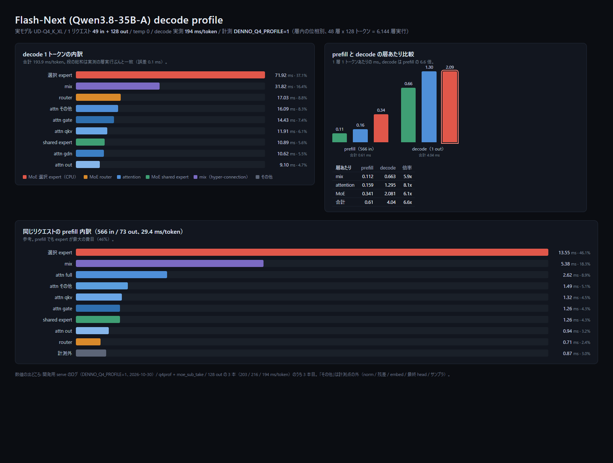

# 第4巻 decode の速度改善 — SIMD からデバイス常駐 chain、そして算術で閉じた棄却まで

> [索引](README.md) / 前: [第3巻 モデル対応](20_models.md) / 次: [第5巻 prefill の速度改善](40_prefill_perf.md) / [English](en/30_decode_perf.md)

decode (1 トークンずつ生成する経路) を速くするために何を測り、何を入れ、何を捨てたかの記録。
CPU の SIMD からはじまり、バッチ化、attention の GPU オフロード、デバイス常駐チェーン、
そして「Rust だけでは届かない」という判定から、数字で閉じた棄却の列までを時系列で並べる。
日付は commit の author date を JST で表す。
`119dd92` (P8) / `1bbffff` (P9) / `4e2428f` (P10) / `16319c7` (P11) / `55c1de0` (P12) は
前身リポジトリのもので、このリポジトリには存在しない。

## この巻で分かること

- decode の律速が「線形層 (帯域) → attention → ホスト往復 → カーネル本体」と移動していく順序。
- 速くするたびに **何をビット一致の契約に残し、どこで緩和したか** (緩和は P17g の attention だけ)。
- 9B int8 の 16.4 ms/token の内訳: バスは 2% 以下で、98% は GPU の計算だという算術。
- 棄却された 5 案 (s118/s119/s120/s121/s122) と、その棄却の根拠になった数字。
- 27B q4 が 75.89 → 32.42 ms/token になった理由 (per-op 線形 D2H 392 回/step の除去)。

## 前提知識

- **decode** = 自己回帰の 1 ステップ。重み全体を 1 トークンあたり 1 回読むので帯域律速になりやすい。
- **exactness 契約** = 数値の一致をどこまで要求するかの分類 (ビット一致 / R1〜R4 の緩和クラス)。
  本巻では attention のスコアと softmax だけが P17g で緩和され、rmsnorm・int8 GEMV・swiglu・
  expf・rope・QK-Norm・fp32 matvec は最後までビット一致のまま。
- **デバイス常駐 chain** = 1 ステップの層ループを GPU 内で連結し、同期をステップ末尾の
  logits D2H 1 回だけにする構造。llama 系が P17d〜P17h、qwen35 系が C4。
- モデルは Qwen2.5-0.5B/1.5B、Qwen3.5-9B (int8)、27B (q4)。数値の条件は各エントリに書く。

## 読む順序

時系列に読む。急ぐ読者向けの抜粋は **P8 → P9/P10 → P12 → P17d〜P17h → C4 → s49/s50 →
s101/s108 → s157 → s174**。棄却の記録 (s118〜s122) は結論だけ拾うなら s101/s108 の直後、
s160 は s157 の直後に読むと「同じ数字を別の角度から否定している」ことが見える。

## 対象 phase 一覧

| phase | 日付 | commit | 一行要約 |
|---|---|---|---|
| P8 | 2026-10-12 | `119dd92` | sampler の固定費 3.5 ms/step を部分ソートで削る |
| P9 | 2026-10-12 | `1bbffff` | fp32 バッチ matvec を SIMD 化し FMA 不使用でビット一致 |
| P10 | 2026-10-12 | `4e2428f` | バッチ attention をセッション×KV ヘッドで並列化 |
| P11 | 2026-10-12 | `16319c7` | ストリーミング detok の U+FFFD 保留で文字化けを直す |
| P12 | 2026-10-12 | `55c1de0` | probs@V を行統合 sgemm とストライド直接参照へ |
| P17d | 2026-10-13 | `121aa3a` | 要素演算を GPU 化し decode 1 step を常駐化 |
| P17e | 2026-10-13 | `c889336` | KV を需要ベースの成長型にしスロットを 4 から 32 へ |
| P17f | 2026-10-13 | `d7d126e` | scores の連続化コピーを廃しストライド参照にする |
| P17g | 2026-10-13 | `bf2a3c6` | attention を GPU 化し exactness 契約をここだけ緩和 |
| P17h | 2026-10-13 | `b090d03` | rope を GPU 化し step の同期を logits 1 回に |
| B2 | 2026-10-15 | commit なし | probs@V の V 再読みを hoist し LDS を 3.7 倍減 |
| B3 | 2026-10-15 | `401b8f92` | b>1 の rope を 1 カーネルにまとめ CPU 演算を削る |
| C4 | 2026-10-16 | `18c97fe2` | qwen35 の decode 1 step をデバイス常駐 chain に |
| s49 | 2026-10-17 | `769aa4a` | fp32 lm_head の毎 step 2.4 GB 読みを GPU へ |
| s50 | 2026-10-17 | `fca2d93` | GDN 状態の D2H を必要になる時点まで遅らせる |
| s54 | 2026-10-19 | `b635b820` | d2h_state を 6 本に細分し内訳を読めるように |
| s101 / s108 | 2026-10-19 | `96f34fe0` | 1 step のホスト往復を台帳化し 12 ms の非現実性を示す |
| s118 | 2026-10-20 | commit なし | key 切り詰めは静的解析では数値不変を証明できない |
| s119 | 2026-10-20 | commit なし | 投機的デコード 3 案を設計し損益分岐を算術で出す |
| s120 | 2026-10-20 | `506b515a` | n-gram 投機の受理率を実測し案 B を閉じる |
| s121 | 2026-10-20 | `568afa64` | swiglu epilogue 融合の上限 90 ms を算術で閉じる |
| s122 | 2026-10-20 | `4dff66e7` | key 切り詰めを回帰テストで実行可能に反証 |
| s157 / B20 段階 1 | 2026-10-21 | `2701cf3` | 27B q4 の線形を常駐 chain へ載せ 392 往復/step を除去 |
| s160 | 2026-10-22 | commit なし | gate_up の固定費という前提を静的監査で否定 |
| s174 / P16 | 2026-10-23 | `c3e53517` | beta・alpha の fp32 matvec 2 発を 1 発に畳む |
| P-MOE-F12 | 2026-10-27 | `b43d66e` | MoE expert の GEMV に Q4_K の AVX2 融合カーネルを入れる |
| P-MOE-F13 | 2026-10-27 | `5828846` | Q8_0 の融合 GEMV (attention の投影と shared expert) |
| P-MOE-F14 | 2026-10-27 | `58ccd86` | Q5_1 の融合 GEMV (`ffn_down_exps`) |
| P-MOE-F15 | 2026-10-27 | `74e41d3` | GEMV の行方向を並列化し層内フェーズを測れるようにする |
| P-MOE-F16 | 2026-10-27 | `a42e144` | GDN のデルタルールをヘッド方向に並列化 |
| P-MOE-F17 | 2026-10-27 | `a469224` | 停止語 decode が停止語を `tokens` に積まないのを直す |
| P-MOE-G1 | 2026-10-27 | `6d3fc13` | ExpertCache を MoE expert 経路へ配線 (既定 0 で封印) |
| P-MOE-G2 | 2026-10-27 | `e4e5547` | QSA indexer を full attention 経路へ配線 (`DENNO_QSA=1`) |
| P-MOE-G3 / G4 | 2026-10-27 | 統合せず | AVX-512 の幅拡大は Q8_0 の mix で −12 ms のみ |
| P-MOE-G5 | 2026-10-27 | `3dc3612` | expert ループを rayon で並列化し 355 → 278 ms |
| P-MOE-G6 | 2026-10-27 | 統合せず | dense 重みの RAM 常駐は差なし |
| P-MOE-G7 | 2026-10-27 | commit なし | expert × 行ブロックの平坦並列は雑音内 |
| P-MOE-G8 | 2026-10-27 | 統合せず | attention のヘッド並列は attn 90 → 93 ms |
| P-MOE-G9 | 2026-10-27 | commit なし | 選択 expert の madvise 先読みは差なし |
| P-MOE-G10 | 2026-10-27 | 統合せず | GEMV 行ループのソフトウェアプリフェッチは差なし |
| H1 | 2026-10-27 | commit なし | GPU スクラッチ再利用は 302 → 313 ms |

## 天井(理論値)と実測の差

| 項目 | 理論値または上限 | 実測 | 差の原因 |
|---|---|---|---|
| 9B int8 decode 1 step のバス転送 | 0.199〜0.333 ms (2,852,864 B/step・計算値) | 16.4 ms/token (受入値) | 転送は 2% 以下。残り 98% は GPU 計算 |
| 9B int8 decode の P2-1 目標 | 12 ms/token (目標値) | 16.4 ms/token | Rust のみのレバーは合計 0.18 ms/step (約 1%) |
| 27B q4 decode の重み読み下限 | 9.3 ms/token (16.7 GB ÷ ピーク ~1.79 TB/s・換算(推定)) | 32.42 ms/token (3 回中央値) | 実効帯域がピークの一部 + scan/attention/launch |
| 27B q4 decode (B20 段階 1 の前) | 同上 | 75.89 ms/token (3 回中央値) | step 内の per-op 線形 D2H が 392 回/step |
| 1.5B int8 長文 decode の attention | 資料なし | CPU 18.52 s → GPU 4.23 s (t≈7700・128 tok) | 短文 (t≈130) では同期律速で差が出ない |
| 27B q4 decode の launch 削減 (P16) | 610 発/token (658 から −7.3%) | 0.05〜0.10 ms/token は**予測のみ・未測定** | enqueue が GPU 実行と重なるため |

---

### P8: sampler の書き換え (2026-10-12, `119dd92`)

**意図** — P7.5 のプロファイルで sampler が **約 3.5 ms/step の固定費**として残っていた
(fp32 で 3.7%、int8 では 9.9%)。語彙 152k 全体の softmax と top-p のソートが毎ステップ走るので、
線形層を速くするほど相対的な重みが増える構造だった。

**変えたもの** — `crates/denno-engine/src/sampler.rs`。top_k は `select_nth_unstable` + 部分ソート、
top_p 単独は上位 2048 の部分集合で計算し境界ヒット時だけ旧フルパスへフォールバック、
plain temperature (本番既定) はソートを廃した 2 パス O(n) + スクラッチ再利用。
**greedy 経路は完全無変更** (temperature=0 は argmax 直行)。

**つまずき** — top_k の tie-break が旧実装とずれると基準出力が動く。ビット一致の参照実装テストを
同時に書いて固定した。もう 1 つ、temperature 経路は RNG→トークンの対応が旧実装と変わるため、
**仕様変更として明記**し、greedy 不変と 0.5B の基準出力不変を条件にした (CI ✅)。

**分かったこと / 残った課題** — sampler は 3.5 → **0.66 ms/step (5.3 倍)**、占拠率は
fp32 3.7% → 0.7%、int8 9.9% → 2%。テストは 98 全緑 (+5)。以後 sampler はプロファイルの上位から
外れ、次の律速は線形層と attention に移った。

**次に効いたこと** — 「greedy 経路を触らない」という線引きが、P9/P10/P12 の A/B で基準出力を
共有したまま比較できる前提になった。temperature 経路の非互換を仕様変更として残したことも、
後の基準更新の議論 (P17f) で効いている。

### P9: fp32 バッチカーネルの SIMD 化 (2026-10-12, `1bbffff`)

**意図** — P6 の連続バッチングで b=4 にすると fp32 経路が**演算律速に遷移**した。
`solo` は 15.4 tok/s (64.7 ms/step) だが、バッチ側は線形層のトークン当たりコストが
61.0 ms のままで、幅を増やしても集約が伸びない状態だった。

**変えたもの** — `crates/denno-engine/src/tensor.rs` の `matvec_rows_bt`。
**レーンは i 方向 (バッチ内 4 セッション) と j 方向 (出力チャネル 4 個の ILP) にのみ張り、
k 方向は張らない** — 各出力要素の k 累積は厳密に逐次、乗算と加算を分離した命令のみで FMA 不使用
(丸め分離)。これで単独 decode の `matvec_bt` とビット一致が保たれる。アクティベーションは
`[k][mp]` に転置 + ゼロパディングしてレーンロードを連続化 (m*k は高々数十 KB で転置コストは無視)。
aarch64 NEON / x86 SSE の二実装 + スカラフォールバック。

**つまずき** — ビット一致テストの形状が足りず、m∈{1..8}・k∈{1,4,65,896}・n 端数込みまで拡張した。
e2e では**集約が 19.4 tok/s (プロファイラ込み・無しで 21.8) 止まり**で、マイクロベンチの
帯域フロア (幅 4 = solo ステップ時間相当) に届かなかった。原因は平均バッチ幅が **2.15** に
落ちること (出力長 45〜83 トークンで早期完了セッションが出る) と、実サーバーでのメモリ系競合
(アクティベーション/KV と重みストリームの干渉) と推定した。**この 2 つは推定で、切り分けは未測定。**

**分かったこと / 残った課題** — 106 テスト全緑、実機で fp32/int8 とも 4 セッション同時 == solo 完全一致。
カーネル単体では gate_up (k=896, n=4864) **3.92 倍**、down (k=4864, n=896) **5.86 倍** (vs 単独 ×4)。
in-server のトークン当たり線形コストは 61.0 → 47.5 ms (1.28 倍) で、集約倍率 1.36 倍とほぼ一致 —
**線形層はもう主要な律速ではない**。残るのは ①平均バッチ幅の低下 ②メモリ系競合
③attention/prefill (幅を上げても伸びない部分)。

**次に効いたこと** — 「カーネル単体の倍率ではなく in-server のトークン当たりで判断する」という
計測規律がここで定まり、P10 の交互 A/B、P12 の op 別プロファイル、s157 の KPI 固定プロトコルまで
同じ形で続く。attention のバッチ化が次の候補として明示された。

### P10: attention の並列化 (セッション×KV ヘッド) (2026-10-12, `4e2428f`)

**意図** — P9 のプロファイルで attn_core はバッチ時に 5.5%。線形層が 1.28 倍まで改善したので、
残る「幅を上げても伸びない部分」のうち最も大きいものが attention だった。

**変えたもの** — `forward_batch` の attention を rayon で並列化。タスク単位は
**(セッション i × KV ヘッド kvh)** (0.5B で最大 32 タスク) で、各タスクは `att` の非重複スライスを持つ。
タスク内の演算列は単独 decode (n==1) 経路と完全同一 (sgemm_acc → softmax → matmul、同一形状) で、
セッション/KV ヘッド間に数値的相互作用がないため**ビット一致は自明に維持**される。
KV 読み取りは新設の `KvCache::kv_bufs_ref(&self)` (読み取り専用) で共有。単独 decode 経路・
prefill 経路は無変更 (基準経路を触らない規律)。

**つまずき** — 最初の前後比較で new 41.2 tok/s vs old 21.8 tok/s (2 倍) という数字が出たが、
これは**測定汚染**だった。同一ホストで常時稼働する他の推論ワークロードが CPU を使うため、
時間帯で背景負荷が変動し、離れた時点の絶対値は比較できない。交互 A/B に切り替えたところ
差は +4% に落ち着いた。教訓は「同一ホスト上の性能計測は必ず new/old 交互 + 同ワークロード」。

**分かったこと / 残った課題** — 交互 2 ペアで バッチ 4×256 集約 **33.4 / 33.1 tok/s**
(平均 33.2) vs 旧 31.6 / 32.2 (平均 31.9) = **+4%**、両ペアで新コード優位。solo 256 は 17.3 tok/s で不変。
物理的にも整合する (attn_core はバッチ時 5.5% なので、その壁時間の大部分を回収すれば数 %)。
106 テスト全緑、実機で 4 セッション同時 == solo 完全一致、CI (x86) も通過。

**次に効いたこと** — 「+4% を 2 倍と誤読しない」ための交互 A/B が、以後のすべての比較
(P12 の 3.1〜3.4%、P17 系の ON/OFF、s157 の KPI) の既定の作法になった。測定汚染の実例を
数字ごと残したことは、後の「フラグを変えたつもりで同じサーバーを叩いていた」(P12) の検出にも効く。

### P11: ストリーミング detok のバイト分割文字修正 (2026-10-12, `16319c7`)

**意図** — 速度の話ではない。gpt2 exactness テストが文字化けで落ち、モデル再取得でも直らず
(同一ファイル 548,105,171 B、英語 raw 生成は正常)、原因がモデルでないと分かった所から始まった。
**この巻に載せる理由**は、ここで確定した「テキスト経路のみ・数値経路不変」という分離が、
以後の速度改善の A/B をテキスト差分で判定できる基準になったからである。

**変えたもの** — `emit_delta_and_check_stop` で末尾が U+FFFD になるトークンを**保留**し、
文字が完成したステップでまとめて差分として流す。新設 `flush_stream` が生成終了時
(EOS/max_tokens) に保留分をフラッシュ (step_chat / step_chat_batch の両方、EOS 分は decode から除外)。

**つまずき** — 原因は 2 つあった。①CI の exactness ジョブが Qwen しか pull していなかったため、
gpt2 テストは「モデル未キャッシュ → スキップ」で**一度も実行されていなかった** (基準文字列は
当時の条件のまま残存)。②バイトレベル BPE ではマルチバイト文字がトークン境界で割れ、未完成バイト列が
decode で U+FFFD になり、それを確定済みテキストに混入させると以後のバイト差分がずれて文字が欠落する。
検証は HF transformers (fp32, greedy) を参照実装として同一プロンプトで比較し、denno 出力と完全一致。

**分かったこと / 残った課題** — 単体 99+7 全緑、exactness 5 件全緑 (aarch64)、CI で gpt2 が
x86 上で実際に走って緑。数値経路は不変 (基準出力と 4 セッション同時 == solo の実測で確認)。
**残った課題**: ストリーミングの保留は「送出が遅れる」方向の変更なので、体感の初速は僅かに落ちる
(未測定)。

**次に効いたこと** — 「緑は経路が動いた証拠にならない」という型がここで一度出ている
(モデル未キャッシュでスキップ)。P17g で同じ型を「経路ゲート」として再発見し、C4 では
テストが Some 返却を明示検証する形に進化した。テキスト経路と数値経路の分離もこの時点で固定された。

### P12: decode attention の probs@V 行統合 + ストライド直接参照 (2026-10-12, `55c1de0` / `f3dea3b`)

**意図** — 開発環境の移行が完了し、他ワークロードの負荷がないクリーン環境で P9 以来の残り律速
(平均バッチ幅の低下 / メモリ系競合 / prefill 割込み) を定量化した。int8 W=4 の op 別では
gate_up 29.5% に次いで **attn_core 19.4%**、down 18.0%、lm_head 10.8% で、int8 では attention が
線形層に次ぐ律速だった (KV 連続化コピー + per-(kvh,g) の m=1 sgemm 7 回 + 23 アロケーション/タスク、
t×dh バッファは mmap 閾値超えで毎ステップ mmap/munmap)。

**変えたもの** — ①`tensor::matmul_rows_bstrided` — probs@V を per-g matmul (m=1) × group 回 +
vh 連続化コピーから、**1 回の行統合 sgemm + キャッシュのストライド直接参照** (コピー無し) へ。
②`attention_decode_kvhead` 新設 — `forward()` (n==1) と `forward_batch()` が同一関数を通る構造に統一。
③qg コピー廃止、kh/scores を thread_local スクラッチで再利用 (mmap チャーン除去)。
④scores 側は従来経路のまま。

**つまずき** — matrixmultiply は**ストライドと行数で SIMD カーネルを選び替えるため数値が変わる**。
scores 側 (b を転置レイアウト rs=1/cs=k で渡す経路) は行統合 (rows=m) もストライド参照も
ビット不一致 (実測)。probs@V 側 (row-major b) は行統合 + ストライド参照でビット一致 (実測) —
つまり**ビット一致規律を守れるのは V 側だけ**だった。計測側でも 2 つ踏んだ。①A/B サーバーを
別バイナリ名で起動したが pkill パターンが旧名にマッチせず、**全 12 回が同じサーバーに当たって
無効データ**になった (2 回目で修正、quant mode ログで毎回確認)。②op 別プロファイルの
`grep -A14 … | tail -13` が**先頭行 (最大 op) を切り捨て**、attn を 48.9% と誤読した
(正しくは gate_up 29.5% / attn 19.4%)。

**分かったこと / 残った課題** — クリーン環境・交互 2 ラウンド・スロット 8 の A/B で
fp32 W=4 26.8/26.8 → 27.7/27.7 tok/s (**+3.4%**)、int8 W=4 126.4/122.5 → 130.4/126.2 (**+3.1%**)、
int8 W=8 119.0/113.5 → 121.3/119.3 (**+3.4%**)。op 別 (int8 W=4・1022 tok・プロファイラ ON) では
attn_core 1,543 → **1,193 ms (−22.6%)**、TOTAL 7,942 → 7,796 ms。テストは 100+7 全緑 +
`decode_attention_probs_v_bitexact` + exactness 5 件 (基準出力含めビット一致)。
**残った課題**: scores 側の根本最適化 (k 方向 SIMD / パック再利用) はビット一致規律と両立不可で、
基準出力の更新を許容するかの判断が必要 — これは P17f で「基準を変える」承認を得て解決する。

**次に効いたこと** — 「どのカーネルが選ばれるかで数値が変わる」という理解が P17f の設計
(基準更新 + HF 参照検証) と、P17g の attention 緩和判断の土台になった。計測の 2 つの失敗
(プロセス取り違え・先頭行の切り捨て) は、以後の op 別表の読み方の前提になった。

### P17d: 要素演算の GPU 化 + デコードチェーン (2026-10-13, `121aa3a`)

**意図** — P17c のプロファイルで swiglu 5.1% と各所のホスト往復が残っていた。
①要素演算 (rmsnorm/residual/swiglu) の GPU カーネル化 ②decode 1 ステップを隠れ状態デバイス常駐の
パイプラインにする、の 2 つ。CPU attention が `matrixmultiply::sgemm` (SIMD/FMA で累積順が
実装依存) なので attention の GPU 化は exactness 契約の緩和判断が必要 → 後回しにし、
判断不要な本フェーズを先行した。

**変えたもの** — `kernels/kernels_elem.cu` に `dno_add_rmsnorm` (平方和は CPU と同一の逐次順で
1 スレッド計算、`1/(ss+eps).sqrt()` → `x*inv*w` 左結合を再現)・`dno_swiglu`・`dno_expf_probe`。
コンパイルは `-fmad=false` + 明示的 `__*_rn` で縮約を制御。`crates/denno-engine/src/cuda.rs` と
`model/llama.rs` に「埋め込み H2D → [rmsnorm → qkv → (CPU: rope/attention/KV) → o_proj →
rmsnorm → gate/up → swiglu → down] ×層数 → final norm → lm_head → logits D2H」のチェーン。

**つまずき** — **glibc expf の完全再現が最大の難所**。swiglu の `exp(-v)` を Rust `f32::exp` と
ビット一致させる必要がある。glibc e_expf は f64 内部演算 + 32 エントリのテーブル + 3 次多項式で
GPU でも再現できるが、**CPU の実バイナリは FMA 縮約版** (multiarch IFUNC が FMA バリアントを選択)
で、素直な逐次実装とは最終 f32 で 1 ULP 差が出た (x=32.564632f で実測、455M 値走査の唯一の不一致)。
gcc -O2 -mfma で逆アセンブルし、縮約が **5 ヶ所**に及ぶことを特定して `__fma_rn` で再現、
455,078,062 値でビット一致。もう 2 つ: 比較用の `f32::exp` ループは LLVM の自動ベクトル化で
libmvec に置換され得るので `#[inline(never)]` でスカラー呼び出しに固定する。
`cargo build -p denno-cli` では cuda feature が CLI に伝播せず、**feature 無しバイナリは GPU ログも
出さず黙って CPU で動く**。

**分かったこと / 残った課題** — GPU テスト 12/12、CPU 106 テスト回帰なし、Qwen2.5-1.5B int8 で
GPU serve と CPU serve の応答が完全一致 (2 プロンプト、msg id 以外バイト一致)。
**200 tok で GPU 2.1 s vs CPU 6.6 s (3.2 倍)、150 tok では 1.46 s vs 6.6 s (4.5 倍)**。
残る CUDA 候補は attention 融合カーネル (緩和判断が必要)・paged KV・sampler カーネル。

**次に効いたこと** — 「ホスト往復を消す」方向が有効だと数字で示したことが、P17g/P17h の
同期除去と C4 の chain 設計の直接の前提になった。expf の教訓 (契約がホストの glibc ビルドに
依存する) は、P17f で PTX とソースの不一致が見つかる伏線にもなっている。

### P17e: 需要ベース KV 確保 (成長型キャッシュ + 予約) (2026-10-13, `c889336`)

**意図** — P15 の KV 予算は「スロット 1 個 = ctx 全幅の事前確保」が前提で、Qwen2.5-1.5B は
スロットあたり約 1.9 GB・既定 4 スロットで起動直前に約 7.5 GB を確保していた。実際のセッションは
大半が数百〜数千トークンなので、**書き込んだ量に応じて成長させる**方式にしてスロット数を増やす。
paged KV (ブロック分割) は構造変更が大きいので後回しにし、連続レイアウトを維持したまま需要ベース化した。
decode の巻に置く理由は、スロット数がそのまま同時 decode の幅の上限だからである。

**変えたもの** — `crates/denno-engine/src/kv_cache.rs`。初期確保 0 で、書き込み量に応じて全層の
バッファを倍々に成長 (上限 max_len・償却 O(1)・既存行は realloc で保存)。レイアウトは
「先頭 len 行が使用済みの連続バッファ」のままなので attention を含む数値経路は旧実装と完全同一。
`DEFAULT_BATCH_SLOTS` を 4 → **32** にし、既定値は「1 セッションの目安予約 4096 トークン ×
bytes_per_token が KV 予算に収まる数」から算出 (1.5B int8・bpt 57,344 B では予約 235 MB/スロット →
予算 12 GB で 32 スロット)。`install_session` が prompt + max_tokens を予約として登録し、
超過は 400 で拒否する。

**つまずき** — **`advance()` 単独で len を進める経路があるモデル (ダミーモデル) は容量確保を
スキップできた**。需要ベース化では「KV を書くモデルは書き込み前に `kv_bufs(layer, n)` で容量確保する」
契約になり、ダミーモデル 3 種とサーバーのテスト用モデルもこれに適合させた。旧実装は
「advance だけしても snapshot が動く」(全量確保済み) だったため、テストがこの契約を隠していた。

**分かったこと / 残った課題** — Qwen2.5-1.5B int8 の起動直後 RSS **約 9.9 GB → 約 2.5 GB**
(旧実装は 4 スロット × 1.88 GB を事前確保)。e2e (200 tok) は GPU 2.15 s vs CPU 9.1 s で
GPU/CPU 応答完全一致。予算 1 MB で起動したサーバーが予約超過を 400 で正しく拒否することも実機確認。
CPU テスト 110 ok、GPU テスト 12/12、wire テスト回帰なし。
**未測定**: 32 スロットを埋めたときの decode 集約 (幅 8 以上) は測っていない。

**次に効いたこと** — 幅の上限が 4 から 32 に上がったことで、P12 の「W=8 には 8 スロット必要」
という制約が消え、以後のバッチ A/B はスロット数を気にせず幅を振れるようになった。
「予約で OOM を閉じる」設計は、C4 のステップ内一括確保 (segfault と非決定論の修正) と同じ発想である。

### P17f: scores 側の根本最適化 (基準更新・ユーザー承認) (2026-10-13, `d7d126e`)

**意図** — P12 で「scores 側はビット一致規律と両立しない」と結論して残した宿題。
ユーザー承認 (「基準変えちゃってください」) を得て、**決定論 (同一形状 → 同一結果) を維持したまま
数値基準を更新する**道を選んだ。基準更新の運用ルール通り、HF transformers 参照実装で検証してから反映した。

**変えたもの** — decode scores: per-g `sgemm_acc(m=1, kh 連続化コピー)` × group 回 →
1 回の `sgemm_scores_kvstrided(m=group, kc ストライド直接参照)`。kh 連続化コピー
(t_total×dh × kv_heads×層数/step のメモリ移動) と KH_SCRATCH を廃止。prefill も qg/kh/vh の
連続化コピーを全廃止し、Q 行バッファ・kv バッファへのストライド直接参照にした。

**つまずき** — 従来経路とは**ビット不一致 (予想通り)**。ここで止めずに、greedy 出力テキストが
既存の基準 6 テスト全てで不変であること (0.5B fp32「1+1は?」「日本の首都は?」・GPT-2・Qwen3 含む)、
HF 参照で 0.5B fp32 の 200 トークン greedy が完全一致することを確認して反映した。
もう 1 つ、コミット済み `kernels_elem.ptx` が `.cu` の `nvcc -arch=compute_75 -fmad=false`
コンパイル結果と**一致していなかった** (P17d でハッシュ未確認のままコミット)。GPU expf テストが
1/455,078,062 不一致になる原因で、再コンパイル版に差し替えて 12/12 に回復した。

**分かったこと / 残った課題** — 性能は 1.5B int8・200 tok e2e で **CPU ウォーム 9.10 s → 8.46 s**、
**GPU チェーン 2.15 s → 1.57 s** (chain の attention も同一関数経由で自動改善)。
決定論は単独/バッチ decode ビット一致テストと prefix cache exactness テストで維持。
**残った課題**: 基準が動いたので、以後の比較は「同じ基準同士」でしかできない (アンカー md5 の
再基準化が必要)。**教訓: 生成物 (.ptx) はコミット前に必ず検証環境のビルドとハッシュ照合する。**

**次に効いたこと** — 「数値が変わる最適化は、参照実装とテキスト不変の 2 段で受入れる」という
手順が確立し、P17g の attention 緩和 (maxabs 2.98e-8 と greedy 列一致で受入) がそのまま同じ型で通った。
PTX のハッシュ照合は B2/B3 で「変更前ソースの再コンパイルが committed PTX と一致することを先に検証する」
という手順に定着した。

### P17g: decode attention の GPU オフロード (2026-10-13, `bf2a3c6`)

**意図** — P17c のプロファイルで attn_core が最大 op (32.7%) になり、CPU 側の attention が
GPU 化の最後の大きな残りだった。ユーザー承認 (「CPU と GPU の不一致は許容で良いです」) により
**attention の exactness 契約のみ緩和**して GPU 化する。線形層 (int8) / expf / swiglu / rmsnorm の
ビット一致契約は変更しない。

**変えたもの** — `kernels/kernels_elem.cu` に `dno_attention` (grid=(heads)・block=(dh)・1 block が
1 q ヘッドを担当、GQA は kvh=h/group、scores → softmax (exp は `dno_expf`) → probs@V、共有メモリ dh*4 B)。
`cuda.rs` に GPU KV ミラー (ホスト KvCache は正・デバイス側に per-session のコピー、`kv_id()` をキー、
不足行は次回 chain_attention で一括 H2D、`DENNO_GPU_KV_MB` 既定 8192 MB 超過で LRU エビクト)。
solo と batch の両経路に適用し、全セッション成功時のみ採用・1 つでも失敗なら全セッション CPU で
やり直す (混合防止) ことで単独/バッチのビット一致は維持。

**つまずき** — **本番の Qwen2.5-1.5B は QKV bias 持ち** (safetensors 由来) のため、solo chain は
P17d 以来**一度も発動していなかった** (P17f の GPU e2e 高速化は per-op GPU 線形によるもの)。
初期実装は chain_compatible にゲートしていたため GPU attention も発動せず、一時ログの仕込みで
特定してゲートを撤去し per-op 経路にも組み込んだ。**教訓: 「緑」は経路発動の証拠にならない —
経路ゲートは実際のモデル構造に対して一度検証する。**

**分かったこと / 残った課題** — 1.5B int8・長コンテキスト decode (t≈7700・128 tok) で
**CPU attention 18.52 s → GPU attention 4.23 s (4.4 倍)**。短文 (t≈130) では ON/OFF ほぼ同等
(同期律速)。テストはカーネル vs CPU 参照 maxabs **2.98e-8** + GPU/CPU greedy 列一致、GPU 14/14・
CPU 110・exactness 6 基準通過。**残課題**: ①長プロンプトの prefill が遅い (t≈2810 で約 100 s・
本件とは無関係の既存問題) ②GPU/CPU の e2e 応答は緩和により不一致になる (`DENNO_GPU_ATTN=0` で
従来どおりビット一致比較が可能) ③短文では効果が薄い (rope/同期が残る)。

**次に効いたこと** — ③が P17h の直接の動機になった。また「escape hatch を必ず用意する」
(`DENNO_GPU_ATTN=0`) という形が、P17g 以降の GPU 経路すべての作法になった。

### P17h: rope の GPU オフロード + 同期フリー decode chain (2026-10-13, `b090d03`)

**意図** — P17g の残課題③ (短文で効果が薄い = rope/同期が残る) を解消する。rope は exactness
契約の緩和対象外なので**ビット一致必須**のまま GPU 化する。

**変えたもの** — `dno_rope_qkv` カーネル (qkv への bias 加算 + rope を 1 カーネルで。
grid=(heads + 2*kv_heads)・block=(dh)、block b < heads は q、次が k、残りが v で bias のみ)。
ビット一致の設計は、cos/sin をホスト (同一プロセスの glibc sinf/cosf) で CPU `rope_row` と
**同一の式**で計算したテーブル `[cos(half)|sin(half)]` を 1 ステップ 1 回アップロードし、
デバイス側は `-fmad=false` の mul.rn/add.rn/sub.rn のみで適用する。bias 加算は rope の前 (CPU と同一順)。
さらに qkv 線形の出力をデバイスに常駐させ、rope/attention もデバイス内で完結、rope 済み k/v は
非同期 D2H で pinned ステージへ逃がし、ホスト KvCache への反映はステップ最後の sync 後に 1 回だけ。

**つまずき** — ステップ内 sync を消すと、pinned バッファの**上書き競合**が新たに現れる。
ping-pong を廃止し、(層 × 用途) ごとの専用スロットに変更して id 採番で回避した。
適用経路では `forward_batch` の **b==1 を solo chain に委譲**する必要があり (サーバーの decode 実経路に
効かせるため)、失敗時は従来バッチ経路へ落とす二重化を入れた。chain_compatible からは qkv bias 条件を
除去した (dno_rope_qkv が bias をサポート)。

**分かったこと / 残った課題** — 1.5B int8 で短文 (t≈38・2 tok) **11.0 ms** (`DENNO_GPU_ATTN=0` の
バッチ経路 14.4 ms との比較・同期削減効果)、長文 decode (t≈7657・128 tok・**warm**)
**4.23 s → 3.88 s (1.09 倍)**。cold prefill は不変 (約 366 s・既存問題)。テストは
`cuda_solo_chain_bias_rope_gpu_matches_cpu` で forward_decode_gpu の**発動を Some 返却で明示検証**、
GPU 16/16・CPU 110・exactness 6 基準通過。PTX は sha256 を再コンパイル結果と照合済み。

**次に効いたこと** — 「1 ステップ 1 sync」という骨格がここで完成し、C4 (qwen35) の chain が
同じ骨格をそのまま流用した。短文の 11.0 ms という数字は、後に「短文ではもう同期しか残っていない」
という判断 (s101/s108 の棚卸し) の出発点になった。

### B2: attn_core の V 累積最適化 — probs@V の行チャンク化 (2026-10-15, commit なし)

> 関連 commit: `401b8f92` (B3・同じ `kernels_elem.ptx` 系列)。B2 自体の commit は記録から特定できない。

**意図** — P17k 後の残り律速は attn_core 3,514 ms (最大 op・13,252 トークンの cold prefill)。
B1 で rmsnorm が消滅したため最大 op に浮上した。P17k の「残る実装候補」1 の
「V 累積の v 再読み削減 (行チャンク化)」を実施する。カーネル内部の再構築のみで**数値はビット一致**
(旧カーネルと同一出力) という条件付き。

**変えたもの** — `kernels/kernels_elem.cu` の `dno_attention_prefill` の probs@V 累積部のみ。
旧実装は行ループ内で `v_sm[kk]` を行数 (PF_BQ=64) 回再読みし、スレッドあたりタイル当たり
s 512 + v 512 + corr 64 の smem 荷載命令を発行していた。`v_sm[kk]` を行ループの外へ hoist し、
行を 2 行インターリーブして再利用、`s_sm`/`corr_sm` を float2 (8 B) 荷載に変更 →
**s 256 + v 8 + corr 32** (v 再読み 64 回 → 1 回、LDS 命令数 ~3.7 倍減)。

**つまずき** — ビット一致の担保。acc[r] への FMA 列が「r 固定・kk 昇順」で旧実装と完全同一
(`fmaf(p.y, v1, fmaf(p.x, v0, acc))` の内側が kk・外側が kk+1) であることを保ち、ホスト C++ で
新旧ループを 128 スレッド × 64 行 × ランダム値 (非正規/±0/最大値含む) で比較して -O0/-O2 とも
全ビット一致を確認した。整列も条件で、s_sm の行先頭が 32 B 刻み・動的 smem ベースが 16 B 整列なので
float2 アクセスの整列は常に成立する (kk は偶数ステップ)。

**分かったこと / 残った課題** — PTX 静的解析の副次効果として、旧 PTX は acc[PF_BQ] が local memory に
spill していた (ld.local 81 / st.local 33) が、新実装は **spill 0**、V 累積部の動的 smem 荷載は
~1,088 → ~296 命令/スレッド/タイル。他カーネルは旧 PTX とバイト一致 (差分は本カーネルに局所)。
**未測定**: `cuda_attn_pf_bench` (n=t=13252) のカーネル単体タイミング (旧 69.3 ms/call からの改善幅)
と E2E wall。BK 8→16 は smem ~54 KB で opt-in が必要なうえ 2 blocks/SM → 1 blocks/SM の
占有率低下リスクがあり、実機 A/B 判断として残した。

**次に効いたこと** — 「smem 荷載命令数を数えてから書き、ビット一致は C++ シミュレーションで先に固定する」
という順序が、B3 と P16 (beta|alpha の 1 発化) でそのまま再利用された。

### B3: b>1 バッチ decode の rope GPU 化 (2026-10-15, `401b8f92`)

**意図** — P17 系残課題の B3。バッチ経路 (b>1) の rope は CPU で session ごとに `tensor::rope_row` を
適用しており、powf/cos/sin が session × (heads+kv_heads) × half × 層数 × ステップ回走っていた。
「バッチ時は同期が隠蔽される」ため効果は CPU 演算の削減が主で、優先度は低いとされていた。

**変えたもの** — `dno_rope_qk_batch` 新設 (grid=(heads + kv_heads, b)・block=(dh)・shared なし、
q は `q[i, b*dh..]`・k は `k[i, kh*dh..]` を行-major in-place、テーブルは `[b, dh]`)。
`cuda.rs` に `batch_rope_qk` (q/k のデバイスバッファ + [q|k] 連結 pinned ステージング、
H2D → カーネル → sync → D2H → sync → ホスト書き戻し)。失敗時はホスト q/k 不変で false を返し、
呼び出し側が CPU rope でやり直す (GPU/CPU 混合なし)。テーブルは (poss・dh・theta) 完全一致で
キャッシュし、1 ステップの層ループで 2 層目以降は生成 + H2D をスキップする。

**つまずき** — rope は緩和対象外なのでビット一致が必須。テーブルをホストが `tensor::rope_row` と
同一式 (同一プロセスの glibc powf/cosf/sinf) で生成し、カーネルは mul/sub のみ (-fmad=false →
PTX は mul.rn/sub.rn/add.rn のみ) とした。検証はホスト C++ シミュレーションで 8 形状 × 4 theta ×
3 pos × 40 試行、**5,427,840 要素比較が -O0/-O2 (-ffp-contract=off) とも全ビット一致**。
形状ガード (b ≤ 65535・dh ≤ 1024・heads+kv_heads ≤ 65535) の非該当は静かに CPU フォールバック。

**分かったこと / 残った課題** — CPU テストは全緑 (lib 147 不変)、PTX は変更前ソースの再コンパイルが
committed PTX (B2 の sha) と一致することを先に検証してから再生成。
**未測定**: b>1 マルチセッション E2E の wall (rope フェーズの削減幅)。B1 以降 op 計上が
無意味化しているため、削減幅は wall でしか出せない。

**次に効いたこと** — 「テーブルをホストで作ってデバイスは四則演算だけ」というパターンが、
C4 の QK-Norm + partial interleaved rope (`dno_qknorm_rope_pi`) にそのまま移植された。

### C4: qwen35 のデバイス常駐 decode chain (2026-10-16, `18c97fe2`)

**意図** — qwen35 (9B/27B) の decode 1 ステップ (n==1) を、llama 系の P17b-g/P17h solo chain と
同一骨格のデバイス常駐チェーンで実行する。qwen35 は GDN 層 (状態が conv/ssm の 2 面) を持つため、
KV だけでなく GDN 状態のミラーも必要だった。設計は `DESIGN_C4.md` に従った。

**変えたもの** — `model/qwen35.rs` の `forward_decode_chain` (GDN 層は `chain_q35_gdn_scan`、
full attention 層は `chain_q35_fullattn` に分岐、`forward()` の n==1 で試行し Some なら即 return・
None なら従来 per-op 経路)。`kernels/kernels_elem.cu` に 3 種: `dno_matvec_f32` (beta/alpha 制御投影
専用・1 スレッド 1 出力・k 逐次で `tensor::matvec_bt` とビット一致)・`dno_qknorm_rope_pi`
(QK-Norm + partial interleaved rope を 1 launch・thread 0 が CPU と同一の逐次 2 乗和)・
`dno_attn_gate_mul`。GDN 状態は ping-pong 2 面で保持し、新状態は staged async D2H →
logits download の sync 後にホスト cache へ反映する (**ホスト状態は常に正**)。

**つまずき** — CPU 検証 192 green の後、実機の初回リクエストで**プロセス死亡 (segfault・3/3 再現・
fault addr は毎回同一の末尾パターン)**。原因は GDN staged D2H の pinned バッファが 1 層分しか
確保されていなかったこと (grow-only の `ensure_pin` が 2 層目以降も収まると判断し再確保しない →
2 番目の GDN 層の DtoH が pinned 領域の外へ書く)。修正はステップ開始時に全 GDN 層分を一括確保。
その次は**同一 payload の run 間で出力が全て異なる非決定論** (4 リクエスト全て別テキスト、
速度は 27.9 ms/step で正常)。原因は CH_QKV / CH_ATT / aq のステップ中途 grow 再確保が
**直前 launch の in-flight バッファを解放**していたことで、初回ステップの層 0 で確実に発火していた。
修正は「最初に全体サイズを確保」規約をステップ内の全バッファへ拡張 (数値経路は無変更)。

**分かったこと / 残った課題** — segfault 修正後は 9B で **27.9 ms/step (旧 77 ms から 2.8 倍)**。
非決定論の修正後は同一 payload 4 実行の md5 一致を実機で確認する手順を残した (未実施)。
CPU テストは 205 passed。**残った課題**: chain 発動時の出力は k 経路修正で変わり得るため、
アンカー再取得が必要 (人間対応)。

**次に効いたこと** — 「CPU で緑でも GPU では死ぬ」という前提がここで確定し、以後の GPU 変更は
①発動の明示検証 (Some 返却) ②in-flight バッファの寿命監査 ③純関数でバイト数を単一ソース化、
の 3 点セットで入るようになった。s50 のデルタ化と s157 の q4 chain はこの骨格の上に載っている。

### s49: fp32 lm_head の GPU 化 (2026-10-17, `769aa4a`)

**意図** — serve の既定は fp32 モード (`--quant` の既定が fp32) で、そのモードでは decode chain
(int8 専用) も `maybe_gpu_linear` (Q8 専用) も発動せず、lm_head (vocab 151936 × e 4096 ≈ 2.4 GB) が
CPU matvec のまま残っていた。**毎ステップ 2.4 GB の重み読み**が発生していた。

**変えたもの** — `cuda.rs` に `maybe_gpu_matvec_f32` を新設し、C4 chain の制御投影用
`dno_matvec_f32` をそのまま流用 (`.cu` / PTX 無変更)。起動は **block=(1,1,1)・grid=(n,1,1)** —
カーネルは block 内の全スレッドが同一計算をする実装なので、chain 側の block=128 規約を
vocab 規模で使うと 128 倍の冗長演算になる。重みはモデルロード毎に一意な key で 1 回だけ同期 H2D。

**つまずき** — 計上の誤りが見つかった。s45 の実機計測で decode の lm_head バケットが
**46.3% = 19.6 ms/step** と出ていたが、旧計上では chain 経路の lm_head バケットが最終
`chain_download` (全 staged async D2H + ステップ全体の GPU 完了待ち sync) を吸収しており、
**sync 待ち込みの過大帰属**だった。`prof.rs` に D2H op (id 14) を新設して分離した (観測のみ)。

**分かったこと / 残った課題** — 数値影響なし (GPU 経路は `tensor::matvec_bt` と全ビット一致、
積と加算の丸め分離・d 逐次・1 block = 1 出力)。CPU テスト 253 passed / 18 ignored で s48 と同一。
**未測定**: fp32 serve の decode ms/step。期待効果 (初回 2.4 GB H2D 以後は h 16 KB + logits 0.6 MB/
ステップ) は**推定**で、実機の再計測は人間対応として残した。

**次に効いたこと** — 「バケットが同期を吸うと、その op のコストを過大に読む」という計測の穴が
記録として残り、s54 の細分計測と s101/s108 の棚卸し (d2h_logits が 13.6 ms に見えた時代)
で同じ穴を名指しで潰すことになった。

### s50: decode D2H のデルタ化 (GDN 状態の GPU ミラー権威化) (2026-10-17, `fca2d93`)

**意図** — C4 chain は各ステップ末尾に GDN 新状態 (conv/ssm) を staged async D2H でホストへ
戻していた。9B で **~75 MB/step** (実装コメント記載の**推定**・実測ではない) が decode の支配項に
なっていた。ping-pong 2 面のミラーがあるので次ステップは必ずミラーから読む — ホストへ戻す必要が
あるのは ①次の prefill ②chain 不発時の CPU フォールバック、の 2 箇所だけである。

**変えたもの** — `KvMirror` に `gdn_pending: Option<usize>` を新設 (Some(pos) の間はホスト状態が
古い可能性がある)。LRU エビクト候補に `gdn_pending.is_none()` 条件を追加 (フラッシュ前にミラーが
消えると回復不能)。`chain_q35_gdn_scan` から staged D2H を削除し、`chain_q35_gdn_flush_pending` で
「ホスト状態が実際に必要になる時点」にだけ同期 D2H する。旧 `chain_q35_gdn_stage_*` と
`q35_gdn_stage_bytes` は削除。

**つまずき** — 位置整合。層ごとに `gdn_pos == target` なら cur 面、`== target+1` なら 1-cur 面
(層途中失敗ステップの入力面)、`None` なら chain 未走層でホストが最新、それ以外は不整合として
pending を破棄して None を返す。ミラーロック保持中に D2H する (解放すると LRU エビクトで
読み出し元が消える) ことも必要だった。None は「回復不能」として呼び出し側が要求を落とす —
古い状態で黙って継続しない。

**分かったこと / 残った課題** — 数値影響なし (転送は bit そのまま・演算なし、ping-pong の
読み出し面は不変)。CPU テスト 253 passed で s49 と同一。**未測定**: decode ms/step の短縮幅。
~75 MB/step が消えるという効果は**推定**で、実機の ignored テスト実行と再計測は人間対応。

**次に効いたこと** — 「ホストが正」という契約を保ったまま転送だけを遅らせる型は、s54 の
D2H 細分 (kv_flush / gdn_flush) と s101/s108 の棚卸し (転送は全体の 2% 以下) で、
「D2H を削っても decode は速くならない」という判定の材料になった。

### s54: d2h_state の細分計測 (2026-10-19, `b635b820`)

**意図** — s50 でデルタ化した後に残った `d2h_state` バケットを、実測で内訳が読めるように細分する。
目的は decode のステップ毎 D2H 内訳の特定で、削減の可否を「d2h_logits と d2h_kv_flush の比率」で
判断できるようにすること。**計測のみ・挙動不変**。

**変えたもの** — `prof.rs` の生 id は変えず、`D2H_LOGITS` / `D2H_KV_STAGE` / `D2H_KV_FLUSH` /
`D2H_GDN_FLUSH` / `D2H_KV_DELAYED_FLUSH` / `D2H_ATTN_PF` (10*D2H + i = 140..145) の 6 本を追加。
`summary()` が `d2h_state` の直下にインデント行で内訳 (ms / calls / cum%) を出す。
`qwen35.rs` の呼び出し側 id を差し替え (decode の logits download → `D2H_LOGITS`、
`chain_q35_kv_stage_flush` → `D2H_KV_FLUSH`、prefill attention 出力 → `D2H_ATTN_PF`)。

**つまずき** — コードリーディングで構造を先に確定させた: decode chain で `d2h_state` はステップ
あたり **2 call** で、①`chain_download(CH_LOGITS, vocab)` の `ctx.sync()` が in-flight DMA
(層ごとの staged async D2H) の完了待ちを吸収する ②`chain_q35_kv_stage_flush` が full 層 k/v 行を
ホストへ反映する。full 層の `cuMemcpyDtoHAsync` は非同期発行のみで同期点を持たないため、
転送時間の計上は ①に集まる。**したがってこの 2 call の比だけでは「転送」と「GPU 待ち」を
分離できない** — 内訳を足しても、その先の切り分けには別の計器が要る。

**分かったこと / 残った課題** — 9B では 16 層 × 2 × kv_dim(1024) × 4 B = **128 KB/step** が
KV フラッシュ分 (算術)。数値影響なし (prof 無効時は 1 分岐で素通し、telemetry の生 id も不変)、
CPU テスト 261 passed で s53 と同一。**未測定**: 実機の内訳計測 (GPU)。予約した 3 本
(`D2H_KV_STAGE` / `D2H_GDN_FLUSH` / `D2H_KV_DELAYED_FLUSH`) は現時点で未使用。

**次に効いたこと** — この細分だけでは足りないことが分かり、s101/s108 で「バケット名ではなく
コードからホスト往復を数え上げる」棚卸しに進んだ。`docs/DECODE_PATH.md` の台帳はこの延長にある。

### s101 / s108: decode 経路の棚卸し — 12 ms/token には Rust だけで届かない (2026-10-19, `96f34fe0`)

**意図** — decode は 16.4 ms/token、P2-1 の目標は 12 ms/token。どこで時間が消えているのかが
バケット名からしか分からなかった (`d2h_logits` が 13.6 ms/step に見えていた時代がある)。
1 ステップのホスト往復をコードから全部数え上げ、`docs/DECODE_PATH.md` に台帳として固定した。
**測ってはいない。コードとバイト数と s68 の帯域から出した算術である。**

**変えたもの** — `docs/DECODE_PATH.md` (新規・台帳) と、計測器の副産物として
`chain_download_site(slot)` (純関数)。logits を `D2H_SRC_LOGITS`、それ以外を `LINEAR` に分類して
`OTHER` に落とさないようにした (表示専用・数値経路には触れない)。

**つまずき** — バケットの読み方を 3 回やり直した。①`d2h_logits` が 13 ms に見えるのは
「そのステップの GPU 仕事が終わるまでの待ち」を測っていたからで、PCIe ではない
(s51 で KV 行の per-step D2H を消しても 16.4 対 16.5 ms で変わらなかったのが同じ事実の裏側)。
②残る会計の穴 (chain_rmsnorm 内の H2D と埋め込みのアップロードが rmsnorm/embed の
計測ラッパに見えている) は文書に記録するに留めた。③`docs/TASKS.md` 側の「45 block」が誤りで
あることも同じ読みから判明した (5,686 tok は PF_BQ=64 で 89 block・端数 10 行)。

**分かったこと / 残った課題** — 9B int8 の chain は 1 ステップに**同期が 1 回だけ**、層ごとの同期 0、
ステップ内の確保 0、重みアップロード 0、KV ミラーの再 seed も 0 (`have == pos0`)。バス上の量は
H2D 1,785,856 B + D2H 73,728 B + D2H 993,280 B = **2,852,864 B** で、実測帯域 (pinned D2H 14.3 GB/s、
H2D 14.2 GB/s、pageable 側を控えめに 8.6 GB/s) で **0.199〜0.333 ms**。つまり 16.4 ms のうち
動いているバイトは **2% 以下**、残りは GPU の計算である。レバーと上限 (すべて計算値) は
L1 ≤ 0.125、L2a ≤ 0.05、L2b ≤ 0.07、L3 ≤ 0.05、L4 は起動オーバーヘッド次第で最大 ~5%、
L5 (GDN スキャン / attention / GEMM のカーネル本体) が**残りの 98%**。
**判定: Rust だけで 12 ms/token に届くレバーは残っていない** (Rust のみの最良の組は L1 + L3 で
約 0.18 ms/step = 約 1%、バスのノイズ床より小さい)。**目標の 16.4 → 12 ms/token は達成していない。**

**次に効いたこと** — 「速くなった」と書かない規律がこの節で明文化され、以後の棄却 (s118〜s122) は
すべてこの台帳の数字を上限として使う。Rust 側で残る仕事は「GPU の周りの直列部分を消すこと」に
限定された (s174/P16 の launch 削減がその最後の 1 つ)。

### s118: causal key 範囲切り詰めは数値不変ではない (2026-10-20, commit なし)

> 関連 commit: `3eab3629` (docs のみ)。**コード変更 0 行・commit しない**。

**意図** — P1-2 candidate 4。`dno_attention_prefill` のタイルループ開始を 0 から
`jstart = floor((pos0+i0)/PF_BK)*PF_BK` に変えれば、block b の各 row は key `j <= pos0+i` しか
要らないので計算量が減る、という案の検証。**この巻に残す理由**は、棄却の理由が
「ビット一致」でも「R3 で見えない」でもなく、**静的解析では数値不変を証明できない**という
新しい種類だったことにある。

**変えたもの** — なし (設計検討のみ)。対象カーネルは prefill 側だが、判断の型は decode の
attention 最適化と同じ「online-softmax の累積器の到達範囲」の話である。

**つまずき** — 前提が成り立たない。`jend = min(t_total, pos0+i0+PF_BQ)` は `n` に依存せず、
score は `j < t_total` 全ての K/V を読む。`t_total` が `pos0+i0+PF_BQ` を超えるとき (prefill の
末尾 block)、カーネルは block の causal 界より先の `PF_BQ` 幅の screen を意図的に計算している。
その pair は `-INFINITY` マスクで出力にもタイルの `m` にも影響しないが、影響するのは
online-softmax の累積器 `acc` の**表現可能範囲**である。先行タイルで `acc = sum_j exp(s_j - m_run)`
(各項 ≤ 1) まで貯まっていると、以後に残る FMA の丸め単位は `2^-23 * acc` になる。切り詰めは
その先溜めを消す。

**分かったこと / 残った課題** — row 単位で差が出る例を特定した: `pos0=0, i0=64` (`jstart=64`) の
row 64 は、HEAD では最初のタイルが `[0,8)` で有効列 8 本、切り詰め後は `[64,72)` で有効列が
`j=64` の 1 本だけになり、最大に到達するまでの列数が 8 → 1 に変わる。差の大きさは
`d=255` の dot が打ち消し合って O(1) の商まで落ちる場合だけで `2^-23` 相対、R3 (絶対 1e-3) では
見えないが、アンカー md5 (1e-7 まで比較) では見える。**「マスク経路が厳密に +0.0f を足す」ことは
コードで確認できるが、「その +0.0f が無いとき同じビット」は別の命題**で、静止解析では証明できない
→ commit しない。将来入れるなら `m_run == -INFINITY` の row を明示的にスキップするガードが先に必要
(`exp((-inf)-(-inf)) = NaN` → `l = NaN` → 出力 `0 * NaN = NaN`)。

**次に効いたこと** — 「証明できないものは入れない」という線が引かれ、s122 で同じ案を**実行可能な
反証** (テスト) に落とす動機になった。s117 の block 数の誤りもここで訂正されている。

### s119: 投機的デコードの設計提案 — 実装ゼロ (2026-10-20, commit なし)

> 関連 commit: `623359bc` (設計文書のみ)。**`crates/` は 1 バイトも変えていない**。

**意図** — s115 の在庫が「decode の唯一の同期は logits D2H で、外すには複数トークン forward +
`.cu` が要る」で閉じたため、その「複数トークン forward」を設計する。成果物は設計文書 1 本
(`docs/SPEC_DECODE_DESIGN.md`) と記録のみ。

**変えたもの** — なし。Step 1 = 1 step の内訳 (16.4 ms の分解、`n == 1` 前提の箇所)、
Step 2 = 案 A / A-lite / 案 B の正しさの契約・実装コスト・損益分岐 p、Step 3 = 比較表。

**つまずき** — 案 A (その場検証) は**ビット一致不可**。1 回の forward で `k+1` 位置を出すと、
1 行目の rmsnorm / attention が「同じバッファに居る他トークン」の影響を受け、**比べる対象
(1 行目の logits) 自体が逐次と変わる**ので検査手段が無い。s118 と同じ種類の差 (online-softmax の
`acc` の到達範囲) で、R1 の枠にも収まらない「経路依存の差」。`λ = 1.00` (楽観仮定) でも損益分岐は
`p > 0.48` (reject 15 ms 込み)。案 A-lite (既存 `n ≧ 2` 経路を prefill 2 トークンとして使う) は
ビット一致を保てるが、1 step が**算出 18.3 ms** (`λ = 1.115`) で損益分岐 **p* = 0.885** —
**速度目的では却下**。

**分かったこと / 残った課題** — 案 B (n-gram 投機) だけが 1 step の構造を変えない
(draft = 通常 step、検証 = 通常 step、reject = 通常 step)。bit 一致・決定論とも既存契約のまま、
`.cu` / アンカー無変更、損益分岐は **p* = 0.0006**。効くかどうかは「直前文脈の 12-gram が同一続きを
持つ率」= p だけで決まり、**その計測に GPU は要らない**。p = 0.5 / 0.7 / 0.9 で実効 10.9 / 9.7 / 8.6
ms/token (**仮定の表**・実測ではない)。巻き戻しは機構として存在する (`KvCache::truncate` +
`bump_epoch()` が GPU GDN 状態を捨てる) が、実費は**算出 15 ms** (KV 210 MB + GDN 5.8 MB を
14.2 GB/s) で reject 1 回ごとに 1 step 分を払う。**未計測**: `λ`・受理率 p・reject の実費・
`n == 2` の step 時間。

**次に効いたこと** — 「p を測れば案 B の可否が GPU 無しで決まる」という形に問題を縮めたことが、
s120 の実測 (と棄却) に直結した。案 A-lite の「1 トークン 2.6 ms/step で回る」という予測は
既存計測と矛盾するので、反証用の 1 回の計測として残した (未実施)。

### s120: n-gram 投機の受理率 p を実測して閉じた (2026-10-20, `506b515a`)

**意図** — s119 が「案 B の成否は 12-gram 文脈の再出現時に続きが前回と一致する率 p だけで決まり、
その計測に GPU は要らない」と書いたので、道具を作って測る。**`crates/` と `kernels/` は 1 バイトも
変えていない**。

**変えたもの** — `scripts/ngram_oracle.py` (標準ライブラリのみ・ネットワーク禁止・モデル重み不要・
乱数は合成コーパスの固定シードのみ)。文脈長 n の位置を昇順に 1 回だけ走査し、「文脈が過去に
出現した位置」だけを機会として、続き k トークンの一致を数える。**直前の出現**を採る
(実装が文脈を後ろから探すのに合わせる。2 番目以前を採ると甘くなる)。テストは
`scripts/test_ngram_oracle.py` 29 件。

**つまずき** — トークナイザが無い。トークン化は `words` (ASCII 英数の連続 / 記号 1 文字 /
日本語は文字種境界) と `bytes` (UTF-8 バイト列) の 2 通りで、**どちらも実トークナイザではない**。
コーパスも (a) 代理 = `docs/*.ja.md` + `docs/*.en.md` + `crates/**/*.rs` (58 文書)、
(b) 合成 tool-call 風 (固定シード) で、**実プロンプトのログは探しに行っていない**。
出力と文書に「代理 / 合成」を明記した。

**分かったこと / 残った課題** — 実測 p (n = 12・母数つき): 代理 words 1,235,606 トークン /
機会 368,831 で **p_1 = 0.2984** (110,072 一致)・p_2 = 0.1521・p_3 = 0.1216・p_4 = 0.0970。
代理 bytes 2,667,516 / 955,830 で **p_1 = 0.1265**・p_2 = 0.0588。合成 words 226,194 / 205,686 で
**p_1 = 0.1156**・p_2 = 0.0286。文脈を短くしても上がらない (代理 words n=2 で p_1 = 0.3316、
n=4 で 0.3400)。**判定: 案 B は閉じた**。p* = 0.0006 との比だけ見れば 190〜550 倍の余裕があるが、
案 B は受理 1 トークンに draft step + verify step の 2 step を払うので実効は `(2S + C_d)/(1 + p_1)`、
`S` = 16.4 ms・p_1 = 0.2984 なら **25.3 ms/token = 逐次の +54%**。勝つには
`p_1 > 1 + 2 C_d / S` = **1.00001** (C_d ≥ 0 で不可能) で、**p をいくら測っても覆らない**。

**次に効いたこと** — 「損益分岐の式が p の値に依存しないなら、p の測定は判定を変えない」という
形の棄却が、s121 (上限 90 ms < 受入 300 ms) と同じ「算術で閉じる」型として定着した。
**残った課題**: 実ワークロード (モデル出力) の p は未計測 (運用側の作業)。

### s121: swiglu の epilogue 融合の上限は 90 ms — 閉じた・実装せず (2026-10-20, `568afa64`)

**意図** — P1-4「swiglu を gate+up GEMM の epilogue に融合する」の受入は「cold A/B で 0.3 s 以上
高速」。その前の問い「上限は 0.3 s に届くのか」を、コード・バイト数・帯域で計算した。
対象は prefill の MLP pass だが、s101/s108 と同じ「上限を算術で出して閉じる」型なのでここに残す。

**変えたもの** — なし (`crates/` と `kernels/` は 1 バイトも変更せず、CUDA ビルドもサーバ起動も
していない)。経路の同定だけ行った: `chain_mlp_prefill` = norm 済み x の H2D → gate_up GEMM →
`dno_swiglu_int` → down GEMM → 層出力の D2H 1 回。gate_up 出力は `[m, 2ff]` f32 の交互配置、
活性化は `[m, ff]` f32 でデバイスを出ない。swiglu は 1 リクエスト 32 回。

**つまずき** — 見積りの前提が 2 つとも古かった。①`rmsnorm` 413 ms という上限は s85 より前の値で、
層ブロック全体を rmsnorm 行に二重計上していた `Ambient` 親スコープを s85 が撤去している。
norm は 1 層あたり 5,686 行のホスト処理で GPU に居らず、GEMM の epilogue では 1 バイトも減らせない。
②根拠の行 (gate_up_proj 2,283 ms / 64 calls / 14.4%) は本文書に残るどの記録とも一致せず、
同じバケットの s70 の値より 1.65 倍大きい。**公表済みの上限値としてのみ**使い、判定はその行に対する
比で出した。

**分かったこと / 残った課題** — 5,686 行 × 12,288 f32 = 1 層 279.5 MB。単独 swiglu が触るのは
読み 17.887 GB + 書き 8.943 GB = **26.830 GB** で、実測 64 call 2,283 ms から**実効 11.75 GB/s**。
融合で消せるのは gate_up の再読み 17.887 GB と、活性化を gate の stripe に書く場合の書き込み
8.943 GB まで (down GEMM が読む活性化は消せない)。帯域で見ると 17.887 GB は
ピーク ~1.79 TB/s で **10 ms**、悲観 100 GB/s でも **179 ms**、200 GB/s で **89 ms** → 上限 **X = 90 ms**。
**判定: 閉じる。上限 90 ms < 300 ms。** しかも「融合する価値を作るはずだった活性化の往復」は
s70 で既に消えている (281 MB → 94 MB)。数値クラスは R1 で、式を保てばビット一致にできる —
**止めているのは数値ではなくバイト数**。

**次に効いたこと** — 「融合してもカーネル起動も同期も 1 つも消えない」という確認手順
(非同期 stream 上の 1 起動で、待ちは後続 GEMM の後だけ) が、s174/P16 の launch 数え上げで
そのまま使われた。**未測定**: cold A/B (閉じた課題なので予定なし)。

### s122: causal key 範囲切り詰めを実行可能な形で反証して閉じた (2026-10-20, `4dff66e7`)

**意図** — s122 のハンドオフは「`jstart = ((pos0+i0)/PF_BK)*PF_BK` からタイルループを始めれば
数値的に同一」として 1 ファイルの `.cu` 編集を指示していた。実装に入る前に前提を検算したところ
**前提が偽**で、そのまま入れると全 prefill の attention が壊れることが分かった。
**`.cu` は 1 バイトも変えていない** (sha256 前後とも不変)。

**変えたもの** — `crates/denno-engine/tests/attn_prefill_jstart.rs` (5 テスト) と `docs/TASKS.md` の
記述の差し替え。偽の前提を二度と導けないようにする回帰テストである。

**つまずき** — カーネルの causal 界は **row ごと**であって block ごとではない。
`jend = min(t_total, pos0 + i0 + PF_BQ)` は block の**最悪 row** に合わせた上界で、実際にどこまで
読むかはマスク `ja <= pos0 + ia` が決める。すなわち row r は `j <= pos0 + i0 + r` まで読む。
`pos0 + i0` は row 0 の**上界**であって block の**下界**ではない。さらに causal マスクでは
「全 row がマスクされるタイル」は常に**末尾側**にしか現れないので、ループ開始点を上げる形では
そのタイルを表現できない。

**分かったこと / 残った課題** — CPU 実測 (5 テスト): カーネルのマスクが CPU 参照と一致すること
(499,095 組の (row, key))。cold 形状 (n = 5,686・pos0 = 0) の block `i0 = 64` で、切り落とす範囲
`[0, 64)` のうち **4,032 組**がマスクされていない (本来到達すべき key)。全 89 block では
**15,983,616 組**が消える。291 block を走査して**全マスクのタイルは 0 枚** → jstart 型の切り詰めは
存在しない。数値の大きさは `dh = 8` の fp32 toy で max |att_full − att_truncated| = **0.466** で、
R3 (絶対 1e-3) の 466 倍 — ビット一致はおろか緩和枠にも入らない。s118 は同じ結論に静的解析で
到達していたが、`docs/TASKS.md` に誤った前提 (`pos0 + i0` 未満は全マスク) が残っていたため
再実行されかけた。**P1-2 はこれで全候補 (1-4) が数字付きで棄却された。**

**次に効いたこと** — 「棄却は静的解析で終わらせず、実行可能なテストとして残す」という方針が
ここで確立した。s118 の見積り (R3 では見えない程度) が誤った前提の上だったことも、
数字の桁で示されている。**未測定**: GPU 実測・PTX 再生成・cold A/B はいずれも不要 (ソース不変)。

### s157 / B20 段階 1: 27B q4 の線形をデバイス常駐 chain へ載せ替え (2026-10-21, `2701cf3`)

**意図** — 27B q4 の decode は per-op ラッパー `maybe_gpu_linear_q4_into` を通っていた。
ホストスライスを引数に取るので **1 step に 392 回の線形 D2H と同期**が入り、GPU util は 40% 止まり
だった。9B int8 が既に使っている chain と同じ入口に q4 を載せ、per-op の往復を層ループから外す。

**変えたもの** — `cuda.rs` の `chain_linear_q4_device` (既存の `dno_gemv_q4_0c{C}` をデバイス常駐
バッファだけで enqueue。カーネル・引数・grid `(n.div_ceil(8*C), m, 1)`・block `(256,1,1)` は
per-op 経路と同一で、ホストスライスも同期も無い)。`chain_linear` を int8 / q4 の dispatcher にし、
group が all-Q8 か all-Q4 でなければ None を返して呼び側を per-op のままにする (遅いが誤らない)。
`DENNO_GPU_Q4_CHAIN` は `"0"` のときだけ OFF (打ち間違いで経路が黙って変わらない)。
`.cu` / `.ptx` は無変更。

**つまずき** — 数値一致は CPU では出せないので、GPU 関門に委ねるしかなかった。フラグ解析の境界
(`"0"` / `""` / `"off"` / `" 0"` / 未設定) と、空 group・混在 group の拒否だけをテストで固定した。
もう 1 つ、chain に入ると 27B の GDN scan / attention も 9B が使うデバイス版の関数へ移る
(ホストスライスを取らない) ため、**変わった範囲が線形だけではない**ことを明示する必要があった。

**分かったこと / 残った課題** — 実測 (GPU 関門・予測値ではない): 27B q4 decode
**75.89 → 32.42 ms/token** (固定プロトコル・3 回中央値・temperature 0・max_tokens 200。
TTFT 0.205 / 0.202 s、wall 6.689 / 6.685 s / 200 token。run1 は cold で 49.30)。9B int8 は
**16.24 ms/token で不変** (gen2 3.248 s / 200 token)。アンカー **3/3 MATCH**、GPU_VERIFY PASS。
PROFILE (40 token) で `d2h_src_linear` は **898 call で 0.0 ms**、`sl_lin` は **0 call/step** (旧 392)。
`bench_all.sh` は非悪化 (m=300 gate_up の +15% は既知の変動)。回答検証は 2 回実行で完全一致。

**次に効いたこと** — 受入指標が「step 内の per-op 線形 D2H の回数」(chain 経路で 0、基準 392、
目標 < 5) と定義され、総 D2H 発行数 (実測 約 140/step、いずれも非同期でホスト待ち 0 ms) とは
別指標であることが `docs/DECODE_PATH.md` §6.1 に固定された。この 2 指標の分離が s160 の監査で
「固定費はもう無い」と結論できる根拠になった。

### s160: 27B q4 decode の gate_up「固定費」を静的監査で却下 (2026-10-22, commit なし)

> 関連 commit: `2701cf3` (B20 段階 1)。**コード変更 0 行・テスト追加 0 件**。

**意図** — G1 の前提は「serve の gate_up 1 呼び出しに約 29.5 ms の固定費 (確保・活性量子化・H2D・
同期・コピーアウト) があり、それが decode 32.42 ms/token の主因」だった。この前提を静的監査で
確かめる。**この巻に残す理由**は、棄却が「実装しない」ではなく「計測の読み方を間違えると
存在しない固定費を追いかける」という警告になったことにある。

**変えたもの** — なし。根拠は `REPORT_G1.md` (gitignore 済み) に残した。経路の同定は
`forward` の n==1 → `forward_decode_chain` → `chain_linear` → `chain_linear_q4_device` で、
発行は**1 カーネルだけ**。`maybe_gpu_linear_q4_into` を呼ぶのは per-op 経路・単体テスト・bench だけで、
decode の chain からは到達しない。profile の bucket 名 (`sl_lay_ffn_gate` は chain の中にしか無い)
が経路の証拠になった。

**つまずき** — 前提が古い。固定費の 6 段のうち **5 段が構造的に存在しない**: 確保は grow-only で
定常 0 回 (step 冒頭の `chain_q35_step_reserve*` が最大を先に取る)、活性の量子化は q4 GEMV が
活性を f32 のまま読むので 0、H2D は CH_H がデバイス常駐で 0、発行は 1 回、同期は 0 回
(step 唯一の同期は末尾の logits D2H)、コピーアウトは 0 回 (出力は CH_GA に残り swiglu が読む)。
HANDOFF の優先順 4 つも `2701cf3` で実装済みだった。

**分かったこと / 残った課題** — 29.5 ms/call は現在の経路を説明しない: gate_up は 64 層 =
1 token あたり 64 呼び出しなので 29.5 ms/call なら **1,888 ms/token** で、実測 32.42 と **58 倍**
食い違う。記録の m=21.5 は prefill の平均 m (decode は m=1) で、`lin_sync_wait` 89% は
`cuCtxSynchronize` の待ち = **カーネル実行そのもの**を待っている値だった (固定費ではない)。
重みバイト share との比較でも、gate_up は 1 層 111.4 MB × 64 層 = 7.13 GB でカード上の重み
16.7 GB の **42.7%**、実測 share 28.4% はバイト share より**小さい** (ステップ平均より速く流れている)。
28.4% の候補は (E1) 初回タッチの重み H2D が span の内側に入る (7.13 GB / 41 step = 174 MB/step、
H2D 12 GB/s なら 14.5 ms/step) か (E2) 発行がデバイスの詰まりでブロックし span が GPU 実行時間を
吸うかで、**どちらも Rust 側では消せない**。判別手順は REPORT に残した (未実施)。

**次に効いたこと** — 「バケットの ms を op のコストとして読まない」という s49/s54/s101 の線が
ここで完成した。計測用 span の追加は見送った (6 段のうち 5 段が 0 で、表の排他の和と COVERAGE の
断言を書き換えることになり「再設計しない」に反する)。6 段の実測が要るなら別タスクで tick の
持ち方から設計する、という宿題だけが残っている。

### s174 / P16: GDN の beta|alpha fp32 matvec を 1 発に畳む (2026-10-23, `c3e53517`)

**意図** — decode 1 token の launch は `dno_gemv_q4_0c4` 257 発・`dno_add_rmsnorm` 129 発。
「層内で隣接する同一形状の gemv を 1 launch にまとめる」を静的に確定した結果、**q4 GEMV は
畳めない**。畳める組は 1 つだけで、それは GDN 層の beta|alpha (`dno_matvec_f32` 2 発) だった。

**変えたもの** — `GdnLayer::ba_w` にロード時 1 回だけ作る行連結 `[2*nv, e]`
(行順 [beta 全行 | alpha 全行]) を持たせ、`cuda.rs` に `Q35_TAG_BA` と `chain_q35_ctl_f32_ba` を追加。
同じ `dno_matvec_f32`・同じ引数の並び・同じ block で grid.x だけ n → 2n。
`chain_q35_gdn_scan` は ba_w があり形状が合えば 1 発、無ければ従来の 2 発 (fail closed)。

**つまずき** — 畳めない理由の確認が本体だった。1 層の 4 発 (qkv → o → gate_up → down) は残差
ストリームの**直列**で、隣り合う 2 発の間には必ず依存カーネルが 1 つ入る (qkv|o の間 = scan/attn、
o|gate_up の間 = `dno_add_rmsnorm` の残差加算、gate_up|down の間 = swiglu、層 i の down と層 i+1 の
qkv の間 = `dno_add_rmsnorm`)。カーネルは入力ポインタ 1 本を受けるので 1 発にできるのは
「同じ入力スロット・同じ k」の組だけ。q|k|v は s166 で既に 1 発化済み (337 → 257)。

**分かったこと / 残った課題** — launch 数は decode 1 token で `dno_matvec_f32` **96 → 48**、
全カーネル **658 → 610 (−7.3%)**、リクエスト (150 token) で 98,700 → 91,500。
`dno_gemv_q4_0c4` 257 と `dno_add_rmsnorm` 129 は変更なし。数値は行独立な逐次縮約なので
行順を連結しても各行の累積順は不変 = **ビット一致** (テスト `f32_beta_alpha_concat_rows_match_parts`
で CPU 側に固定)。VRAM は増減なし、ホストは連結コピー分 +94 MB (27B)。
**予測 ms**: 48 発減 × 1〜2 us = 0.05〜0.10 ms/token、実測は 0.00〜0.10 ms
(17.49〜17.51 → 17.45〜17.51 ms/token・≤0.6%) — **実機では未測定**。テストは 321 passed / 37 ignored。

**次に効いたこと** — 「launch を減らす余地は、残差ストリームの依存を数えれば静的に尽きる」という
結論が出た。257 をさらに減らすには残差加算 + rmsnorm + gemv の融合 (`.cu` 変更) が必要で、
それは s121 で上限 90 ms と算定された方向の延長にある。**残った課題**: 実機の ms/token・
アンカー 3 本・nsys は未実施。

---

### P-MOE-F12〜F17: Flash-Next (MoE) の decode を型別融合 GEMV と並列化で 11.8 倍にする (2026-10-27, `b43d66e`..`a469224`)

**狙い** — 新規対応した MoE モデル (`qwen4exp`、48 層・expert 512・top-10) の 1 トークン forward が
**6827 ms** で、CPU 参照実装の 390 ms/token に対して 17 倍遅かった。内訳の大半が MoE の
expert GEMV で、1 行ずつ f32 に開いてから逐次内積していた (SIMD が効いていない)。

**入れたもの (段階ごとの実測)**

| 段階 | commit | 内容 | forward |
|---|---|---|---|
| 起点 | — | — | 6827 ms |
| F12 | `b43d66e` | Q4_K の AVX2+FMA 融合 GEMV (144 B ブロックから直接 FMA) | 5214 ms |
| F13 | `5828846` | Q8_0 の融合 GEMV + 層内フェーズ計測 (`DENNO_Q4_PROFILE=1`) | 1755 ms |
| F14 | `58ccd86` | Q5_1 の融合 GEMV | 1036 ms |
| F15 | `74e41d3` | GEMV の行方向を並列化 (フィーチャ `par`、既定で有効) | 601 ms |
| F16 | `a42e144` | GDN のデルタルールをヘッド方向に並列化 | **579 ms** |

**効いた理由と効かなかった理由**

- Q4_K のカーネルだけでは 1.3 倍にしかならなかった。原因はこのモデルの量子化が**混在**して
  いることで、attention の投影 (`attn_qkv` / `attn_gate` / `attn_output`) と shared expert が
  **Q8_0**、`ffn_down_exps` が **Q5_1** (43/48 層)、`ffn_gate_exps` / `ffn_up_exps` だけが Q4_K だった。
  型ごとにカーネルを足して 3 段で 6.5 倍になり、そこから並列化でさらに 1.8 倍。
- カーネル単体の実測は Q4_K が 2281 → 164 ns/行。f64 真値との最大差は Q8_0 の融合 1.05e-5
  (スカラー経路 6.10e-5)、Q5_1 の融合 2.38e-7 (同 2.15e-6) で、融合したほうが**正確**だった。
  Q5_1 は `w = d*q + m` なので `dot(w, x) = d*dot(q, x) + m*sum(x)` に分けられる。
- 行並列は行が独立なので各要素の累積順序が変わらず、ビット一致を保ったまま 16 スレッドで
  1.7 倍になった。ヘッド並列も同様 (ヘッドは独立)。greedy 4 トークン
  `[271, 248068, 198, 760]` は全段階で不変。
- `MADV_WILLNEED` の先読みは効果が無かった (5197 vs 5214 ms)。

**残った律速** — 並列化後の層内訳は attn 3.72 ms (うち gdn 1.29) / **moe 4.63 ms** / mix 1.50 ms。
moe は 1 層あたり 10.1 MB を 2.2 GB/s で読んでおり、これは NVMe のシーケンシャル速度
(実測 2.8 GB/s、ページキャッシュに載った範囲は 26 GB/s) とほぼ同じ。モデル全体が 104 GB に
対して RAM が 60 GB なのでページキャッシュが足りず、毎回ディスクに落ちている。**計算ではなく I/O 律速**。

**副産物** — 素の clone で `cargo test --release --all-targets` を回したところ、`decode_greedy_stop`
が停止語を `tokens` に積まない既存不具合が出た (`0f5610c` でも失敗)。停止語を検出した分岐で
`step()` を呼ばずに `break` していたのが原因で、F17 で forward してから止める形に直した。

**未検証** — 27B (Q4_0) の wide 8 問 md5 と GPU アンカーは本番サーバ停止中のため取り直していない。
行並列・ヘッド並列は累積順序を変えないので数値は不変のはずだが、再起動後に確認する。

---

### P-MOE-G1〜G5: ExpertCache と QSA を配線し、expert ループを rayon で並列化 (2026-10-27, `6d3fc13`..`3dc3612`)

数値はすべて CPU・実重み・5 トークン 1 forward・warm-up 後・交互 3 巡の中央値。

**狙い** — F17 の 579 ms は計算ではなく I/O 律速で、層内訳は attn 3.72 ms (うち gdn 1.29) /
moe 4.63 ms / mix 1.50 ms だった。モデルが 104 GB に対して RAM が 60 GB しかないので、
expert の読みが毎回ディスクへ落ちる。ここを (G1) 明示的なキャッシュで持ち上げるか、
(G2) QSA で key を選んでセル数を減らすか、(G5) 計算そのものを並列化するか、の 3 方向を試した。

**入れたもの (段階ごとの実測)**

| 段階 | commit | 内容 | forward |
|---|---|---|---|
| F17 直後 | — | — | 579 ms |
| G1 + G2 | `6d3fc13` / `e4e5547` | ExpertCache と QSA indexer を経路へ配線 | 355 ms (attn 93 / moe 185 / mix 56) |
| G5 | `3dc3612` | 選択 expert の寄与 h_e を rayon で並列計算 | **278 ms** (attn 84 / moe 121 / mix 56) |

- G1 の ExpertCache は `DENNO_EXPERT_CACHE_MB`。実測で並列 mmap に大敗したため
  **既定 0 で封印**した (既定の構成では無効)。
- G2 の QSA は `DENNO_QSA=1` で有効。選んだ cell 列を `attend_visible` に渡すだけで、
  dense 経路は `attend_impl(None)` を通り、ループの式も丸めの順序も G2 以前と同一。
  出力は dense と完全一致する。
- G5 は `DENNO_MOE_PAR` (既定 1)。並列化したのは互いに独立な h_e だけで、重み付きの
  足し込みは index 昇順の逐次なので加算順序は不変 = **ビット一致** (`par` 0/1 の
  `to_bits()` 全一致を合成 GGUF で確認)。

**効いた理由と効かなかった理由** — 削減の大半は G5 の moe で、185 → 121 ms (−64 ms)。
9 トークン greedy は 5769 → 4515 ms。expert の寄与は互いに独立なので、並列度を上げても
要素ごとの演算列が変わらず、数値の契約を緩めずに済んだ。一方 attn も 93 → 84 ms に下がって
いるが、G5 は moe の expert ループだけを触っているのでこの差は G5 では説明できない
(段階ごとに層内訳の測り方が違う可能性。素材に説明は無い)。

**数値一致** — 参照実装 (llama.cpp) と 16/16 トークン一致。GREEDY4 は
`[271, 248068, 198, 760]`。F 系の段階では先頭 4 トークンまでしか一致せず 9 トークン目で
分岐していたので、この一致は QSA を有効にした構成のもの (推定)。

**残った律速** — 278 ms の内訳は attn 84 / moe 121 / mix 56 で、moe が依然として最大。
ここをさらに削る 5 案 (G6〜G10) と GPU 側の 1 案 (H1) は、いずれも実測で棄却された
(下の棄却カタログ)。

## 棄却カタログ

当時は妥当に見えたが後で捨てた判断。本文の該当エントリへの参照だけを置き、数字は本文と
`docs/TASKS.md` の記録から採る。

### s118: causal key 範囲切り詰め — 静的解析では数値不変を証明できない (commit なし)
- 何を試したか: `dno_attention_prefill` のタイルループ開始を `jstart` へ上げ、causal 界より前の key を読まない。
- 実測値: 差の大きさは `d=255` の dot が打ち消し合う場合で `2^-23` 相対。R3 (絶対 1e-3) では見えず、アンカー md5 (1e-7 まで比較) では見える。
- なぜ捨てたか: マスク経路が `+0.0f` を足すことはコードで読めるが、「それが無いとき同じビット」は別の命題で、静的解析では証明できない。証明できないものは入れない。
- 記録: 本文 s118、関連 commit `3eab3629` (docs のみ)。

### s119: 投機的デコードの案 A / 案 A-lite (commit なし)
- 何を試したか: 複数トークン forward による投機の 3 案 (A = その場検証 / A-lite = 既存の n≧2 経路を 2 トークン prefill として使う / B = n-gram) の設計と比較。
- 実測値: 案 A-lite は 1 step **算出 18.3 ms** (`λ = 1.115`) で損益分岐の受理率は **0.885**。案 A は 1 行目の logits 自体が逐次と変わるため比較手段が無い。
- なぜ捨てたか: 案 A はビット一致不可、案 A-lite は速度目的で損益分岐に届かない。生き残った案 B も s120 で閉じた。
- 記録: 本文 s119、関連 commit `623359bc` (設計文書のみ)。

### s120: n-gram 投機の案 B (実測で棄却・`506b515a`)
- 何を試したか: 直前 12-gram 文脈の再出現時に続きが一致する率 p を、代理コーパスと合成コーパスで測る。
- 実測値: 代理 words で p_1 = 0.2984 (機会 368,831)、代理 bytes で 0.1265、合成 words で 0.1156。実効 `(2S + C_d)/(1 + p_1)` は S = 16.4 ms・p_1 = 0.2984 で **25.3 ms/token = 逐次の +54%**。
- なぜ捨てたか: 勝つ条件が `p_1 > 1 + 2 C_d / S` = 1.00001 で、p の値では覆らない。損益分岐の式が p に依存しないので、p を測っても判定は変わらない。
- 記録: 本文 s120、`scripts/ngram_oracle.py` と 29 件のテスト。実ワークロードの p は未計測。

### s121: swiglu の epilogue 融合 (算術で棄却・`568afa64`)
- 何を試したか: gate+up GEMM の epilogue で swiglu を適用し、活性化の再読みを消せるかの上限計算。
- 実測値: 消せるのは 17.887 GB の再読み (+ stripe への書き込み 8.943 GB)。ピーク帯域で 10 ms、200 GB/s で 89 ms、100 GB/s で 179 ms → 上限 **X = 90 ms**。受入は cold A/B 0.3 s。
- なぜ捨てたか: 上限 90 ms < 受入 300 ms。しかも融合の動機だった活性化の往復は s70 で既に 281 MB → 94 MB に減っている。
- 記録: 本文 s121。実装は 1 バイトもしておらず、cold A/B も未実施 (閉じた課題)。

### s122: causal key 範囲切り詰めの実行可能な反証 (`4dff66e7`)
- 何を試したか: s118 の案を CPU モデルで実行し、切り詰めで落ちる (row, key) 対を数える。
- 実測値: cold 形状 (n = 5,686・pos0 = 0) の block i0 = 64 で、飛ばす範囲 `[0, 64)` のうち **4,032 組**がマスクされていない。全 89 block で 15,983,616 組。fp32 toy の差は max 0.466 で R3 の 466 倍。
- なぜ捨てたか: 前提 (「`pos0 + i0` 未満は全マスク」) が偽。causal マスクで全マスクになるタイルは常に末尾側にしか出ないので、ループ開始点を上げる形では表現できない。
- 記録: 本文 s122、`crates/denno-engine/tests/attn_prefill_jstart.rs` (5 テスト)。`.cu` は 1 バイトも変えていない。

### P1-2 の候補 1〜3 (すべて数値付きで棄却・`docs/TASKS.md` §P1-2)
- 候補 1: K/V 読みへの `__ldg` (s112 `b5f1f37` + `78e7d08`)。実測 **-0.9%** で revert (`ac73729`)。バケットが DRAM 律速でないのでキャッシュヒントが効かない。
- 候補 2: (BQ 64, BK 16) / (128, 8) / (128, 16) / (32, 16) / BQ 256 / kv ヘッドループについての交通量と smem・occupancy の模型 (s116・コード変更なし)。どの形も受入 0.3 s に届かない。K/V 読みは 1 リクエスト 273.2 GB と実体 186 MB の 1,466 倍だが、実測は pass 1 で 147 GB/s・pass 2 で 433 GB/s で DRAM 律速ではなく、kv ヘッド 1 本の範囲は 126 MB の L2 に収まる。BQ 128 / BK 8 はバイトを 0.522 倍にするが warps も半分にし (149.6 KiB・1 block/SM)、BQ 256 (283.1 KiB) は smem 上限 227 KiB を超える。
- 候補 3: カーネル書き換え (kv ヘッド単位の転置タイル / flash 風タイルへ online softmax を移す、s117・設計のみ)。(a) は 283.1 KiB smem と 256 floats/thread で上限 (227 KiB・255 regs) 超過、(b) は予算内 (124.5 KiB・約 64 regs) だが 14.3〜45.3 ms = 942 ms バケットの 1.5〜4.8% にしかならない。
- 候補 4: causal key 範囲切り詰め → 上の s118 / s122 の節。これで P1-2 は全候補が数字付きで閉じた。

### s160: 27B q4 decode の gate_up「固定費」を追う (commit なし)
- 何を試したか: 「gate_up 1 呼び出しに約 29.5 ms の固定費があり、32.42 ms/token の主因」という前提の静的監査。
- 実測値: 29.5 ms/call × 64 層 = 1,888 ms/token で実測 32.42 と **58 倍**食い違う。固定費 6 段のうち 5 段 (確保・活性量子化・H2D・発行・同期・コピーアウト) は構造的に 0 回。gate_up のバイト share 42.7% に対し実測 share は 28.4% で、バイト share より小さい。
- なぜ捨てたか: 記録の m=21.5 は prefill の平均 m で decode は m=1。`lin_sync_wait` 89% はカーネル実行そのものを待つ値で固定費ではない。存在しない固定費を追う計測の読み方自体を棄却した。
- 記録: 本文 s160、関連 commit `2701cf3`。

### P-MOE-G3 / G4: AVX-512 の幅拡大 (2026-10-27, 統合せず)
- 何を試したか: Q4_K / Q8_0 / Q5_1 の GEMV を 512bit に広げ、2 行を 1 命令で処理する。行 r のレーンを AVX2 版と同一に置くので、値は AVX2 版とビット一致のまま。
- 実測値: **Q4_K はデコード律速で効果なし。Q8_0 は mix のみ −12 ms。** カーネル単体 (n_in = 2560・n = 640) では Q8_0 が 253.6 → 133.1 ns/行 (1.91 倍)、Q5_1 が 220.8 → 192.8 ns/行 (1.14 倍)。
- なぜ捨てたか: forward で動くのが mix の 12 ms だけで、attn / moe の主要バケットが動かない。moe が I/O 律速である以上、カーネルの幅を広げても行の到着待ちは減らない (推定)。
- 記録: 作業差分は WIP commit (`909cb18`) として残ったが統合していない。数値は `to_bits()` 全一致で AVX2 版と同一。

### P-MOE-G6: dense 重みの RAM 常駐 (2026-10-27, 統合せず)
- 何を試したか: expert 以外の `GgufLinear` を mmap ではなく所有 Vec に置き、ページ追い出しを避ける (`DENNO_PIN_DENSE=1`)。
- 実測値: forward は 363〜371 ms 対 349〜372 ms で**差なし**。
- なぜ捨てたか: dense は約 1 GB で、常駐にしても毎トークンの読みが速くならない。差が範囲の重なりに埋もれる。
- 記録: 未統合の作業 commit `4fc94da`。on/off のバイト列は同一 (同じ範囲のコピー) で、`to_bits()` 一致はテストで固定済み。

### P-MOE-G7: expert × 行ブロックの平坦並列 (commit なし)
- 何を試したか: G5 の expert 並列と F15 の行並列の 2 段を 1 段に平坦化し、expert 間の負荷差をならす。
- 実測値: moe **124 → 110 ms**。ただし 9 トークン greedy は **4515 対 4438 ms** で差は雑音内。
- なぜ捨てたか: 層内訳の moe は 14 ms 改善するが、トークン単位の合計に現れない。受入は合計時間なので採らない。
- 記録: commit なし。

### P-MOE-G8: attention のヘッド並列 (2026-10-27, 統合せず)
- 何を試したか: `attend` のヘッドループを rayon で並列化する (`DENNO_ATTN_PAR`)。ヘッドは独立なので、どのスレッドが担当しても各要素の積和の順序は変わらない。
- 実測値: attn **90 → 93 ms** (わずかに悪化)。
- なぜ捨てたか: attn は既に GEMV の行並列で埋まっており、24 ヘッドに対して 1 ヘッドの仕事が小さすぎて fork-join のコストが勝つ。
- 記録: 未統合の作業 commit `089dbea`。逐次と `to_bits()` 全一致、並列分岐が走ったことはカウンタで検査済み。

### P-MOE-G9: 選択 expert の madvise 先読み (commit なし)
- 何を試したか: 選択された expert の範囲を `MADV_WILLNEED` で先に読み出す。
- 実測値: moe **123 対 123 ms**。
- なぜ捨てたか: 差なし。F 系の `MADV_WILLNEED` (5197 対 5214 ms) と同じ結論。
- 記録: commit なし。

### P-MOE-G10: GEMV 行ループのソフトウェアプリフェッチ (2026-10-27, 統合せず)
- 何を試したか: 行 r を処理する直前に r+3 行の行頭を `_mm_prefetch` する (`DENNO_GEMV_PF`)。PF 無効の単相化には prefetch 命令を 1 本も残さない。
- 実測値: moe **125 対 124 ms**。
- なぜ捨てたか: 差なし。行アクセスが完全に逐次なので、HW プリフェッチャが既に効いている (推定)。
- 記録: 未統合の作業 commit `f9df39d`。on/off の `to_bits()` 一致と発行本数 (off = 0 / on = `n_out - PF_DIST`) はテストで固定済み。

### H1: GPU スクラッチ再利用 (commit なし)
- 何を試したか: GPU 側のスクラッチバッファを確保し直さず使い回す。
- 実測値: **302 → 313 ms** (何の合計かの記録は無い)。
- なぜ捨てたか: 悪化。悪化の内訳は素材に無い。
- 記録: commit なし。
### P57: Flash-Next の decode を層内フェーズで割る (2026-10-30, commit `8c981776d`)

`DENNO_Q4_PROFILE=1` を serve の実経路から読めるようにした (`q4prof` と `moe_sub_take`)。
リクエストの prefill 終端と decode 終端で 1 行ずつ出して 0 に戻す。計測点は層の区切りだけで、
GEMV の内側には入っていない。未設定なら分岐 1 回で no-op、数値経路は不変。

- 測定条件: 実モデル UD-Q4_K_XL、1 リクエスト **49 in + 128 out** (temp 0)、同条件 3 本のうち 3 本目。
  48 層 × 128 トークン = 6,144 層実行。
- 実測 (decode 1 トークン、合計 **193.9 ms**): 選択 expert **71.9 (37.1%)** / mix 31.8 (16.4%)
  / router 17.0 (8.8%) / shared expert 10.9 (5.6%) / attention 62.2 (32.1%)。
- attention の内訳: gate 14.4 / その他 (conv・gated norm 等) 16.1 / qkv 11.9 / gdn 10.6 / out 9.1 ms。
- 層あたり (1 層 1 トークン): prefill 0.61 ms (mix 0.112 / attn 0.159 / moe 0.341) に対し
  decode 4.04 ms (0.663 / 1.295 / 2.081)。**6.6 倍**。
- prefill も同じ費目構成で、566 in の 29.4 ms/token のうち選択 expert が 13.6 (46.1%)、mix 5.4 (18.3%)、
  full attention 2.6 (8.9%)。
- 読み: decode の最大項は CPU に落ちている選択 expert (37%)。ただし
  `DENNO_GPU_WEIGHT_MB=8000` / `DENNO_EXPERT_VRAM_MB=16000` で expert を VRAM に載せても decode は
  233〜247 ms/token で変わらなかった (同日の A/B、確保失敗 0 件)。**expert の置き場所は律速ではない**。
  次に疑うのは decode の GEMV そのもの (batch 1 で 1 層 4.04 ms)。
- 記録: `8c981776d` (計測の配線のみ)。

